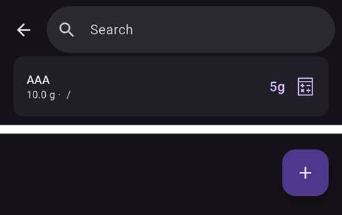
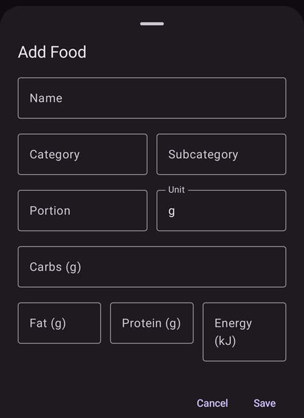

(food)=
# Aliments (la vostra base de dades d'aliments)

La base de dades d'**Aliments** és la vostra llista personal d'aliments desats. Cada entrada guarda els **carbohidrats** d'un aliment (i, si voleu, els greixos, les proteïnes, l'energia i una categoria). Així podeu tenir en un sol lloc el que mengeu sovint i iniciar un bolus des d'un aliment desat amb els carbohidrats ja omplerts.

```{contents} Table of contents
:depth: 2
:local: true
```

---

## Obrir la base de dades d'aliments

Obriu la pantalla **Gestionar** (navegació inferior) i trieu **Aliments** (*«Gestionar les entrades de la base de dades d'aliments»*). A **AAPS** v4, Aliments **ja no és un plugin**: no cal activar res; és una pantalla independent que s'obre des del [full Gestionar](#v4changes-manage).

---

## La llista d'aliments

Els vostres aliments es mostren en una llista que es pot desplaçar. Cada fila mostra el **nom** de l'aliment, la **porció / unitat / categoria** i els **carbohidrats**:



- **🔍 Cercar** (a dalt): filtra la llista pel **nom** (sense distingir majúscules i minúscules).
- **Filtre de categoria**: unes etiquetes (chips) us permeten limitar la llista a una **categoria**; quan trieu una categoria, apareixen les etiquetes de les **subcategories**. (Toqueu una altra vegada una etiqueta seleccionada per treure-la.)
- **➕** (a baix a la dreta): afegir un aliment nou (vegeu més avall).
- Toqueu una fila per **editar** aquest aliment.

Si la llista (o el filtre actual) no té cap entrada, la pantalla mostra **Sense dades**.

---

## Afegir i editar un aliment

Toqueu **➕** per afegir-ne un, o toqueu una fila existent per editar-la. S'obre un editor en un full inferior (**Afegir aliment** / **Editar aliment**):



Els camps són:

- **Nom**: obligatori (no podeu desar sense nom).
- **Categoria** i **Subcategoria**: opcionals, serveixen per agrupar i filtrar els aliments.
- **Porció** i **Unitat**: la mida habitual d'una ració; la **Unitat** per defecte és **g**.
- **Carbs (g)**: la quantitat de carbohidrats de l'aliment.
- **Greixos (g)**, **Proteïnes (g)**, **Energia (kJ)**: valors nutricionals opcionals.

Toqueu **Desar** per guardar-lo, o **Cancel·lar** per descartar-lo. Quan editeu un aliment existent, l'editor també té un botó **Eliminar**.

```{admonition} Deleting is undoable
:class: note
Quan elimineu un aliment, es mostra un missatge **«Aliment eliminat»** amb l'acció **Desfer**, de manera que és fàcil desfer una eliminació per error.
```

---

## Fer servir un aliment per a un bolus

Cada fila d'aliment té un botó de **calculadora**. Si el toqueu, s'obre la **Calculadora de bolus** amb els **carbohidrats** de l'aliment ja omplerts i el **nom** de l'aliment afegit com a nota del tractament. Així només cal confirmar i lliurar, sense tornar a escriure els carbohidrats.

```{admonition} The carbs value is used as-is
:class: note
El número de **carbohidrats** desat de l'aliment passa directament a la calculadora: **AAPS** no el multiplica per la porció ni per la quantitat que heu menjat. Si la quantitat és diferent, ajusteu els carbohidrats a la calculadora abans de confirmar. (No hi ha cap selector d'aliments *dins* de la Calculadora de bolus ni del diàleg de carbohidrats; comenceu des de la fila de l'aliment, aquí.)
```

---

## D'on vénen els aliments (sincronització amb Nightscout)

La base de dades d'aliments es comparteix a través de **Nightscout**, però **només en una direcció**:

- **Descarregar:** **AAPS** **llegeix** els aliments de la **base de dades d'aliments** del vostre lloc Nightscout i manté la llista local sincronitzada amb ella. Això es fa com a part de la sincronització de NSClient, de manera que un **client / seguidor** connectat també acaba tenint els mateixos aliments.
- **Enviar:** **AAPS** **no** envia aliments **a** Nightscout: NSClient no permet enviar entrades d'aliments. Per tant, els aliments que creeu o editeu **dins d'AAPS** es queden **en aquell dispositiu** i no passen a Nightscout ni als vostres altres dispositius.

```{admonition} Maintain your shared list in Nightscout
:class: important
Com que els aliments **només es descarreguen**, la manera de compartir una sola llista d'aliments entre el vostre telèfon, el vostre seguidor / [client](../RemoteFeatures/ClientMasterControl.md) i la resta de la vostra configuració és mantenir-la a **Nightscout** (amb el seu editor d'aliments integrat). **AAPS** descarregarà aquestes entrades. Un aliment afegit només a **AAPS** és local d'aquell dispositiu, i s'hi queda: una descàrrega relaciona les entrades de Nightscout pel seu ID de Nightscout, de manera que les afegeix i les actualitza, però mai no sobreescriu ni elimina un aliment que hàgiu creat localment (un aliment només s'elimina quan s'esborra la seva còpia a Nightscout).

Tingueu en compte que la base de dades d'aliments tampoc **no** forma part del canal de control signat principal ↔ client: viatja només com a dades de Nightscout.
```

---

## No és al rellotge

La base de dades d'aliments és una funció del **telèfon**: no hi ha cap navegador d'aliments, mosaic ni menú en un **rellotge Wear OS**.

---


<!-- =====================================================================
     Screenshots captured from a real master device:
       - food_list.png    (Manage → Food: list row, search, add button)
       - food_editor.png  ("Add Food" editor: name/category/subcategory/portion/unit/carbs/fat/protein/energy)
     No food was created or deleted (the editor was cancelled).
     Sync facts code-verified: download via LoadFoodsWorker.getFoods(); upload disabled
     (DataSyncSelectorV3 processChangedFoods() commented out — "NSCv3 doesn't support food update").
     Maintainers: relocate page + images and fix cross-links as needed.
     ===================================================================== -->
