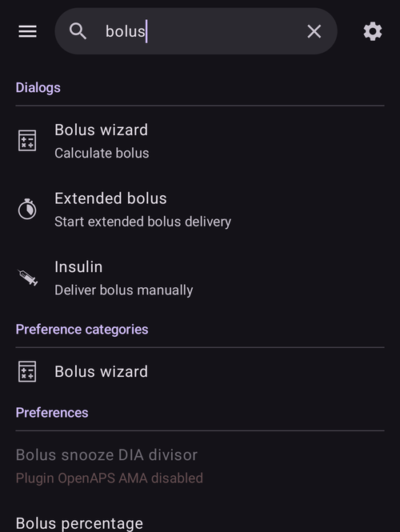
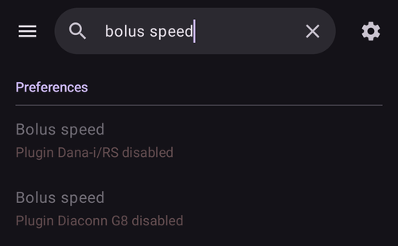
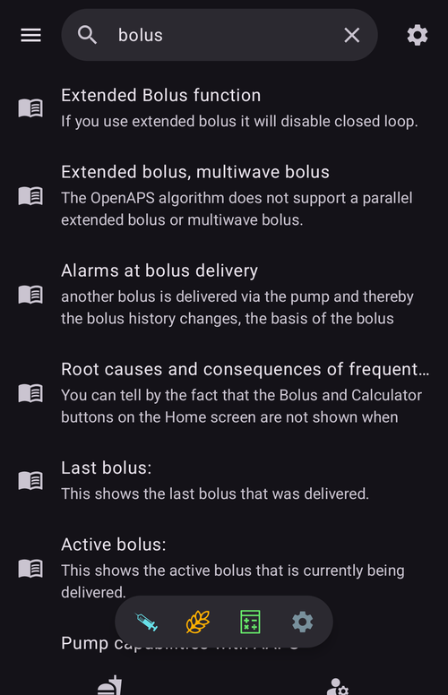

(global-search)=
# Cerca global

**AAPS** v4 té un quadre de **cerca global** a la part de dalt de la pantalla principal. Escriviu una paraula i la cerca mira a tota l'aplicació alhora (plugins, diàlegs, pantalles de configuració, opcions individuals) i, si teniu connexió, també a la **documentació d'AndroidAPS**. És la manera més ràpida d'anar a una opció o a una pantalla sense recordar on és.

```{contents} Table of contents
:depth: 2
:local: true
```

---

## Obrir la cerca

Toqueu el camp **🔍 Cercar** a la part de dalt del **Resum** (al costat del menú ☰). Comenceu a escriure i els resultats apareixen mentre escriviu (després d'una petita pausa), agrupats per categories:



While the box is empty, **AAPS** shows your **Recent searches**, newest first (up to ten). Tap one to run that search again, or tap the **✕** at the end of a row to remove only that search from the list. A search is added to the list when you open one of its results, so half-typed words are not kept. The list is stored on this phone only: it is not included in a settings export and is not sent to **AAPSClient**.

Esborreu el quadre amb la **✕**, o tanqueu la cerca amb el botó **Enrere** del dispositiu.

---

## Cerqueu en anglès *o* en el vostre idioma

Això és important: la cerca compara amb **tots dos** textos, el de l'**idioma seleccionat** **i** el text original en **anglès**.

- Si l'aplicació està, per exemple, en alemany o en txec, podeu escriure la paraula **traduïda** **o** la paraula en **anglès**: totes dues troben l'opció.
- Una coincidència amb el títol **traduït** té la posició més alta, després el títol en **anglès** i després les **descripcions** traduïdes i en anglès.
- La cerca no té en compte els **accents i diacrítics** (així *ů* troba *u* i *é* troba *e*) i **no distingeix majúscules i minúscules**.

Per això una guia o un missatge d'un fòrum escrit en anglès us porta igualment a l'opció correcta, encara que el telèfon ho mostri tot traduït.

---

## Què inclou la cerca

Els resultats s'agrupen en aquestes categories:

- **Plugins**: tots els plugins visibles a la vostra compilació (els mateixos que surten al [Configurador](../SettingUpAaps/ConfigBuilder.md)). Cada fila de plugin té el seu **interruptor d'activació**, així podeu activar o desactivar un plugin directament des dels resultats. Si toqueu la fila d'un plugin desactivat (que es pot activar), s'activa.
- **Diàlegs**: les pantalles de tractaments/accions i de gestió (Calculadora de bolus, Insulina, Bolus estès, Calibració, Objectiu temporal, Perfil, …). Les pantalles que no serveixen per a la vostra compilació no hi surten (per exemple *Emparellar amb el principal* en un dispositiu principal, *Clients autoritzats* en un client).
- **Categories de configuració**: les **pantalles** de configuració i les seves subpantalles, tant les pròpies de l'aplicació (General, Aparença, Protecció, Alertes, Manteniment, …) com les dels plugins, i també els petits grups d'opcions que s'obren des dels diàlegs (botons d'encebar, passos dels botons d'insulina/carbohidrats, llindars dels indicadors d'estat, opcions de l'assistent, …).
- **Configuració**: cada **opció individual** que té un títol. Es filtren segons la vostra compilació i mode, així només veieu les opcions que realment s'apliquen (APS / NSClient / control de la bomba).
- **Documentació**: pàgines de la **documentació d'AndroidAPS** en línia (vegeu més avall).

```{admonition} Settings that belong to a disabled plugin
:class: note
Una opció d'un plugin que ara està **desactivat** també surt, però **en gris** i sense poder-la tocar, amb una nota *«Plugin … desactivat»*. Així sabeu que l'opció existeix i quin plugin heu d'activar per arribar-hi.


```

---

## Resultats de la documentació (en línia)

Mentre es fa la cerca local, **AAPS** també consulta al mateix temps la **documentació oficial d'AndroidAPS** (allotjada a ReadTheDocs). Les pàgines que coincideixen surten en un grup **Documentació** a la part de baix, cadascuna amb una icona 📖, el títol de la secció i un fragment curt del text:



- Si la documentació està traduïda a l'idioma de l'aplicació, **AAPS** cerca alhora a les pàgines traduïdes i a les pàgines en anglès. Primer surten les pàgines en el vostre idioma i després les pàgines en anglès que encara no s'havien trobat.
- Si toqueu un resultat de la documentació, la pàgina s'obre al **navegador**.
- La cerca a la documentació necessita **internet**: sense connexió veureu la nota *«La cerca a la documentació necessita connexió a internet»*, i els resultats locals (de dins l'aplicació) funcionen igual que sempre.

---

## Obrir un resultat

Toqueu un resultat per anar-hi directament:

- **Plugin** → obre aquest plugin.
- **Diàleg** → obre aquesta pantalla o diàleg.
- **Categoria de configuració** → obre aquesta pantalla de configuració.
- **Opció** → obre l'opció **al seu lloc** (salta fins a ella dins la seva pantalla).
- **Documentació** → obre la pàgina al navegador.

Obrir la configuració i fer accions protegides continua respectant la vostra **[protecció](#Preferences-protection)** (PIN/contrasenya), exactament com si hi haguéssiu arribat a mà. Després d'actuar sobre un resultat, podeu prémer **Enrere** per tornar als resultats de la cerca.

---

## Dreceres per a usuaris avançats

Dues cerques especials mostren una categoria sencera alhora:

- `%PLUGINS%`: mostra **tots** els plugins.
- `%DIALOGS%`: mostra **tots** els diàlegs/pantalles d'acció.

---

```{admonition} The index stays current
:class: note
L'índex de cerca es crea el primer cop que cerqueu i després es manté a punt. Es torna a crear automàticament quan **activeu o desactiveu un plugin** o **canvieu l'idioma de l'aplicació**, així els resultats sempre corresponen a la vostra configuració actual.
```

---


<!-- =====================================================================
     Screenshots captured from a real master device (query "bolus"):
       - search_results.png        (categorized local results: Dialogs / Preference categories / Preferences)
       - search_disabled_plugin.png (greyed-out preference from a disabled plugin)
       - search_documentation.png   (online ReadTheDocs results with 📖 icon + snippets)
     Maintainers: relocate page + images and fix cross-links as needed.
     ===================================================================== -->
