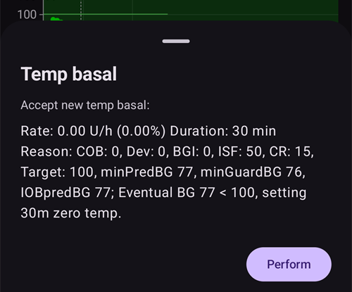
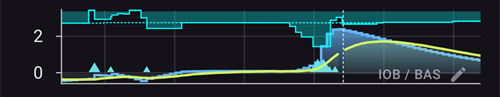

# Funcions principals d'AAPS

## Mode de funcionament

L'estat del llaç es mostra a la pantalla principal amb una de les icones de sota.

**AAPS** ofereix diversos modes de llaç, com ara Llaç tancat (1), Suspensió per glucèmia baixa (LGS - 2) i Llaç obert (3).

Vegeu [Pantalles d'AAPS > La pantalla principal > Estat del llaç](#AapsScreens-loop-status) per saber com seleccionar el mode de llaç i què volen dir les altres icones de la imatge (4 a 6).

(KeyAapsFeatures-OpenLoop)=

### Llaç obert

**AAPS** avalua contínuament totes les dades disponibles (IOB, COB, glucèmia...) i fa recomanacions de tractament (taxes basals temporals) sobre com ajustar la vostra teràpia si cal.

Les recomanacions no s'executen automàticament (com en el llaç tancat). L'usuari ha d'aplicar les recomanacions manualment a la bomba (si fa servir la bomba virtual) o amb un botó si **AAPS** està connectat a una bomba real.

When **AAPS** has a suggestion, a **Loop** entry with a green dot appears in the bottom navigation of the main screen. Premeu-la per llegir la recomanació («Acceptar la nova basal temporal») amb la taxa, la durada i el motiu, i després premeu **Executar** per aplicar-la:

Una recomanació només és vàlida durant uns quants minuts. Si té més d'uns 9 minuts, o si mentrestant s'ha suspès el llaç o s'ha desconnectat la bomba, **AAPS** la rebutja i no s'envia res a la bomba (*«Aquesta recomanació és massa antiga. No s'ha enviat res a la bomba. Espereu la següent.»*). Espereu la recomanació següent.

Aquesta opció serveix per conèixer com funciona **AAPS** o si feu servir una bomba no compatible. Estareu en llaç obert, trieu el que trieu aquí, fins al final de l'**[Objectiu 5](#objectives-objective5)**.

(KeyAapsFeatures-LGS)=

### Suspensió per glucèmia baixa (LGS)

En aquest mode, [maxIOB](#Open-APS-features-maximum-total-iob-openaps-cant-go-over) es posa a zero.

Això vol dir que, si la glucèmia baixa, **AAPS** us pot reduir la basal. Però si la glucèmia puja, no es fa cap correcció automàtica. Les vostres taxes basals es mantenen tal com estan definides al vostre **Perfil** actual. Només si l'IOB és negativa (per una suspensió per glucèmia baixa anterior) s'administra insulina addicional per baixar la **glucèmia**.

Aquest mode està disponible a partir de l'**[Objectiu 6](#objectives-objective6)**.

A més de seleccionar-lo vosaltres, **AAPS** també pot canviar a aquest mode per si mateix: mentre treballeu en l'**[Objectiu 6](#objectives-objective6)**, i sempre que detecti lectures de glucèmia duplicades (vegeu [senyal d'avís de glucèmia](#aaps-screens-bg-warning-sign)).

(KeyAapsFeatures-ClosedLoop)=

### Llaç tancat

**AAPS** avalua contínuament totes les dades disponibles (IOB, COB, glucèmia...) i ajusta automàticament el tractament si cal (*és a dir*, sense que hàgiu d'intervenir) per arribar al [rang o valor objectiu](#profile-glucose-targets) definit (lliurament de bolus, taxa basal temporal, aturada de la insulina per evitar una hipo, etc.).

El llaç tancat funciona dins de nombrosos límits de seguretat, que es poden configurar individualment.

El llaç tancat només és possible si sou a l'**[Objectiu 7](#objectives-objective7)** o superior i feu servir una bomba compatible.

(autosens)= (Open-APS-features-autosens)=

## Autosens

- Autosens és un algoritme que analitza les desviacions de la glucèmia (positives/negatives/neutres).
- Intenta esbrinar com de sensible o resistent sou a partir d'aquestes desviacions.
- La implementació oref a **OpenAPS** funciona amb una combinació de dades de 24 i de 8 hores. Fa servir la que sigui més sensible.
- Si veniu d'oref1, probablement notareu que el sistema pot reaccionar menys als canvis, perquè la sensibilitat es calcula amb 24 o amb 8 hores.
- Un canvi de cànula o un canvi de perfil restableix la ràtio d'Autosens al 100% (un canvi de perfil percentual amb durada no restableix l'Autosens).
- Autosens ajusta la vostra basal i l'ISF (és a dir, imita el que fa un desplaçament del perfil).
- Si mengeu carbohidrats de manera contínua durant un període llarg, Autosens serà menys eficaç durant aquest període, perquè els carbohidrats s'exclouen del càlcul de la delta de **glucèmia**.
- Les desviacions es converteixen en una **ràtio de sensibilitat** (un percentatge): una ràtio per sota del 100% vol dir que AAPS creu que sou més sensibles a la insulina del que suposa el vostre **Perfil** (per això baixa la basal efectiva i puja el valor de l'ISF), i una ràtio per sobre del 100% vol dir que sou més resistents (per això puja la basal i baixa el valor de l'ISF).
- Per defecte, aquesta ràtio es manté entre 0,7 (70%, més sensible) i 1,2 (120%, més resistent), de manera que una sèrie de dades poc habituals no pot allunyar massa la dosificació del vostre **Perfil**. Aquests límits es poden ajustar a la configuració avançada de la Detecció de sensibilitat.
- Autosens i [Autotune](../AdvancedOptions/Autotune.md) tracten el mateix problema de fons en escales de temps diferents: Autosens ajusta la vostra dosificació *en directe* minut a minut a partir de les últimes 8–24 h, mentre que Autotune reescriu a poc a poc el vostre mateix *Perfil* a partir de setmanes d'historial. És normal i esperat fer servir tots dos: es complementen, no es dupliquen.

*Per a la descripció tècnica completa de l'algoritme autosens, vegeu la [documentació d'Autosens d'OpenAPS](https://openaps.readthedocs.io/en/latest/docs/Customize-Iterate/autosens.html).*

(Open-APS-features-super-micro-bolus-smb)=

## Super Micro Bolus (SMB)

**SMB**, l'abreviatura de **Super micro bolus**, és una funció d'OpenAPS introduïda a partir del 2018, dins de l'algoritme Oref1. A diferència de l'**AMA**, l'**SMB** no fa servir taxes basals temporals per controlar la glucèmia, sinó sobretot **petits super micro bolus**. En situacions en què l'**AMA** afegiria 1,0 U d'insulina amb una taxa basal temporal, l'**SMB** lliura diversos super micro bolus en passos petits a **intervals de 5 minuts**, per exemple 0,4 U, 0,3 U, 0,2 U i 0,1 U. Al mateix temps (per seguretat), la taxa basal real es posa a 0 U/h durant un cert temps per evitar una sobredosi (**'zero-temping'**). Això permet al sistema ajustar la glucèmia més ràpidament que amb l'augment de la taxa basal temporal de l'**AMA**.

Gràcies a l'SMB, per a àpats amb només carbohidrats «lents» pot ser suficient indicar al sistema la quantitat de carbohidrats prevista i deixar la resta a **AAPS**. Però això pot provocar pics postprandials (després dels àpats) més alts, perquè no és possible fer un prebolus. O podeu administrar, si cal amb un prebolus, un **bolus inicial** que cobreixi **només una part** dels carbohidrats (per exemple, 2/3 de la quantitat estimada) i deixar que l'**SMB** lliuri la resta de la insulina.

Els SMB es mostren al [gràfic d'IOB](#aaps-screens-iob) amb triangles blaus. [Manteniu premut](#aaps-screens-graph-press-and-hold) el gràfic sobre un triangle per veure quanta insulina s'ha lliurat, o feu servir l'[historial de Tractaments](#aaps-screens-treatments).

Les funcions de l'**SMB** inclouen alguns mecanismes de seguretat:

1. **Dosi d'SMB única més gran**  
  La dosi d'SMB única més gran només pot ser el valor més petit de:
  
        * el valor que correspon a la taxa basal actual (ajustada per autosens) durant el temps definit a «Màxim de minuts de basal per limitar l'SMB», per exemple la quantitat de basal dels pròxims 30 minuts, o
        * la meitat de la quantitat d'insulina que cal en aquest moment, o
        * la part que queda del vostre valor maxIOB de la configuració.
      

2. **Taxes basals temporals baixes**  
  Amb l'**SMB** s'activen més sovint taxes basals temporals baixes (anomenades 'low temps') o taxes basals temporals de 0 U/h (anomenades 'zero-temps'). Això és així a propòsit, per seguretat, i no té efectes negatius si el **Perfil** està ben configurat. Al gràfic principal, la corba d'IOB (línia fina groga) diu més que l'evolució de les taxes basals temporals.

3. **Àpats no anunciats**  
  Càlculs addicionals per predir l'evolució de la glucèmia, per exemple amb l'**UAM** (àpats no anunciats). Fins i tot sense que l'usuari introdueixi carbohidrats manualment, l'**UAM** pot detectar automàticament una pujada important de la glucèmia causada per àpats, adrenalina o altres factors, i intentar corregir-la amb **SMB**. Per seguretat, també funciona al revés i pot aturar l'SMB abans si es produeix una baixada de glucèmia inesperadament ràpida. Per això l'UAM sempre hauria d'estar activat amb l'SMB.

L'SMB no decideix per si sol que cal insulina: es basa en les mateixes prediccions combinades de glucèmia (glucèmia final, zero-temp, COB, UAM) descrites a [com AAPS converteix les prediccions en una decisió de dosificació](#aaps-screens-how-predictions-become-a-dosing-decision). L'SMB i el zero-temping són simplement les dues eines que AAPS fa servir per aplicar aquesta decisió.

**Heu d'haver iniciat l'[objectiu 9](#objectives-objective9) per fer servir l'SMB.**

Vegeu també la [documentació oref1/SMB d'OpenAPS](https://openaps.readthedocs.io/en/latest/docs/Customize-Iterate/oref1.html#understanding-super-micro-bolus-smb) per a la descripció tècnica completa, o [la informació de Tim sobre l'SMB](https://www.diabettech.com/artificial-pancreas/understanding-smb-and-oref1/) per a una explicació de la comunitat.

A continuació es descriu la configuració d'OpenAPS SMB.

(Open-APS-features-max-u-h-a-temp-basal-can-be-set-to)=

### Taxa basal màxima

Aquesta configuració de seguretat determina la taxa basal temporal màxima que pot lliurar la bomba d'insulina. També es coneix com a **max-basal**.

El valor es mesura en unitats per hora (U/h). Es recomana posar-hi un valor raonable. Una bona recomanació per configurar aquest paràmetre és:

**BASAL MÀXIMA = TAXA BASAL MÉS ALTA x 4**

Per exemple, si la taxa basal més alta del vostre perfil fos 0,5 U/h, podríeu multiplicar-la per 4 i obtindríeu un valor de 2 U/h.

**AAPS** limita aquest valor amb un «límit fix» segons [Configuració > Seguretat > Edat del pacient](#preferences-patient-type). Els límits fixos són aquests:

- Infant: 2
- Adolescent: 5
- Adult: 10
- Adult resistent a la insulina: 12
- Embaraç: 25

*Vegeu també la [visió general dels límits fixos](#Open-APS-features-overview-of-hard-coded-limits).*

(Open-APS-features-maximum-total-iob-openaps-cant-go-over)=

### IOB màxima per a SMB

Aquest valor determina la quantitat màxima d'**insulina a bord** (IOB de basal i de bolus) per sota de la qual es manté **AAPS** quan funciona en mode de llaç tancat. També es coneix com a **maxIOB**.

Si l'IOB actual (per exemple, després d'un bolus d'àpat) és superior al valor definit, el llaç deixa d'administrar insulina fins que l'IOB torna a estar per sota del límit.

Un bon punt de partida per configurar aquest paràmetre és:

      maxIOB = bolus d'àpat mitjà + 3x basal diària màxima
    

Aneu amb compte i tingueu paciència quan ajusteu la vostra **max-IOB**. És diferent per a cada persona i també pot dependre de la dosi diària total (TDD) mitjana.

**AAPS** limita aquest valor amb un «límit fix» segons [Configuració > Seguretat > Edat del pacient](#preferences-patient-type). Els límits fixos són aquests:

- Infant: 7
- Adolescent: 13
- Adult: 22
- Adult resistent a la insulina: 30
- Embaraç: 70

*Vegeu també la [visió general dels límits fixos](#Open-APS-features-overview-of-hard-coded-limits).*

Nota: Quan feu servir **SMB**, la **max-IOB** es calcula de manera diferent que amb AMA. Amb **AMA**, maxIOB és un paràmetre de seguretat per a l'**IOB** de basal, mentre que en mode SMB també inclou l'IOB de bolus.

### Utilitzar sensibilitat dinàmica

Aquesta és la funció [ISF dinàmic (DynISF)](../DailyLifeWithAaps/DynamicISF.md). Quan s'activa, hi ha configuracions noves disponibles. La configuració s'explica a la pàgina [ISF dinàmic (DynISF)](#dyn-isf-preferences).

### Utilitzar Autosens

Aquesta és la funció [Autosens](#Open-APS-features-autosens). Quan feu servir ISF dinàmic, no es pot fer servir Autosens, perquè són dos algoritmes diferents que modifiquen la mateixa variable (la sensibilitat).

Autosens analitza les desviacions de la glucèmia (positives/negatives/neutres). Intenta esbrinar com de sensible o resistent sou a partir d'aquestes desviacions i ajusta la taxa basal i l'ISF segons aquestes desviacions.

Quan s'activa, hi ha configuracions noves disponibles.

#### La sensibilitat puja l'objectiu

Si aquesta opció està activada, la detecció de sensibilitat (autosens) pot pujar l'objectiu quan es detecta sensibilitat (per sota del 100%). En aquest cas, l'objectiu puja en el percentatge de la sensibilitat detectada.

Si l'objectiu es modifica per la detecció de sensibilitat, es mostra amb fons verd a la pantalla principal.

Aquesta configuració està disponible quan «Utilitzar sensibilitat dinàmica» o «Utilitzar Autosens» està activat.

#### La resistència baixa l'objectiu

Si aquesta opció està activada, la detecció de sensibilitat (autosens) pot baixar l'objectiu quan es detecta resistència (per sobre del 100%). En aquest cas, l'objectiu baixa en el percentatge de la resistència detectada.

Aquesta configuració està disponible quan «Utilitzar sensibilitat dinàmica» o «Utilitzar Autosens» està activat.

### Activar SMB

Activeu-ho per fer servir la funció SMB. Si està desactivat, no s'administrarà cap **SMB**.

Quan s'activa, hi ha configuracions noves disponibles.

(Open-APS-features-enable-smb-with-high-temp-targets)=

#### Activar SMB amb objectiu temporal alt

Si aquesta configuració està activada, els **SMB** es continuen lliurant encara que l'usuari hagi seleccionat un **Objectiu temporal** alt (definit com a 100 mg/dl o 5,6 mmol/l o més, sigui quin sigui l'objectiu del **Perfil**). Aneu amb compte quan l'activeu: els **SMB** poden ser massa agressius si la vostra configuració no està ben ajustada o si el vostre **Perfil** canvia sovint (per exemple, en infants).

Quan aquesta configuració està desactivada, un **Objectiu temporal** alt desactiva els **SMB**. Per exemple, si aquesta opció està desactivada, els **SMB** es poden desactivar posant un **Objectiu temporal** de 100 mg/dl o 5,6 mmol/l o més. Aquesta opció també desactiva els **SMB** encara que una altra condició intenti activar l'SMB, excepte amb un **Objectiu temporal** baix com **Menjar aviat** (o qualsevol **Objectiu temporal** de 98 mg/dl o 5,4 mmol/l o menys), que encara pot lliurar **SMB** per portar la **glucèmia** cap a l'objectiu.

Aquesta configuració no activa l'**SMB** per si sola. Amb un objectiu temporal alt, l'**SMB** només es dona si una de les altres configuracions de més avall (per exemple **Activar SMB sempre** o **Activar SMB amb COB**) també ho permet.

(Open-APS-features-enable-smb-always)=

#### Activar SMB sempre

Si aquesta configuració està activada, l'SMB sempre està activat (independentment del COB, dels objectius temporals o dels bolus). Si aquesta configuració està activada, la resta de configuracions d'activació de més avall no tenen cap efecte. Però si **Activar SMB amb objectiu temporal alt** està desactivat i hi ha un objectiu temporal alt, els SMB es desactiven.

Aquesta configuració només està disponible si **AAPS** detecta que feu servir una [font de glucèmia fiable](#GettingStarted-TrustedBGSource), amb filtratge avançat. FreeStyle Libre 1 no es considera una font fiable, pel risc que repeteixi sense fi dades de glucèmia antigues si el sensor falla.

Les dades sorolloses poden fer creure a **AAPS** que la glucèmia puja molt de pressa, i això pot provocar SMB innecessaris. Per a més informació sobre el soroll i el suavitzat de dades, vegeu [aquí](../CompatibleCgms/SmoothingBloodGlucoseData.md).

#### Activar SMB amb COB

Si aquesta configuració està activada, l'SMB s'activa quan el COB és superior a 0.

Aquesta configuració no es veu si «Activar SMB sempre» està activat.

#### Activar SMB amb objectiu temporal baix

Si aquesta configuració està activada, l'SMB s'activa quan hi ha un objectiu temporal (menjar aviat, activitat, hipo, personalitzat). Si aquesta configuració està activada però **Activar SMB amb objectiu temporal alt** està desactivat, l'SMB s'activa quan hi ha un objectiu temporal baix (98 mg/dl o 5,4 mmol/l o menys), però es desactiva quan hi ha un objectiu temporal alt.

Aquesta configuració no es veu si «Activar SMB sempre» està activat.

#### Activar SMB després de carbohidrats

Si està activat, l'SMB s'activa durant 6 h després d'anunciar carbohidrats, encara que el COB hagi arribat a 0.

Per seguretat, aquesta configuració només està disponible si **AAPS** detecta que feu servir una font de glucèmia fiable. No es veu si «Activar SMB sempre» està activat.

Aquesta configuració només està disponible si **AAPS** detecta que feu servir una [font de glucèmia fiable,](#GettingStarted-TrustedBGSource) amb filtratge avançat. FreeStyle Libre 1 no es considera una font fiable, pel risc que repeteixi sense fi dades de glucèmia antigues si el sensor falla.

Les dades sorolloses poden fer creure a **AAPS** que la glucèmia puja molt de pressa, i això pot provocar SMB innecessaris. Per a més informació sobre el soroll i el suavitzat de dades, vegeu [aquí](../CompatibleCgms/SmoothingBloodGlucoseData.md).  
Aquesta configuració no es veu si «Activar SMB sempre» està activat.

#### Interval d'SMB

Aquesta funció limita la freqüència dels SMB. Aquest valor determina el temps mínim entre SMB. Tingueu en compte que el llaç s'executa cada vegada que arriba un valor de glucèmia (normalment cada 5 minuts). Resteu-hi 2 minuts perquè el llaç tingui temps addicional per acabar. Per exemple, si voleu que es doni un SMB a cada execució del llaç, poseu-hi 3 minuts.

Valor per defecte: 3 min.

(Open-APS-features-max-minutes-of-basal-to-limit-smb-to)=

#### Màxim de minuts de basal per limitar l'SMB

Aquesta és una configuració de seguretat important. Aquest valor determina quant SMB es pot donar segons la quantitat d'insulina basal en un temps determinat, quan està cobert pel COB.

Si augmenteu aquest valor, l'SMB pot ser més agressiu. Hauríeu de començar amb el valor per defecte de 30 minuts. Amb una mica d'experiència, augmenteu el valor en passos de 15 minuts i observeu els efectes durant diversos àpats.

Es recomana no posar un valor superior a 90 minuts, perquè l'algoritme podria arribar a un punt en què no pugui compensar una glucèmia que baixa amb una basal de 0 U/h ('zero-temp'). També hauríeu de configurar alarmes, sobretot si encara esteu provant configuracions noves, que us avisin molt abans d'una hipo.

Valor per defecte: 30 min.

#### Màxim de minuts de basal per limitar l'SMB amb UAM

Aquesta configuració permet ajustar la força de l'SMB durant l'UAM, quan ja no queden carbohidrats.

Valor per defecte: el mateix que **Màxim de minuts de basal per limitar l'SMB**.

Aquesta configuració només es veu si «Activar SMB» i «Activar UAM» estan activats.

(enable-uam)=

### Activar UAM

Amb aquesta opció activada, l'algoritme SMB pot reconèixer àpats no anunciats. Això és útil si oblideu indicar els carbohidrats a **AAPS**, si els calculeu malament i la quantitat introduïda és incorrecta, o si un àpat amb molt de greix i proteïna dura més del previst. Sense cap entrada de carbohidrats, l'UAM pot reconèixer una pujada ràpida de la glucèmia causada per carbohidrats, adrenalina, etc., i intenta corregir-la amb SMB. També funciona al revés: si la glucèmia baixa ràpidament, pot aturar els SMB abans.

**Per això l'UAM sempre hauria d'estar activat quan feu servir SMB.**

(key-aaps-features-minimal-carbs-required-for-suggestion)=

### Llindar de carbohidrats necessaris

Mínim de grams de carbohidrats per mostrar una alerta de carbohidrats recomanats. Es recomana menjar carbohidrats addicionals quan l'algoritme de referència detecta que en calen. En aquest cas rebreu un avís que podeu postposar 5, 15 o 30 minuts.

Si voleu, els avisos de carbohidrats necessaris es poden enviar a Nightscout. En aquest cas es mostrarà i es difondrà un avís.

En qualsevol cas, els carbohidrats necessaris es mostren a la secció COB de la pantalla principal.

### Configuració avançada

Per a la referència completa dels paràmetres (incloses configuracions que no es tracten aquí), vegeu la [documentació d'OpenAPS sobre preferències i configuració de seguretat](https://openaps.readthedocs.io/en/latest/docs/While%20You%20Wait%20For%20Gear/preferences-and-safety-settings.html).

**Utilitzar sempre la delta mitjana curta** Si activeu aquesta funció, **AAPS** fa servir la delta mitjana curta de la glucèmia dels últims 15 minuts, que normalment és la mitjana dels tres últims valors. Això ajuda **AAPS** a ser més estable amb fonts de dades sorolloses com xDrip i Libre.

**Multiplicador de seguretat diari màxim** Aquest és un límit de seguretat important. El valor per defecte (que difícilment caldrà canviar) és 3. Això vol dir que **AAPS** mai no podrà posar una taxa basal temporal superior a 3 vegades la taxa basal horària més alta programada a la bomba i/o al perfil de l'usuari. Exemple: si la vostra taxa basal més alta és 1,0 U/h i el multiplicador de seguretat diari màxim és 3, **AAPS** pot posar una taxa basal temporal màxima de 3,0 U/h (= 3 x 1,0 U/h).

Valor per defecte: 3 (no s'hauria de canviar si no és realment necessari i no sabeu què feu)

**Multiplicador de seguretat de la basal actual** Aquest és un altre límit de seguretat important. El valor per defecte (que tampoc no caldrà canviar gaire probablement) és 4. Això vol dir que **AAPS** mai no podrà posar una taxa basal temporal superior a 4 vegades la taxa basal horària actual programada a la bomba i/o al perfil de l'usuari.

Valor per defecte: 4 (no s'hauria de canviar si no és realment necessari i no sabeu què feu)

* * *

(Open-APS-features-auto-isf)=

## Auto ISF

**Auto ISF** és un algoritme **experimental** per a usuaris avançats. Es basa en OpenAPS SMB i afegeix regles que fan el factor de sensibilitat a la insulina (ISF) més fort o més feble segons com es comporta la vostra glucèmia.

És una funció de desenvolupament: només es pot activar en una [compilació de desenvolupament](../AdvancedOptions/DevBranch.md) amb el **Mode enginyeria** activat. En una compilació normal (release) queda sempre desactivat i per això no es mostra a **Configurador → APS**. Completar els [Objectius](../SettingUpAaps/CompletingTheObjectives.md) no el desbloqueja.

Després de seleccionar-lo, la seva **Configuració** conté la configuració d'OpenAPS SMB i un grup **Configuració AutoISF**:

- **Activar AutoISF**: activa els ajustos de l'ISF. Sense això, l'algoritme es comporta com OpenAPS SMB.
- **AutoISF mín.** i **AutoISF màx.**: fins a quin punt l'ISF pot ser més feble i més fort, de la mateixa manera que els límits d'Autosens. Amb el valor per defecte 1,0 l'efecte està desactivat.
- **Pesos**: cadascuna controla una regla, i el valor per defecte 0,0 desactiva la regla. 
  - mentre la glucèmia **s'accelera**, l'ISF es fa més fort (més insulina);
  - mentre la glucèmia **es desaccelera**, l'ISF es fa més feble (menys insulina);
  - mentre la glucèmia és **per sota de l'objectiu**, l'ISF es fa més feble;
  - mentre la glucèmia és **per sobre de l'objectiu**, l'ISF es fa més fort;
  - un pes **postprandial** i un pes de **durada** actuen després dels àpats i quan la glucèmia es manté alta durant molt de temps.
- **Ràtio de lliurament d'SMB** (amb un mínim, un màxim i un rang de glucèmia): quina part de la insulina necessària es pot lliurar com a SMB.
- **Extensió màxima del rang d'SMB**: per quin factor es pot superar el límit habitual de mida de l'SMB ([màxim de minuts de basal](#Open-APS-features-max-minutes-of-basal-to-limit-smb-to), 30 minuts per defecte). El valor per defecte 1 no canvia res; es pot arribar fins a 5. Augmenteu aquest valor experimental a poc a poc i amb prudència.
- **Percentatge del llindar d'IOB**: el percentatge de l'IOB màxima per sobre del qual es desactiven els SMB.

    {admonition} Només per a usuaris experimentats
    :class: danger
    Amb els valors per defecte, Auto ISF no canvia res. Cada valor que augmenteu fa **AAPS** més agressiu. Canvieu un sol valor cada vegada, en passos petits, i observeu el resultat durant diversos dies. Aneu amb molta cura amb un **AutoISF màx.** superior a 2,5.

(Open-APS-features-advanced-meal-assist-ama)=

## Advanced Meal Assist (AMA)

AMA, l'abreviatura d'«advanced meal assist» (assistència avançada als àpats), és una funció d'OpenAPS del 2017 (oref0). OpenAPS Advanced Meal Assist (AMA) permet al sistema posar una basal temporal alta més ràpidament després d'un bolus d'àpat, si introduïu els carbohidrats de manera fiable.

Trobareu més informació a la [documentació d'OpenAPS](https://newer-docs.readthedocs.io/en/latest/docs/walkthrough/phase-4/advanced-features.html#advanced-meal-assist-or-ama).

### Taxa basal màxima (OpenAPS «max-basal»)

Aquesta configuració de seguretat evita que **AAPS** pugui donar mai una taxa basal perillosament alta i limita la taxa basal temporal a x U/h. Es recomana posar-hi un valor raonable. Una bona recomanació és agafar la taxa basal més alta del vostre perfil i multiplicar-la per 4, i com a mínim per 3. Per exemple, si la taxa basal més alta del vostre perfil és 1,0 U/h, podríeu multiplicar-la per 4 per obtenir un valor de 4 U/h i posar 4 com a paràmetre de seguretat.

No podeu triar qualsevol valor: per seguretat, hi ha un «límit fix», que depèn de l'edat del pacient. El «límit fix» de maxIOB és més baix amb AMA que amb SMB. Per als infants el valor és el més baix, i per als adults resistents a la insulina és el més alt.

Els paràmetres fixos a **AAPS** són:

- Infant: 2
- Adolescent: 5
- Adult: 10
- Adult resistent a la insulina: 12
- Embaraç: 25

*Vegeu també la [visió general dels límits fixos](#Open-APS-features-overview-of-hard-coded-limits).*

### IOB màxima per a AMA

Aquest paràmetre limita l'IOB de basal màxima amb la qual **AAPS** encara funciona. Si l'IOB és més alta, deixa de donar insulina basal addicional fins que l'IOB de basal torna a estar per sota del límit.

El valor per defecte és 2, però hauríeu de pujar aquest paràmetre a poc a poc per veure com us afecta i quin valor us va millor. És diferent per a cada persona i també depèn de la dosi diària total (TDD) mitjana. Per seguretat, hi ha un límit, que depèn de l'edat del pacient. El «límit fix» de maxIOB és més baix amb AMA que amb SMB.

- Infant: 3
- Adolescent: 5
- Adult: 7
- Adult resistent a la insulina: 12
- Embaraç: 25

*Vegeu també la [visió general dels límits fixos](#Open-APS-features-overview-of-hard-coded-limits).*

### Utilitzar Autosens (AMA)

Aquí podeu triar si voleu fer servir la [detecció de sensibilitat](../DailyLifeWithAaps/SensitivityDetectionAndCob.md) autosens o no.

### Autosens ajusta els objectius

Si teniu aquesta opció activada, autosens també pot ajustar els objectius (a més de la basal i l'ISF). Això fa que **AAPS** treballi de manera més «agressiva» o no. Així l'objectiu real es pot assolir més ràpidament.

### Configuració avançada

- Normalment no cal canviar la configuració d'aquest diàleg!
- Si igualment la voleu canviar, assegureu-vos que enteneu el que feu: vegeu la referència completa dels paràmetres a la [documentació d'OpenAPS sobre preferències i configuració de seguretat](https://openaps.readthedocs.io/en/latest/docs/While%20You%20Wait%20For%20Gear/preferences-and-safety-settings.html).

**Utilitzar sempre la delta mitjana curta** Si activeu aquesta funció, **AAPS** fa servir la delta mitjana curta de la glucèmia dels últims 15 minuts, que normalment és la mitjana dels tres últims valors. Això ajuda **AAPS** a funcionar de manera més estable amb fonts de dades sorolloses com xDrip i Libre.

**Multiplicador de seguretat diari màxim** Aquest és un límit de seguretat important. El valor per defecte (que difícilment caldrà canviar) és 3. Això vol dir que **AAPS** mai no podrà posar una taxa basal temporal superior a 3 vegades la taxa basal horària més alta programada a la bomba de l'usuari. Exemple: si la vostra taxa basal més alta és 1,0 U/h i el multiplicador de seguretat diari màxim és 3, **AAPS** pot posar una taxa basal temporal màxima de 3,0 U/h (= 3 x 1,0 U/h).

Valor per defecte: 3 (no s'hauria de canviar si no és realment necessari i no sabeu què feu)

**Multiplicador de seguretat de la basal actual** Aquest és un altre límit de seguretat important. El valor per defecte (que tampoc no caldrà canviar gaire probablement) és 4. Això vol dir que **AAPS** mai no podrà posar una taxa basal temporal superior a 4 vegades la taxa basal horària actual programada a la bomba de l'usuari.

Valor per defecte: 4 (no s'hauria de canviar si no és realment necessari i no sabeu què feu)

**Divisor de DIA per al retard de bolus** La funció «bolus snooze» (retard de bolus) actua després d'un bolus d'àpat. **AAPS** no posa taxes basals temporals baixes després d'un àpat durant el temps de la DIA dividit pel paràmetre «bolus snooze». El valor per defecte és 2. Això vol dir que, amb una DIA de 5 h, el «bolus snooze» duraria 5 h : 2 = 2,5 h.

Valor per defecte: 2

* * *

(Open-APS-features-overview-of-hard-coded-limits)=

## Visió general dels límits fixos

|            | Infant | Adolescent | Adult | Adult resistent a la insulina | Embaraç |
| ---------- | ------ | ---------- | ----- | ----------------------------- | ------- |
| MAXBOLUS   | 5      | 10         | 17    | 25                            | 60      |
| MINDIA     | 5      | 5          | 5     | 5                             | 5       |
| MAXDIA     | 9      | 9          | 9     | 9                             | 10      |
| MINIC      | 2      | 2          | 2     | 2                             | 0.3     |
| MAXIC      | 100    | 100        | 100   | 100                           | 100     |
| MAXIOB_AMA | 3      | 5          | 7     | 12                            | 25      |
| MAXIOB_SMB | 7      | 13         | 22    | 30                            | 70      |
| MAXBASAL   | 2      | 5          | 10    | 12                            | 25      |