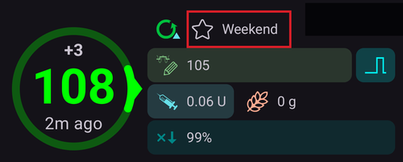
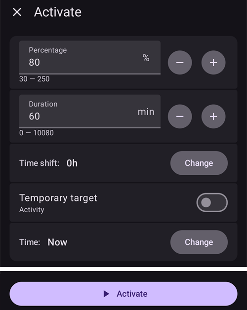
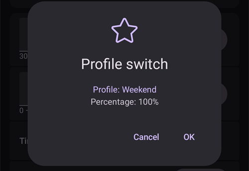
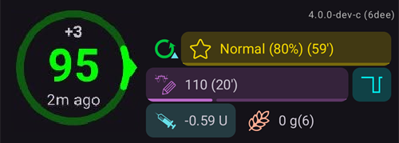
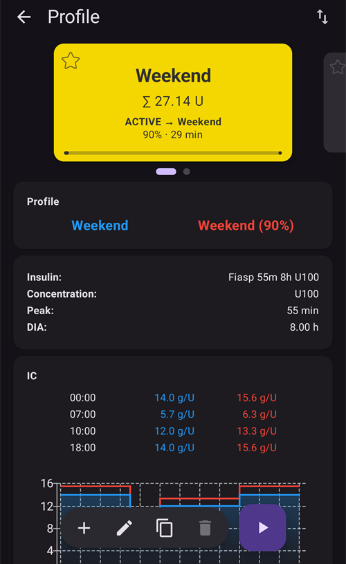
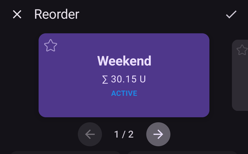
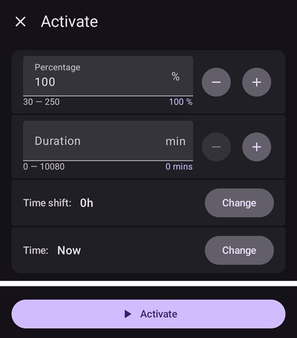
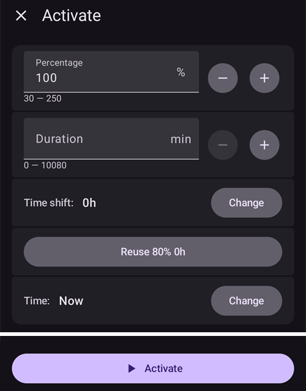
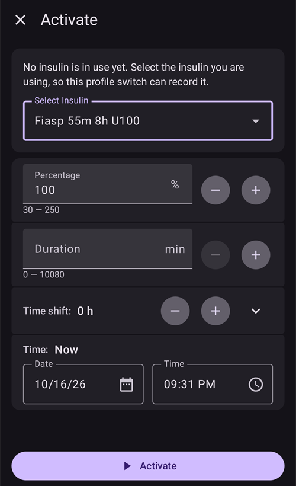
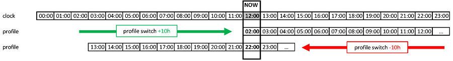

# Canvi de perfil i percentatge del perfil

Aquesta secció explica què és un **Canvi de perfil** i un **Percentatge del perfil**. Podeu aprendre a crear un **Perfil** a [El vostre perfil d'AAPS](#your-aaps-profile-create-and-edit-profiles).

Quan comenceu amb **AAPS**, haureu de crear un **Perfil**, entendre com fer un **Canvi de perfil** i aprendre l'efecte d'un **Percentatge del perfil** dins d'**AAPS**. Les funcions de **Canvi de perfil** o de **Percentatge del perfil** poden ser especialment útils per a:

- el cicle menstrual: un ajust de percentatge dins d'un **Perfil** es pot configurar a **Automatització** perquè **AAPS** s'adapti a les diferents fases del cicle hormonal i a la resistència a la insulina prevista.

- l'esport: un ajust de percentatge dins d'un **Perfil** es pot configurar a **Automatització** per a l'esport, per reduir la basal.

- el treball de nit o per torns: un desplaçament horari al **Perfil** es pot configurar per a qui treballa per torns. Canvieu el nombre d'hores del **Perfil** segons quantes hores més tard o més d'hora l'usuari anirà a dormir o es llevarà.

Per què fer servir un **Percentatge del perfil** en lloc d'un ajust temporal de la basal? Per ser més eficaç, un **Percentatge del perfil** aplica una reducció o un augment proporcional a: la basal, l'ISF i la I:C. Així **AAPS** calcula un ajust equilibrat quan administra la insulina de l'usuari. Una reducció de la basal al **Perfil** d'**AAPS** serveix de poc si l'algoritme continua fent servir les mateixes ràtios d'ISF i I:C.

(ProfileSwitch-change-percentage)=

## Canviar el percentatge del perfil des de la pantalla principal

Necessiteu almenys un **Perfil** desat. Un **Percentatge del perfil** sempre s'aplica amb un **Canvi de perfil**: torneu a activar un **Perfil**, aquesta vegada amb un percentatge.

```{admonition} Veniu d'AAPS 3? :class: note Una pulsació llarga sobre el nom del perfil ja no obre el diàleg de canvi de perfil. **Toqueu** el nom del perfil i després toqueu el botó rodó **▶** a baix a la dreta: obre la mateixa configuració (percentatge, durada, objectiu temporal d'activitat).

    <br />1. A la pantalla principal, **toqueu el nom del perfil** (al costat de la icona de l'estrella). La [pantalla Perfil](#ProfileSwitch-manage-v4) s'obre a la targeta del **Perfil** en ús, marcada com a **ACTIU**.
    
       
    
    2. Per mantenir el mateix **Perfil**, deixeu seleccionada la targeta **ACTIU**. Per canviar de **Perfil** al mateix temps, llisqueu fins a una altra targeta.
    3. Toqueu el botó rodó **▶** (**Activar**) a baix a la dreta. S'obre la pantalla **Activar**.
    4. Configureu el **Percentatge** amb **−** / **+** (passos del 5%), o escriviu-lo (del 30 al 250%). El camp sempre comença al **100%**: no mostra el percentatge que està en ús ara. Per exemple, introduïu **80** per a un 20% menys d'insulina, o **120** per a un 20% més.
    5. Configureu la **Durada** en minuts:
       * **0** manté el nou percentatge fins que feu un altre **Canvi de perfil**;
       * qualsevol altre valor acaba el canvi després d'aquest temps, i **AAPS** torna al **Perfil** que estava en ús abans.
    
       
    
    6. Toqueu **▶ Activar** a la part de baix de la pantalla. Comproveu el resum al diàleg **Canvi de perfil** i toqueu **OK**.
    
       
    
    De nou a la pantalla principal, el nom del perfil mostra el percentatge i el temps que queda, per exemple *Normal (80%) (59')*, i es posa groc mentre hi ha en ús un canvi amb durada. Una estrella marca el canvi al gràfic de glucèmia. Vegeu [la pantalla principal](#aaps-screens-profile--target).
    
    
    
    Per **tornar al 100%** abans del final, repetiu els passos i deixeu el **Percentatge** a 100 i la **Durada** a 0.
    
    ```{admonition} Percentatges amb un sol toc
    :class: tip
    Si feu servir sovint el mateix percentatge (esport, malaltia), afegiu una [drecera de perfil](#profile-shortcuts) a la barra d'accés ràpid, o creeu una [escena](Scenes.md). Totes dues apliquen un perfil amb un percentatge i una durada predefinits amb un sol toc.
    

(ProfileSwitch-manage-v4)=

## Gestionar i activar perfils (Gestionar → Perfil)

A **AAPS** v4 els perfils es gestionen i s'activen des de la pantalla **Gestionar** (navegació inferior) → **Perfil** (*«Gestionar i activar perfils»*).

La pantalla Perfil mostra els vostres perfils com un **carrusel de targetes que podeu lliscar**. La targeta del perfil en ús està marcada com a **ACTIU** i mostra la seva basal diària total (p. ex. *∑ 30,15 U*). Sota la targeta seleccionada veieu els detalls d'aquell perfil: el tipus d'**Insulina** i els horaris d'**IC**, **ISF**, **basal** i **objectiu**, amb gràfics.

Quan hi ha en ús un canvi temporal, la targeta **ACTIU** mostra el seu percentatge i el seu desplaçament horari amb el temps que queda, per exemple *110% +2 h · 2 h 40 min*, sobre una barra de progrés. Tots dos s'actualitzen cada 30 segons. Llavors els detalls de sota tenen dues columnes: els valors del perfil en blau, i els valors que es fan servir amb el percentatge en vermell.



Els botons de la part de baix actuen sobre el perfil **seleccionat**: **➕ Afegir**, **✏️ Editar**, **⧉ Duplicar** i **🗑️ Eliminar**, i el botó rodó **▶ Activar** a la dreta. Per saber com omplir els quatre horaris a l'editor (IC / ISF / BAS / TARG), vegeu [Crear i editar perfils](#your-aaps-profile-create-and-edit-profiles).

**⧉ Duplicar** fa servir la icona de dos quadrats que sovint vol dir *copiar*, però no hi ha res per enganxar: fa el duplicat en un sol pas. Confirmeu *Duplicar el perfil "Normal"?* i s'afegeix un perfil nou anomenat *Còpia de Normal* al final del carrusel. Queda seleccionat i a punt per a **✏️ Editar** (on també el podeu canviar de nom). No és el mateix que duplicar un **Canvi de perfil** antic des de l'historial de tractaments, que crea un perfil nou *amb el percentatge i el desplaçament horari aplicats*. Vegeu [Guardar un canvi de perfil per fer-lo servir més tard](#ProfileSwitch-keep-for-later).

(ProfileSwitch-read-only-mode)= **Només hi ha el botó ▶ Activar?** La vostra configuració està protegida, i per això la pantalla s'obre només de lectura. Toqueu el **✏️ llapis** a la barra superior i introduïu la contrasenya de la configuració. Vegeu [La protecció de la configuració ara també bloqueja les pantalles de gestió](#v4changes-read-only-management).

### Reordenar els perfils

Si teniu més d'un perfil, podeu triar-ne l'ordre al carrusel: toqueu la icona **Reordenar** (⇅, dues fletxes, una cap amunt i una cap avall) a la barra superior. L'indicador de pàgina es canvia per **botons de moure ◀ / ▶** amb una indicació *posició / total*. Moveu la targeta del centre més endavant o més enrere, i després confirmeu amb **✓** (o descarteu amb **✕**). El nou ordre es desa una sola vegada, quan confirmeu.



### Activar un perfil

Seleccioneu un perfil i toqueu **▶ Activar**. La pantalla **Activar** us permet ajustar com s'aplica el **Canvi de perfil**:



- **Percentatge** (30–250%, comença al 100% cada vegada): escala tot el perfil. El 100% el fa servir tal com és; per exemple, el 70% redueix la basal i la dosi d'insulina calculada (tant els bolus d'àpat com les correccions) un 30%. No canvia els vostres objectius de glucèmia ni l'absorció de carbohidrats. Vegeu [Percentatge del perfil](#ProfileSwitch-profile-percentage) per conèixer tot l'efecte.
- **Durada** (0–10080 minuts, és a dir, fins a 7 dies): quant de temps dura el canvi. **0 = indefinit** (fins que torneu a canviar); un valor diferent de zero torna al perfil anterior quan acaba.
- **Objectiu temporal / Activitat (esport)**: només apareix quan configureu una **Durada** i un **Percentatge** per sota del 100%. Activeu-lo per iniciar també un [objectiu temporal d'activitat](#TempTargets-activity-temp-target) amb la mateixa durada, com faríeu abans de fer esport.
- **Decalatge horari** (desplaçament horari): mostra *0h*; toqueu **Canviar** per moure l'horari endavant o enrere fins a 23 hores (útil per al treball per torns o per als viatges). Vegeu [Desplaçament horari](#ProfileSwitch-ProfilePercentage-time-shift-of-the-circadian-percentage-profile).
- **Reutilitzar**: apareix quan el canvi en ús té un percentatge diferent del 100% o un desplaçament horari, per exemple **Reutilitzar 80% 0h**. Toqueu-lo per omplir el mateix percentatge i el mateix desplaçament horari, per exemple per allargar un canvi que està a punt d'acabar.
    
    

- **Hora**: *Ara* per defecte. Podeu triar una altra hora, fins a 24 hores abans o després d'ara. Un canvi configurat en el futur comença a aquella hora; un objectiu temporal d'activitat configurat amb ell també comença llavors a aquella hora.
    
    

- **Notes**: només es mostra si [Mostrar notes als diàlegs](#Preferences-show-notes-field-in-treatments-dialogs) està activat.

Si les taxes basals amb el percentatge triat no són compatibles amb la vostra bomba, apareix un avís a dalt i **▶ Activar** queda desactivat: trieu un altre percentatge.

Toqueu **▶ Activar** i després **OK** al diàleg de confirmació. Llavors el perfil en ús porta la marca **ACTIU** a la seva targeta.

```{admonition} La vostra bomba pot arrodonir les taxes basals :class: note Cada bomba només pot donar taxes basals en els seus propis passos (per exemple 0,05 U/h), i per això arrodoneix les taxes del vostre **Perfil**. Llavors **AAPS** fa servir la basal que la bomba dona realment, i així l'IOB i la TDD continuen sent correctes. Si la bomba dona una mica més o menys insulina per dia que el vostre **Perfil**, l'avís *"Perfil de basal actualitzat a la bomba"* us diu quanta, per exemple *"lliura 10,00 U per dia en lloc de 10,12 U"*.

Si la bomba informa d'una basal molt diferent del vostre **Perfil**, **AAPS** manté la basal del **Perfil** i us demana que comproveu les taxes basals a la bomba.

    <br />```{admonition} Amb el percentatge i el desplaçament horari, un sol perfil serveix per a moltes situacions
    :class: note
    En lloc de crear molts perfils semblants, mantingueu un perfil base i apliqueu-lo amb un altre **percentatge** o **desplaçament horari** per a situacions que es repeteixen (malaltia, esport, viatges). Això és exactament el que automatitzen les [escenes](Scenes.md).
    

Un canvi de perfil no es limita a aquesta pantalla. El mateix canvi també es pot fer des d'un **rellotge Wear OS**, des d'un **client** emparellat (vegeu [Control principal ↔ client](../RemoteFeatures/ClientMasterControl.md)), des d'una **[escena](Scenes.md)** o amb una tasca d'**Automatització**.

(ProfileSwitch-profile-percentage)=

## Percentatge del perfil

És important que l'usuari entengui les funcions principals d'un **Percentatge del perfil**. Si apliqueu un augment o una reducció de percentatge amb un **Canvi de perfil**, els paràmetres de l'usuari configurats al **Perfil** pugen o baixen en el mateix percentatge.

Per exemple: un **Canvi de perfil** al 130% (vol dir que l'usuari és un 30% més resistent a la insulina) fa que **AAPS**:

- **augmenti** la taxa basal un 30%; 
- **baixi** l'**ISF**: el divideix per 1,3;
- **baixi** la **I:C**: la divideix per 1,3.

Recordeu que baixar l'**ISF** o la **I:C** vol dir una ràtio més forta i que s'administra més insulina. Els usuaris nous d'**AAPS** ho poden oblidar fàcilment.

Un cop seleccionat, **AAPS** torna a ajustar la taxa basal per defecte, i **AAPS** (llaç obert o tancat) continua funcionant sobre el **Perfil** amb el percentatge seleccionat.

L'efecte d'un percentatge del **Perfil** es resumeix a la taula següent:

| Canvi de perfil  
Percentatge |    Efecte     |     I:C  
g/U     | Exemple  
15 g |          ISF  
mmol/l/U  
mg/dl/U          | U per baixar  
2 mmol/l  
40 mg/dl |
|:-----------------------------:|:-------------:|:-----------------:|:--------------:|:------------------------------------------:|:----------------------------------:|
|              90%              |   Més feble   | 5/0,9  
=**5,55** |     2,7 U      | 2,2/0,9  
=**2,4**  
  
40/0,9  
=**44,4** |               0,8 U                |
|           **100%**            | **Estàndard** |       **5**       |    **3 U**     |                **2,2  
40**                |             **0,9** U              |
|             130%              |   Més fort    | 5/1,3  
=**3,85** |     3,9 U      | 2,2/1,3  
=**1,7**  
  
40/1,3  
=**30,8** |               1,2 U                |

(ProfileSwitch-ProfilePercentage-time-shift-of-the-circadian-percentage-profile)=

## Desplaçament horari del perfil circadià amb percentatge

Un «desplaçament horari» al **Perfil** de l'usuari mou la configuració del **Perfil** al llarg del rellotge del dia («circadià») el nombre d'hores que s'introdueix. Això pot ser útil per a:

- **treballadors de nit o per torns**: per als torns de nit, canvieu al **Perfil** el nombre d'hores segons quantes hores més tard o més d'hora l'usuari anirà a dormir o es llevarà; 
- **usuaris que canvien de fus horari quan viatgen**; o
- **nens amb diabetis tipus 1**: que tenen una rutina fixa per anar a dormir i una resistència a la insulina tinguda en compte al seu **Perfil**. Si per algun motiu el nen anirà a dormir més tard, el cuidador pot aplicar un «desplaçament horari» al **Perfil** del nen. Així **AAPS** reacciona a la resistència a la insulina en el període que l'usuari vol.

La pregunta sempre és: la configuració del **Perfil** de quina hora ha de substituir la configuració de l'hora actual? Aquesta hora s'ha de desplaçar x hores. Per tant, fixeu-vos bé en les direccions, com es descriu a l'exemple següent:

- Hora actual: 12:00
- **Positiu** desplaçament horari 
    - 2:00 **+10 h** -> 12:00
    - Es fa servir la configuració de les 2:00 en lloc de la configuració que normalment es fa servir a les 12:00, perquè el desplaçament horari és positiu.
- **Negatiu** desplaçament horari 
    - 22:00 **-10 h** -> 12:00
    - Es fa servir la configuració de les 22:00 (10 del vespre) en lloc de la configuració que normalment es fa servir a les 12:00, perquè el desplaçament horari és negatiu.



Aquest mecanisme de fer instantànies del **Perfil** permet un càlcul del passat molt més precís i la possibilitat de seguir els canvis del **Perfil**.

(ProfileSwitch-keep-for-later)=

## Guardar un canvi de perfil per fer-lo servir més tard

Després de fer un canvi de perfil amb percentatge i/o desplaçament horari, podeu fer una còpia d'aquest perfil temporal en un perfil nou.

Per fer-ho, obriu el menú (☰) → **Tractaments** i aneu a la pestanya **Canvi de perfil**; vegeu [Duplicar un canvi de perfil en un perfil nou](#your-aaps-profile-clone-profile-switch).