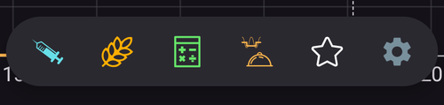
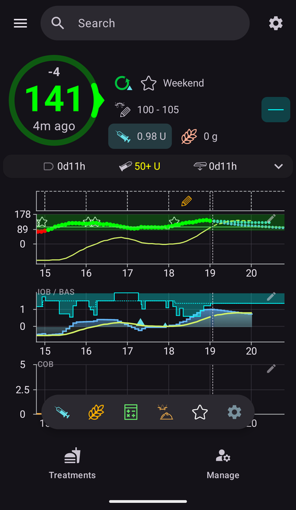
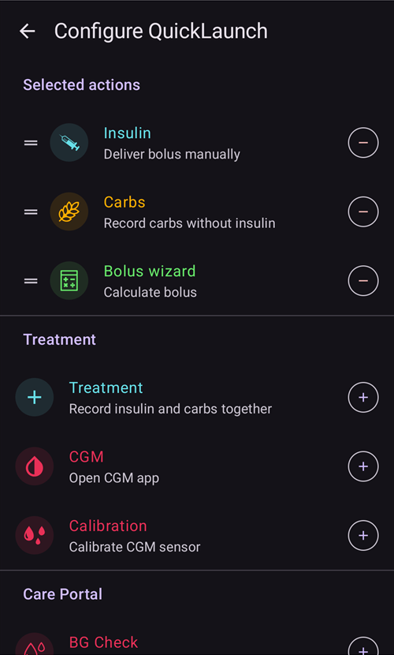
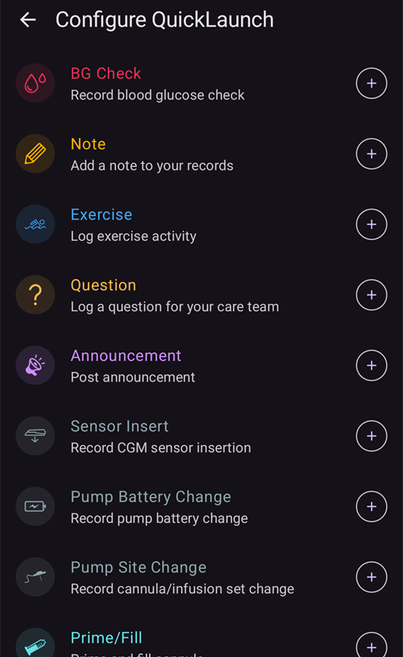
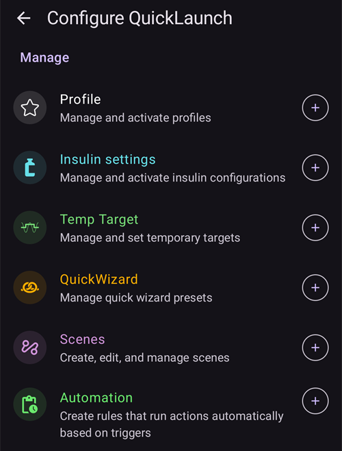
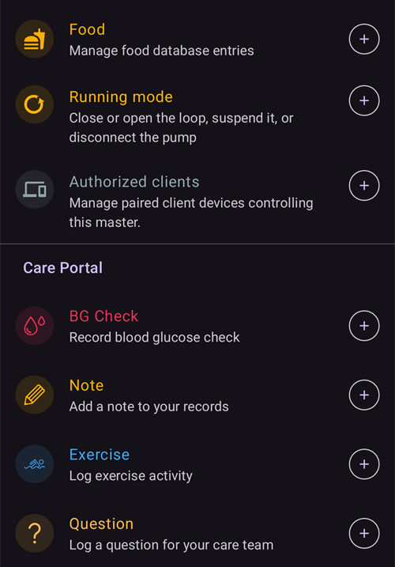
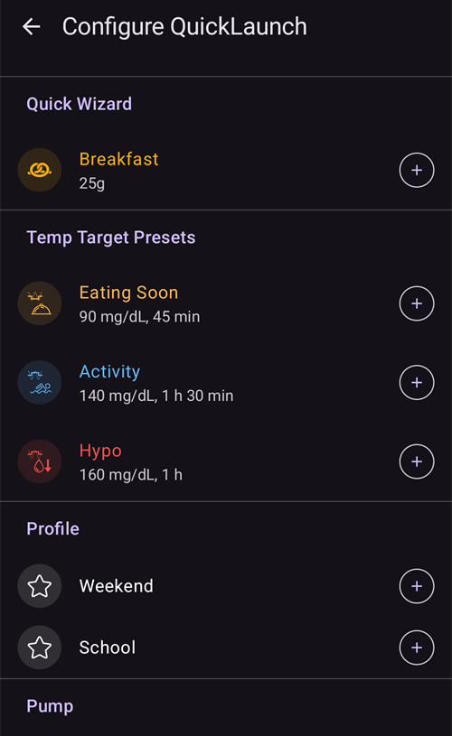
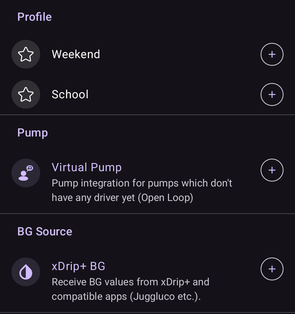
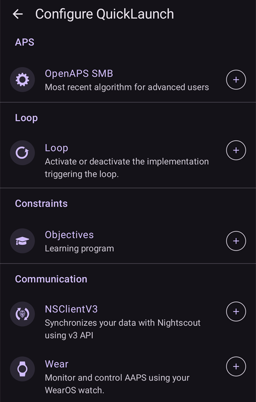

(quicklaunch)=
# Accés ràpid (barra d'accions ràpides del resum)

L'**accés ràpid** és la petita **barra d'accions ràpides** que flota a la part inferior del resum d'**AAPS**, just a sobre de la navegació inferior. És una fila de botons d'un sol toc que podeu personalitzar: decidiu quines accions hi ha i en quin ordre. Així, les coses que feu més sovint sempre són a un toc a la pantalla principal.

```{contents} Table of contents
:depth: 2
:local: true
```



---

## Ús de la barra

La barra és al **resum**, entre els gràfics i la navegació inferior:



- **Toqueu** una icona per executar la seva acció, exactament com si l'haguéssiu obert des de la seva pantalla normal (un bolus o un tractament encara mostra primer la confirmació habitual).
- **Manteniu premuda** una icona per veure un **text d'ajuda** amb el nom de l'acció i una descripció curta.
- Si afegiu **més botons dels que caben** a la pantalla, els que sobren passen a un **menú addicional** (el botó **⋮** al final de la barra).
- Cada icona manté el **color** de la seva acció (per exemple, insulina, carbohidrats, objectiu temporal), així la reconeixeu d'un cop d'ull.

```{admonition} The toolbar is always there
:class: note
L'últim botó és sempre **Configurar l'accés ràpid** (l'engranatge **⚙️**). No es pot eliminar, així sempre podeu arribar a la pantalla de configuració directament des de la barra. Per defecte, la barra només té dos botons: la **Calculadora de bolus** i aquest engranatge.
```

---

## Configurar l'accés ràpid

Toqueu l'engranatge **⚙️** de la barra (o obriu **[Configurador](../SettingUpAaps/ConfigBuilder.md) → … → Configurar l'accés ràpid**) per obrir la pantalla **Configurar l'accés ràpid** (*«Personalitzar els botons d'acció ràpida del resum»*).



La pantalla té dues parts:

- **Accions seleccionades** (a dalt): els botons que ara són a la barra, en l'ordre de la barra.
- Un **catàleg** a sota: totes les accions que podeu afegir, agrupades per categoria. Cada entrada del catàleg té un botó **➕** per afegir-la.

### Accions seleccionades: reordenar, editar, eliminar

Cada acció seleccionada té:

- una **⠿ nansa d'arrossegament**: premeu i arrossegueu per **reordenar** els botons (l'ordre d'aquí és l'ordre de la barra),
- un botó **−**: l'**elimina** de la barra,
- i, només per a una drecera de **Perfil**, un botó **✏️** per editar el percentatge i la durada (vegeu [Dreceres de perfil](#profile-shortcuts)).

Els canvis s'apliquen **immediatament**: no hi ha cap botó *Desar* a part. Una acció nova s'afegeix al final de la barra; després la podeu moure on vulgueu.

---

## Les categories d'accions

El catàleg agrupa tot el que podeu afegir en les categories següents, en aquest ordre. Les categories que no tenen res per oferir (per exemple, si no teniu cap escena) no es mostren.

### Tractament

Els diàlegs de tractament i de CGM de cada dia:

- **Insulina**: lliurar un bolus manualment.
- **Carbs**: registrar carbohidrats sense insulina.
- **Calculadora de bolus**: obrir la calculadora de bolus.
- **Tractament**: registrar insulina i carbohidrats junts.
- **CGM**: obrir la vostra aplicació de CGM (per exemple, xDrip).
- **Calibració**: calibrar el sensor del CGM.

### Portal de cures

Els esdeveniments del portal de cures i els registres de manteniment dels dispositius:

- **Control glucèmia**, **Nota**, **Esport**, **Pregunta**, **Avís**,
- **Inserció del sensor**, **Canvi de pila de la bomba**, **Canvi de cànula**, **Encebar**, **Rotació de punts d'inserció**.

**Encebar** i **Canvi de pila de la bomba** només es mostren si la vostra bomba els fa servir. Les bombes patch, per exemple, s'omplen i canvien la pila durant els seus propis passos d'activació, per això aquestes entrades no es mostren per a elles (igual que al full **Gestionar**).



Són les mateixes entrades a les quals arribaríeu pels fulls **[Tractaments](#v4changes-treatments)** i **[Gestionar](#v4changes-manage)**. L'accés ràpid només posa al resum les que feu servir.

### Gestionar

Les pantalles del full **[Gestionar](#v4changes-manage)**, en el mateix ordre, perquè pugueu obrir des de la barra la que feu servir més:

- **Perfil**, **Configuració d'insulina** (gestionar i activar configuracions d'insulina; té un nom diferent d'**Insulina** a propòsit, perquè aquell botó lliura un bolus), **Objectiu temporal**, **Assistent ràpid**, **Escenes**, **Automatització**, **Aliments**,
- **Mode de funcionament**: tancar o obrir el llaç, suspendre'l o desconnectar la bomba,
- **Clients autoritzats**: només en un dispositiu principal o en un client emparellat.

Aquests botons obren la pantalla; no inicien res per si sols. Per iniciar una escena o un assistent ràpid amb un sol toc, afegiu-los des de la categoria **Escenes** o **Assistent ràpid** de més avall.

 

### Assistent ràpid

Cada un dels vostres **[Assistents ràpids](QuickWizards.md)** predefinits es pot afegir com a botó. Així, un àpat que es repeteix és a un toc des del resum. El botó porta el nom de l'assistent i mostra la quantitat de carbohidrats o d'insulina; si el toqueu, executa l'assistent ràpid amb la confirmació habitual.

Els assistents ràpids configurats per mostrar-se només al rellotge no s'ofereixen. Un botó d'assistent ràpid a la barra segueix les mateixes regles que al full **Tractaments**: s'amaga fora del seu [interval d'hores vàlid](#quickwizard_validity) i durant una estona curta després d'utilitzar-lo. Es queda a la configuració de la barra i torna quan l'assistent ràpid es pot tornar a utilitzar.

### Escenes

Cada **[escena](Scenes.md)** activada es pot afegir com a botó. Quan el toqueu, demana confirmació i després activa l'escena (el mateix conjunt d'accions que obtindríeu des de la pantalla Escenes). Aquesta categoria només apareix si teniu almenys una escena.

El text d'ajuda i el catàleg mostren el mateix resum que **Gestionar → Escenes**, per exemple *«3 accions, 2 h → Refredament»*, on el nom després de la fletxa és l'escena següent.

### Automatització

Les vostres regles d'automatització d'**acció de l'usuari** (les que activeu a mà) es poden afegir com a botons. Quan en toqueu una, demana confirmació i després executa les accions d'aquella regla.

```{admonition} Automation buttons run on the master
:class: note
L'automatització s'executa al **dispositiu principal**, per això les dreceres d'automatització només s'ofereixen i s'executen al dispositiu principal. No estan disponibles en un **[client](../RemoteFeatures/ClientMasterControl.md)** emparellat.
```

### Objectius temporals predefinits

Cada un dels vostres **[objectius temporals](TempTargets.md)** predefinits es pot afegir com a botó (es mostren el nom, l'objectiu i la durada, per exemple *«Menjar aviat — 5,0 mmol/l, 45 min»*). Quan el toqueu, demana confirmació i després inicia aquell objectiu temporal.



(profile-shortcuts)=
### Perfil

Cada **[perfil](ProfileSwitch-ProfilePercentage.md)** es pot afegir com a **drecera** que fa un **canvi de perfil** amb un sol toc. A diferència de la majoria de dreceres, una drecera de perfil porta el seu propi **percentatge** i la seva pròpia **durada**, que configureu després d'afegir-la amb el botó **✏️**:

- **Percentatge** (30–250%, en passos del 5%): escala el perfil quan s'aplica. 100% el fa servir tal com és.
- **Durada** (0–10080 min, és a dir, fins a 7 dies, en passos de 10 min): quant de temps dura el canvi. **0 = Permanent** (fins que torneu a canviar de perfil).



Així podeu tenir diversos botons per al **mateix** perfil amb intensitats diferents, per exemple *«Perfil 100%»* i *«Perfil 70% durant 2 h»*, i aplicar-ne qualsevol amb un sol toc. (Podeu afegir el mateix perfil més d'una vegada amb configuracions diferents.)

### Plugins



Finalment, qualsevol **plugin activat** que tingui una pantalla pròpia es pot afegir com a drecera per obrir-la directament. S'agrupen per tipus de plugin (**Bomba**, **Origen glucèmia**, **APS**, **Llaç**, **Detecció de sensibilitat**, **Suavitzat**, **Calibració**, **Restriccions**, **Comunicació** i **General**). Així podeu, per exemple, anar directament des del resum a la pantalla de la bomba o del llaç.

---

## Accés ràpid i principal/client

A diferència de la majoria de la vostra configuració, la **barra d'accés ràpid es configura per a cada dispositiu**: es desa **localment i no se sincronitza** entre el dispositiu principal i els clients emparellats. Així, cada dispositiu té el seu propi conjunt de botons. (Sí que *s'inclou* a la **còpia de seguretat o exportació** de la configuració, així que una restauració la recupera al mateix dispositiu.)

El que cada dispositiu pot posar a la barra depèn del que té: els assistents ràpids, les escenes, els objectius temporals predefinits i els perfils se sincronitzen tots, així que el catàleg d'un client ofereix els mateixos elements. Només els trieu per a cada dispositiu. Alguns detalls que heu de saber:

- Els botons que apunten a una cosa que ja no existeix (un assistent ràpid, una escena o un objectiu predefinit eliminats, una regla desactivada) **s'ometen automàticament**.
- Les dreceres d'**Automatització** només s'ofereixen i s'executen al **dispositiu principal** (l'automatització s'executa al dispositiu principal). Els botons d'escena, d'assistent ràpid, d'objectiu temporal i de perfil estan disponibles en un client.
- Quan toqueu en un client un botó que s'ha d'executar al dispositiu principal (un bolus, un objectiu temporal, un canvi de perfil o una escena), el **dispositiu principal** el fa i emet la confirmació. Vegeu [Control principal ↔ client (control remot signat)](../RemoteFeatures/ClientMasterControl.md).

---


<!-- =====================================================================
     Screenshots captured from a real master device:
       - quicklaunch_toolbar.png    (cropped close-up of the overview toolbar pill)
       - quicklaunch_overview.png   (full overview showing the toolbar in place)
       - quicklaunch_config.png     (Configure QuickLaunch: Selected actions + Treatment + start of Manage)
       - quicklaunch_dynamic.png    (catalog: Quick Wizard / Scenes / Automation / Temp Target Presets)
       - quicklaunch_categories.png (catalog: Profile shortcuts + plugin categories)
     No QuickLaunch action was actually run (nothing delivered; only scrolled).
     Maintainers: relocate page + images and fix cross-links as needed.
     ===================================================================== -->
