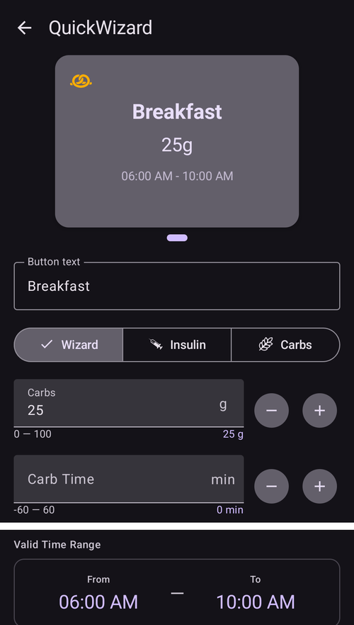
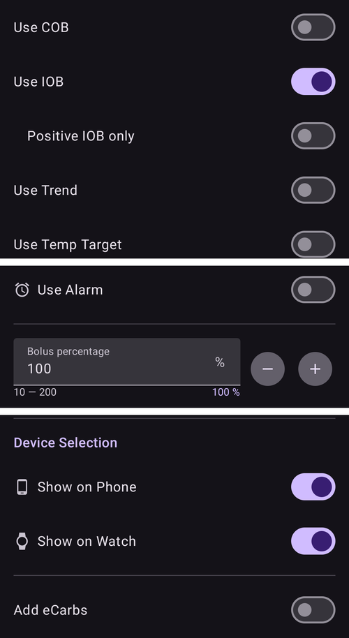
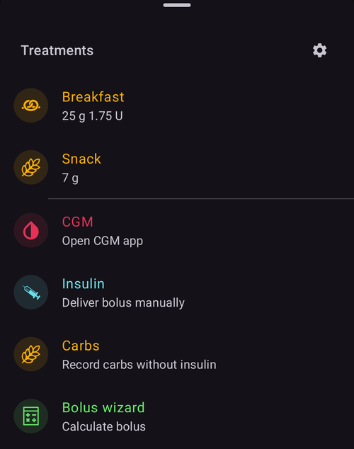
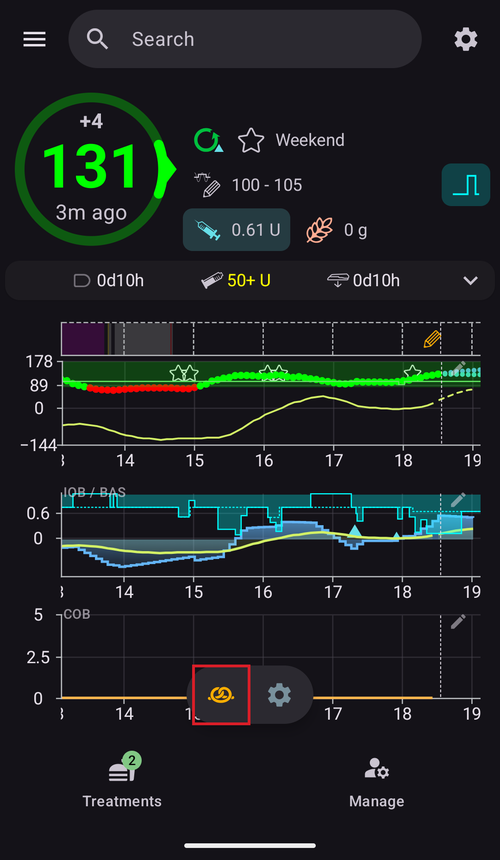
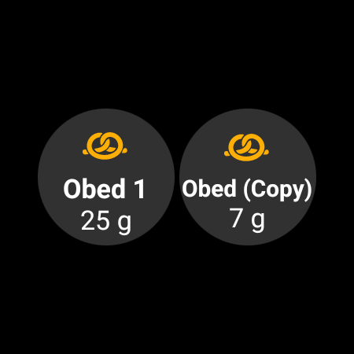

(quickwizards)=
# Assistents ràpids (bolus amb un toc)

Un **Assistent ràpid** és un botó desat que funciona amb un sol toc, per a un àpat o una situació que es repeteix. Porta una quantitat fixa de **carbohidrats** (i com calcular la dosi per a aquests carbohidrats). Així podeu lliurar un bolus, o només registrar carbohidrats, amb un sol toc i una confirmació, en lloc d'obrir cada vegada la calculadora de bolus completa.

```{contents} Table of contents
:depth: 2
:local: true
```

---

## Obrir els assistents ràpids

Obriu la pantalla **Gestionar** (navegació de baix) i trieu **Assistent ràpid** (*«Gestionar predefinits de l'assistent ràpid»*).

---

## Gestionar els assistents ràpids

Els vostres assistents ràpids es mostren com un **carrusel de targetes que podeu lliscar** (cada targeta mostra el text del botó, els carbohidrats i l'interval de temps vàlid). L'editor de sota configura l'assistent **seleccionat**; la barra d'accions de baix té els botons **➕ afegir**, **⧉ duplicar**, **🗑️ eliminar** i un botó **▶** per executar l'assistent ràpid seleccionat.



Els camps principals de l'editor són:

- **Text del botó**: el text que es mostra al botó.
- **Carbs** i **Hora dels carbohidrats**: la quantitat de carbohidrats i el seu desplaçament de temps.
- **Interval de temps vàlid**: vegeu [Validesa](#quickwizard_validity).
- **Opcions de la calculadora** i **Selecció de dispositiu**: vegeu més avall.

---

## Els tres modes

El selector de dalt de l'editor (**Calculadora / Insulina / Carbs**) decideix **què fa el botó** quan el premeu:

- **Calculadora**: executa la **calculadora de bolus** completa per als carbohidrats configurats, amb els valors actuals de **glucèmia, IOB, COB i tendència** (segons les *Opcions de la calculadora* de més avall). Lliura el bolus *calculat* i registra els carbohidrats. Aquest és l'assistent ràpid clàssic.
- **Insulina**: lliura una **quantitat fixa d'insulina** que heu definit, sense cap càlcul.
- **Carbs**: registra **només els carbohidrats** configurats, **sense bolus**.

---

## Opcions de la calculadora (mode Calculadora)

Per a un botó en mode **Calculadora**, trieu quines dades fa servir el càlcul:

- **Utilitzar glucèmia**, **Utilitzar COB**, **Utilitzar IOB** (amb *Només IOB positiu*), **Utilitzar tendència** (*Totes / Només positiva / Només negativa*), **Utilitzar objectiu temporal**, **Utilitzar alarma**.
- **Percentatge del bolus**: ajusta el bolus calculat en percentatge.
- **Afegir e-carbs**: també programa carbohidrats estesos.



---

## Validesa: quan apareix el botó

(quickwizard_validity)= L'**Interval de temps vàlid** (*Des de / Fins a*) controla **quan** es mostra i es pot fer servir un assistent ràpid. Un botó configurat, per exemple, de **06:00–10:00** només apareix al matí. Així un assistent ràpid d'*Esmorzar* no omple la pantalla (ni es prem per error) a l'hora de sopar. Fora del seu interval, el botó s'amaga del full **Tractaments** i de la barra [Accés ràpid](QuickLaunch.md). Un botó de la barra no s'elimina: torna a aparèixer quan l'interval torna a començar.

Quan l'interval de temps vàlid és de menys de 4 hores, el botó també s'amaga durant 30 minuts després de fer-lo servir, perquè no s'introdueixi el mateix àpat dues vegades per error.

---

## Punts d'ús: on el feu servir

Els interruptors de **Selecció de dispositiu** decideixen on apareix cada assistent ràpid:

- **Mostrar al telèfon**: apareix al **full [Tractaments](../Maintenance/V4Changes.md)** (amb la dosi calculada mostrada al mateix botó). Un assistent ràpid que es mostra al telèfon també es pot **fixar com a botó d'acció ràpida al Resum**: obriu *Configurar l'accés ràpid* (el ⚙ de la barra [Accés ràpid](QuickLaunch.md)) i afegiu-lo des de la categoria **Assistent ràpid**.
- **Mostrar al rellotge**: apareix al **mosaic d'assistents ràpids de Wear OS** (llisqueu fins a aquest mosaic al carrusel de mosaics del rellotge i premeu un botó per executar-lo, igual que amb el [mosaic d'escenes](#scenes-from-watch)).

```{admonition} Don't see Device Selection?
:class: note
La secció **Selecció de dispositiu** només apareix a l'editor quan el plugin **Wear** està activat i la seva opció **Control des de Wear** està activada. Sense això, tots els assistents ràpids simplement es mostren al telèfon.
```

Al telèfon, els assistents ràpids apareixen a la part de dalt del full inferior **Tractaments**:



…i com a botó d'acció ràpida al Resum:





Un **client** emparellat (**AAPSClient**) també pot activar un assistent ràpid; el telèfon **principal** el calcula i el lliura (vegeu [Control principal ↔ client (control remot signat)](../RemoteFeatures/ClientMasterControl.md)).

Des d'on sigui que s'activi, en prémer un assistent ràpid sempre es mostra una **confirmació** (la confirmació creada pel telèfon principal, quan s'activa des d'un client o des del rellotge) abans de lliurar res.

Un assistent ràpid es rebutja quan la seva dosi supera el vostre bolus màxim, o quan els seus carbohidrats o e-carbs superen el vostre màxim de carbohidrats (per exemple, després d'haver baixat el límit). Quan els carbohidrats superen el límit, el botó del full **Tractaments** està desactivat. Editeu l'assistent ràpid o el límit.

---

## Afegir i eliminar

- **➕ Afegir**: crea un assistent ràpid nou.
- **⧉ Duplicar**: en fa una còpia per començar des d'aquí.
- **🗑️ Eliminar**: n'elimina un.

Amb dos o més assistents ràpids també podeu canviar-ne l'ordre al carrusel: premeu la icona **Reordenar** (⇅) a la barra de dalt, moveu la targeta del centre amb els **botons de moure ◀ / ▶** i després confirmeu amb **✓**. (Els controls són els mateixos que per [reordenar perfils](ProfileSwitch-ProfilePercentage.md).)

Els assistents ràpids formen part de la configuració sincronitzada, així que es comparteixen entre el telèfon principal i els clients emparellats.

---


<!-- =====================================================================
     Screenshots captured from a real master device:
       - quickwizard_editor.png   (Manage → QuickWizard: carousel, mode, carbs, carb time, valid time range)
       - quickwizard_options.png  (Calculator Options, Bolus percentage, Device Selection)
       - quickwizard_overview.png (the QuickWizard quick-action button on the overview)
       - quickwizard_watch_tile.png (the Wear OS QuickWizard tile)
     No QuickWizard was actually run (no bolus delivered).
     Maintainers: relocate page + images and fix cross-links as needed.
     ===================================================================== -->
