(scenes)=
# Escenes (configuracions per a cada situació)

Una **escena** és una configuració amb nom que aplica un **conjunt d'accions alhora**: per exemple una configuració *Dormir*, *Esport* o *Dia de malaltia* que canvia el perfil, posa un objectiu temporal, activa o desactiva SMB i afegeix una nota al portal de cures amb un sol toc, si voleu durant un temps fix.

```{contents} Table of contents
:depth: 2
:local: true
```

---

## Què és una escena

En lloc de canviar diverses coses a mà cada vegada que torna una situació habitual, les configureu una vegada com a escena i l'activeu amb un toc. Una escena pot agrupar qualsevol d'aquestes accions:

- **Canvi de perfil**: canvia el perfil i/o l'ajusta amb un percentatge (p. ex. 70%).
- **Objectiu temporal**: posa un objectiu temporal (p. ex. *Activitat*, *Menjar aviat* o un valor propi).
- **SMB activat/desactivat**: activa o desactiva els SMB (super micro bolus) mentre l'escena està activa.
- **Mode de funcionament**: canvia el mode de funcionament (p. ex. a un mode més prudent).
- **Nota del portal de cures**: registra un esdeveniment (p. ex. *Esport*, *Malaltia*) perquè es vegi al gràfic i a Nightscout.

Una escena també té una **durada** (un temps fix en minuts/hores/dies, o *Indefinida (finalització manual)*) i una **acció final** que s'executa quan s'acaba: o bé un **avís**, o bé pot **encadenar** una altra escena (per exemple *Dia de malaltia → Esport*).

---

## Gestionar les escenes

Obriu **Gestionar → Escenes** per veure, crear, editar, activar/desactivar i reordenar les vostres escenes.

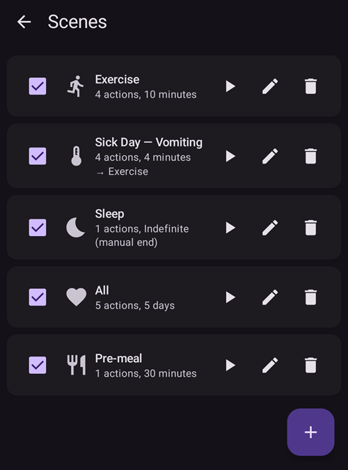

Cada targeta d'escena mostra:

- una **casella** per activar/desactivar l'escena,
- una **icona** i un **nom**,
- un resum, *«N accions, durada»*, i l'**→ escena encadenada** si encadena una altra escena,
- i tres botons: **▶ activar**, **✏️ editar**, **🗑️ eliminar**.

Toqueu el botó **+** per crear una escena nova.

---

## Crear o editar una escena

### Partir d'una plantilla

Per **crear** una escena, toqueu el botó **+** a la pantalla Escenes. El primer pas és **Partir d'una plantilla**: trieu una escena preparada per a una situació habitual (*Esport*, *Dia de malaltia*, *Dia de malaltia — Vòmits*, *Dormir*, *Nit després de l'esport*, *Abans de menjar*, *Alcohol*, *Conduir*, *Bany*, *Fase lútia*, *Temps calorós*, *Procediment mèdic*) o comenceu amb una escena *En blanc*. Cada plantilla **omple per endavant les accions recomanades**, i ho podeu ajustar tot als passos següents.

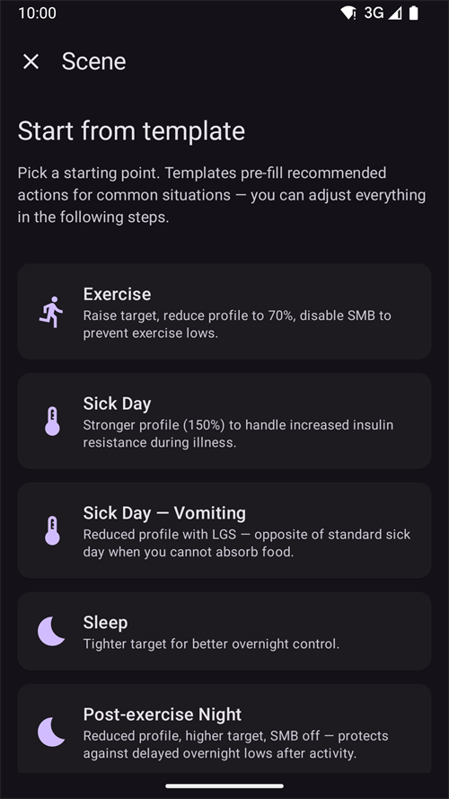

Quan trieu una plantilla, abans de continuar s'explica per a què serveix: *quan* i *per què* fer-la servir.

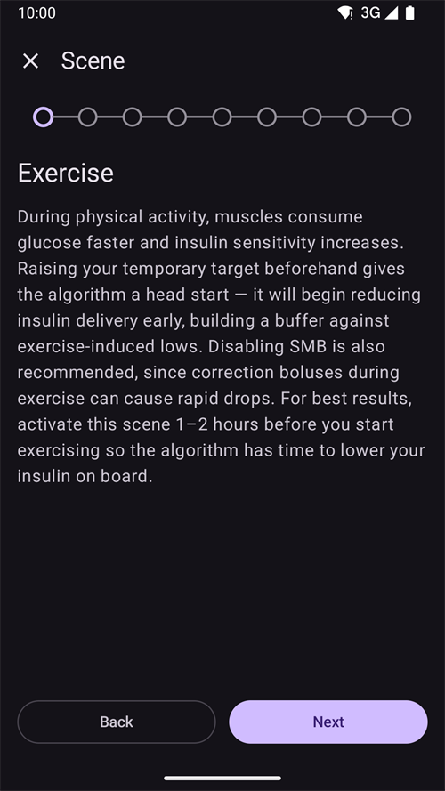

### Passar per les accions

La resta de l'editor és un assistent curt **pas a pas**. Cada pas és un tipus d'acció amb un interruptor *«Incloure … a l'escena»*: activeu-lo només per a les accions que voleu que faci aquesta escena, i deixeu les altres desactivades.

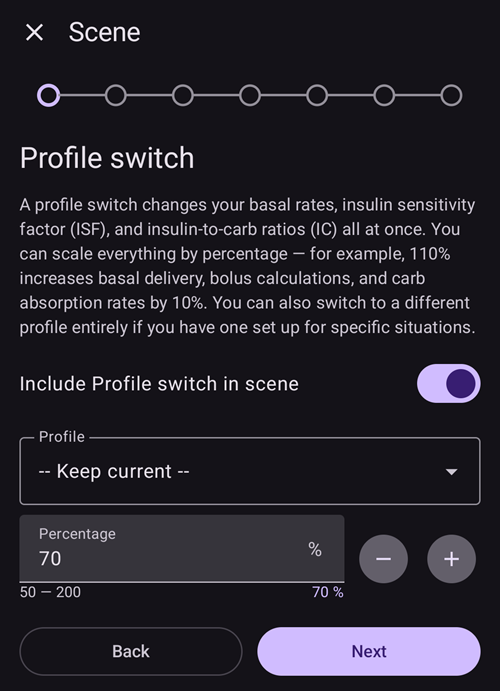

Passeu pels passos amb **Següent**/**Enrere**: *Canvi de perfil*, *Objectiu temporal*, *SMB*, *Mode de funcionament*, *Nota del portal de cures*, després la **durada**, l'**acció final** (avisar o encadenar una altra escena) i, finalment, el **nom i la icona** de l'escena. Deseu quan hàgiu acabat. (Per **editar** una escena que ja existeix, toqueu el seu botó **✏️**: anireu directament a aquests passos.)

Cada pas comença amb una explicació curta del que fa l'acció. Els passos són així, aquí amb la plantilla *Esport*:

**Objectiu temporal**: trieu un dels vostres objectius temporals predefinits:

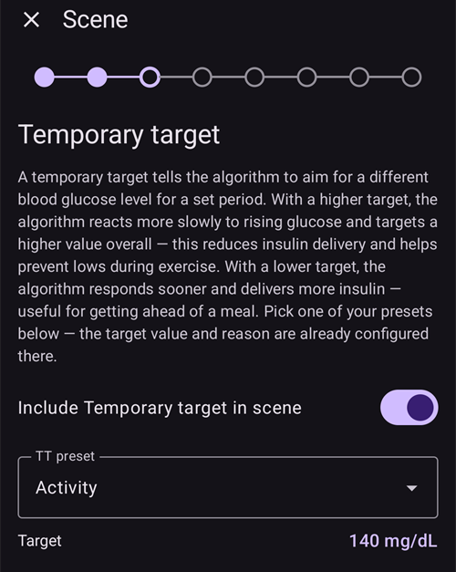

**SMB**: activeu o desactiveu SMB mentre l'escena està activa:

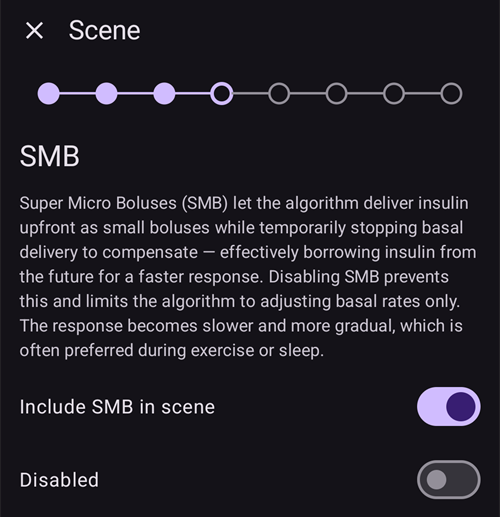

**Mode de funcionament**: si voleu, canvieu el mode del llaç:

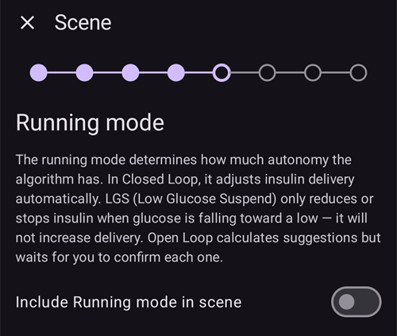

**Portal de cures**: el tipus d'esdeveniment i la nota que es registren:

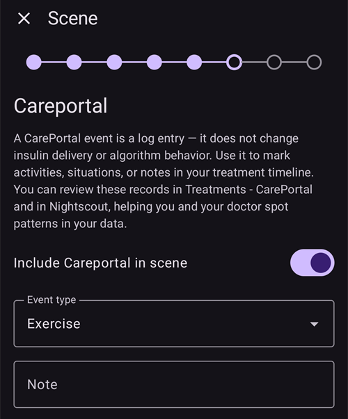

**Durada**: quant de temps queda activa l'escena; 0 vol dir fins que la finalitzeu vosaltres:

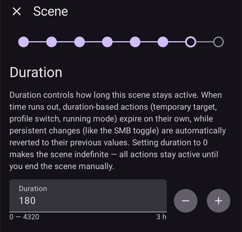

**Escena següent**: si voleu, l'escena que comença quan aquesta s'acaba:

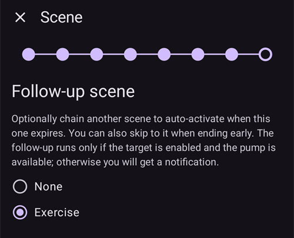

**Escena**: el nom i la icona. Premeu **Finalitzar** per desar:

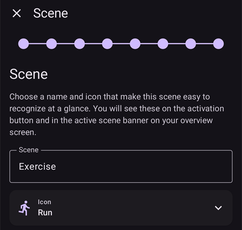

---

## Activar una escena

Activeu una escena des de la llista **Escenes** (el botó **▶**) o des de l'entrada **Escenes** de la navegació inferior. Al full **Escenes** de la navegació inferior, cada escena mostra el mateix resum que a la llista d'escenes, i el **llapis** a dalt del full obre **Gestionar → Escenes** per crear o editar les vostres escenes.

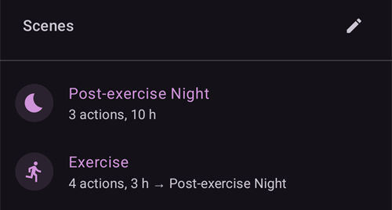

Si la [protecció del bolus](#Preferences-protection) està activada, **AAPS** la demana abans que una escena comenci o s'acabi. Per canviar una escena cal la [protecció de la configuració](#Preferences-settings-protection).

Abans d'aplicar res, rebeu una **confirmació** amb la llista exacta del que farà l'escena, perquè ho pugueu revisar:

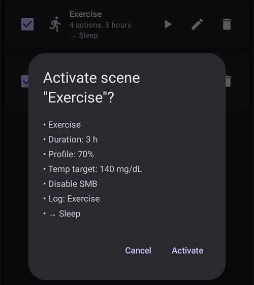

Si l'escena encadena una altra escena, la confirmació acaba amb **→** i el nom de l'escena següent, igual que es mostra a la llista d'escenes.

Quan inicieu l'escena des de l'entrada **Escenes** de la navegació inferior, la confirmació és un diàleg més senzill amb la mateixa llista d'accions. Premeu **OK** per activar-la:

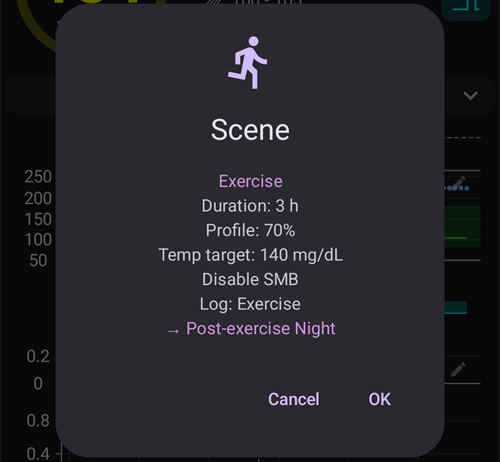

Quan confirmeu, s'apliquen les accions i l'**escena activa** es mostra a dalt del resum amb un botó **Finalitzar escena**. Si l'escena encadena una altra escena, la franja també mostra el nom de l'escena següent:

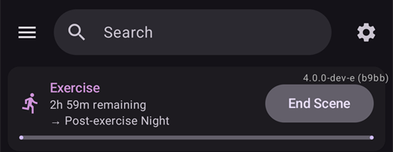

Les accions de l'escena continuen actives fins que:

- s'acaba la seva **durada** (s'executa l'**acció final**: un avís, o encadena l'escena següent), o
- toqueu **Finalitzar escena** per acabar-la a mà. Si l'escena encadena una altra escena, teniu dues opcions: **Passar a** l'escena següent (l'escena activa s'acaba i la següent comença ara), o **Finalitzar escena** (l'escena activa s'acaba i la següent no comença).

Una escena sense escena següent només us demana que confirmeu:

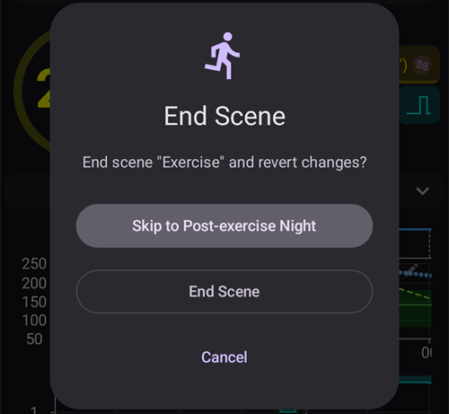

Finalitzar una escena **desfà** els canvis que ha fet (per exemple el canvi de perfil i l'objectiu temporal que ha iniciat).

Mentre una escena està activa, el perfil i l'objectiu de la pantalla principal porten una petita icona d'escena quan els ha posat l'escena. El full **Escenes** de la navegació inferior continua disponible per iniciar una altra escena:

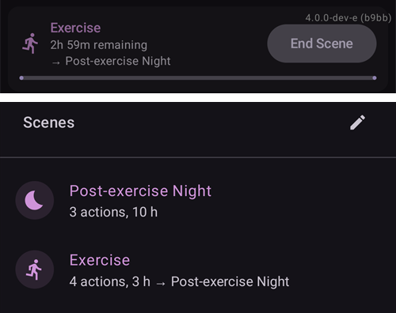

Quan la durada s'acaba sola, els canvis es desfan de seguida i la franja canvia a **Escena finalitzada** amb un botó **Ignorar**. Ignorar només treu la franja de la pantalla: l'escena ja s'ha acabat, per això les regles d'automatització i una escena encadenada continuen sense esperar.

---

## Activar escenes des de l'Automatització

No cal iniciar una escena a mà: l'**Automatització** la pot executar per vosaltres. Quan afegiu una acció a una regla d'automatització (**Gestionar → Automatització**), el selector d'accions té una categoria **Escenes**:

- **Executar escena**: activa una escena quan s'activen els activadors de la regla (per exemple a una hora fixada, quan arribeu a un lloc o quan la glucèmia passa un llindar).
- **Activar escena** / **Desactivar escena**: fa que una escena estigui disponible (o no disponible) sense activar-la.

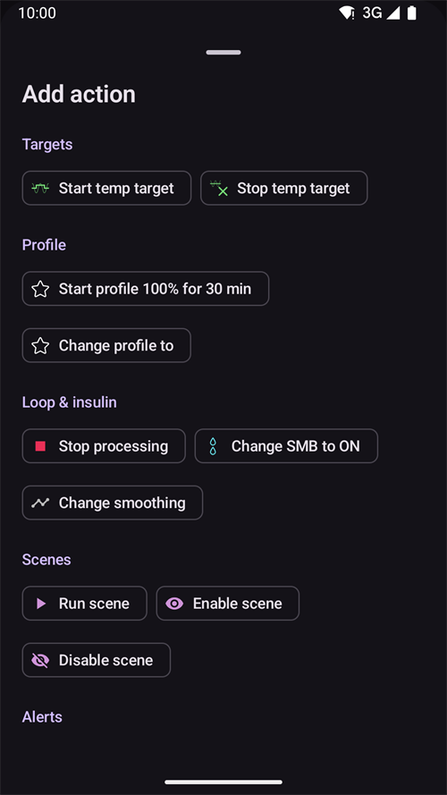

L'Automatització també pot **reaccionar a** una escena: la llista d'activadors inclou un activador **Escena**, perquè una regla només s'executi mentre una escena concreta està activa. Junt amb l'**acció final** d'una escena (desfer, avisar o encadenar una altra escena), això permet que les escenes comencin, continuïn i s'acabin automàticament.

---

## Escenes amb principal/client i un rellotge

L'**escena activa es sincronitza** entre tots els vostres dispositius emparellats: activeu-la en un telèfon i els altres també la mostren.

Un **client** emparellat (**AAPSClient**) també pot activar o finalitzar una escena: la petició s'envia al **dispositiu principal**, que crea la confirmació i aplica l'escena al seu propi estat. Vegeu [Control principal ↔ client (control remot signat)](../RemoteFeatures/ClientMasterControl.md) per saber com funciona.

(scenes-from-watch)=
### Des d'un rellotge Wear OS

Les escenes estan disponibles en un **rellotge Wear OS** com a **mosaic Escena**. Llisqueu fins al mosaic **Escena** al carrusel de mosaics del rellotge (si encara no hi és, primer afegiu-lo des de la llista de mosaics del carrusel) i toqueu l'escena que voleu iniciar:

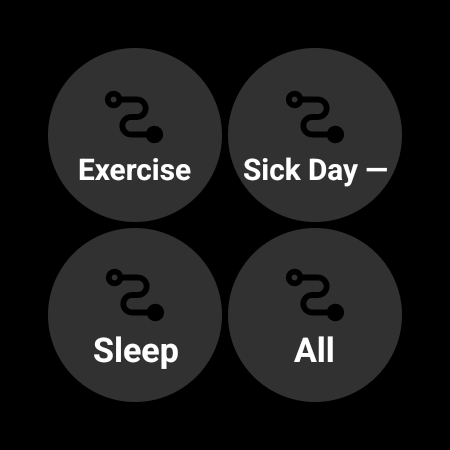

El mosaic té quatre posicions. Per defecte, cada posició s'omple **automàticament** amb la següent de les vostres escenes activades, en l'ordre que tenen al telèfon. Per triar-les vosaltres, **manteniu premut el mosaic** i obriu-ne la configuració: per a cadascuna de les quatre posicions podeu deixar **Automàtic**, fixar una **escena concreta** o seleccionar **Cap** per deixar la posició buida. Una posició fixada a una escena que després s'ha eliminat o desactivat mostra **No disponible**: trieu-hi una altra escena.

Després el rellotge mostra una confirmació: toqueu **✓** per activar-la, o llisqueu enrere per cancel·lar:

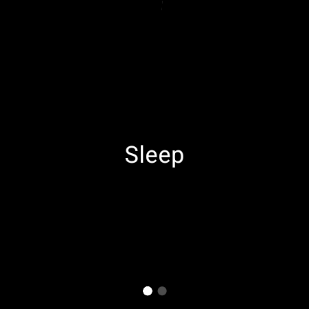

Igual que en un client, el **dispositiu principal crea la confirmació i executa l'escena**; el rellotge només transmet la petició (a través del telèfon client, si el rellotge està emparellat amb un client).

Mentre una escena està en marxa (o la seva franja **Escena finalitzada** encara es veu al telèfon), el mosaic mostra un botó **Finalitzar** amb el nom de l'escena a sota. Toqueu-lo per finalitzar l'escena activa, o per treure la franja que queda, des del canell.

Si l'escena en marxa encadena una altra escena, el mosaic també mostra un botó **Ometre** amb el nom de l'escena següent a sota. Són les mateixes dues opcions que al telèfon:

- **Finalitzar**: l'escena activa s'acaba. La confirmació us diu que l'escena següent no començarà.
- **Ometre**: l'escena activa s'acaba i l'escena següent comença ara. La confirmació mostra el nom de les dues escenes.

La [pantalla Estat del llaç](#WearOsSmartwatch-loop-status) del rellotge també mostra l'escena activa, el temps que li queda i l'escena següent.

---


<!-- =====================================================================
     Screenshots captured from a real master device:
       - scenes_list.png        (Manage → Scenes management list)
       - templates_picker.png   (create: "Start from template" picker)
       - template_explanation.png (create: chosen template's explanation)
       - scene_editor.png       (scene editor, Profile switch step)
       - scene_confirmation.png (scene activation confirmation — also used on the Client/Master page)
       - scene_active_banner.png (overview active-scene banner with the End Scene button)
       - automation_scene_action.png (Automation action picker — Scenes category)
       - scene_watch_tile.png    (Wear OS Scene tile)
       - scene_watch_confirm.png (Wear OS scene confirmation)
     Maintainers: relocate page + images and fix cross-links as needed.
     ===================================================================== -->
