# Objectius temporals

## Què són els objectius temporals i on els puc establir i configurar?

Un **objectiu temporal** (o, abreujat, **OT**) és una funció d'**AAPS** que permet a l'usuari canviar el seu [rang objectiu de **glucèmia**](#profile-glucose-targets) per a activitats planificades. **AAPS** ho aconsegueix ajustant la insulina que rep l'usuari.

Un objectiu de glucèmia, sobretot si és de curta durada (menys de 4 hores), no ha de ser el *valor real* que espereu o voleu que tingui la vostra glucèmia. És més aviat una bona manera de dir a **AAPS** que sigui més o menys agressiu, mantenint igualment la glucèmia dins del rang.

Els objectius temporals es poden definir dins d'aquests límits:

|       | Objectiu temporal     |
| ----- | --------------------- |
| Mínim | 4 mmol/l o 72 mg/dl   |
| Màxim | 10 mmol/l o 180 mg/dl |

**AAPS** té tres **objectius temporals** predefinits de sèrie: per a l'exercici (**Activitat (esport)**), els àpats (**Menjar aviat**) i una hipoglucèmia prevista (**Hipo**). Són a la pantalla **Objectiu temporal** (**Gestionar** → **Objectiu temporal**), que també podeu obrir simplement tocant el **xip de l'objectiu** a la pantalla principal.

Els usuaris han de tenir expectatives realistes sobre els resultats que es poden aconseguir quan seleccionen un **objectiu temporal** a **AAPS**. L'èxit per arribar a l'objectiu de **glucèmia** desitjat depèn de molts factors, com ara: la fiabilitat de la configuració d'**AAPS** de l'usuari, el control general de la **glucèmia**, la **IOB**, la sensibilitat a la insulina, la resistència a la insulina, la intensitat de l'esforç durant l'exercici, etc.

Un **objectiu temporal** pot necessitar uns 30 minuts o més per arribar a l'objectiu de **glucèmia** desitjat. **AAPS** no pot arribar a un objectiu de **glucèmia** amb efecte immediat, i els usuaris ho han de tenir en compte quan seleccionen un **objectiu temporal**.

Les seccions següents resumeixen les funcions de l'**objectiu temporal Activitat (esport)**, l'**objectiu temporal Menjar aviat** i l'**objectiu temporal Hipo**. Els valors que es mostren són els valors per defecte; podeu [ajustar cada predefinit](#TempTargets-change-preset-defaults) a les vostres necessitats.

### OT - Activitat (esport)

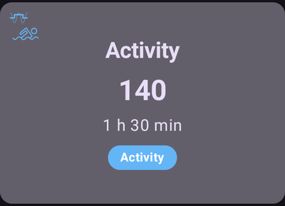

**Objectiu de glucèmia (predefinit per defecte, ajustable)**

AAPS intentarà arribar a 140 mg/dl o 7,8 mmol/l durant 1 h 30 min

**Altres aspectes que els usuaris poden tenir en compte quan el seleccionen**:

Segons la **glucèmia**, **AAPS** «reduirà» la insulina per arribar a l'objectiu de **glucèmia**. Si l'objectiu de **glucèmia** no és dins del rang (és a dir, és per sobre de l'objectiu de **glucèmia** seleccionat al **perfil** de l'usuari), **AAPS** pot mantenir la basal.

En mode de llaç tancat, els **SMB**:

- *es poden* desactivar (vegeu més avall); i/o
- la basal es pot activar si **AAPS** té **IOB** negativa, o <0.

Els usuaris també poden considerar:

- *seleccionar* aquest **OT** 1–2 hores abans de l'exercici planificat, per assegurar una IOB més baixa (el moment adequat per a aquest OT varia d'una persona a una altra); i
- *seleccionar* un perfil temporal (reduït) durant l'activitat planificada, per assegurar una **IOB** més baixa;
- *assegurar* que l'**OT** es *desactivi* poc abans de l'exercici, perquè la **IOB** ja està reduïda i alguns usuaris tenen una pujada ràpida de la **glucèmia** després de l'exercici.

### OT - Menjar aviat

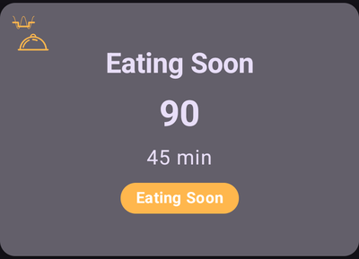

**Objectiu de glucèmia (predefinit per defecte, ajustable)**

AAPS intentarà arribar a 90 mg/dl o 5,0 mmol/l durant 45 minuts

**Altres aspectes que els usuaris poden tenir en compte quan el seleccionen**:

En mode de llaç tancat, els **SMB**:

- continuaran activats; i/o
- la basal també es pot activar segons la configuració del **perfil** de l'usuari.

Segons la **glucèmia**, **AAPS** «augmentarà» la insulina, dins dels paràmetres de configuració d'**AAPS** de l'usuari, per arribar a l'objectiu de **glucèmia** desitjat.

### OT - Hipo

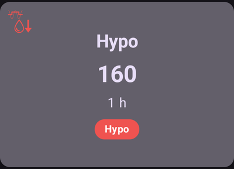

**Objectiu de glucèmia (predefinit per defecte, ajustable)**

AAPS intentarà arribar a 160 mg/dl o 8,9 mmol/l durant 1 hora

**Altres aspectes que els usuaris poden tenir en compte quan el seleccionen**:

En mode de llaç tancat, els **SMB**:

- *es poden* desactivar (vegeu més avall); i/o
- la basal es pot activar si **AAPS** té **IOB** negativa, o <0.

(TempTargets-manage-v4)=

## Establir i gestionar objectius temporals (Gestionar → Objectiu temporal)

A **AAPS** v4, gestioneu els vostres OT **predefinits** i inicieu un objectiu temporal des de la pantalla **Gestionar** (navegació inferior) → **Objectiu temporal** (*«Gestionar i establir objectius temporals»*).

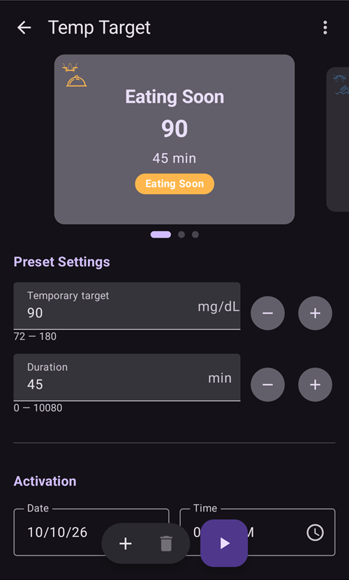

La pantalla té tres parts:

1. **Carrusel de predefinits** (a dalt): feu lliscar per veure els vostres OT predefinits. Cada targeta mostra el **nom**, l'**objectiu** i la **durada** del predefinit; l'OT que està en marxa queda destacat.
2. **Editor** (al mig): l'**Objectiu temporal** i la **Durada** que s'aplicaran realment, i també una data/hora d'**Activació**.
3. **Barra d'accions** (a baix): els botons **➕ afegir**, **‘️ eliminar** i **▶ activar**.

Quan seleccioneu una targeta de predefinit, el seu **objectiu** i la seva **durada** es carreguen a l'editor.

```{admonition} Predefinits de sèrie i personalitzats :class: note Els predefinits de sèrie (**Menjar aviat**, **Activitat (esport)** i **Hipo**) sempre existeixen i **no es poden eliminar** (però en podeu canviar els valors i desar-los). Els predefinits que creeu vosaltres són **personalitzats** i els podeu editar o eliminar lliurement.

    <br />### Activar un objectiu temporal
    
    Feu lliscar fins al predefinit que vulgueu (els seus valors es carreguen a l'editor), si voleu ajusteu l'**objectiu**/la **durada** a l'editor, i després toqueu **▶ Activar**. Una confirmació mostra l'objectiu, la durada i el motiu exactes abans que comenci res:
    
    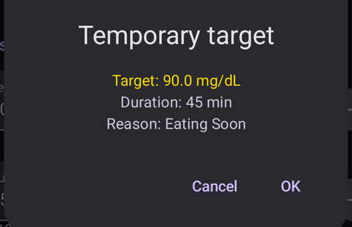
    
    Quan confirmeu, l'objectiu temporal comença immediatament (o a l'hora d'**Activació** triada) i dura la **durada** establerta.
    
    ```{admonition} Canviar els números és només per a una vegada: no canvia el predefinit
    :class: important
    L'**objectiu** i la **durada** de l'editor són els valors que **Activar** farà servir *ara mateix*. Si els canvieu, el canvi és **temporal**: només s'aplica a aquesta activació i **no modifica el predefinit desat**. Així podeu «ajustar i activar» un OT puntual (per exemple, activar *Activitat (esport)* avui amb un objectiu una mica diferent) sense canviar el predefinit per sempre.
    

### Desar canvis en un predefinit

Si *sí* que voleu conservar un valor editat, **deseu-lo**: quan l'editor és diferent del predefinit seleccionat, apareix una icona **Desar** a la barra d'eines superior. En tocar-la, l'**objectiu** i la **durada** actuals (i el nom, en els predefinits personalitzats) es desen al predefinit seleccionat. En els predefinits de sèrie, a la barra d'accions també apareix un botó **Restaurar valors per defecte** (↺): torna els valors per defecte del predefinit.

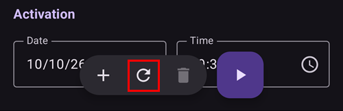

Per tant, la regla general és:

- **Activar** → fer servir els números **una vegada** (el predefinit no canvia).
- **Desar** → fer que els números siguin els **nous valors per defecte** del predefinit.

Per tornar un predefinit de sèrie als valors originals, seleccioneu-lo i toqueu el botó **↺ Restaurar**. Només apareix a la barra d'accions per a un predefinit **de sèrie** amb valors diferents dels valors de fàbrica, i torna l'**objectiu** i la **durada** originals d'aquest predefinit.

### Afegir i eliminar predefinits

- **➕ Afegir**: crea un **predefinit personalitzat nou** amb els valors actuals de l'editor. La targeta nova apareix al carrusel.
- **‘️ Eliminar**: elimina el predefinit **personalitzat** seleccionat. Els predefinits de sèrie (*Menjar aviat*, *Activitat (esport)*, *Hipo*) no es poden eliminar.

Quan tingueu almenys dos predefinits **personalitzats**, també en podeu canviar l'ordre al carrusel: toqueu la icona **Reordenar** (⇅) a la barra superior, moveu la targeta del centre amb els **botons ◀ / ▶** i confirmeu amb **✓**. Els predefinits de sèrie no canvien de lloc: només es poden moure els predefinits personalitzats. (Els controls són els mateixos que per [reordenar perfils](ProfileSwitch-ProfilePercentage.md).)

Els vostres predefinits formen part de la configuració sincronitzada, de manera que es comparteixen entre el telèfon principal i els clients emparellats.

### Altres maneres d'establir un objectiu temporal

També es pot establir un objectiu temporal sense obrir aquesta pantalla:

- amb els **interruptors d'OT del diàleg Carbs** (vegeu [més avall](#TempTargets-carbs-dialog)),
- amb un **botó de predefinit a la [barra d'accés ràpid](QuickLaunch.md)**: la categoria *Objectius temporals predefinits* de *Configurar l'accés ràpid* ofereix un botó d'un sol toc per a cada predefinit,
- des d'un **rellotge Wear OS** (l'element de menú / mosaic **Objectiu temporal**),
- des d'un **client** emparellat (vegeu [Control principal ↔ client (control remot signat)](../RemoteFeatures/ClientMasterControl.md)),
- com a part d'una **[escena](Scenes.md)** (l'acció *Objectiu temporal*), o
- des d'una regla d'**Automatització** (*Iniciar objectiu temporal* / *Aturar objectiu temporal*).

* * *

(TempTargets-where-can-i-select-a-temp-target)=

## On puc seleccionar un objectiu temporal?

La manera més ràpida és tocar el **xip de l'objectiu** a la pantalla principal (mostra el vostre rang objectiu actual):

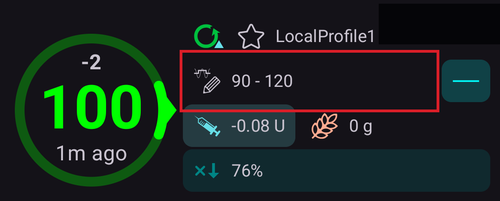

Això obre la pantalla **Objectiu temporal** descrita més amunt: feu lliscar fins a un predefinit i toqueu **▶ Activar**. També podeu arribar a la mateixa pantalla des de **Gestionar** → **Objectiu temporal**.

(TempTargets-carbs-dialog)= Quan introduïu carbohidrats, no cal que obriu la pantalla **Objectiu temporal**: el **diàleg Carbs** (**Tractaments** → **Carbs**) té a dalt els interruptors **Iniciar OT: Hipo**, **Iniciar OT: Menjar aviat** i **Iniciar OT: Esport**. Activeu-ne un i el predefinit corresponent s'activa juntament amb l'entrada de carbohidrats:

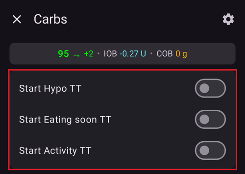

    {admonition} OT Hipo automàtic
    :class: note
    Si obriu el **diàleg Carbs** quan la vostra glucèmia és inferior a 72 mg/dl (4 mmol/l), **AAPS** us preselecciona l'interruptor **Iniciar OT: Hipo** (tret que ja hi hagi en marxa un objectiu temporal més alt amb més temps restant).

(TempTargets-change-preset-defaults)=

## On puc canviar l'objectiu temporal per defecte i substituir-lo per les meves preferències?

L'**objectiu** i la **durada** de cada predefinit s'editen directament a la pantalla **Objectiu temporal**; ja no hi ha cap entrada separada a la configuració per a això:

1. Obriu la pantalla **Objectiu temporal** (toqueu el xip de l'objectiu, o **Gestionar** → **Objectiu temporal**).
2. Feu lliscar fins al predefinit que voleu canviar.
3. Ajusteu l'**Objectiu temporal** i/o la **Durada** a l'editor.
4. Toqueu la icona **Desar** que apareix a la barra d'eines superior.

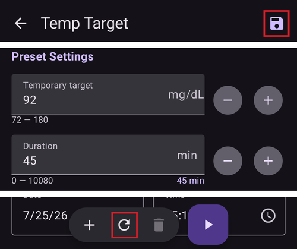

Mentre l'editor sigui diferent dels valors de fàbrica d'un predefinit de sèrie, a la barra d'accions també apareix un botó **↺ Restaurar**: toqueu-lo per tornar l'objectiu i la durada originals del predefinit.

## Com cancel·lo un objectiu temporal?

Mentre hi ha un objectiu temporal en marxa, el xip de l'objectiu de la pantalla principal mostra l'objectiu i el temps que queda. Toqueu-lo: a la pantalla **Objectiu temporal**, el predefinit en marxa queda destacat com a **ACTIU**, i apareix un botó vermell **✗ Cancel·lar** al final de la barra d'eines inferior, just a l'esquerra del botó **▶ Activar**. Toqueu-lo i confirmeu:

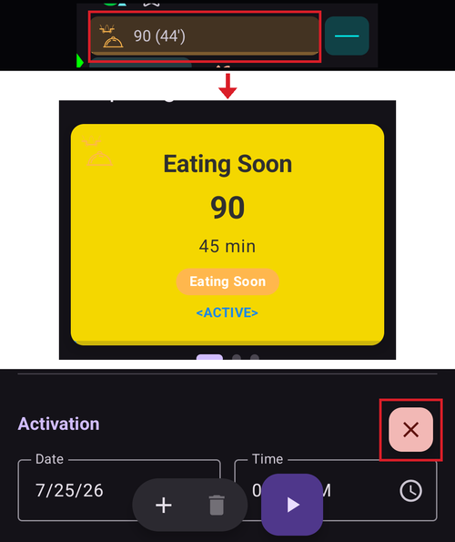

Un objectiu temporal en marxa també es pot aturar des d'un **rellotge Wear OS**, des d'un **client** emparellat o amb una regla d'**Automatització** (*Aturar objectiu temporal*).

(TempTargets-hypo-temp-target)=

## Objectiu temporal Hipo

L'**objectiu temporal Hipo** permet que **AAPS** eviti que l'usuari tingui una glucèmia baixa, reduint la insulina que rep. Si l'usuari preveu que la seva **glucèmia** baixarà: normalment **AAPS** ho hauria de gestionar, però depèn molt de l'estabilitat de la configuració d'**AAPS** de l'usuari. Un **objectiu temporal Hipo** permet a l'usuari anticipar-se a la baixada prevista i fer que **AAPS** redueixi la insulina.

De vegades, quan es mengen carbohidrats per tractar una hipo, la **glucèmia** de l'usuari pot pujar ràpidament, i **AAPS** corregirà aquesta pujada ràpida de la **glucèmia** activant els **SMB**.

Alguns usuaris volen evitar que es donin **SMB** durant l'**objectiu temporal Hipo**. Per fer-ho, desactiveu *'Activar SMB amb objectiu temporal alt'* a **Configuració** → **OpenAPS SMB** (vegeu més avall):

- Avançat, objectiu 9: l'usuari pot activar *«Un objectiu temporal alt puja la sensibilitat»* per a **objectius temporals** de 100 mg/dl (5,6 mmol/l) o més a OpenAPS SMB; aleshores **AAPS** serà més sensible.

- Avançat, objectiu 9: l'usuari pot desactivar *«Activar SMB amb objectiu temporal alt»*, de manera que, encara que **AAPS** tingui COB > 0, «Activar SMB amb objectiu temporal baix» o «Activar SMB sempre» estigui activat i OpenAPS SMB estigui actiu, **AAPS** no donarà SMB mentre hi hagi objectius temporals alts actius.

Nota: si obriu el **diàleg Carbs** quan la vostra glucèmia és inferior a 72 mg/dl o 4 mmol/l, **AAPS** preselecciona automàticament l'interruptor **Iniciar OT: Hipo**.

(TempTargets-activity-temp-target)=

## Objectiu temporal Activitat (esport)

Abans i durant l'exercici, l'usuari pot necessitar un objectiu més alt per evitar una hipoglucèmia durant l'activitat.

Per simplificar l'**objectiu temporal Activitat (esport)**, l'usuari pot configurar un **objectiu temporal Activitat (esport)** per defecte que faci pujar la **glucèmia** reduint la insulina, per frenar la baixada de la **glucèmia** i evitar la hipoglucèmia.

Els usuaris nous d'**AAPS** potser hauran de fer proves i personalitzar els valors per defecte de l'**objectiu temporal Activitat (esport)** perquè aquesta funció els vagi el millor possible. Cada persona és diferent a l'hora d'aconseguir un control estable de la glucèmia durant l'exercici. Vegeu també la [secció d'esport de les preguntes freqüents](#FAQ-sports).

Alguns usuaris també prefereixen activar un **Canvi de perfil** (un perfil reduït < 100% perquè **AAPS** lliuri menys insulina) abans i durant l'**objectiu temporal Activitat (esport)**. Podeu iniciar tots dos en un sol pas: toqueu el nom del perfil a la pantalla principal, toqueu el botó rodó **▶**, establiu un **Percentatge** inferior al 100% i una **Durada**, i després activeu **Objectiu temporal / Activitat (esport)**. Vegeu [Canviar el percentatge del perfil](#ProfileSwitch-change-percentage).

Avançat, objectiu 9: els usuaris poden activar *'Un objectiu temporal alt puja la sensibilitat'* per a **objectius temporals** de 100 mg/dl (5,6 mmol/l) o més a OpenAPS **SMB**. Un objectiu de 99 mg/dl (5,5 mmol/l) és un objectiu normal, ni alt ni baix. Aleshores **AAPS** és més sensible.

A més, si *'Activar SMB amb objectiu temporal alt'* està desactivat, **AAPS** no lliurarà **SMB**, encara que hi hagi COB > 0, *'Activar SMB amb objectiu temporal baix'* o *'Activar SMB sempre'* estigui activat i OpenAPS **SMB** estigui actiu.

(TempTargets-eating-soon-temp-target)=

## Objectiu temporal Menjar aviat

L'**objectiu temporal Menjar aviat** pot ajudar a fer baixar suaument la **glucèmia** i a assegurar que hi hagi prou **IOB** abans de menjar.

Pot ser una eina important per als usuaris que no fan prebolus. Tot i així, l'eficàcia de l'**objectiu temporal Menjar aviat** depèn de diversos factors, com ara: la configuració de l'usuari, si segueix una dieta baixa en carbohidrats i si fa servir una insulina d'acció ràpida (com Fiasp o Lyumjev) per no haver de fer prebolus. Normalment, fins que no tinguin experiència amb **AAPS**, els usuaris han de comptar amb fer un prebolus quan facin servir l'**objectiu temporal Menjar aviat**, sobretot si segueixen una dieta rica en carbohidrats.

Podeu llegir més sobre el «mode Menjar aviat» a l'article ['How to do “eating soon” mode'](https://diyps.org/2015/03/26/how-to-do-eating-soon-mode-diyps-lessons-learned/) (en anglès) o [aquí](https://diyps.org/tag/eating-soon-mode/).

Avançat, [objectiu 9](#objectives-objective9): si feu servir OpenAPS SMB i teniu activat *'Un objectiu temporal baix baixa la sensibilitat'*, **AAPS** actua una mica més agressivament. Per a aquesta opció, cal que l'**objectiu temporal** sigui de 98 mg/dl (5,4 mmol/l) o menys.

## Com desactivo els SMB durant els objectius temporals?

Per fer-ho, obriu **Configuració** → **OpenAPS SMB** i desactiveu *'Activar SMB amb objectiu temporal alt'*.

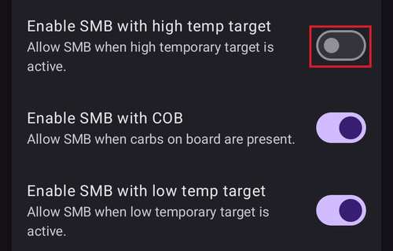

Així us assegureu que **AAPS** no donarà **SMB**, encara que hi hagi COB > 0, *'Activar SMB amb objectiu temporal baix'* o *'Activar SMB sempre'* estigui activat i OpenAPS SMB estigui actiu.