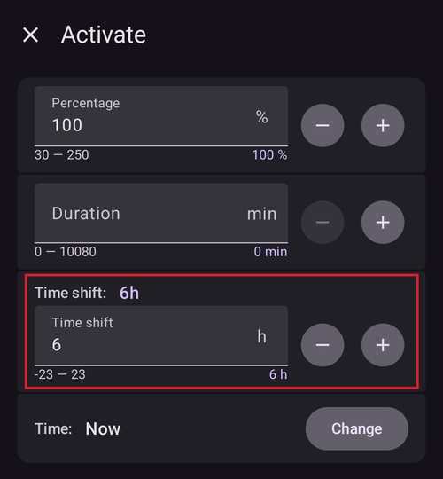

# Canvi de fus horari i horari d'estiu

Quan canvia el fus horari del telèfon, **AAPS** torna a calcular des de zero l'**IOB**, la basal i la sensibilitat del passat, uns 10 segons després del canvi. Mentre es fa aquest càlcul, els gràfics i els valors de la pantalla principal poden tardar una mica a actualitzar-se.

(timezone-traveling-with-pumps)=

## Canvi de fus horari amb Omnipod Dash

* Actualitzeu l'estat de la bomba a **Gestionar → Bomba**
* Seleccioneu temporalment un altre **perfil** i després torneu al vostre **perfil** original o al que vulgueu

## Canvi de fus horari amb DanaR i DanaR coreana

No hi ha cap problema si canvieu el fus horari al telèfon, perquè la bomba no fa servir l'historial

(timezone-traveling-danarv2-danars)=

## Canvi de fus horari amb DanaRv2, DanaRS i Dana-i

Aquestes bombes necessiten una atenció especial, perquè **AAPS** fa servir l'historial de la bomba, però els registres de la bomba no tenen el fus horari. **Això vol dir que, si canvieu el fus horari al telèfon, els registres es llegiran amb un altre fus horari i quedaran duplicats.**

Per evitar-ho hi ha dues possibilitats:

### Opció 1: mantenir l'hora de casa i desplaçar el perfil en el temps

* Desactiveu «Data i hora automàtiques» a la configuració del telèfon (canvi manual del fus horari).

* El telèfon ha de mantenir la vostra hora normal de casa durant tot el viatge.

* Desplaceu el vostre **perfil** en el temps segons la diferència horària entre l'hora de casa i l'hora del destí.
   
   * Toqueu el nom del **perfil** a la pantalla principal per obrir la [pantalla del perfil](#ProfileSwitch-manage-v4)
   * Seleccioneu el vostre **perfil** i toqueu **▶ Activar**
   * Poseu el «**Decalatge horari**» segons el vostre destí i toqueu **Activar**.
   
   
   
   * p. ex. Viena -> Nova York: **Canvi de perfil** +6 hores
   * p. ex. Viena -> Sydney: **Canvi de perfil** -8 hores

### Opció 2: esborrar l'historial de la bomba

* Desactiveu «Data i hora automàtiques» a la configuració del telèfon (canvi manual del fus horari)

Quan baixeu de l'avió:

* apagueu la bomba
* canvieu el fus horari al telèfon
* apagueu el telèfon i engegueu la bomba
* esborreu l'historial de la bomba
* canvieu l'hora a la bomba
* engegueu el telèfon
* deixeu que el telèfon es connecti a la bomba i ajusti l'hora amb precisió

(timezone-traveling-insight)=

## Canvi de fus horari amb Insight

El controlador ajusta automàticament l'hora de la bomba a l'hora del telèfon.

La Insight també registra a l'historial el moment en què es va canviar l'hora i de quina hora (antiga) a quina hora (nova). Així **AAPS** pot saber l'hora correcta tot i el canvi d'hora.

Pot causar imprecisions en les **TDD**. Però no hauria de ser un problema.

Per tant, l'usuari de la Insight no s'ha de preocupar pels canvis de fus horari ni pels canvis d'hora. Hi ha una excepció a aquesta regla: la bomba Insight té una petita bateria interna per mantenir l'hora, etc. mentre canvieu la pila «real». Si el canvi de pila tarda massa, aquesta bateria interna s'esgota, el rellotge es reinicia i, després de posar una pila nova, se us demana que introduïu l'hora i la data. En aquest cas, AAPS no té en compte en els càlculs cap entrada anterior al canvi de pila, perquè no pot saber bé l'hora correcta.

## Canvi de fus horari amb Accu-Chek Combo

El [controlador de la Combo](../CompatiblePumps/Accu-Chek-Combo-Pump-v2.md) ajusta automàticament l'hora de la bomba a l'hora del telèfon. La Combo no pot desar fusos horaris, només l'hora local, que és exactament el que el controlador programa a la bomba. A més, desa el fus horari a la configuració local d'AAPS per poder convertir l'hora local de la bomba en una marca de temps completa amb el desfasament del fus horari. L'usuari no ha de fer res; si l'hora de la Combo s'allunya massa de l'hora actual del telèfon, l'hora de la bomba s'ajusta automàticament.

Tingueu en compte que això tarda una mica, perquè només es pot fer en el mode de terminal remot, que en general és lent. És una limitació de la Combo que no es pot evitar.

## Canvi de fus horari amb Medtrum

El controlador ajusta automàticament l'hora de la bomba a l'hora del telèfon.

Els canvis de fus horari mantenen l'historial intacte; només la TDD es pot veure afectada. Canviar l'hora del telèfon manualment pot causar problemes amb l'historial i amb l'**IOB**. Si canvieu l'hora manualment, comproveu bé l'**IOB**.

Quan canvia el fus horari o l'hora, s'aturen les **TBR** en curs.

(time-adjustment-daylight-savings-time-dst)=

## HORARI D'ESTIU (DST)

Ajust de l'hora per a l'horari d'estiu.

Segons la vostra bomba i el vostre CGM, els salts d'hora poden fer que **AAPS** no funcioni bé. Amb algunes bombes és millor ajustar el fus horari quan esteu desperts, abans del canvi d'hora, i no durant la nit.

### Ajust automàtic de l'horari d'estiu per a la majoria de bombes

* Però el **llaç** es desactivarà durant 3 hores DESPRÉS del canvi d'hora (normalment a partir de la 1 de la matinada) i **AAPS** farà servir la basal de fons que heu triat al vostre **perfil**. Es fa per seguretat: l'**IOB** pot ser massa alt per culpa de bolus duplicats d'abans del canvi d'hora.
* Després del canvi d'hora, feu un **canvi de perfil** al **perfil** que vulgueu per activar el **llaç**: toqueu el nom del perfil a la pantalla principal i després el botó rodó **▶** (vegeu [Activar un perfil](#ProfileSwitch-manage-v4)).
* Abans del canvi d'hora també rebreu un avís a la pantalla principal d'**AAPS** que diu que el **llaç** s'ha desactivat temporalment. Aquest missatge apareixerà sense bip, vibració ni cap so semblant.

Si feu un bolus amb la calculadora d'**AAPS**, no feu servir les dades de **COB** i **IOB** si no esteu segurs que són del tot correctes. Aneu amb compte i no feu servir aquesta funció durant unes hores després del canvi d'hora.

### Horari d'estiu amb Accu-Chek Insight

* El canvi a l'horari d'estiu es fa automàticament. No cal fer res.

### Horari d'estiu amb Accu-Chek Combo

* El canvi a l'horari d'estiu es fa automàticament. No cal fer res.

### Horari d'estiu amb Medtrum

* El canvi a l'horari d'estiu es fa automàticament. No cal fer res.

### Horari d'estiu amb Omnipod Dash

* O bé deixeu que **AAPS** faci servir temporalment la basal de fons després del canvi d'hora, com s'explica més amunt.
* O bé, si no voleu que **AAPS** faci servir temporalment la basal de fons durant la nit, podeu canviar el fus horari el dia abans del canvi d'hora per evitar problemes durant la nit. ATENCIÓ: AQUESTA OPCIÓ POT FER QUE EL POD CADUQUI ABANS D'HORA. SI TRIEU LA FUNCIÓ DE SOTA, PORTEU MATERIAL DE RECANVI.

#### Accions abans del canvi d'hora

1. Desactiveu tota configuració del telèfon que ajusti automàticament el fus horari, perquè pugueu canviar a un fus horari que no faci servir l'horari d'estiu. Com activar-ho depèn del vostre telèfon i de la versió d'Android.
   
   * Alguns telèfons tenen dues opcions: una per a l'ajust automàtic de l'hora (que l'ideal és deixar activada) i una per a l'ajust automàtic del fus horari (que HEU de DESACTIVAR: **Set automatically** a **Time zone** a la captura de pantalla de sota).
   * Per desgràcia, algunes versions d'Android tenen un sol interruptor per activar l'ajust automàtic tant de l'hora com del fus horari. De moment l'haureu de desactivar.

2. Busqueu un fus horari que tingui la mateixa hora que el lloc on sou ara, però que no faci servir l'horari d'estiu.
   
   * Hi ha una llista d'aquests països a [https://greenwichmeantime.com/countries](https://greenwichmeantime.com/countries/)
   * Per a l'hora central europea (CET) podria ser «Brazzaville» (Congo). Canvieu el fus horari del telèfon al del Congo.

3. A **AAPS**, actualitzeu la bomba i canvieu al **perfil** que vulgueu.

4. Comproveu l'**IOB** i el **COB** d'**AAPS** i, si no són correctes, desactiveu el **llaç** com a mínim durant una DIA o durant el temps màxim d'absorció de carbohidrats (**Temps màxim d'absorció**), el que sigui més llarg.

5. Accions després del canvi d'hora. Un bon moment per tornar al fus horari local és quan l'**IOB** és baix. Per exemple, una hora abans d'un àpat com l'esmorzar. L'ideal és que el **COB** i l'**IOB** siguin tots dos propers a zero.