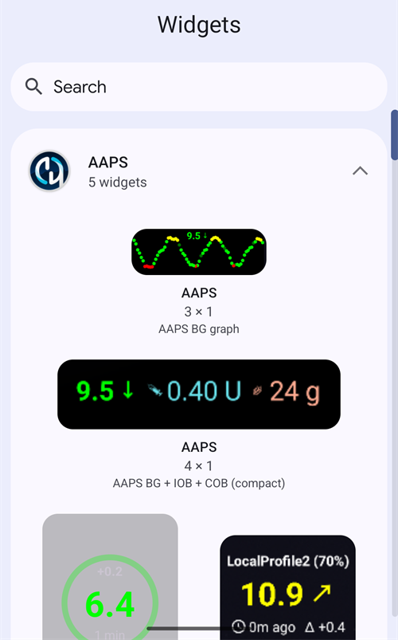
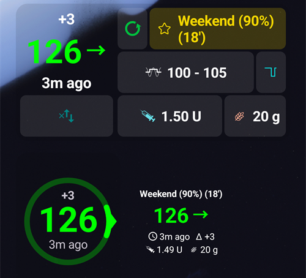
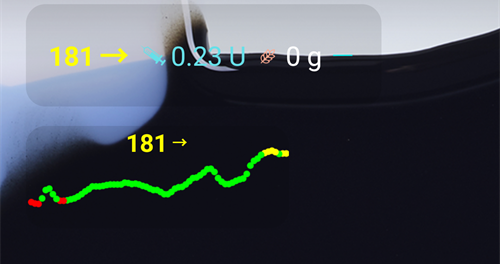
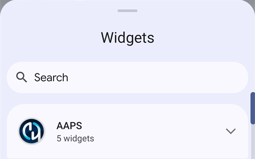
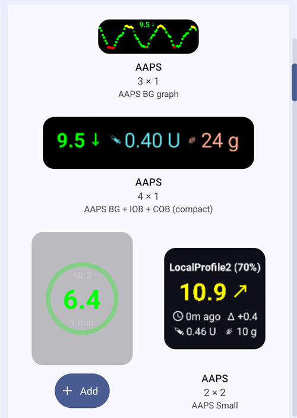
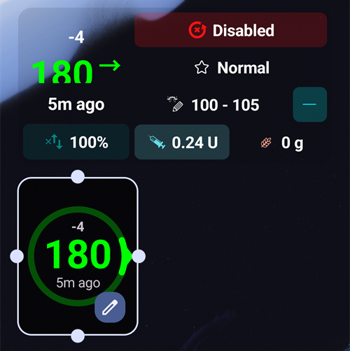
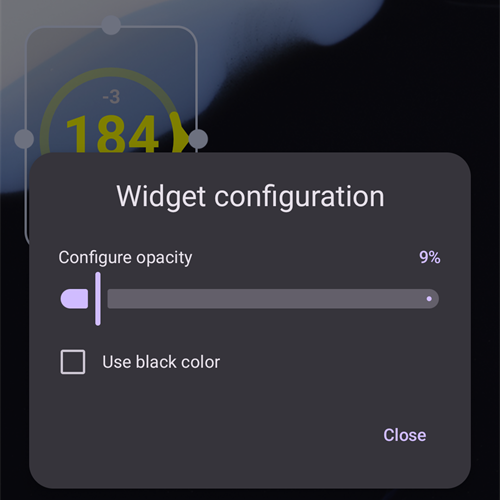

(widgets)=
# Widgets de la pantalla d'inici

**AAPS** ofereix widgets que podeu afegir a la pantalla d'inici del vostre telèfon. Un widget mostra les vostres dades actuals sense obrir l'aplicació. Toqueu un widget per obrir **AAPS**.

```{contents} Table of contents
:depth: 2
:local: true
```

---

## Widgets disponibles

Hi ha cinc widgets disponibles. Apareixen sota **AAPS** al selector de widgets d'Android:



| Widget                                   | Mida per defecte | Què mostra                                                                                                                                                                                                                                                                                             |
| ---------------------------------------- | ---------------- | ------------------------------------------------------------------------------------------------------------------------------------------------------------------------------------------------------------------------------------------------------------------------------------------------------ |
| **Widget AAPS**                          | 5 × 2            | El bloc d'estat de la pantalla principal: glucèmia amb tendència i delta, el mode del llaç com a icona al costat del nom del perfil, objectiu, sensibilitat (com a la pantalla principal), IOB i COB. Els textos es fan més petits per cabre a la mida que doneu al widget, en lloc de quedar tallats. |
| **Cercle de glucèmia AAPS**              | 2 × 2            | El cercle de glucèmia de la pantalla principal: un anell del color de la glucèmia, l'arc de tendència, la delta, el valor de glucèmia i el temps des de l'última lectura.                                                                                                                              |
| **AAPS petit**                           | 2 × 2            | Nom del perfil, glucèmia amb fletxa de tendència, temps des de l'última lectura, delta, IOB i COB.                                                                                                                                                                                                     |
| **AAPS glucèmia + IOB + COB (compacte)** | 4 × 1            | Una línia amb la glucèmia i la fletxa de tendència, IOB i COB.                                                                                                                                                                                                                                         |
| **Gràfic de glucèmia AAPS**              | 3 × 1            | El valor de glucèmia amb un petit gràfic de les lectures recents.                                                                                                                                                                                                                                      |

El **Widget AAPS**, el **Cercle de glucèmia** i el widget **AAPS petit** en una pantalla d'inici:



El widget **compacte** i el widget **Gràfic de glucèmia**:



Els valors de glucèmia fan servir els mateixos colors que a **AAPS**: verd dins del rang, groc per sobre del rang, vermell per sota del rang.

---

## Afegir un widget

Els passos exactes depenen del vostre telèfon i del seu launcher. A la majoria de telèfons:

1. Mantingueu premuda una zona buida de la pantalla d'inici i seleccioneu **Widgets**.

   

2. Obriu **AAPS** a la llista i toqueu el widget que vulgueu.
3. Premeu **Afegeix** (o arrossegueu el widget al lloc que vulgueu).

   

El widget es col·loca a la pantalla d'inici. Just després d'afegir-lo, es mostra amb unes nanses: arrossegueu una nansa per **canviar la mida** del widget, o arrossegueu el widget per moure'l. El cercle de glucèmia es pot ajustar a qualsevol mida.



Si la pàgina de la pantalla d'inici és plena, el telèfon posa el widget en una pàgina nova.

---

## Configuració del widget

Toqueu el botó del **llapis** que es mostra al widget just després d'afegir-lo. Més endavant, mantingueu premut el widget per tornar a veure les nanses i el llapis.

El diàleg **Configuració del widget** té dues opcions:

- **Configurar opacitat** — com d'opac és el fons del widget. Un valor baix deixa veure el fons de pantalla.
- **Utilitzar color negre** — fer servir un fons negre en lloc del fons per defecte.



Cada widget té la seva pròpia configuració.

---

## Bo de saber

- Un widget només **mostra** dades. No podeu fer un bolus ni canviar res des d'un widget.
- **AAPS** és qui actualitza el widget. Si **AAPS** no s'està executant, o si Android el restringeix en segon pla, el widget pot mostrar dades antigues. Comproveu el temps des de l'última lectura i assegureu-vos que **AAPS** està exclòs de l'[optimització de la bateria](#SetupWizard-StoragePermission).
- Amb **AAPSClient**, **AAPSClient2** i **AAPSClient3**, el fons del widget és groc, blau o verd, perquè pugueu distingir les aplicacions. Augmenteu l'opacitat a la configuració del widget si el color es veu malament. Vegeu [Sobre AAPSClient, AAPSClient2 i AAPSClient3](#remotecontrol-aapsclient-versions).
