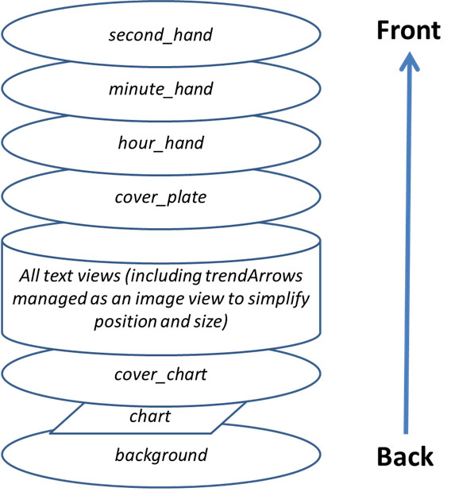
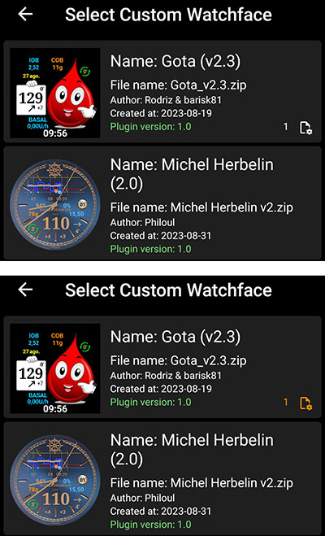
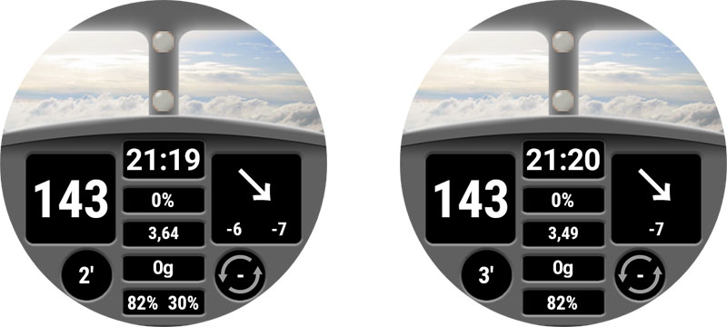
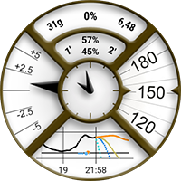
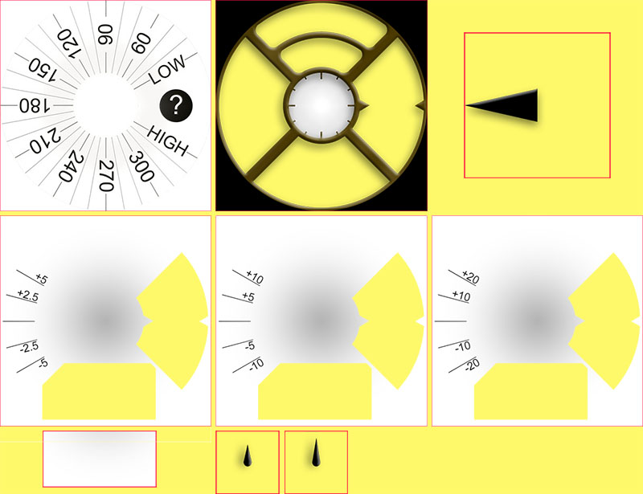
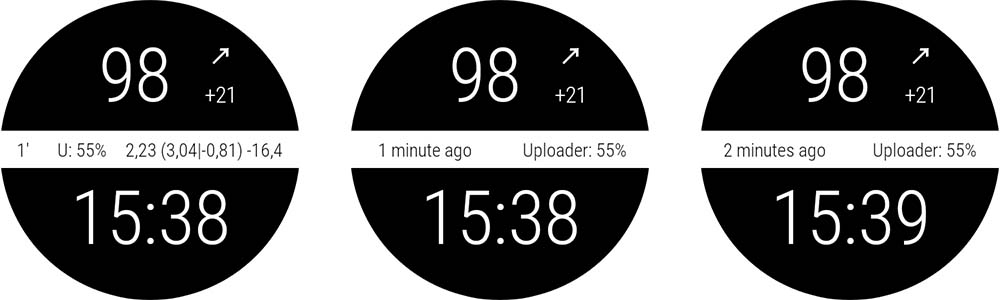
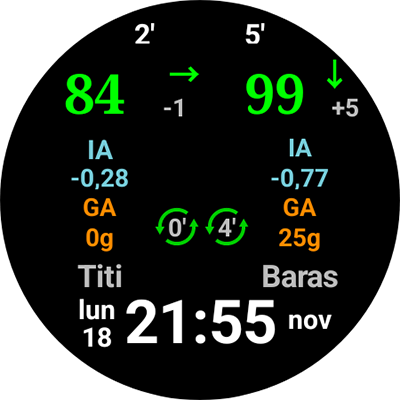

# Document de referència de watchfaces personalitzats

Aquesta pàgina és per a dissenyadors de nous watchfaces. Hi trobareu totes les paraules clau i funcions disponibles per crear o animar un watchface nou.

- Les noves funcions i claus disponibles a Custom Watchface V2 (Wear apk 3.3.0 o posterior) les trobareu [aquí](#cwf-reference-new-v2-features)

## Format de watchface personalitzat

Custom Watchface és un format obert dissenyat per a AAPS i associat al nou watchface «AAPS (Custom)» disponible al rellotge.

El fitxer de watchface és un fitxer zip senzill, però perquè es reconegui com a fitxer de watchface, el fitxer zip ha de contenir aquests fitxers:

- Un fitxer d'imatge anomenat CustomWatchface (pot ser un fitxer bitmap `CustomWatchface.jpg`, `CustomWatchface.png` o un fitxer vectorial `CustomWatchface.svg`). Aquest fitxer és la petita icona que es fa servir per seleccionar el watchface quan premeu el botó «Carregar watchface», i també és la imatge que es veu al plugin Wear d'AAPS.
- Un fitxer anomenat `CustomWatchface.json` (vegeu [Estructura JSON](#cwf-reference-json-structure) més avall). Aquest segon fitxer és el fitxer principal. Conté tota la informació necessària per dissenyar el watchface. Aquest fitxer json ha de ser vàlid (probablement és el punt més difícil quan editeu aquest fitxer a mà amb un editor de text, perquè una coma que falta o que sobra ja trenca el format json). Aquest fitxer JSON també ha d'incloure un bloc `"metadata"` amb una clau `"name"` que no estigui buida. Aquest serà el nom del vostre watchface personalitzat (vegeu [Configuració de les metadades](#cwf-reference-metadata-settings) més avall)
- la mida d'aquest zip ha de ser tan petita com sigui possible (menys d'uns 500 kB). Si aquest fitxer és massa gran, es bloquejarà i no s'enviarà al rellotge.

El fitxer zip també pot contenir alguns fitxers de recursos addicionals:

- Noms de fitxer fixos per a les imatges que es fan servir a les vistes estàndard del watchface (com `Background`, `CoverChart`... vegeu [Llista de fitxers de recursos fixos](#cwf-reference-list-of-hardcoded-resource-files) més avall). Tots aquests fitxers poden estar en format `jpg`, `png` o `svg`. però per a la majoria haureu de fer servir `png` o `svg`, que admeten transparència (els jpg són més petits que els png, però no tenen transparència). Tingueu en compte que la millor qualitat amb la mida més petita s'obté normalment amb fitxers svg (format vectorial).
- Fitxers de recursos addicionals amb noms lliures. Aquests fitxers addicionals poden ser fitxers d'imatge o fitxers de font (per a les fonts s'accepten els formats `ttf` i `otf`). Tingueu en compte que, per a aquests fitxers addicionals, el `filename` (sense extensió) es fa servir com a keyValue al fitxer JSON per indicar on o quan s'han de fer servir aquests fitxers.
  - els fitxers d'imatge s'utilitzen sovint com a fons de les vistes de text o per a animacions dinàmiques (per exemple, el nivell de bateria del 0% al 100%)
  - els fitxers de font us permeten fer servir fonts pròpies al vostre watchface

(cwf-reference-json-structure)=

## Estructura JSON

Els fitxers JSON es poden editar amb l'editor de text Notepad (o Notepad++) (millor Notepad++, que reconeix JSON i fa servir colors)

- conté claus de text `"string_key":` i valors de clau que poden ser textos com `"key value"`, enters, booleans com `true` o `false`, o blocs de dades.
- cada valor se separa amb una coma `,`
- Un bloc de dades comença amb `{` i acaba amb `}`
- el fitxer json és un bloc sencer, per tant comença amb `{` i acaba amb `}`. Dins d'aquest fitxer, tots els blocs interns estan associats a una `"key"` que ha de ser única dins del bloc
- Per llegir millor el fitxer json, normalment té sagnat (cada clau nova va en una línia nova i cada bloc nou es desplaça 4 espais a la dreta)

(cwf-reference-metadata-settings)=

### Configuració de les metadades

Aquest bloc és el primer bloc del fitxer json i és obligatori. Conté tota la informació associada a aquest watchface, com el nom, l'autor, la data de creació o d'actualització, la versió de l'autor o la versió del plugin.

A continuació teniu un exemple de bloc de metadades:

```text
"metadata": {
    "name": "Default Watchface",
    "author": "myName",
    "created_at": "07\/10\/2023",
    "author_version": "1.0",
    "cwf_version": "1.0",
    "comment": "Default watchface, you can click on EXPORT WATCHFACE button to generate a template"
},
```

Tingueu en compte que la `/` de la data és un caràcter especial. Perquè el fitxer json el reconegui correctament, hi heu de posar davant un caràcter d'«escapament» `\`

En alguns fitxers json podeu veure una clau addicional `"filename"`. Aquesta clau es crea o s'actualitza automàticament quan el watchface personalitzat es carrega a AAPS (serveix per mostrar a l'usuari el nom del fitxer zip a la carpeta exports), per tant podeu eliminar aquesta clau del bloc de metadades.

(cwf-reference-general-parameter-settings)=

### Configuració dels paràmetres generals

Després del primer bloc de metadades, definireu alguns paràmetres generals (vegeu [Llista de paràmetres generals](#cwf-reference-list-of-general-parameters) més avall). Això us permet definir els colors del gràfic (carbohidrats, bolus, valors de glucèmia...) i també els colors per defecte per a valors dins del rang, hiper o hipo (colors per defecte del valor de glucèmia i de les fletxes)

A continuació teniu un exemple de paràmetres generals

```text
"highColor": "#FFFF00",
"midColor": "#00FF00",
"lowColor": "#FF0000",
"lowBatColor": "#E53935",
"carbColor": "#FB8C00",
"basalBackgroundColor": "#0000FF",
"basalCenterColor": "#64B5F6",
"gridColor": "#FFFFFF",
"pointSize": 2,
"enableSecond": true,
```
(cwf-reference-imageview-settings)=

### Configuració d'ImageView

La imatge personalitzada es pot ajustar amb el nom de fitxer correcte per a cada ImageView inclosa al disseny (layout) del watchface personalitzat. El bloc json només serveix per definir la posició, la mida, si la vista és visible o no i, opcionalment, per ajustar el color:

A continuació teniu un exemple d'un bloc d'imatge per a second_hand (en aquest cas no hi ha cap imatge al fitxer zip, per tant es farà servir la imatge per defecte de l'agulla dels segons, però amb un color personalitzat).

```text
"second_hand": {
    "width": 400,
    "height": 400,
    "topmargin": 0,
    "leftmargin": 0,
    "visibility": "visible",
    "color": "#BC906A"
}
```
Perquè second_hand tingui el color de glucèmia per defecte (lowRange, midRange o highRange), només cal modificar l'última línia amb el keyValue `bgColor`

```json
    "color": "bgColor"
```

(cwf-reference-textview-settings)=

### Configuració de TextView

TextView té més paràmetres disponibles que ImageView: podeu ajustar la rotació (valor enter en graus), textsize (valor enter en píxels), gravity (per definir si el text va centrat (valor per defecte) o alineat a l'esquerra o a la dreta), definir la font, fontStyle i fontColor, i també el color de fons de la TextView

```text
"basalRate": {
    "width": 91,
    "height": 32,
    "topmargin": 133,
    "leftmargin": 249,
    "rotation": 0,
    "visibility": "visible",
    "textsize": 23,
    "gravity": "center",
    "font": "default",
    "fontStyle": "bold",
    "fontColor": "#BDBDBD"
},
```
Tingueu en compte que, si no voleu fer servir una vista al vostre watchface, poseu la clau `"visibility"` a `"gone"`, però també poseu la mida i la posició fora de l'àrea visible, així:

```text
"second": {
    "width": 0,
    "height": 0,
    "topmargin": 0,
    "leftmargin": 0,
    "rotation": 0,
    "visibility": "gone",
    "textsize": 46,
    "gravity": "center",
    "font": "default",
    "fontStyle": "bold",
    "fontColor": "#BDBDBD"
},
```
Si la mida i la posició són dins de l'àrea visible, és possible que vegeu un «flaix» del valor ocult quan el watchface s'actualitza.

Si voleu personalitzar la imatge de fons d'una vista de text, podeu fer servir la clau `"background":` i posar com a keyValue el nom del fitxer d'imatge inclòs al fitxer zip. També podeu canviar només el color de fons amb la clau `"color:"`.

```json
"background": "fileName"
```

També teniu 4 textViews especials (anomenades freetext1 a freetext4) que tenen un paràmetre propi `"textvalue":`. Es pot fer servir, per exemple, per posar una etiqueta

(cwf-reference-chartview-settings)=

### Configuració de ChartView

La vista del gràfic (Chart view) és una vista molt especial que pot compartir alguns paràmetres amb ImageView o amb TextView...

La configuració estàndard d'aquesta vista és molt senzilla:

```text
"chart": {
    "width": 400,
    "height": 170,
    "topmargin": 230,
    "leftmargin": 0,
    "visibility": "visible"
},
```
Els 2 paràmetres addicionals que podeu incloure per a la vista del gràfic són un color de fons (per defecte és transparent), amb la clau `"color"`, o una imatge de fons, amb la clau `"background"`.

(cwf-reference-how-to-build-watchface)=

## Com crear i dissenyar el vostre primer watchface

### Eines necessàries

- Editor de text: us recomano fer servir Notepad++ (o un programa semblant). És un editor de text senzill, però mostra el text formatat amb colors, i així és més fàcil trobar errors. qualsevol editor de text senzill us servirà. Perquè l'objectiu és ajustar la informació json.
- Editor d'imatges (bitmap i/o vectorial)
  - Si feu servir bitmap
    - L'editor d'imatges ha de poder treballar amb transparència (cal per a totes les imatges que van damunt del fons) i amb el format png (si feu servir imatges bitmap)
    - La imatge de fons pot estar en format jpg (més petit que png)
    - L'editor d'imatges ha de permetre mesurar en píxels els objectes gràfics (pot ser un simple quadrat) (dalt, esquerra, amplada, alçada)
    - L'editor d'imatges ha de poder mostrar els colors amb el codi RRGGBB en hexadecimal
    - L'editor d'imatges ha de poder canviar la mida de la imatge a 400px x 400px (és molt important treballar amb aquesta resolució)
  - Si feu servir imatges vectorials
    - La imatge vectorial s'ha d'exportar en format svg

### Obtenir una plantilla per no començar de zero

Quan vulgueu dissenyar el vostre primer watchface, el millor és començar pel watchface per defecte (així segur que teniu la versió més nova, amb totes les vistes disponibles ben ordenades)

- Podeu obtenir el fitxer zip prement el botó «Exportar plantilla» al plugin Wear. El fitxer zip es desa a la carpeta AAPS/exports
- Tingueu en compte que cal tenir un rellotge connectat a AAPS per veure els botons del watchface personalitzat (el rellotge també cal per comprovar, provar i ajustar el vostre watchface personalitzat)

El watchface per defecte és molt senzill i el fitxer zip només conté els 2 fitxers:

- CustomWatchface.png (imatge del watchface per defecte per a la selecció de watchface)
- CustomWatchface.json

### Organitzeu els fitxers al vostre ordinador

La manera més fàcil de treballar és tenir el telèfon connectat a l'ordinador i treballar amb dues carpetes concretes:

- un explorador obert en una carpeta concreta amb tots els fitxers (json, imatges bitmap, imatges vectorials, fonts) i el fitxer CustomWatchface.zip
- un altre explorador (o l'arbre de navegació ajustat) obert a la carpeta Telèfon/AAPS/exports

Així és molt fàcil treballar: cada vegada que ajusteu el fitxer json amb un editor de text, o una imatge amb l'editor d'imatges (bitmap o vectorial), només heu de:

1. desar els canvis a cada aplicació
2. arrossegar i deixar anar tots els fitxers dins del fitxer CustomWatchface.zip
3. arrossegar i deixar anar CustomWatchface.zip a la carpeta AAPS/exports del telèfon
4. enviar CustomWatchface al rellotge per comprovar el resultat

### Començar a personalitzar el watchface

El primer pas és definir un nom per al watchface (cal per seleccionar-lo fàcilment quan el proveu) i començar a ajustar les claus de metadades al principi del fitxer json

Després heu de decidir quina informació voleu mostrar, és a dir, quines vistes han de ser visibles o ocultes.

- mostrareu els segons o no?
- voleu dissenyar un rellotge analògic o digital (o tots dos...)?

Ara podeu començar a modificar el fitxer json: poseu la clau `"visibility":` de cada vista a `"visible"` o `"gone"` (segons si voleu mantenir la vista o no)

També podeu començar a ajustar aproximadament els valors de marge superior, marge esquerre, amplada i alçada per començar a organitzar el watchface (aquests valors s'ajustaran després amb l'editor d'imatges)

Nota: tot es dissenya dins d'un **rectangle de 400px x 400px**. Per tant, tot es col·loca amb coordenades absolutes dins d'aquesta mida.

Quan dissenyeu el vostre primer watchface, heu de saber que tot s'organitza per capes, des del fons fins a dalt. Per tant, cada vista (ImageView o TextView) pot amagar alguna cosa que hi ha al darrere...





Al fitxer json totes les vistes estan ordenades des del fons fins a dalt (això us ajudarà a recordar què hi ha darrere de què...)

Si dissenyeu o ajusteu el vostre primer watchface personalitzat, comenceu per coses senzilles: canvieu la visibilitat d'algunes vistes, afegiu una imatge de fons pròpia sense canviar el fitxer json...

### Gestionar els colors

Al fitxer json hi ha diverses claus per indicar colors: `"color"` i `"fontColor"` per a les vistes, però també `"highColor"`, `"midColor"`, `"lowColor"`... (vegeu [Llista de paràmetres generals](#cwf-reference-list-of-general-parameters))

Els colors s'indiquen amb un camp de text que comença amb `#` seguit dels valors RRGGBB (vermell, verd, blau) en format hexadecimal:

- `"#FFFFFF"` és blanc, `"#000000"` és negre, `"#FF0000"` és vermell...

També podeu afegir 2 valors més per a la capa alfa i indicar un nivell de transparència (AARRGGBB):

- `"#00000000"` és completament transparent i `"#FF000000"` és completament opac (per tant, `"#FF000000"` és equivalent a `"#000000"`)

També podeu fer servir el valor de clau especial `"bgColor"` per fer servir automàticament `"highColor"`, `"midColor"` o `"lowColor"`, definits als paràmetres generals, segons el valor de glucèmia:

- `"fontColor": "bgColor",` defineix automàticament el color de la font de la vista segons el valor de glucèmia
- Tingueu en compte que les vistes `sgv` (per al valor de glucèmia) i `direction` (per a la fletxa de tendència) apliquen automàticament els colors de glucèmia definits als paràmetres generals (si voleu colors diferents per a aquestes 2 vistes, haureu de fer servir la funció avançada [dynData](#cwf-reference-dyndata-feature) amb un color d'un sol pas...)

Per a més informació sobre les ImageViews i la clau `"color":`, vegeu el capítol [Ajustar el color de la imatge](#cwf-reference-tune-image-color) més avall.

### Incloure imatges fixes (hardcoded)

la manera més fàcil de començar a ajustar el vostre watchface és incloure al fitxer zip algunes imatges amb noms concrets (vegeu [Llista de fitxers de recursos fixos](#cwf-reference-list-of-hardcoded-resource-files))

- La imatge ha d'estar en format `.jpg`, `.png` o `.svg`. però aneu amb compte: jpg no admet transparència, per tant només s'ha de fer servir per a la capa de fons. Per a totes les capes intermèdies (cover_chart, cover_plate, agulles), feu servir imatges `.png` o `.svg`

- Si teniu un editor d'imatges vectorials (per exemple Illustrator), feu servir preferiblement aquest format: produeix fitxers de text petits amb l'extensió `.svg` i la millor qualitat.
- Heu d'utilitzar el nom de fitxer exacte (incloses les majúscules i minúscules)

Ara, si voleu una imatge de fons pròpia, només cal posar al fitxer zip un fitxer anomenat `Background.jpg` (sense canviar res més). Envieu el fitxer zip al rellotge i comproveu el resultat!

Si voleu personalitzar hour_hand, minute_hand o second_hand per a un rellotge analògic, només cal incloure `HourHand.png` (o `HourHand.svg`), `MinuteHand.png` i `SecondHand.png`.

- aquestes imatges giren automàticament al voltant del centre de la imatge, per tant les imatges s'han de dibuixar a les 00:00:00 (i, per a un rellotge analògic de «pantalla completa», feu servir una mida de 400 x 400 px col·locada a dalt 0, esquerra 0)

També podeu veure a la [Llista de fitxers de recursos fixos](#cwf-reference-list-of-hardcoded-resource-files) que, per a cada vista d'imatge, hi ha dos noms de fitxer fixos addicionals, `High` i `Low` (per exemple, podeu incloure al fitxer zip altres imatges anomenades `BackgroundHigh.jpg` i `BackgroundLow.jpg`). llavors la imatge canvia automàticament segons el vostre nivell de glucèmia (dins del rang, hiper o hipo). Vegeu el watchface AIMICO com a exemple.

(cwf-reference-tune-image-color)=

### Ajustar el color de la imatge

La clau `"color"` es pot fer servir per ajustar el color de la imatge per defecte:

- aplicada a la vista de fons, defineix el color de fons (per defecte negre)
- aplicada a cover_plate (esfera simple) o a les agulles, substitueix el color de la imatge per defecte (blanc) pel color indicat (també `"bgColor"`)

Quan apliqueu la clau `"color"` a una imatge bitmap (`.jpg` o `.png`), el color aplica un efecte interessant a la saturació del color. Així encara reconeixereu el vostre bitmap.

Finalment, en un fitxer d'imatge `.svg` la clau `"color"` no té cap efecte: el color dels fitxers vectorials és fix dins de la imatge. Si voleu canviar els colors, haureu d'incloure diversos fitxers `svg` i fer servir la funció avançada [dynData](#cwf-reference-dyndata-feature) per canviar-los

### Fer servir fonts addicionals per a les TextViews

A la wear apk ja hi ha diverses fonts per defecte (vegeu les claus de font al capítol [Valors de clau](#cwf-reference-key-values)). Però si voleu fer servir fonts addicionals que no estan disponibles per defecte, podeu incloure fonts addicionals al fitxer zip:

- els 2 formats de font acceptats són els fitxers `.ttf` i `.otf`
- si incloeu una font personalitzada al fitxer zip, per exemple un fitxer anomenat `myCustomFont.ttf`, heu de fer servir el nom del fitxer per utilitzar-la al fitxer json per a una TextView:

```
"font": "myCustomFont",
```

Recordeu que algunes fonts poden ser fitxers grans (i la mida màxima del fitxer zip és limitada). Per tant, si només feu servir molt pocs caràcters (números, `.`, `,`), podeu fer servir eines gratuïtes per eliminar els caràcters que no feu servir (per exemple [aquí](https://products.aspose.app/font/generator/ttf-to-ttf)) i així reduir la mida de la font.

(cwf-reference-advanced-features)=

## Funcions avançades

(cwf-reference-preference-feature)=

### Funció de configuració

CustomWatchface pot ajustar automàticament algunes opcions de configuració del rellotge perquè el watchface es vegi correctament (si l'usuari ho ha autoritzat a la configuració de Wear).

Però cal fer servir aquesta funció amb compte. La configuració és comuna a tots els altres watchfaces. Per tant, amb aquesta funció cal respectar algunes regles:

- no definiu mai opcions de configuració que afectin vistes ocultes
- intenteu maximitzar les vistes visibles
- no dubteu a fer més amples algunes vistes:
  - La TBR es pot mostrar com a percentatge (poca amplada) però també com a valor absolut (molt més ample)
  - la delta o la delta mitjana amb informació detallada poden ser amples
  - el mateix per a iob2: aquesta vista pot mostrar la IOB total, però si se selecciona la IOB detallada, el text pot ser molt llarg

Si encara necessiteu alguna opció molt concreta perquè es vegi correctament (a l'exemple de sota, si no hi ha prou espai per a la IOB detallada, podeu «forçar» aquest paràmetre a `false` al vostre rellotge), podeu incloure al bloc de metadades una restricció de configuració com aquesta

```text
"metadata": {
    "name": "Default Watchface",
    "author": "myName",
    "created_at": "07\/10\/2023",
    "author_version": "1.0",
    "cwf_version": "1.0",
    "comment": "Default watchface, you can click on EXPORT WATCHFACE button to generate a template",
    "key_show_detailed_iob": false
},
```

Si l'usuari autoritza el watchface personalitzat a modificar els paràmetres del rellotge (opció del plugin Wear), «Mostrar IOB detallada» es posarà a «desactivat» i quedarà bloquejat en desactivat (aquest paràmetre no es pot modificar fins que no es desactivi l'autorització a la configuració del plugin Wear o se seleccioni un altre watchface)

- Tingueu en compte que, quan un usuari selecciona un watchface, pot veure el nombre de «paràmetres necessaris» durant la selecció

A l'exemple de sota, el watchface Gota té un paràmetre necessari. Si no s'ha donat l'autorització, el número es mostra en blanc. Si s'ha donat l'autorització, aquest paràmetre es defineix i queda bloquejat al rellotge (en aquest cas el número es mostra en taronja)




(cwf-reference-twinview-feature)=

### Funció TwinView

Les vistes bessones (twin views) són una manera fàcil d'ajustar la posició d'una vista segons les vistes que són visibles. No és tan potent com un disseny fet completament amb LinearLayout, però resol molts casos habituals.

A l'exemple de sota podeu veure el watchface AAPS (Cockpit) amb totes les vistes visibles a la configuració, i el mateix watchface amb «Mostrar bateria rig» i «Mostrar delta mitjana» desactivats



Podeu veure que, quan una de les vistes bessones està oculta, l'altra es desplaça per quedar centrada

en aquest exemple podeu veure que al bloc `"uploader_battery"` s'ha afegit la clau `"twinView":` per definir la vista `"rig_battery"`, i al bloc `"rig_battery"` la clau `"twinView":` defineix `"uploader_battery"` com a bessona. Després, la clau addicional `"leftOffsetTwinHidden":` defineix quants píxels s'ha de desplaçar la vista quan la bessona està oculta.

Per calcular aquest número, mireu la diferència entre el leftMargin de cada una de les vistes bessones: és de 50 píxels, per tant el desplaçament per quedar centrat és la meitat, en una direcció o en l'altra.

Si les vistes bessones estan col·locades verticalment, heu de fer servir la clau `"topOffsetTwinHidden":`

```text
"uploader_battery": {
    "width": 49,
    "height": 30,
    "topmargin": 354,
    "leftmargin": 150,
    "rotation": 0,
    "visibility": "visible",
    "textsize": 23,
    "gravity": "center",
    "font": "roboto_condensed_bold",
    "fontStyle": "bold",
    "fontColor": "#FFFFFF",
    "twinView": "rig_battery",
    "leftOffsetTwinHidden": 25
},
"rig_battery": {
    "width": 49,
    "height": 30,
    "topmargin": 354,
    "leftmargin": 200,
    "rotation": 0,
    "visibility": "visible",
    "textsize": 23,
    "gravity": "center",
    "font": "roboto_condensed_bold",
    "fontStyle": "bold",
    "fontColor": "#FFFFFF",
    "twinView": "uploader_battery",
    "leftOffsetTwinHidden": -25
},
```
(cwf-reference-dyndata-feature)=

### Funció DynData

DynData és la funció més potent si voleu afegir alguna animació al vostre watchface segons alguns valors interns (com el valor de glucèmia, el nivell de glucèmia, la delta, el % de bateria... vegeu la llista de dades disponibles [aquí](#cwf-reference-dyndata-key-values))

Per explicar aquesta funció, faré servir l'exemple del watchface AAPS (SteamPunk):



En aquest watchface haurem de gestionar la [rotació del valor de glucèmia](#cwf-reference-background-management) (de 30 graus a 330 graus) a la dreta, el [rang dinàmic d'avg_delta](#cwf-reference-avg-delta-management) (escala fins a 5 mg/dl, 10 mg/dl o 20 mg/dl segons el valor), la [rotació de l'agulla](#cwf-reference-dynamic-rotation-management), que ha d'anar sincronitzada amb l'escala, i també les diferents capes de les vistes...

Per poder gestionar aquest watchface, a continuació teniu totes les imatges incloses al fitxer zip:

Nota: perquè es pugui veure la transparència, totes aquestes imatges estan sobre un fons groc i envoltades d'un quadrat vermell



- A la primera fila, Background.jpg i CoverPlate.png s'assignen automàticament a la vista corresponent (nom de fitxer per defecte de les vistes), i steampunk_pointer.png el gestiona dynData
- A la segona fila veieu les 3 escales del rang dinàmic per a avg_delta, que també gestiona dynData
- A la tercera fila, chartBackground.jpg s'enllaça manualment a la vista del gràfic, i els fitxers HourHand.png i MinuteHand.png s'assignen automàticament a les vistes corresponents

(cwf-reference-background-management)=

#### Gestió del fons

Primer, pel que fa a la imatge del valor de glucèmia, aquí no hi ha opció: només pot anar a la capa de fons (si no, quedaria davant de la vista del gràfic i el gràfic no es veuria!). Per tant, hem d'assignar el valor de glucèmia al fons i després girar la imatge de fons segons el valor de glucèmia.

Dins del bloc `"background"` hi posarem 2 claus específiques per fer aquesta rotació:

```text
"background": {
    "width": 400,
    "height": 400,
    "topmargin": 0,
    "leftmargin": 0,
    "dynData": "rotateSgv",
    "rotationOffset": true,
    "visibility": "visible"
},
```
La clau `"dynData":` defineix quin bloc es fa servir per definir l'animació (valor, rang, conversió...). Aquí aquest bloc s'anomena «rotateSgv» (trieu un nom clar quan feu servir aquesta funció),

`"rotationOffset": true,` indica que l'animació segons el valor ha de ser una rotació. (altres claus disponibles són `"leftOffset"` i `"topOffset"`, si voleu crear un control lliscant)

Ara anem al final del fitxer, després de l'última vista:

```text
"second_hand": {
    "width": 120,
    "height": 120,
    "topmargin": 140,
    "leftmargin": 140,
    "visibility": "gone"
},
"dynData": {
    "rotateSgv": {
        "valueKey": "sgv",
        "minData": 30,
        "maxData": 330
    },
```
Podeu veure que després de l'última vista (`"second_hand"`) hem afegit un bloc nou `"dynData": { ... }` que conté totes les animacions:

El bloc definit a la vista `"background"` s'anomena `"rotateSgv"`. És el primer bloc que trobareu dins de `"dynData"`!

Aquest bloc és senzill: hi ha una primera clau anomenada `"valueKey":` que defineix quin valor s'ha de fer servir. en aquest cas `"sgv"` és un «keyValue» que defineix el valor de glucèmia (tingueu en compte que, en la majoria de casos, el keyValue té el mateix nom que la vista que mostra aquesta informació).

Pel que fa al valor de glucèmia, el valor mínim per defecte és 39 mg/dl i el màxim és 400 mg/dl (vegeu més avall [Valors de les claus de DynData](#cwf-reference-dyndata-key-values), amb tots els keyValues disponibles i els valors mínim i màxim associats).

Dins del bloc `"rotateSgv"`, les dues claus addicionals (`"minData":` i `"maxData":`) serveixen per ajustar les dades mínima i màxima a 30 i 330. Amb aquests valors mínim i màxim, podem fer servir directament el valor de les dades (sense cap conversió) per girar el fons en graus. En aquesta situació, tots els valors de glucèmia per sobre de 330 mg/dl es limiten a 330, el límit superior de la imatge.

#### Gestió del gràfic

El fons del gràfic per defecte és transparent. Per amagar l'escala de glucèmia inclosa a la imatge de fons, cal posar-hi una imatge de fons pròpia (aquesta imatge inclou totes les ombres del watchface Steampunk). L'enllaç al fitxer chartBackground.jpg es fa amb la clau `"background":`

És clar que la mida i la posició de la vista s'han d'ajustar al píxel!

```text
"chart": {
    "width": 216,
    "height": 107,
    "topmargin": 280,
    "leftmargin": 80,
    "visibility": "visible",
    "background": "chartBackground"
},
```
(cwf-reference-avg-delta-management)=

#### Gestió de la delta mitjana

Per gestionar el rang dinàmic de la delta mitjana, farem servir les quatre vistes freetext. freetext1 serveix per gestionar l'escala de la imatge, i freetext2 a freetext4 serveixen per gestionar la rotació de l'agulla segons l'escala.

**freetext1**

Com s'ha explicat abans, les vistes freetext estan davant del gràfic i davant del fons. Per això hem inclòs una àrea transparent per veure aquestes imatges (costat dret i part de sota de la imatge)

Tingueu en compte que la part de sota que s'ha tret d'aquestes imatges s'ha fet servir com a fons del gràfic, perquè tot encaixi perfectament.

```text
"freetext1": {
    "width": 400,
    "height": 400,
    "topmargin": 0,
    "leftmargin": 0,
    "rotation": 0,
    "visibility": "visible",
    "dynData": "avgDeltaBackground"
},
```
Per a aquesta vista posem l'enllaç a un altre bloc `"dynData"` anomenat `avgDeltaBackground`. Aquest bloc gestiona l'escala d'avgDelta segons el valor d'avgDelta.

```text
"avgDeltaBackground": {
    "valueKey": "avg_delta",
    "minData": -20,
    "maxData": 20,
    "invalidImage": "steampunk_gauge_mgdl_5",
    "image1": "steampunk_gauge_mgdl_20",
    "image2": "steampunk_gauge_mgdl_20",
    "image3": "steampunk_gauge_mgdl_10",
    "image4": "steampunk_gauge_mgdl_5",
    "image5": "steampunk_gauge_mgdl_5",
    "image6": "steampunk_gauge_mgdl_10",
    "image7": "steampunk_gauge_mgdl_20",
    "image8": "steampunk_gauge_mgdl_20"
},
```
- `"valueKey":` fa l'enllaç amb el valor `"avg_delta"`
- minData i maxData també limiten el rang al valor màxim disponible en aquest watchface (de -20 mg/dl a 20 mg/dl). Usuaris de mmol: recordeu que a AAPS tots els valors interns són sempre en mg/dl.

Ara veurem com gestionar una imatge de fons dinàmica segons el valor.

`"invalidImage":` és la clau que defineix la imatge que es mostra quan les dades no són vàlides (o falten). Aquí fem l'enllaç amb la imatge addicional inclosa al fitxer zip, amb l'escala de 5 mg/dl

Després farem servir una sèrie d'imatges, de `"image1":` a `"image8":`. El nombre d'imatges que doneu defineix el nombre de passos entre `minData` i `maxData`.

- `image1` defineix la imatge que es mostra quan avg_delta és igual o proper a `minData`, i la imatge amb el número més alt (aquí `image8`) defineix la imatge que es mostra quan avg_delta és igual o proper a `maxData`
- entre -20 mg/dl i 20 mg/dl, el rang total és de 40 mg/dl; dividit per 8 (el nombre d'imatges), tenim 8 passos de 5 mg/dl
- Ara podem assignar les imatges de fons segons el valor d'avg_delta, començant pels valors més baixos: entre -20 i -15, i també entre -15 i -10, farem servir `steampunk_gauge_mgdl_20` per a l'escala; després, entre -10 i -5, `steampunk_gauge_mgdl_10`, i així successivament fins a +15 i +20, on tornarem a fer servir la imatge de fons `steampunk_gauge_mgdl_20`

(cwf-reference-dynamic-rotation-management)=

**freetext2 a freetext4**

Per a aquestes vistes combinarem les imatges dinàmiques i la funció de rotació explicades abans:

```text
"freetext2": {
    "width": 276,
    "height": 276,
    "topmargin": 64,
    "leftmargin": 64,
    "rotation": 0,
    "visibility": "visible",
    "dynData": "avgDelta5",
    "rotationOffset": true
},
"freetext3": {
    "width": 276,
    "height": 276,
    "topmargin": 64,
    "leftmargin": 64,
    "rotation": 0,
    "visibility": "visible",
    "dynData": "avgDelta10",
    "rotationOffset": true
},
"freetext4": {
    "width": 276,
    "height": 276,
    "topmargin": 64,
    "leftmargin": 64,
    "rotation": 0,
    "visibility": "visible",
    "dynData": "avgDelta20",
    "rotationOffset": true
},
```
Aquí cada vista correspon a una escala concreta (per tant, està enllaçada a un bloc dynData propi). També podeu veure que la clau `"rotationOffset":` està activada per a aquestes 3 vistes. Ara mirem el primer bloc dynData:

```text
"avgDelta5": {
    "valueKey": "avg_delta",
    "minData": -20,
    "maxData": 20,
    "rotationOffset": {
        "minValue": -120,
        "maxValue": 120
    },
    "invalidImage": "null",
    "image1": "null",
    "image2": "null",
    "image3": "null",
    "image4": "steampunk_pointer",
    "image5": "steampunk_pointer",
    "image6": "null",
    "image7": "null",
    "image8": "null"
},
```
Aquí, encara que el rang dinàmic només es farà servir entre -5 i +5 de dades avg_delta, és important mantenir el rang total de -20, +20 mg/dl perquè l'agulla estigui sincronitzada amb el fons quan canvia l'escala. Per això mantenim el mateix rang total que per a `avgDeltaBackground` i el mateix nombre de passos (8 imatges).

Podeu veure que tant `"invalidImage"` com diverses `"imagexx"` tenen el valor de clau `"null"` (pot ser qualsevol text que no existeixi com a nom de fitxer dins del fitxer zip). Quan no es troba un nom de fitxer, la imatge de fons de la vista és transparent. Per tant, aquesta configuració fa que l'agulla només sigui visible als passos 4 i 5 (delta mitjana entre -5 mg/dl i +5 mg/dl), i que no sigui visible fora d'aquest rang.

Ara podem veure un bloc nou `"rotationOffset":` que conté dues claus: `"minValue":` i `"maxValue":`. Aquests valors serveixen per fer la conversió entre les dades internes (en mg/dl) i l'angle de rotació que volem.

- El watchface Steampunk està dissenyat perquè l'agulla giri com a màxim de -30 graus a 30 graus. Per tant, segons l'escala (aquí de -5 mg/dl a 5 mg/dl), volem tenir 30 graus per a aquests valors. Com que `minData` i `maxData` són 4 vegades més grans, els minValues i maxValues corresponents són 4 * 30 graus, és a dir, -120 i +120 graus. Però per a qualsevol rotació per sobre o per sota de ±30 graus, l'agulla s'amaga (no hi ha cap imatge visible), i l'agulla només és visible per a valors entre -5 i +5 mg/dl... I això és exactament el que volem aquí.

Els altres blocs dynData es defineixen de la mateixa manera per ajustar `"avgDelta10"` i `"avgDelta20"`

#### vista del llaç (loop)

al watchface Steampunk, les fletxes verdes i vermelles del llaç (per a l'estat) estan desactivades. Això també es gestiona amb un bloc dynData propi associat a la vista del llaç.

```text
    "loopArrows": {
        "invalidImage": "greyArrows",
        "image1": "greenArrows",
        "image2": "redArrows"
    }
```
Com que aquest bloc només el crida la vista del llaç, i les dades per defecte d'aquesta vista són la informació del llaç, la clau `"valueKey":` és opcional.

Per al llaç, els valors per defecte de `minData` i `maxData` són 0 min i 28 min. Per tant, amb dues imatges, tots els valors per sota de 14 min es mostren amb el fons `image1` i tots els valors per sobre de 14 min es mostren amb `image2`. 14 min és exactament el llindar per passar de la fletxa verda a la fletxa vermella.

En aquest exemple, els fitxers `greyArrows`, `greenArrows` i `redArrows` no són al fitxer zip, per tant aquestes fletxes simplement desapareixen (invisibles). Però podeu fer servir aquest bloc tal com és si voleu ajustar les fletxes d'estat amb imatges de fons personalitzades.

#### Vistes rig_battery i uploader_battery

Per acabar la visió general de la funció dynData, mirarem la gestió de la bateria. La idea aquí és personalitzar el color del text segons el nivell de bateria (del 0 al 100%)

```text
"uploader_battery": {
    "width": 60,
    "height": 28,
    "topmargin": 100,
    "leftmargin": 170,
    "rotation": 0,
    "visibility": "visible",
    "textsize": 20,
    "gravity": "center",
    "font": "default",
    "fontStyle": "bold",
    "fontColor": "#00000000",
    "dynData": "batteryIcons",
    "twinView": "rig_battery",
    "topOffsetTwinHidden": -13
},
"rig_battery": {
    "width": 60,
    "height": 28,
    "topmargin": 74,
    "leftmargin": 170,
    "rotation": 0,
    "visibility": "visible",
    "textsize": 20,
    "gravity": "center",
    "font": "default",
    "fontStyle": "bold",
    "fontColor": "#00000000",
    "dynData": "batteryIcons",
    "twinView": "uploader_battery",
    "topOffsetTwinHidden": 13
},
```
Aquí podeu veure que totes dues vistes comparteixen el mateix bloc `dynData`, anomenat `batteryIcons`. És possible perquè, per defecte, les dades associades són les de la vista (per tant, sense indicar cap clau `"valueKey":` al bloc `batteryIcons`, s'aplica amb les dades d'`uploader_battery` o de `rig_battery`, segons la vista).

Tingueu en compte que aquestes dues vistes també fan servir la funció TwinView, explicada [aquí](#cwf-reference-twinview-feature).

Ara mirem el bloc dynData:

```text
"batteryIcons": {
    "invalidFontColor": "#00000000",
    "fontColor1": "#A00000",
    "fontColor2": "#000000",
    "fontColor3": "#000000",
    "fontColor4": "#000000",
    "fontColor5": "#000000"        
},
```
Aquí fem servir exactament la mateixa lògica que per a la imatge de fons dinàmica, però amb claus pròpies (`"invalidFontColor"` i `"fontColor1"` a `"fontColor5"`, per definir 5 passos del 20% cadascun).

- `"fontColor1"` (vermell fosc) es fa servir per a tots els valors per sota del 20%, i el blanc per a tots els valors per sobre d'aquest llindar.
- Si voleu baixar el llindar a «per sota del 10%», només cal afegir 5 claus més, de `"fontColor6"` a `"fontColor10"`. També podeu ajustar cada color si voleu un canvi progressiu de verd a groc, taronja i vermell...

(cwf-reference-dynpref-feature)=

### Funció DynPref

Abans de llegir aquest capítol, heu d'entendre com funciona [dynData](#cwf-reference-dyndata-feature), perquè DynPref és un ús avançat de DynData: ara podreu ajustar cada bloc DynData segons les opcions de configuració que ha triat l'usuari:

Per explicar la funció DynPref, farem servir dos exemples:

- El watchface Steampunk (ús senzill: incloure en un mateix watchface la versió en mg/dl i la versió en mmol/l; el watchface canvia automàticament segons la unitat seleccionada a AAPS).
- El watchface AAPS V2 combina diverses opcions de configuració per gestionar el color del text i el fons segons les opcions «Fosc» i Match divider.

#### Ús senzill de dynPref al watchface Steampunk

A Steampunk tenim dos conjunts d'imatges segons les unitats: la imatge `background`, que té l'escala de glucèmia i gira segons el valor de glucèmia. i `freeText1`, que conté l'escala dinàmica segons el valor d'avgDelta. Per tenir un sol watchface que mostri automàticament les unitats correctes, cal seleccionar la imatge segons la unitat seleccionada.

Per fer-ho, substituirem la clau `dynData` per una clau `dynPref` dins del bloc de la vista:

```text
 "background": {
    "width": 400,
    "height": 400,
    "topmargin": 0,
    "leftmargin": 0,
    "dynPref": "rotateSgv",
    "rotationOffset": true,
    "visibility": "visible"
},
```
Les claus `dynPref` es fan servir de manera molt semblant a les claus `dynData` explicades al capítol anterior

Ara mirarem el final del fitxer json, després del bloc `dynData`:

```text
"dynData": {
    ...
},
"dynPref": {
    "rotateSgv": {
        "prefKey": "key_units",
        "true": {
            "valueKey": "sgv",
            "minData": 30,
            "maxData": 330,
            "invalidImage": "Background_mgdl",
            "image1": "Background_mgdl"
        },
        "false": {
            "valueKey": "sgv",
            "minData": 30,
            "maxData": 330,
            "invalidImage": "Background_mmol",
            "image1": "Background_mmol"
        }
    },
    ...
}
```
Podeu veure que la clau dynPref definida al bloc de la vista `background` (`"dynPref": "rotateSgv"`) existeix al bloc json `dynPref` inclòs al final del fitxer json:

Aquest bloc ha de contenir una clau `"prefKey"` que defineix quina opció de configuració s'ha de fer servir. En aquest exemple, la clau `"key_units"` està enllaçada a les unitats seleccionades a AAPS al telèfon. El valor és `"true"` si la unitat seleccionada és mg/dl i `"false"` si la unitat seleccionada és mmol/l.

Després trobareu dos blocs json que fan servir el format «dynData» i que s'utilitzen segons l'opció seleccionada

Tingueu en compte que el nom de fitxer fix («HardCoded») de la imatge de fons ara se substitueix per una imatge dinàmica, que és la mateixa sigui quin sigui el valor de glucèmia (fitxer `Background_mgdl.png` si key_units és «true», `Background_mmol.png` si key_units és false). També hi afegim una clau `"invalidImage"` per tenir sempre una imatge de fons, encara que no s'hagin rebut dades del telèfon.

#### Combinar diverses opcions de configuració dins de dynPref amb AAPS V2

Normalment, quan definiu una opció de configuració, no és per obtenir un «comportament dinàmic», sinó només el resultat segons el que seleccioneu. Però dins de dynPref es considera una funció dinàmica...

- mentre que a `dynData` indiqueu un bloc complet de paràmetres (amb imatges, fontColor, Color...), amb `dynPref` podeu combinar cada paràmetre segons una opció de configuració concreta.
- Aquí veurem com l'opció Match divider s'associa a l'opció «Fosc» per mostrar, quan està activada (true), text blanc sobre fons negre en un watchface fosc (paràmetre dark true) o text negre sobre fons blanc en un watchface clar (dark false)...

Primer mirem el principi del fitxer json:

```text
"dynPrefColor": "prefColorDark",
"pointSize": 2,
"enableSecond": false,
"background": {
    "width": 400,
    "height": 400,
    "topmargin": 0,
    "leftmargin": 0,
    "visibility": "visible",
    "dynPref": "dark"
},
```
`"dynPrefColor": "prefColorDark"` indica el bloc dynPref de tots els colors per defecte fora de les vistes. Aquests colors s'ajusten segons el paràmetre dark dins de `"prefColorDark"`:

I al final, dins del bloc `dynPref`, hi ha un bloc dynPref propi per als colors per defecte:

```text
"prefColorDark": {
    "prefKey": "key_dark",
    "true": {
        "highColor": "#FFFF00",
        "midColor": "#00FF00",
        "lowColor": "#FF0000",
        "lowBatColor": "#E53935",
        "carbColor": "#FB8C00",
        "basalBackgroundColor": "#0000FF",
        "basalCenterColor": "#64B5F6",
        "gridColor": "#FFFFFF"
    },
    "false": {
        "highColor": "#A0A000",
        "midColor": "#00A000",
        "lowColor": "#A00000",
        "lowBatColor": "#E53935",
        "carbColor": "#D07C00",
        "basalBackgroundColor": "#0000A0",
        "basalCenterColor": "#64B5F6",
        "gridColor": "#303030"
    }
}
```
La diferència entre aquest bloc dynPref i els altres blocs dynPref estàndard de les vistes és que aquí no hi ha un bloc dynData per a cada valor del paràmetre `"key_dark"`, sinó només la llista dels colors principals (`highColor`, `midColor`, ...)

Ara mirem els elements inclosos a la «banda del divisor» (a l'exemple de sota, la vista `"basalRate"` enllaçada a la vista dynPref `"matchDivider"`):

```text
"basalRate": {
    "width": 90,
    "height": 32,
    "topmargin": 127,
    "leftmargin": 242,
    "rotation": 0,
    ...
    "leftOffsetTwinHidden": 33,
    "dynPref": "matchDivider"
},
```
Després, dins del bloc dynPref, podeu veure que el paràmetre Match divider (clau `key_match_divider`) inclou els 2 blocs «true» i «false». Però aquests dos blocs només serveixen per definir que la vista farà servir el dynBlock «dark» (és a dir, exactament el mateix color de fons i de text que les altres vistes fora de la banda) o el dynBlock «white», que posa els colors contraris per al fons i el text...

```text
"matchDivider": {
    "prefKey": "key_match_divider",
    "true": {
        "dynPref": "dark"
    },
    "false": {
        "dynPref": "white"
    }
},
"dark": {
    "prefKey": "key_dark",
    "true": {
        "color1": "#000000",
        "fontColor1": "#FFFFFF"
    },
    "false": {
        "color1": "#FFFFFF",
        "fontColor1": "#000000"
    }
},
```
Tingueu en compte que aquí sou dins d'un bloc «dynData». Per tant, per definir un color o un fontColor fareu servir un dynData (aquí no s'indica) i un sol pas (es fan servir `"color1"` i `'fontColor1'`)

- per a tots els paràmetres excepte `image`, el «valor no vàlid» per defecte (si no s'ha definit amb la clau `"invalidColor"` o `"invalidFontColor"`) serà `"color1"` i `"fontColor1"`.


Després veurem un tercer exemple amb les vistes de IOB (`iob1` i `iob2`), on farem servir un text més petit per a la IOB detallada i un text més gran per a la IOB total:

```text
"iob1": {
    "width": 125,
    "height": 33,
    "topmargin": 168,
    "leftmargin": 275,
    "rotation": 0,
    "visibility": "visible",
    "textsize": 19,
    ...
    "dynPref": "prefIob1"
},
"iob2": {
    "width": 125,
    "height": 33,
    "topmargin": 196,
    "leftmargin": 275,
    "rotation": 0,
    "visibility": "visible",
    "textsize": 24,
    ...
    "leftOffsetTwinHidden": -10,
    "dynPref": "prefIob2"
},
```
A la configuració per defecte de la vista veureu la mida del text (19 a `iob1` i 24 a `iob2`) i els dos blocs `dynPref` diferents que ajusten el textsize (segons el paràmetre de IOB detallada) i els colors (segons el paràmetre dark)

```text
"prefIob1": {
    "prefKey": "key_show_detailed_iob",
    "true": {
        "dynPref": "dark",
        "textsize1": 24
    },
    "false": {
        "dynPref": "dark"
    }
},
"prefIob2": {
    "prefKey": "key_show_detailed_iob",
    "true": {
        "dynPref": "dark",
        "textsize1": 19
    },
    "false": {
        "dynPref": "dark"
    }
},
```
Aquí podeu veure que, segons el paràmetre de IOB detallada (clau `"key_show_detailed_iob"`), quan és «true» el textsize es defineix amb un valor fix més gran que el valor per defecte (24 en lloc de 19). Això es fa amb la funció de «passos» de textsize, amb un sol valor, és a dir, un sol pas... (tingueu en compte que, per a tots els paràmetres excepte les imatges, si no es defineix invalidTextSize, es fa servir textsize1 per a les dades no vàlides)

Després es fa servir el bloc dynPref «dark» per definir color i fontColor

En aquest exemple, el bloc dynData que es fa servir per a la vista iob1 quan la IOB detallada està activada i Fosc està activat és:

```text
{
    "color1": "#000000",
    "fontColor1": "#FFFFFF",
    "textsize1": 24
},
```

Per tant, el text serà blanc sobre fons negre, i la mida 24 substituirà la mida per defecte de 19 definida a la vista

El bloc dynData que es fa servir per a la mateixa vista iob1 quan la IOB detallada està desactivada i Fosc està desactivat és:

```text
{
    "color1": "#FFFFFF",
    "fontColor1": "#000000"
},
```

Ara el text serà negre sobre fons blanc, amb una mida de 19

#### Consells i trucs per a dynPref

- Podeu combinar tantes opcions de configuració com vulgueu, però aneu amb compte: el nombre de blocs que cal descriure pot créixer molt de pressa (és exponencial). Si encadeneu 3 paràmetres i voleu definir totes les situacions, haureu de descriure 8 blocs, si cada paràmetre només té 2 valors...
- Aneu amb compte de no crear un «bucle infinit» (per exemple, si el bloc dynpref1 s'ha de completar amb el bloc dynpref2, que s'ha de completar amb el bloc dynpref1...). En aquest cas, els blocs dynPref es consideraran no vàlids...
- No oblideu posar l'índex numèric després de la clau (per exemple, quan feu servir la clau `"textsize"` dins d'una vista, heu de fer servir `"textsize1"` dins del bloc de valors dynPref, perquè té el format «dynData» i, per tant, està enllaçat al valor amb un sol pas en aquest cas)
- Només s'ha de definir una clau `"valueKey"` per vista. Per tant, si el bloc `dynData` final es construeix a partir de diversos blocs `dynPref`, no hi poseu diverses `"valueKey"` (ni les `"minData"`, `"maxData"`... associades)

(cwf-reference-new-v2-features)=

### Funcions noves a CustomWatchface V2 (AAPS V3.3.0 o posterior)

Tingueu en compte que els watchfaces que fan servir aquestes funcions o vistes noves necessiten la wear apk més nova, compilada a partir de la versió 3.3.0 d'AAPS.

Si feu servir un zip «v2» amb un rellotge que té CustomWatchface V1, faltarà informació o el contingut del watchface serà incorrecte.

CustomWatchface V2 inclou aquestes funcions noves:

- [Nova vista Status](#cwf-reference-new-status-feature)
- [Nova vista TempTarget](#cwf-reference-new-temp-target-feature)
- [Nova vista Reservoir Level](#cwf-reference-new-reservoir-level-feature)
- [Nova funció de format](#cwf-reference-new-formating-feature)
- [Mostrar dades externes per a seguidors](#cwf-reference-show-external-datas) (fins a 3 conjunts de dades en un sol watchface, per a AAPS, AAPSCLIENT i AAPSCLIENT2)

(cwf-reference-new-status-feature)=

#### Nova vista Status

La clau d'aquesta vista és `"status"` i el bloc associat s'inclou automàticament a la plantilla exportada des de la wear apk «Custom Watchface V2» (compilada a partir de la versió 3.3.0 d'AAPS o posterior)

Aquesta vista ja existia als watchfaces anteriors AAPS (NoChart), AAPS (BigChart) i AAPS (Large), i inclou un valor de text (generat dins de la wear apk).

Aquests watchfaces anteriors s'han eliminat i s'han substituït per 3 watchfaces personalitzats nous a AAPS 3.3.0.

- la informació mínima és el valor de IOB (sempre visible, sigui quin sigui el paràmetre IOB al rellotge)
- després hi ha els valors de IOB detallada (BolusIOB|BasalIOB), si estan activats a la configuració
- i el valor de BGI (també si està activat a la configuració)

Aquesta vista `"status"` està associada a la clau `"key_show_loop_status"` (dins de dynPref) per gestionar-ne la visibilitat.

A la V1 aquesta vista es podia fer amb les vistes existents `"iob1"`, `"iob2"` i `"bgi"`, però calia una configuració dynPref complexa per gestionar l'espai entre cada informació segons les diferents opcions seleccionades al rellotge.

(cwf-reference-new-temp-target-feature)=

#### Nova vista TempTarget

La clau d'aquesta vista és `"tempTarget"` i el bloc associat s'inclou automàticament a la plantilla exportada des de la wear apk «Custom Watchface V2» (compilada a partir de la versió 3.3.0 d'AAPS o posterior).

Mostra al watchface:

- L'objectiu del perfil (un sol valor o valors mínim–màxim de l'objectiu) (color per defecte: blanc)
- Objectiu ajustat pel llaç (color per defecte: verd)
- Objectiu temporal definit per l'usuari (color per defecte: groc)

Aquesta vista `"tempTarget"` està associada a la clau `"key_show_temp_target"` (dins de dynPref) per gestionar-ne la visibilitat.

La clau DynData (associada a la informació del color) és `"tempTarget"` (clau DynData per defecte associada a la vista TempTarget)

El valor DynData és:

- 0 (objectiu del perfil),
- 1 (objectiu del llaç) o
- 2 (objectiu temporal de l'usuari)

Tingueu en compte que aquesta vista també està disponible per a dades externes (vegeu [més avall](#cwf-reference-show-external-datas)) amb les claus `"tempTarget_Ext1"` i `"tempTarget_Ext2"` (vista i DynData)

(cwf-reference-new-reservoir-level-feature)=

#### Nova vista Reservoir Level

La clau d'aquesta vista és `"reservoir"` i el bloc associat s'inclou automàticament a la plantilla exportada des de la wear apk «Custom Watchface V2» (compilada a partir de la versió 3.3.0 d'AAPS o posterior).

Aquesta vista mostra el nivell del reservori (en `U`): en blanc per defecte, groc al nivell d'avís i vermell al nivell urgent

Aquesta vista `"reservoir"` està associada a la clau `"key_show_reservoir_level"` (dins de dynPref) per gestionar-ne la visibilitat.

Les claus DynData associades al nivell del reservori són:

-  `"reservoir"` (clau DynData per defecte associada a la vista Reservoir Level), associada al nivell d'insulina en `U`
  - El valor mínim és 0,0 U
  - El valor màxim és 500,0 U
-  `"reservoirLevel"`
  - 0 (nivell normal, color blanc per defecte)
  - 1 (nivell d'avís, color groc per defecte)
  - 2 (nivell urgent, color vermell per defecte)

Tingueu en compte que aquesta vista també està disponible per a dades externes (vegeu [més avall](#cwf-reference-show-external-datas)) amb les claus `"reservoir_Ext1"`, `"reservoir_Ext2"`, `"reservoirLevel_Ext1"` i `"reservoirLevel_Ext2"` (vista i DynData).

(cwf-reference-new-formating-feature)=

#### Nova funció de format per a DynData o DynPref

Ara podeu definir un format personalitzat per als valors en brut que rep el rellotge i que són a la [taula de valors de les claus de DynData](#cwf-reference-dyndata-key-values) més avall.

Per explicar com funciona aquesta funció, prenem com a exemple el watchface AAPS (Large) i mirem els resultats segons el «temps des de l'últim valor» i segons si la nova vista «status» és visible o no:



- A la primera captura de pantalla, a l'esquerra, la vista status és visible (amb IOB, IOB detallada i BGI), per tant només hi ha 1/3 de la línia per mostrar el timestamp (informació molt compacta amb `1'`, i per a la bateria de l'uploader `U: 55%`)
- A la segona captura de pantalla, la vista `status` s'ha amagat als paràmetres del rellotge, per tant hi ha molt d'espai per mostrar l'etiqueta completa del timestamp i de la bateria de l'uploader (`1 minute ago` i `Uploader : 55%`)
- A la tercera captura de pantalla, a la dreta, la configuració del rellotge és exactament la mateixa, però ara el timestamp ha canviat i és més gran que «1». ara el watchface personalitzat pot mostrar l'etiqueta actualitzada amb el plural correcte (`2 minutes ago`)

No explicaré com es gestionen totes les vistes dins del fitxer zip (la posició de cada vista segons les diferents opcions). Només em centraré en com es gestiona la funció de format i el valor dinàmic associat al watchface AAPS (Large).


**Aquesta funció necessita un «bloc dinàmic»** (pot ser un bloc `dynData` o un bloc `dynPref`)

- Per al watchface AAPS (Large) volíem que el format s'ajustés segons els paràmetres (format curt o llarg segons la visibilitat de la vista `status`), per això hem fet servir un bloc `dynPref`.

Primer comencem per les vistes:

```text
"uploader_battery": {
    "width": 200,
    "height": 50,
    "topmargin": 175,
    "leftmargin": 0,
    "rotation": 0,
    "visibility": "visible",
    "textsize": 25,
    "gravity": "center",
    "font": "roboto_condensed_light",
    "fontStyle": "normal",
    "dynPref": "uploader",
    "dynValue": false,
    "fontColor": "#BDBDBD"
},

"timestamp": {
    "width": 200,
    "height": 50,
    "topmargin": 175,
    "leftmargin": 0,
    "rotation": 0,
    "visibility": "visible",
    "textsize": 25,
    "gravity": "center",
    "font": "roboto_condensed_light",
    "fontStyle": "normal",
    "dynPref": "timestamp",
    "dynValue": false,
    "fontColor": "#FFFFFF"
},
```
aquí la clau més important és `"dynValue"`: amb aquesta clau s'activa la gestió dinàmica del valor en brut. el booleà que hi ha darrere (true o false) defineix si el valor s'ha de «convertir o no»

- `false`: el valor en brut es fa servir tal com és, sense cap límit ni conversió
- `true`: el valor en brut es converteix (amb les claus `minData` i `maxData` del bloc dynData i amb `minValue` i `maxValue` definits a dynData)

Per a aquest watchface, els valors en brut es fan servir sense cap conversió, per tant, per a totes dues vistes, la clau `"dynValue"` s'ha posat a `false`.


Ara mirarem el bloc `"uploader"` definit dins de `"dynPref"`:

```text
"uploader": {
    "prefKey": "key_show_loop_status",
    "true": {
        "dynPref": "uploader_true_ago",
        "invalidTextvalue": "U: --",
        "textvalue1": "U: %.0f%%"
    },
    "false": {
        "dynPref": "uploader_false_ago",
        "invalidTextvalue": "Uploader: --",
        "textvalue1": "Uploader: %.0f%%"
    }
},
```
Per defecte, la vista `"uploader_battery"` està enllaçada a `"uploader_battery"`, per tant no cal afegir una línia explícita amb

`"valueKey": "uploader_battery"` (valor mínim 0, valor màxim 100; el valor en brut és el percentatge de bateria del telèfon)

La cadena de format va a la clau `"textvalue1"` (les claus `"textvalue1"`, `"textvalue2"`, etc. estan enllaçades a la clau `"textvalue"`, que es pot incloure al bloc `view`)

- La clau `"textvalue"` es pot fer servir amb informació de format dins del bloc de la vista (en aquest cas el format serà estàtic, siguin quins siguin el valor o la configuració)
- Si voleu modificar la informació de format segons la configuració o els valors, es pot aplicar tota la funció dynData. Les claus pròpies són la clau `"invalidTextValue"` (sense «informació de format», perquè el valor no és vàlid) i `"textvalue1"`, `"textvalue2"`... (i tants valors com passos vulgueu gestionar entre minData i maxData)
- les claus `"dynPref"` addicionals serveixen per definir altres blocs per variar la posició i el color segons les vistes visibles i les opcions dark i matchDivider

Pel que fa a la cadena de format, la sintaxi és aquesta: `%[flags][width][.precision]f`

- `%` és el principi d'un format, `f` és el final i s'ha de fer servir per convertir valors Double.
  - Tingueu en compte que, si voleu fer servir el caràcter `%` dins del text, heu d'escriure `%%` per indicar que no és una cadena de format sinó el caràcter de percentatge.
- `[flag]` és opcional; normalment pot ser `+` si sempre voleu un signe davant del número, o `(` si voleu els valors negatius entre parèntesis
- `[width]` és opcional; defineix el nombre mínim de caràcters que s'escriuen a la sortida
- `[.precision]` defineix el nombre de dígits després de la coma decimal.
  - Tingueu en compte que els valors són de tipus Double, per tant és recomanable definir sempre una precisió (per evitar molts caràcters després de la coma decimal per la precisió de Kotlin)

Per tant, a l'exemple anterior `%.0f` mostra el valor Double com un enter


Ara mirem el bloc dynPref de timestamp per gestionar el plural:

```text
"timestamp": {
    "prefKey": "key_show_loop_status",
    "true": {
        "dynPref": "timestamp_true_uploader",
        "invalidTextvalue": "U: --",
        "textvalue1": "%.0f'"
    },
    "false": {
        "dynPref": "timestamp_false_uploader",
        "minData": 0,
        "maxData": 3,
        "invalidTextvalue": "-- minute ago",
        "textvalue1": "%.0f minute ago",
        "textvalue2": "%.0f minutes ago"
    }
},
```
- aquí, si la vista `status` és visible (és a dir, la clau `"key_show_loop_status"` és `true`), es fa servir un sol format (`"textvalue1"`), amb `'` com a «unitat»
- si la vista `status` està oculta, es fan servir 2 formats diferents: un per a 0 o 1, en singular, i un altre per als valors de 2 o més, en plural
  - `"minData"` i `"maxData"` serveixen per definir el rang i assegurar que el canvi de singular a plural es fa entre els valors 1 i 2
  - Tingueu en compte que `"maxData"` (enter) s'ha posat a 3 i no a 2, perquè les dades Double que gestiona el sistema no són enters. Un valor una mica per sobre o una mica per sota d'1 pot tenir el format singular o plural, encara que arrodonit a enter el valor sigui 1.

- Per a la vista `timestamp`, és important posar la clau `"dynValue"` a `false`. Si no, a causa del format (singular/plural), tots els valors per sobre de 3 quedarien limitats a `3 minutes ago` per la conversió amb `maxData`...


**Comentari addicional sobre la funció de format**

- recordeu que els únics valors dinàmics disponibles són els que es llisten [aquí](#cwf-reference-dyndata-key-values)
- Tots els valors de `BG` són en mg/dl. Si voleu fer servir la funció de format per mostrar valors en mmol/l, haureu de fer vosaltres la conversió de mg/dl a mmol/l. Dins d'un bloc `dynData` o `dynPref`, la clau que dona nom al bloc que conté `"minValue"` i `"maxValue"` per a la conversió del valor s'ha d'anomenar `"dynValue": { ...  }`. (vegeu [Claus de DynData](#cwf-reference-dyndata-keys))
- Si en una vista voleu fer servir una cadena de format estàtica, amb la clau `"textvalue"` per definir el format i la clau `"dynValue"` per indicar que es fa servir el valor dinàmic, també haureu de fer servir un bloc `"dynData"` o `"dynPref"` (encara que sigui buit) per poder utilitzar la funció de format.
- `"textvalue1"`, `"textvalue2"` fins a textvalue*n* es poden fer servir sense la funció de format per substituir un pas del valor double per una etiqueta de text pròpia (per exemple, amb el valor de clau `"day_name"` i set passos per definir un nom propi per a cada dia de la setmana...)

- Per a la documentació completa, podeu consultar [Class Formatter](https://docs.oracle.com/javase/8/docs/api/java/util/Formatter.html)

(cwf-reference-show-external-datas)=

#### Mostrar dades externes per a seguidors

Ara Custom Watchface pot mostrar en un mateix watchface fins a 3 conjunts de dades: AAPS, AAPSCLIENT i AAPSCLIENT2

Per fer servir aquesta funció, cal:

- tenir instal·lades al telèfon almenys 2 d'aquestes 3 aplicacions (AAPS, AAPSCLIENT, AAPSCLIENT2)
- activar l'emissió de dades (Broadcast data) a AAPSCLIENT i/o AAPSCLIENT2 per enviar les dades a l'aplicació principal que se sincronitza amb CustomWatchface (AAPS o AAPSCLIENT)
- Fer servir un CustomWatchface que implementi vistes amb claus que contenen `_Ext1` o `_Ext2` (vegeu [Referència de claus i valors de clau](#cwf-reference-key-and-keyvalue-reference) més avall)

Tingueu en compte que, si l'aplicació principal del telèfon és AAPSCLIENT i l'aplicació secundària que emet les dades és AAPSCLIENT2, haureu d'activar el paràmetre `Alternar dades externes al watchface` a la configuració pròpia de Custom Watchface si feu servir un watchface amb vistes estàndard i vistes addicionals Ext1 (Ext1 està enllaçat a AAPSCLIENT i Ext2 a AAPSCLIENT2)

A més, s'han afegit tres vistes noves (`"patient_name"`, `"patient_name_Ext1"` i `"patient_name_Ext2"` *) per poder incloure automàticament el nom del pacient (definit a la configuració d'AAPS) al watchface (vegeu l'exemple de sota)



(cwf-reference-key-and-keyvalue-reference)=

## Referència de claus i valors de clau

(cwf-reference-list-of-metadata-keys)=

### Llista de claus de metadades

(cwf-reference-list-of-standard-metadata-keys)=

#### Llista de claus de metadades d'informació estàndard

| Clau               | Comentari                                                                                                                                     |
| ------------------ | --------------------------------------------------------------------------------------------------------------------------------------------- |
| `"name"`           | Nom del watchface personalitzat                                                                                                               |
| `"author"`         | Nom o pseudònim de l'autor o autors                                                                                                           |
| `"created_at"`     | Data de creació (o d'actualització). Aneu amb compte: `/` és un caràcter especial, per tant, si el feu servir a la data, poseu-hi `\` davant |
| `"cwf_version"`    | Plugin de watchface compatible amb el disseny del vostre watchface                                                                            |
| `"author_version"` | Aquí l'autor pot indicar la versió del seu watchface                                                                                          |
| `"comment"`        | Text lliure per donar informació o explicar les limitacions d'aquest watchface                                                                |

(cwf-reference-preference-keys)=

#### Claus de configuració

| Clau                          | Valor per defecte i comentari                                                                                                                                                                                                                                                                        |
| ----------------------------- | ---------------------------------------------------------------------------------------------------------------------------------------------------------------------------------------------------------------------------------------------------------------------------------------------------- |
| `"key_show_detailed_iob"`     | true bloqueja les dades de IOB detallada a la vista `iob2`; llavors `iob1` (si és visible i no s'ha substituït per una icona) mostra la IOB total.<br />false bloqueja la IOB total a la vista `iob2`. es pot fer servir si l'amplada d'`iob2` és massa petita per mostrar bé la IOB detallada |
| `"key_show_detailed_delta"`   | false (només si el disseny no admet l'amplada de la delta detallada a les vistes `delta` i `avg_delta`)                                                                                                                                                                                              |
| `"key_show_bgi"`              | true si el vostre disseny necessita la informació `bgi`                                                                                                                                                                                                                                              |
| `"key_show_iob"`              | true si el vostre disseny necessita les vistes `iob1` o `iob2`                                                                                                                                                                                                                                       |
| `"key_show_cob"`              | true si el vostre disseny necessita les vistes `cob1` o `cob2`                                                                                                                                                                                                                                       |
| `"key_show_delta"`            | true si el vostre disseny necessita la informació `delta`                                                                                                                                                                                                                                            |
| `"key_show_avg_delta"`        | true si el vostre disseny necessita la informació `avg_delta`                                                                                                                                                                                                                                        |
| `"key_show_temp_target"`      | true si el vostre disseny necessita la informació `tempTarget`                                                                                                                                                                                                                                       |
| `"key_show_reservoir_level"`  | true si el vostre disseny necessita la informació `reservoir`                                                                                                                                                                                                                                        |
| `"key_show_uploader_battery"` | true si el vostre disseny necessita la informació `uploader_battery` (bateria del telèfon)                                                                                                                                                                                                           |
| `"key_show_rig_battery"`      | true si el vostre disseny necessita la informació `rig_battery`                                                                                                                                                                                                                                      |
| `"key_show_temp_basal"`       | true si el vostre disseny necessita la informació `basalRate`                                                                                                                                                                                                                                        |
| `"key_show_direction"`        | true si el vostre disseny necessita la informació `direction` (fletxes de variació de la glucèmia)                                                                                                                                                                                                   |
| `"key_show_ago"`              | true si el vostre disseny necessita la informació `timestamp` (minuts des de l'última glucèmia rebuda)                                                                                                                                                                                               |
| `"key_show_bg"`               | true si el vostre disseny necessita la informació `sgv` (valor de glucèmia)                                                                                                                                                                                                                          |
| `"key_show_loop_status"`      | true si el vostre disseny necessita la informació `loop` (estat del llaç i temps des de l'última execució)                                                                                                                                                                                           |
| `"key_show_week_number"`      | true si el vostre disseny necessita la informació `week_number`                                                                                                                                                                                                                                      |
| `"key_show_date"`             | true si el vostre disseny necessita la informació `Date`, `Month` o `Day of the week`                                                                                                                                                                                                                |

#### Claus internes

| Clau                  | Comentari                                                                                                                                                                                              |
| --------------------- | ------------------------------------------------------------------------------------------------------------------------------------------------------------------------------------------------------ |
| `"filename"`          | Aquesta clau es crea (o s'actualitza) automàticament quan es carrega el watchface i conté el nom del fitxer zip local a la carpeta exports                                                             |
| `"cwf_authorization"` | aquesta clau es crea (quan es carrega el watchface) i s'actualitza cada vegada que es canvia l'opció d'autorització a la configuració de Wear. Serveix per sincronitzar l'autorització amb el rellotge |

(cwf-reference-list-of-general-parameters)=

### Llista de paràmetres generals

| Clau                     | Comentari                                                                                                                                                                                                                                                    |
| ------------------------ | ------------------------------------------------------------------------------------------------------------------------------------------------------------------------------------------------------------------------------------------------------------ |
| `"highColor"`            | `"#FFFF00"` (per defecte groc): color del valor de glucèmia, de les fletxes de tendència i dels valors de glucèmia al gràfic quan la glucèmia és per sobre del límit superior (hiper)                                                                        |
| `"midColor"`             | `"#00FF00"` (per defecte verd): color del valor de glucèmia, de les fletxes de tendència i dels valors de glucèmia al gràfic quan la glucèmia és dins del rang                                                                                               |
| `"lowColor"`             | `"#FF0000"` (per defecte vermell): color del valor de glucèmia, de les fletxes de tendència i dels valors de glucèmia al gràfic quan la glucèmia és per sota del límit inferior (hipo)                                                                       |
| `"lowBatColor"`          | `"#E53935"` (per defecte vermell fosc): color d'`uploader_battery` quan el valor és baix (per sota del 30%)                                                                                                                                                  |
| `"carbColor"`            | `"#FB8C00"` (per defecte taronja): color dels punts de carbohidrats al gràfic                                                                                                                                                                                |
| `"basalBackgroundColor"` | `"#0000FF"` (per defecte blau fosc): color de la corba de TBR al gràfic                                                                                                                                                                                      |
| `"basalCenterColor"`     | `"#64B5F6"` (per defecte blau clar): color dels punts de bolus o SMB al gràfic                                                                                                                                                                               |
| `"gridColor"`            | `"#FFFFFF"` (per defecte blanc): color de les línies i del text de l'escala al gràfic                                                                                                                                                                        |
| `"pointSize"`            | 2 (per defecte): mida dels punts al gràfic (1 per a punts petits, 2 per a punts grans)                                                                                                                                                                       |
| `"enableSecond"`         | false (per defecte): indica si el watchface mostra els segons o no a les vistes `time`, `second` o `second_hand`. és important que la visibilitat de les vistes i aquesta opció general siguin coherents. Aquesta opció permet actualitzar l'hora cada segon |
| `"dayNameFormat"`        | "E" (per defecte): de "E" a "EEEE", indica el format del nom del dia (número, nom curt, nom complet)                                                                                                                                                         |
| `"monthFormat"`          | "MMM" (per defecte): de "M" a "MMMM", indica el format del mes (número, nom curt, nom complet)                                                                                                                                                               |

(cwf-reference-list-of-hardcoded-resource-files)=

### Llista de fitxers de recursos fixos (hardcoded)

Per a la majoria d'imatges, els sufixos High i Low permeten ajustar la imatge segons el nivell de glucèmia (dins del rang, hiper o hipo)

| Noms de fitxer                                                  | Comentari                                                                                                                                                                                                           |
| --------------------------------------------------------------- | ------------------------------------------------------------------------------------------------------------------------------------------------------------------------------------------------------------------- |
| CustomWatchface                                                 | Imatge que es mostra per seleccionar el watchface i al plugin Wear                                                                                                                                                  |
| Background,<br />BackgroundHigh,<br />BackgroundLow | cap (per defecte negre): imatge de fons. el fons sempre és visible i el color per defecte és negre si no hi ha cap imatge. El color es pot modificar per adaptar-lo al disseny del watchface                        |
| CoverChart,<br />CoverChartHigh,<br />CoverChartLow | cap (per defecte): imatge davant del gràfic (ha de tenir transparència per veure el gràfic de darrere). Es pot fer servir per limitar les vores del gràfic                                                          |
| CoverPlate,<br />CoverPlateHigh,<br />CoverPlateLow | esfera simple (per defecte): imatge davant de tots els valors de text. la transparència és obligatòria per veure tots els valors que hi ha al darrere                                                               |
| HourHand,<br />HourHandHigh,<br />HourHandLow       | hour_hand (per defecte): imatge de l'agulla de les hores. es proporciona una imatge per defecte, que es pot pintar d'un color per adaptar-la al disseny analògic. Nota: l'eix de rotació és el centre de la imatge  |
| MinuteHand,<br />MinuteHandHigh,<br />MinuteHandLow | minute_hand (per defecte): imatge de l'agulla dels minuts. es proporciona una imatge per defecte, que es pot pintar d'un color per adaptar-la al disseny analògic. Nota: l'eix de rotació és el centre de la imatge |
| SecondHand,<br />SecondHandHigh,<br />SecondHandLow | second_hand (per defecte): imatge de l'agulla dels segons. es proporciona una imatge per defecte, que es pot pintar d'un color per adaptar-la al disseny analògic. Nota: l'eix de rotació és el centre de la imatge |
| ArrowNone                                                       | ?? (per defecte): imatge que es mostra quan no hi ha cap fletxa vàlida.                                                                                                                                             |
| ArrowDoubleUp                                                   | ↑↑ (per defecte): imatge de la fletxa doble cap amunt                                                                                                                                                               |
| ArrowSingleUp                                                   | ↑ (per defecte): imatge de la fletxa simple cap amunt                                                                                                                                                               |
| Arrow45Up                                                       | ↗ (per defecte): imatge de la fletxa de 45 graus cap amunt                                                                                                                                                          |
| ArrowFlat                                                       | → (per defecte): imatge de la fletxa plana                                                                                                                                                                          |
| Arrow45Down                                                     | ↘ (per defecte): imatge de la fletxa de 45 graus cap avall                                                                                                                                                          |
| ArrowSingleDown                                                 | ↓ (per defecte): imatge de la fletxa simple cap avall                                                                                                                                                               |
| ArrowDoubleDown                                                 | ↓↓ (per defecte): imatge de la fletxa doble cap avall                                                                                                                                                               |

Per a cada un dels noms de fitxer anteriors, l'extensió pot ser `.jpg`, `.png` o `.svg`. Però aneu amb compte: `.jpg` no admet transparència (per tant, la majoria dels fitxers haurien de ser .png o .svg per no amagar les vistes que hi ha al darrere...)

(cwf-reference-list-of-view-keys)=

### Llista de claus de les vistes

Aquesta llista està ordenada del fons al primer pla. És molt important conèixer aquest ordre quan organitzeu el vostre watchface, perquè algunes imatges o textos poden quedar amagats per altres imatges.

Nota: totes les claus que acaben amb `_Ext1` o `_Ext2` són noves i serveixen per als watchfaces multiusuari.

| Clau                                                                                   | Tipus de vista                        | Dades associades                                                                                                                                   | Clau DynData                                                                                                                                     |
| -------------------------------------------------------------------------------------- | ------------------------------------- | -------------------------------------------------------------------------------------------------------------------------------------------------- | ------------------------------------------------------------------------------------------------------------------------------------------------ |
| `"background"`                                                                         | Image View                            |                                                                                                                                                    |                                                                                                                                                  |
| `"chart"`                                                                              | Vista de gràfic especial (Chart View) | Corbes gràfiques                                                                                                                                   |                                                                                                                                                  |
| `"cover_chart"`                                                                        | Image View                            |                                                                                                                                                    |                                                                                                                                                  |
| `"freetext1"`                                                                          | Text View                             |                                                                                                                                                    |                                                                                                                                                  |
| `"freetext2"`                                                                          | Text View                             |                                                                                                                                                    |                                                                                                                                                  |
| `"freetext3"`                                                                          | Text View                             |                                                                                                                                                    |                                                                                                                                                  |
| `"freetext4"`                                                                          | Text View                             |                                                                                                                                                    |                                                                                                                                                  |
| `"patient_name"` *<br/>`"patient_name_Ext1"` *<br/>`"patient_name_Ext2"` * | Text View                             | Nom del pacient                                                                                                                                    |                                                                                                                                                  |
| `"iob1"`<br/>`"iob1_Ext1"` *<br/>`"iob1_Ext2"` *                           | Text View                             | Etiqueta IOB o IOB total                                                                                                                           |                                                                                                                                                  |
| `"iob2"`<br/>`"iob2_Ext1"` *<br/>`"iob2_Ext2"` *                           | Text View                             | IOB total o IOB detallada                                                                                                                          |                                                                                                                                                  |
| `"cob1"`<br/>`"cob1_Ext1"` *<br/>`"cob1_Ext2"` *                           | Text View                             | Etiqueta de carbohidrats                                                                                                                           |                                                                                                                                                  |
| `"cob2"`<br/>`"cob2_Ext1"` *<br/>`"cob2_Ext2"` *                           | Text View                             | Valor de COB                                                                                                                                       |                                                                                                                                                  |
| `"delta"`<br/>`"delta_Ext1"` *<br/>`"delta_Ext2"` *                        | Text View                             | Delta curta (5 min)                                                                                                                                | delta<br/>delta_Ext1<br/>delta_Ext2                                                                                                  |
| `"avg_delta"`<br/>`"avg_delta_Ext1"` *<br/>`"avg_delta_Ext2"` *            | Text View                             | Delta mitjana (15 min)                                                                                                                             | avg_delta<br/>avg_delta_Ext1<br/>avg_delta_Ext2                                                                                  |
| `"tempTarget"`*<br/>`"tempTarget_Ext1"` *<br/>`"tempTarget_Ext2"` *        | Text View                             | Objectiu de glucèmia (un sol valor o valors mínim–màxim de l'objectiu)                                                                             | tempTarget<br/>tempTarget_Ext1<br/>tempTarget_Ext2                                                                                   |
| `"reservoir"`*<br/>`"reservoir_Ext1"` *<br/>`"reservoir_Ext2"` *           | Text View                             | Nivell del reservori                                                                                                                               | reservoir<br/>reservoirLevel<br/>reservoir_Ext1<br/>reservoirLevel_Ext1<br/>reservoir_Ext2<br/>reservoirLevel_Ext2 |
| `"uploader_battery"`                                                                   | Text View                             | nivell de bateria del telèfon (%)                                                                                                                  | uploader_battery                                                                                                                                 |
| `"rig_battery"`<br/>`"rig_battery_Ext1"` *<br/>`"rig_battery_Ext2"` *      | Text View                             | nivell de bateria del rig (%)                                                                                                                      | rig_battery<br/>rig_battery_Ext1<br/>rig_battery_Ext2                                                                            |
| `"basalRate"`<br/>`"basalRate_Ext1"` *<br/>`"basalRate_Ext2"` *            | Text View                             | % o valor absolut                                                                                                                                  |                                                                                                                                                  |
| `"bgi"`<br/>`"bgi_Ext1"` *<br/>`"bgi_Ext2"` *                              | Text View                             | mgdl/(5 min) o mmol/(5 min)                                                                                                                        |                                                                                                                                                  |
| `"status"` *<br/>`"status_Ext1"` *<br/>`"status_Ext2"` *                   | Text View                             | Resum de la IOB (sigui quina sigui l'opció IOB al rellotge), la IOB detallada (segons l'opció del rellotge) i la BGI (segons l'opció del rellotge) |                                                                                                                                                  |
| `"time"`                                                                               | Text View                             | HH:MM o HH:MM:SS                                                                                                                                   |                                                                                                                                                  |
| `"hour"`                                                                               | Text View                             | HH                                                                                                                                                 |                                                                                                                                                  |
| `"minute"`                                                                             | Text View                             | MM                                                                                                                                                 |                                                                                                                                                  |
| `"second"`                                                                             | Text View                             | SS                                                                                                                                                 |                                                                                                                                                  |
| `"timePeriod"`                                                                         | Text View                             | AM o PM                                                                                                                                            |                                                                                                                                                  |
| `"day_name"`                                                                           | Text View                             | nom del dia (vegeu dayNameFormat)                                                                                                                  | day_name                                                                                                                                         |
| `"day"`                                                                                | Text View                             | DD data                                                                                                                                            | day                                                                                                                                              |
| `"week_number"`                                                                        | Text View                             | (WW) número de la setmana                                                                                                                          | week_number                                                                                                                                      |
| `"month"`                                                                              | Text View                             | nom del mes (vegeu monthFormat)                                                                                                                    |                                                                                                                                                  |
| `"loop"`<br/>`"loop_Ext1"` *<br/>`"loop_Ext2"` *                           | Text View                             | minuts des de l'última execució i estat (fletxes de color al fons). Les fletxes de color es poden ajustar amb DynData                              | loop                                                                                                                                             |
| `"direction"`<br/>`"direction_Ext1"` *<br/>`"direction_Ext2"` *            | Image View                            | TrendArrows                                                                                                                                        | direction                                                                                                                                        |
| `"timestamp"`<br/>`"timestamp_Ext1"` *<br/>`"timestamp_Ext2"` *            | Text View                             | enter (minuts des de)                                                                                                                              | timestamp                                                                                                                                        |
| `"sgv"`<br/>`"sgv_Ext1"` *<br/>`"sgv_Ext2"` *                              | Text View                             | valor sgv (mgdl o mmol)                                                                                                                            | sgv<br />sgvLevel<br/>sgv_Ext1<br />sgvLevel_Ext1<br/>sgv_Ext2<br />sgvLevel_Ext2                                  |
| `"cover_plate"`                                                                        | Image View                            |                                                                                                                                                    |                                                                                                                                                  |
| `"hour_hand"`                                                                          | Image View                            |                                                                                                                                                    |                                                                                                                                                  |
| `"minute_hand"`                                                                        | Image View                            |                                                                                                                                                    |                                                                                                                                                  |
| `"second_hand"`                                                                        | Image View                            |                                                                                                                                                    |                                                                                                                                                  |

**Vista afegida a Custom Watchface V2.0 o posterior (disponible a la wear apk d'AAPS 3.3.0 o posterior)*

(cwf-reference-list-of-json-keys)=

### Llista de claus json

(cwf-reference-common-keys)=

#### Claus comunes

 que es poden fer servir a tots els tipus de vista (Text View, Image View, vista de gràfic)

| Clau                     | tipus   | comentari / valor                                                                                                                                                                                              |
| ------------------------ | ------- | -------------------------------------------------------------------------------------------------------------------------------------------------------------------------------------------------------------- |
| `"width"`                | int     | amplada de la vista en píxels                                                                                                                                                                                  |
| `"height"`               | int     | alçada de la vista en píxels                                                                                                                                                                                   |
| `"topmargin"`            | int     | marge superior en píxels                                                                                                                                                                                       |
| `"leftmargin"`           | int     | marge esquerre en píxels                                                                                                                                                                                       |
| `"rotation"`             | int     | angle de rotació en graus                                                                                                                                                                                      |
| `"visibility"`           | string  | vegeu la taula de valors de clau                                                                                                                                                                               |
| `"dynData"`              | string  | nom del bloc de claus que defineix les dades dinàmiques que s'enllacen i l'animació associada (colors, imatge, desplaçament, rotació)<br />`"dynData": "customName",` (vegeu més avall)                  |
| `"leftOffset"`           | boolean | afegiu aquesta clau amb el valor true per activar el desplaçament horitzontal (valor positiu o negatiu) segons el valor de dynData                                                                             |
| `"topOffset"`            | boolean | afegiu aquesta clau amb el valor true per activar el desplaçament vertical (valor positiu o negatiu) segons el valor de dynData                                                                                |
| `"rotationOffset"`       | boolean | afegiu aquesta clau amb el valor true per activar la rotació (valor positiu o negatiu) segons el valor de dynData                                                                                              |
| `"twinView"`             | string  | clau de l'altra vista (normalment l'altra vista també inclou el paràmetre twinView amb la clau d'aquesta vista)                                                                                                |
| `"topOffsetTwinHidden"`  | int     | nombre de píxels per desplaçar verticalment la posició de la vista si la vista bessona està oculta (valor positiu o negatiu)<br />topOffsetTwinHidden = (topOffset twinView - topOffset thisView)/2      |
| `"leftOffsetTwinHidden"` | int     | nombre de píxels per desplaçar horitzontalment la posició de la vista si la vista bessona està oculta (valor positiu o negatiu)<br />leftOffsetTwinHidden= (leftOffset twinView - leftOffset thisView)/2 |
| `"dynPref"`              | string  | nom del bloc de claus que defineix la configuració dinàmica que s'enllaça i l'animació associada (colors, imatge, desplaçament, rotació)<br />`"dynPref": "customName",` (vegeu més avall)               |

(cwf-reference-textview-keys)=

#### Claus de TextView

| Clau           | tipus   | comment                                                                                                                                                                                                                                                                                                                                                                                                                                                                                                                                                                                                                                                                                                                                                                                                                                                                                                         |
| -------------- | ------- | --------------------------------------------------------------------------------------------------------------------------------------------------------------------------------------------------------------------------------------------------------------------------------------------------------------------------------------------------------------------------------------------------------------------------------------------------------------------------------------------------------------------------------------------------------------------------------------------------------------------------------------------------------------------------------------------------------------------------------------------------------------------------------------------------------------------------------------------------------------------------------------------------------------- |
| `"textsize"`   | int     | mida de la font en píxels (recordeu que la font pot incloure un marge superior i inferior, per tant la mida real del text normalment serà més petita que el nombre de píxels indicat). Tingueu en compte que la mida ha de ser més petita que l'alçada de la vista perquè no es talli                                                                                                                                                                                                                                                                                                                                                                                                                                                                                                                                                                                                                           |
| `"gravity"`    | string  | vegeu la taula de valors de clau                                                                                                                                                                                                                                                                                                                                                                                                                                                                                                                                                                                                                                                                                                                                                                                                                                                                                |
| `"font"`       | string  | vegeu la taula de valors de clau per a les fonts disponibles.<br />També pot ser el nom del fitxer de font (sense extensió) per a les fonts incloses al fitxer zip                                                                                                                                                                                                                                                                                                                                                                                                                                                                                                                                                                                                                                                                                                                                        |
| `"fontStyle"`  | string  | vegeu la taula de valors de clau                                                                                                                                                                                                                                                                                                                                                                                                                                                                                                                                                                                                                                                                                                                                                                                                                                                                                |
| `"fontColor"`  | string  | Gestiona el color de la font<br />`"#RRGGBB"`: codi de color en format RGB, en valors hexadecimals; #FF0000 és vermell<br />`"#AARRGGBB"`: AA conté la informació alfa (transparència); 00 és transparent, FF és opac<br />`"bgColor"`: el keyValue bgColor és una manera fàcil de fer servir highColor, midColor o lowColor segons el valor de glucèmia                                                                                                                                                                                                                                                                                                                                                                                                                                                                                                                                      |
| `"allCaps"`    | boolean | true si voleu el text en majúscules (sobretot el nom del dia o del mes)                                                                                                                                                                                                                                                                                                                                                                                                                                                                                                                                                                                                                                                                                                                                                                                                                                         |
| `"background"` | string  | `resource_filename`: podeu posar una imatge de recurs com a fons de la vista de text (el fitxer de recurs es redimensiona per adaptar-se a l'alçada i l'amplada de la vista de text, però mantenint la proporció de la imatge). el valor del text queda davant de la imatge de fons.<br />- Tingueu en compte que aquesta clau també es pot fer servir a la vista `chart` per posar un fons personalitzat al gràfic, davant de la imatge de fons                                                                                                                                                                                                                                                                                                                                                                                                                                                          |
| `"color"`      | string  | Gestiona el color del fons de la vista o ajusta el color de la imatge (només bitmap)<br />`"#RRGGBB"`: codi de color en format RGB, en valors hexadecimals; #FF0000 és vermell<br />`"#AARRGGBB"`: AA conté la informació alfa (transparència); 00 és transparent, FF és opac<br />`"bgColor"`: el keyValue bgColor és una manera fàcil de fer servir highColor, midColor o lowColor segons el valor de glucèmia<br />- Per a la imatge integrada per defecte (agulla, esfera), el color s'aplica directament; per a una imatge bitmap (jpg o png), s'aplica un filtre de degradat de saturació a la imatge<br />- Per a svg, aquest paràmetre no té cap efecte (el color dels fitxers svg no es pot modificar)<br />- Tingueu en compte que aquesta clau també es pot fer servir a la vista `chart` per posar un fons personalitzat al gràfic, davant de la imatge de fons |
| `"textvalue"`  | string  | Clau pròpia de les 4 vistes de text lliure incloses al disseny (de freetext1 a freetext4). Us permet definir el text que s'hi mostra (pot ser una etiqueta, o només `:` si voleu afegir un separador entre la vista de l'hora i la dels minuts...)  
Des del plugin Custom Watchface v2 (AAPS 3.3), textvalue es pot fer servir per posar una cadena de format a les altres textViews (amb la clau `dynValue` i `dynData` o `dynPref`). per exemple                                                                                                                                                                                                                                                                                                                                                                                                                                                             |
| `"dynValue"`*  | boolean | true si voleu incloure el valor en brut (double). Útil amb la clau `textvalue` si voleu un format propi per mostrar el valor                                                                                                                                                                                                                                                                                                                                                                                                                                                                                                                                                                                                                                                                                                                                                                                    |

**Clau afegida a Custom Watchface V2.0 o posterior (disponible a la wear apk d'AAPS 3.3.0 o posterior)*

(cwf-reference-imageview-keys)=

#### Claus d'ImageView

| Clau      | tipus  | comment                                                                                                                                                                                                                                                                                                                                                                                                                                                                                                                                                                                                                                                                                                                                                                                                                                                                                                         |
| --------- | ------ | --------------------------------------------------------------------------------------------------------------------------------------------------------------------------------------------------------------------------------------------------------------------------------------------------------------------------------------------------------------------------------------------------------------------------------------------------------------------------------------------------------------------------------------------------------------------------------------------------------------------------------------------------------------------------------------------------------------------------------------------------------------------------------------------------------------------------------------------------------------------------------------------------------------- |
| `"color"` | string | Gestiona el color del fons de la vista o ajusta el color de la imatge (només bitmap)<br />`"#RRGGBB"`: codi de color en format RGB, en valors hexadecimals; #FF0000 és vermell<br />`"#AARRGGBB"`: AA conté la informació alfa (transparència); 00 és transparent, FF és opac<br />`"bgColor"`: el keyValue bgColor és una manera fàcil de fer servir highColor, midColor o lowColor segons el valor de glucèmia<br />- Per a la imatge integrada per defecte (agulla, esfera), el color s'aplica directament; per a una imatge bitmap (jpg o png), s'aplica un filtre de degradat de saturació a la imatge<br />- Per a svg, aquest paràmetre no té cap efecte (el color dels fitxers svg no es pot modificar)<br />- Tingueu en compte que aquesta clau també es pot fer servir a la vista `chart` per posar un fons personalitzat al gràfic, davant de la imatge de fons |

(cwf-reference-chartview-keys)=

#### Claus de ChartView

| Clau           | tipus  | comment                                                                                                                                                                                                                                                                                                                                                                                                                                                                                                                                                                                                                                                                                                                                                                                                                                                                                                         |
| -------------- | ------ | --------------------------------------------------------------------------------------------------------------------------------------------------------------------------------------------------------------------------------------------------------------------------------------------------------------------------------------------------------------------------------------------------------------------------------------------------------------------------------------------------------------------------------------------------------------------------------------------------------------------------------------------------------------------------------------------------------------------------------------------------------------------------------------------------------------------------------------------------------------------------------------------------------------- |
| `"color"`      | string | Gestiona el color del fons de la vista o ajusta el color de la imatge (només bitmap)<br />`"#RRGGBB"`: codi de color en format RGB, en valors hexadecimals; #FF0000 és vermell<br />`"#AARRGGBB"`: AA conté la informació alfa (transparència); 00 és transparent, FF és opac<br />`"bgColor"`: el keyValue bgColor és una manera fàcil de fer servir highColor, midColor o lowColor segons el valor de glucèmia<br />- Per a la imatge integrada per defecte (agulla, esfera), el color s'aplica directament; per a una imatge bitmap (jpg o png), s'aplica un filtre de degradat de saturació a la imatge<br />- Per a svg, aquest paràmetre no té cap efecte (el color dels fitxers svg no es pot modificar)<br />- Tingueu en compte que aquesta clau també es pot fer servir a la vista `chart` per posar un fons personalitzat al gràfic, davant de la imatge de fons |
| `"background"` | string | `resource_filename`: podeu posar una imatge de recurs com a fons de la vista de text (el fitxer de recurs es redimensiona per adaptar-se a l'alçada i l'amplada de la vista de text, però mantenint la proporció de la imatge). el valor del text queda davant de la imatge de fons.<br />- Tingueu en compte que aquesta clau també es pot fer servir a la vista `chart` per posar un fons personalitzat al gràfic, davant de la imatge de fons                                                                                                                                                                                                                                                                                                                                                                                                                                                          |

(cwf-reference-key-values)=

### Valors de clau

| Valor de clau                | clau       | comment                                                                                     |
| ---------------------------- | ---------- | ------------------------------------------------------------------------------------------- |
| `"gone"`                     | visibility | vista oculta                                                                                |
| `"visible"`                  | visibility | vista visible al watchface (però la visibilitat es pot activar o desactivar als paràmetres) |
| `"center"`                   | gravity    | el text està centrat verticalment i horitzontalment dins de la vista                        |
| `"left"`                     | gravity    | el text està centrat verticalment però alineat a l'esquerra dins de la vista                |
| `"right"`                    | gravity    | el text està centrat verticalment però alineat a la dreta dins de la vista                  |
| `"sans_serif"`               | font       |                                                                                             |
| `"default"`                  | font       |                                                                                             |
| `"default_bold"`             | font       |                                                                                             |
| `"monospace"`                | font       |                                                                                             |
| `"serif"`                    | font       |                                                                                             |
| `"roboto_condensed_bold"`    | font       |                                                                                             |
| `"roboto_condensed_light"`   | font       |                                                                                             |
| `"roboto_condensed_regular"` | font       |                                                                                             |
| `"roboto_slab_light"`        | font       |                                                                                             |
| `"normal"`                   | fontStyle  |                                                                                             |
| `"bold"`                     | fontStyle  |                                                                                             |
| `"bold_italic"`              | fontStyle  |                                                                                             |
| `"italic"`                   | fontStyle  |                                                                                             |

(cwf-reference-dyndata-keys)=

### Claus de DynData

| Clau                      | tipus  | comment                                                                                                                                                                                                                                                                                                                                                                                                                                                                                                                       |
| ------------------------- | ------ | ----------------------------------------------------------------------------------------------------------------------------------------------------------------------------------------------------------------------------------------------------------------------------------------------------------------------------------------------------------------------------------------------------------------------------------------------------------------------------------------------------------------------------- |
| `"dynData"`               | block  | defineix el bloc que conté tots els blocs de dades dinàmiques que fan servir les vistes. normalment després de l'última vista.<br />Totes les claus definides dins d'aquest bloc es fan servir com a valor de clau dins del bloc de la vista:<br />`"dynData": { dynData blocks }`<br />i cada bloc es defineix amb un nom personalitzat i diverses claus a dins:<br />`"customName": { one dynData block }`                                                                                          |
| `"valueKey"`              | string | nom de les dades dinàmiques que es fan servir (normalment el mateix que la clau de la vista associada).<br />Si no existeix, per defecte es fan servir els valors de la vista que utilitza aquest bloc. <br />per exemple, podeu definir un bloc per personalitzar el percentatge del nivell de bateria sense indicar valueKey, i després fer servir el mateix bloc per personalitzar uploader_battery i rig_battery                                                                                            |
| `"minData"`               | int    | indica el valor mínim que es té en compte per a les dades d'AAPS: per exemple, si el valor és sgv (internament en mg/dl) i minData és 50, tots els valors de glucèmia per sota de 50 mg/dl es posen a 50.<br />- Tingueu en compte que minData i maxData es fan servir per calcular els valors dinàmics (en píxels o en graus).                                                                                                                                                                                         |
| `"maxData"`               | int    | indica el valor màxim que es té en compte per a les dades d'AAPS: per exemple, si el valor és sgv (internament en mg/dl) i maxData és 330, tots els valors de glucèmia per sobre de 330 mg/dl es posen a 330.                                                                                                                                                                                                                                                                                                                 |
| `"leftOffset"`            | block  | Indica el desplaçament horitzontal de la vista en píxels, segons els valors mínim i màxim.<br />- Inclou la clau `minValue`, la clau `maxValue` i la clau `invalidValue` (opcional)<br />- Si les dades són iguals o inferiors a minData, la vista es desplaça minValue píxels, i si les dades són iguals o superiors a maxData, la vista es desplaça maxValue píxels<br />Tingueu en compte que, per aplicar aquest desplaçament, `leftOffset` ha de ser true dins de la vista                             |
| `"topOffset"`             | block  | Indica el desplaçament vertical de la vista en píxels, segons els valors mínim i màxim.<br />- Inclou la clau `minValue`, la clau `maxValue` i la clau `invalidValue` (opcional)<br />- Si les dades són iguals o inferiors a minData, la vista es desplaça minValue píxels, i si les dades són iguals o superiors a maxData, la vista es desplaça maxValue píxels<br />Tingueu en compte que, per aplicar aquest desplaçament, topOffset ha de ser true dins de la vista                                   |
| `"rotationOffset"`        | block  | Indica l'angle de rotació de la vista en graus, segons els valors mínim i màxim.<br />- Inclou la clau `minValue`, la clau `maxValue` i la clau `invalidValue` (opcional)<br />- Si les dades són iguals o inferiors a `minData`, la vista gira `minValue` graus, i si les dades són iguals o superiors a `maxData`, la vista gira `maxValue` graus<br />Tingueu en compte que, per aplicar aquesta rotació, `rotationOffset` ha de ser true dins de la vista                                               |
| `"dynValue"`*             | block  | Indica la conversió de dynValue del rang mínim–màxim als valors mínim i màxim.<br />- Inclou la clau `minValue`, la clau `maxValue` i la clau `invalidValue` (opcional)<br />- Si les dades són iguals o inferiors a `minData`, el dynValue enviat és minValue (convertit a double), i si les dades són iguals o superiors a `maxData`, el dynValue calculat és maxValue (convertit a double)<br />Tingueu en compte que, per aplicar aquesta conversió, la clau `dynValue` ha de ser true dins de la vista |
| `"minValue"`              | int    | valor resultant que s'aplica a la vista (clau vàlida només dins d'un bloc leftOffset, topOffset o rotationOffset)                                                                                                                                                                                                                                                                                                                                                                                                             |
| `"maxValue"`              | int    | valor resultant que s'aplica a la vista (clau vàlida només dins d'un bloc leftOffset, topOffset o rotationOffset)                                                                                                                                                                                                                                                                                                                                                                                                             |
| `"invalidValue"`          | int    | valor resultant que s'aplica a la vista si les dades no són vàlides (clau vàlida només dins d'un bloc leftOffset, topOffset o rotationOffset)                                                                                                                                                                                                                                                                                                                                                                                 |
| `"invalidImage"`          | string | `resource_filename` que es fa servir per a la ImageView o per al fons de la TextView si les dades no són vàlides                                                                                                                                                                                                                                                                                                                                                                                                              |
| image*1_to_n*           | string | Imatge `resource_filename` que es fa servir per a cada pas entre minData (o proper a minData), amb `"image1"`, i maxData (o proper a maxData), amb image*n*<br />Per exemple, si poseu 5 imatges (de image1 a image5), el rang entre minData i maxData es divideix en 5 passos i, segons el valor de les dades, es mostra la imatge corresponent                                                                                                                                                                        |
| `"invalidFontColor"`      | string | Gestiona els passos de fontColor si les dades no són vàlides<br />`"#RRGGBB"` o `"#AARRGGBB"`: color que es fa servir si es reben dades no vàlides (pot ser transparent si AA=00)                                                                                                                                                                                                                                                                                                                                       |
| fontColor*1_to_n*       | string | Gestiona els passos de fontColor<br />`"#RRGGBB"` o `"#AARRGGBB"`: color de cada pas entre minData (o proper a minData), amb `"fontColor1"`, i maxData (o proper a maxData), amb fontColor*n*                                                                                                                                                                                                                                                                                                                           |
| `"invalidColor"`          | string | Gestiona els passos del color de fons o del color de la imatge si les dades no són vàlides<br />`"#RRGGBB"` o `"#AARRGGBB"`: color que es fa servir si es reben dades no vàlides (pot ser transparent si AA=00)                                                                                                                                                                                                                                                                                                         |
| color*1_to_n*           | string | Gestiona els passos del color de fons o del color de la imatge<br />`"#RRGGBB"` o `"#AARRGGBB"`: color de cada pas entre minData (o proper a minData), amb `"color1"`, i maxData (o proper a maxData), amb color*n*                                                                                                                                                                                                                                                                                                     |
| `"invalidTextSize"`       | int    | Gestiona els passos de la mida del text si les dades no són vàlides                                                                                                                                                                                                                                                                                                                                                                                                                                                           |
| textsize*1_to_n*        | int    | Gestiona la mida del text de cada pas entre minData (o proper a minData), amb `"textsize1"`, i maxData (o proper a maxData), amb textsize*n*                                                                                                                                                                                                                                                                                                                                                                                  |
| `"invalidLeftOffset"`     | int    | Gestiona els passos de leftOffset si les dades no són vàlides                                                                                                                                                                                                                                                                                                                                                                                                                                                                 |
| leftOffset*1_to_n*      | int    | Gestiona el leftOffset de cada pas entre minData (o proper a minData), amb `"leftOffset1"`, i maxData (o proper a maxData), amb leftOffset*n*<br />Nota: es pot fer servir amb dynPref per desplaçar una vista quan una altra està oculta...                                                                                                                                                                                                                                                                            |
| `"invalidTopOffset"`      | int    | Gestiona els passos de topOffset si les dades no són vàlides                                                                                                                                                                                                                                                                                                                                                                                                                                                                  |
| topOffset*1_to_n*       | int    | Gestiona el topOffset de cada pas entre minData (o proper a minData), amb topOffset1, i maxData (o proper a maxData), amb topOffset*n*<br />Nota: es pot fer servir amb dynPref per desplaçar una vista quan una altra està oculta...                                                                                                                                                                                                                                                                                   |
| `"invalidRotationOffset"` | int    | Gestiona els passos de rotationOffset si les dades no són vàlides                                                                                                                                                                                                                                                                                                                                                                                                                                                             |
| rotationOffset*1_to_n*  | int    | Gestiona el rotationOffset de cada pas entre minData (o proper a minData), amb rotationOffset1, i maxData (o proper a maxData), amb rotationOffset*n*                                                                                                                                                                                                                                                                                                                                                                         |
| `"invalidTextvalue"`*     | string | Gestiona textvalue si les dades no són vàlides                                                                                                                                                                                                                                                                                                                                                                                                                                                                                |
| textvalue*1_to_n* *     | string | Gestiona el textvalue de cada pas entre minData (o proper a minData), amb textvalue1, i maxData (o proper a maxData), amb textvalue*n*<br />Nota: pot incloure una cadena de format si `"dynValue"` és true dins de la vista                                                                                                                                                                                                                                                                                            |

**Clau afegida a Custom Watchface V2.0 o posterior (disponible a la wear apk d'AAPS 3.3.0 o posterior)*

(cwf-reference-dyndata-key-values)=

### Valors de les claus de DynData

| Valor de clau                                                                               | clau     | comment                                                                                                                                                                                                                                                                                                                             |
| ------------------------------------------------------------------------------------------- | -------- | ----------------------------------------------------------------------------------------------------------------------------------------------------------------------------------------------------------------------------------------------------------------------------------------------------------------------------------- |
| `"sgv"`<br/>`"sgv_Ext1"` *<br>`"sgv_Ext2"` *                                    | valueKey | minData per defecte = 39 mgdl<br />maxData per defecte = 400 mgdl<br />- Tingueu en compte que el maxData real depèn del vostre sensor i que els valors interns sempre són en mgdl                                                                                                                                      |
| `"sgvLevel"`<br/>`"sgvLevel_Ext1"` *<br/>`"sgvLevel_Ext2"` *                    | valueKey | minData per defecte = -1 (hipo)<br />maxData per defecte = 1 (hiper)<br />si la glucèmia és dins del rang = 0                                                                                                                                                                                                           |
| `"direction"`<br/>`"direction_Ext1"` *<br/>`"direction_Ext2"` *                 | valueKey | minData per defecte = 1 (doble avall)<br />maxData per defecte = 7 (doble amunt)<br />dada de la fletxa plana = 4<br />Error o dades que falten = 0                                                                                                                                                               |
| `"delta"`<br/>`"delta_Ext1"` *<br/>`"delta_Ext2"` *                             | valueKey | minData per defecte = -25 mgdl<br />maxData per defecte = 25 mgdl<br />- Tingueu en compte que els valors reals mínim i màxim poden ser més grans, i que els valors interns sempre són en mgdl                                                                                                                          |
| `"avg_delta"`<br/>`"avg_delta_Ext1"` *<br/>`"avg_delta_Ext2"` *                 | valueKey | minData per defecte = -25 mgdl<br />maxData per defecte = 25 mgdl<br />- Tingueu en compte que els valors reals mínim i màxim poden ser més grans, i que els valors interns sempre són en mgdl                                                                                                                          |
| `"tempTarget"`*<br/>`"tempTarget_Ext1"` *<br/>`"tempTarget_Ext2"` *             | valueKey | minData per defecte = 0 (objectiu del perfil)<br />maxData per defecte = 2 (objectiu temporal)<br />Objectiu ajustat pel llaç = 1<br/>Informació per defecte o que falta = 0                                                                                                                                      |
| `"reservoir"`*<br/>`"reservoir_Ext1"` *<br/>`"reservoir_Ext2"` *                | valueKey | minData per defecte = 0 U<br />maxData per defecte = 500 U                                                                                                                                                                                                                                                                    |
| `"reservoirLevel"`*<br/>`"reservoirLevel_Ext1"` *<br/>`"reservoirLevel_Ext2"` * | valueKey | minData per defecte = 0 (color normal)<br/>maxData per defecte = 2 (color urgent)<br/>Color d'avís = 1                                                                                                                                                                                                                  |
| `"uploader_battery"`                                                                        | valueKey | minData per defecte = 0 %<br />maxData per defecte = 100%                                                                                                                                                                                                                                                                     |
| `"rig_battery"`<br/>`"rig_battery_Ext1"` *<br/>`"rig_battery_Ext2"` *           | valueKey | minData per defecte = 0 %<br />maxData per defecte = 100%                                                                                                                                                                                                                                                                     |
| `"timestamp"`<br/>`"timestamp_Ext1"` *<br/>`"timestamp_Ext2"` *                 | valueKey | minData per defecte = 0 min<br />maxData per defecte = 60 min                                                                                                                                                                                                                                                                 |
| `"loop"`<br/>`"loop_Ext1"` *<br/>`"loop_Ext2"` *                                | valueKey | minData per defecte = 0 min<br />maxData per defecte = 28 min<br />- Tingueu en compte que les fletxes d'estat són verdes per sota de 14 min i vermelles per sobre de 14 min. Per tant, si poseu 2 imatges, podeu substituir el fons de l'estat per les vostres imatges amb els valors per defecte de minData i maxData |
| `"day"`                                                                                     | valueKey | minData per defecte = 1<br />maxData per defecte = 31                                                                                                                                                                                                                                                                         |
| `"day_name"`                                                                                | valueKey | minData per defecte = 1<br />maxData per defecte = 7                                                                                                                                                                                                                                                                          |
| `"month"`                                                                                   | valueKey | minData per defecte = 1<br />maxData per defecte = 12                                                                                                                                                                                                                                                                         |
| `"week_number"`                                                                             | valueKey | minData per defecte = 1<br />maxData per defecte = 53                                                                                                                                                                                                                                                                         |

**Clau afegida a Custom Watchface V2.0 o posterior (disponible a la wear apk d'AAPS 3.3.0 o posterior)*

(cwf-reference-dynpref-keys)=

### Claus de DynPref

| Clau             | tipus  | comment                                                                                                                                                                                                                                                                                                                                                                                                                                                                                                                                                                                                                |
| ---------------- | ------ | ---------------------------------------------------------------------------------------------------------------------------------------------------------------------------------------------------------------------------------------------------------------------------------------------------------------------------------------------------------------------------------------------------------------------------------------------------------------------------------------------------------------------------------------------------------------------------------------------------------------------- |
| `"dynPref"`      | block  | defineix el bloc que conté tots els blocs de configuració dinàmica que fan servir les vistes. Normalment després de l'última vista o després del bloc dynData.<br />Totes les claus definides dins d'aquest bloc es fan servir com a valor de clau dins del bloc de la vista:<br />`"dynPref": { dynPref blocks }`<br />i cada bloc es defineix amb un nom personalitzat i diverses claus a dins:<br />`"customName": { one dynPref block }`                                                                                                                                                   |
| `"dynPref"`      | string | *Dins d'un bloc de vista*<br />nom del bloc dynPref dinàmic que es fa servir (normalment el mateix que la clau de la vista associada o de l'opció de configuració associada).                                                                                                                                                                                                                                                                                                                                                                                                                                    |
| `"dynPref"`      | string | *Dins d'un bloc dynData parcial inclòs en un bloc dynPref*<br />nom del bloc dynPref dinàmic que es fa servir per completar el bloc dynData. Això us permet ajustar un bloc dynData segons diverses opcions de configuració                                                                                                                                                                                                                                                                                                                                                                                      |
| `"dynPrefColor"` | string | aquesta clau és pròpia del bloc principal amb tots els colors principals (highColor, midColor, lowColor, colors del gràfic...). la fareu servir si voleu ajustar els colors principals segons la configuració                                                                                                                                                                                                                                                                                                                                                                                                          |
| `"prefKey"`      | string | indica el valor de la clau de configuració que es fa servir per obtenir la configuració de l'usuari (vegeu [Valors de PrefKey](#cwf-reference-prefkey-values) més avall). Aquesta clau s'ha de fer servir dins d'un bloc `dynPref`.<br />Llavors, segons la clau de configuració, el bloc `dynPref` ha de contenir tantes claus com valors té prefKey.<br />Tingueu en compte que la majoria de les opcions de configuració són booleanes, per tant dins del bloc dynPref hi hauríeu de trobar aquests dos blocs dynData: <br />`"true": { dynData Block },`<br />`"false": { dynData Block }` |
| `"true"`         | block  | la majoria de les opcions de configuració donen un booleà `"true"` o `"false"`. Aquí indiqueu el bloc dynData que es fa servir si l'opció seleccionada per l'usuari és true.<br />Tingueu en compte que, si el bloc també conté una clau `"dynPref":`, el bloc dynData es fusiona amb l'altre bloc. Això us permet ajustar, per exemple, el color segons una opció de configuració i el textsize segons una altra                                                                                                                                                                                                |
| `"false"`        | block  | la majoria de les opcions de configuració donen un booleà `"true"` o `"false"`. Aquí indiqueu el bloc dynData que es fa servir si l'opció seleccionada per l'usuari és false.<br />Tingueu en compte que, si el bloc també conté una clau `"dynPref":`, el bloc dynData es fusiona amb l'altre bloc. Això us permet ajustar, per exemple, el color segons una opció de configuració i el textsize segons una altra                                                                                                                                                                                               |

(cwf-reference-prefkey-values)=

### Valors de PrefKey

Totes les claus del capítol [Claus de configuració](#cwf-reference-preference-keys) anterior es poden fer servir per ajustar els paràmetres de les vistes

També podeu fer servir aquestes claus addicionals incloses als paràmetres propis d'AAPS (Custom):

| Clau                  | tipus   | comment                                                                                                                                                                                                                                                                                                                                                                 |
| --------------------- | ------- | ----------------------------------------------------------------------------------------------------------------------------------------------------------------------------------------------------------------------------------------------------------------------------------------------------------------------------------------------------------------------- |
| `"key_units"`         | boolean | *true*: si la unitat seleccionada a AAPS és mgdl<br />*false*: si la unitat seleccionada a AAPS és mmol                                                                                                                                                                                                                                                           |
| `"key_dark"`          | boolean | *true*: per fer servir un fons fosc<br />*false*: per fer servir un fons clar<br />Nota: aquest paràmetre es fa servir sovint als watchfaces AAPS anteriors (AAPS, AAPS V2...)                                                                                                                                                                              |
| `"key_match_divider"` | boolean | *true*: divisor inclòs a AAPS, els watchfaces AAPS v2 no seran visibles<br />*false*: divisor inclòs a AAPS, els watchfaces AAPS v2 seran visibles<br />Nota: aquesta opció sovint es combina amb l'opció dark (fent servir la clau `dynPref` dins del bloc `dynData`) per definir el color del text (i del fons) igual o contrari al del paràmetre dark... |
