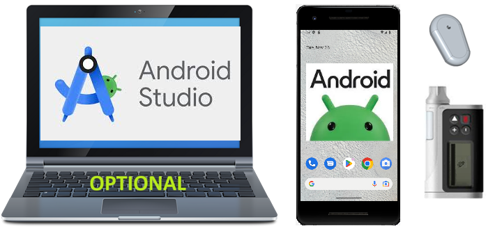

# Visió general dels components

**AAPS** no és només una aplicació (que compileu vosaltres); és un dels diversos mòduls del vostre sistema de llaç tancat. Abans de triar els components, és bona idea llegir la documentació de cada component.



```{admonition} IMPORTANT SAFETY NOTICE
:class: important

La base de les funcions de seguretat d'**AAPS** que es descriuen en aquesta documentació són les funcions de seguretat del maquinari que feu servir per construir el vostre sistema. Per tancar un llaç de dosificació automàtica d'insulina, és molt important que feu servir només una bomba d'insulina i un CGM provats, que funcionin del tot i que estiguin aprovats per les autoritats oficials del vostre país. Les modificacions de maquinari o de programari d'aquests components poden causar dosis d'insulina inesperades i un risc greu per a l'usuari. Si trobeu o us ofereixen bombes d'insulina o receptors de CGM trencats, modificats o fets a casa, **no els feu servir** per crear un sistema **AAPS**.

A més, és igual d'important fer servir només material original, com aplicadors, cànules i reservoris d'insulina aprovats pel fabricant per a la vostra bomba o el vostre CGM. Fer servir material no provat o modificat pot causar errors de lectura del CGM i errors en la dosi d'insulina. La insulina és molt perillosa si la dosi és incorrecta: no jugueu amb la vostra vida manipulant el vostre material.

I, per acabar, no heu de prendre inhibidors de l'SGLT-2 (gliflozines), perquè fan baixar la glucèmia d'una manera que no es pot calcular. La combinació amb un sistema que redueix la taxa basal per fer pujar la glucèmia és especialment perillosa: a causa de la gliflozina, aquesta pujada de glucèmia pot no passar i es pot arribar a un estat perillós de falta d'insulina. [Més informació aquí](#PreparingForAaps-no-sglt-2-inhibitors).
```

## Mòduls necessaris

### Una bona dosificació individual per a la vostra teràpia de la diabetis

Tot i que no és una cosa que es crea o es compra, probablement és el «mòdul» més infravalorat, però és imprescindible. Quan deixeu que un algoritme us ajudi a gestionar la diabetis, ha de conèixer la configuració correcta per no cometre errors greus. Encara que us faltin altres mòduls, ja podeu comprovar i ajustar el vostre **perfil** amb el vostre equip de diabetis.

El **perfil** inclou:

- BR (taxes basals): dona la insulina de fons;
- ISF (factor de sensibilitat a la insulina): quant baixarà la vostra glucèmia amb 1 unitat d'insulina;
- CR (ràtio de carbohidrats): quants grams de carbohidrats cobreix una unitat d'insulina.

La majoria d'usuaris del llaç fan servir BR, ISF i CR circadians, que s'adapten a la sensibilitat hormonal a la insulina durant el dia.

A més del vostre **perfil**, també heu de configurar la vostra **insulina** a **Gestionar → Configuració d'insulina**, inclosa la seva DIA (durada de l'acció de la insulina); vegeu [Configuració d'insulina](#Config-Builder-insulin-dia).

Més informació sobre el vostre **perfil** [a la seva pàgina](../SettingUpAaps/YourAapsProfile.md).

### Telèfon

Vegeu la pàgina [Telèfons](../Getting-Started/Phones.md).

### Bomba d'insulina

Vegeu la pàgina [Bombes compatibles](../Getting-Started/CompatiblePumps.md).

**Avantatges i inconvenients d'alguns models de bomba**

La Combo, la Insight i les Medtronic antigues són bombes sòlides i es poden fer servir amb el llaç. La Combo té l'avantatge que podeu triar entre molts més tipus de sets d'infusió, perquè té una connexió Luer-Lock estàndard. I la pila és una de normal que podeu comprar a qualsevol benzinera o botiga de 24 hores, i si de debò en necessiteu una, la podeu agafar del comandament de la tele de l'habitació de l'hotel ;-).

Però els avantatges de la DanaR/RS i la Dana-i davant la Combo com a bomba preferida són:

- L'emparellament inicial és més senzill amb la Dana-i/RS. Però normalment només ho feu una vegada, així que només importa si voleu provar una funció nova amb diferents bombes.
- Fins ara la Combo funciona llegint la pantalla. En general funciona molt bé, però és lent. Per al llaç això no importa gaire, perquè tot funciona en segon pla. Tot i així, cal estar connectat molt més temps, i per tant hi ha més temps en què la connexió BT es pot tallar, cosa que no és fàcil si us allunyeu del telèfon mentre feu un bolus i cuineu.
- La Combo vibra al final de les TBR; la DanaR vibra (o fa un bip) amb els SMB. A la nit, probablement fareu servir més TBR que SMB.  La Dana-i/RS es pot configurar perquè no faci bips ni vibri.
- Llegir l'historial de la Dana-i/RS, amb els carbohidrats, en pocs segons permet canviar de telèfon fàcilment sense connexió a internet i continuar amb el llaç tan aviat com arriben alguns valors del CGM.
- Totes les bombes amb què **AAPS** es pot comunicar són impermeables quan es lliuren. Només les bombes Dana són també «impermeables per garantia», gràcies al compartiment de la pila segellat i al sistema d'omplir el reservori.

### Origen glucèmia

Vegeu la pàgina [CGM compatibles](../Getting-Started/CompatiblesCgms.md).

### Fitxer .apk d'**AAPS**

El component principal del sistema. Per instal·lar l'aplicació, primer heu de compilar vosaltres mateixos el fitxer apk. Les instruccions són [aquí](../SettingUpAaps/BuildingAaps.md).

### Servidor d'informes

Un servidor d'informes mostra les vostres dades de glucèmia i de tractaments, i crea informes per a una anàlisi detallada. Ara mateix hi ha dos servidors d'informes que podeu fer servir amb AAPS: [Nightscout](#SettingUpTheReportingServer-nightscout) i [Tidepool](#SettingUpTheReportingServer-tidepool). Tots dos permeten veure les vostres dades de diabetis al llarg del temps i donen estadístiques sobre el **temps en rang** (TIR) i altres mesures.

El servidor d'informes és independent dels altres mòduls. Si no voleu fer servir un servidor d'informes, heu de saber que no és obligatori per fer funcionar **AAPS** a llarg termini. Però igualment n'heu de configurar un, perquè cal per completar l'[**Objectiu 1**](#objectives-objective1).

Trobareu més informació sobre com configurar el vostre servidor d'informes [aquí](../SettingUpAaps/SettingUpTheReportingServer.md).

## Mòduls opcionals

### Rellotge intel·ligent

Podeu triar qualsevol rellotge intel·ligent amb **Wear OS 3** o més nou. Vegeu [Rellotges intel·ligents i AAPS](../Getting-Started/Watches.md) per a més detalls.

Els usuaris fan una [llista de telèfons i rellotges provats](#Phones-list-of-tested-phones). Hi ha diverses watchfaces per fer servir amb **AAPS**, que podeu trobar [aquí](../WearOS/WearOsSmartwatch.md).

### xDrip

Encara que no necessiteu l'aplicació xDrip com a **Origen glucèmia**, la podeu fer servir igualment, per exemple per a alarmes o per veure la glucèmia d'una altra manera. Podeu tenir tantes alarmes com vulgueu, indicar a quina hora ha d'estar activa una alarma, triar si pot sonar en mode silenciós, etc. Trobareu informació sobre xDrip [aquí](../CompatibleCgms/xDrip.md). Tingueu en compte que la documentació d'aquesta aplicació no sempre està actualitzada, perquè canvia ràpidament.

## Què podeu fer mentre espereu els mòduls

De vegades es tarda una mica a tenir tots els mòduls per tancar el llaç. Però no us preocupeu, hi ha moltes coses que podeu fer mentre espereu. It is **necessary** to check and (where appropriate) adapt basal rates (BR), insulin-carb ratio (IC), insulin-sensitivity-factors (ISF) etc. I potser el llaç obert és una bona manera de provar el sistema i familiaritzar-vos amb **AAPS**. En aquest mode, **AAPS** dona recomanacions de tractament que podeu fer manualment.

Podeu continuar llegint aquesta documentació, contactar amb altres usuaris del llaç en línia o en persona, [llegir](../UsefulLinks/BackgroundReading.md) documentació o el que escriuen altres usuaris del llaç (tot i que heu d'anar amb compte: no tot és correcte ni adequat per a vosaltres).

**Fet?** Si ja teniu tots els components d'**AAPS** (felicitats!) o com a mínim prou per començar en mode de llaç obert, primer heu de llegir la [descripció dels objectius](../SettingUpAaps/CompletingTheObjectives.md) abans de cada objectiu nou, i configurar el vostre maquinari.
