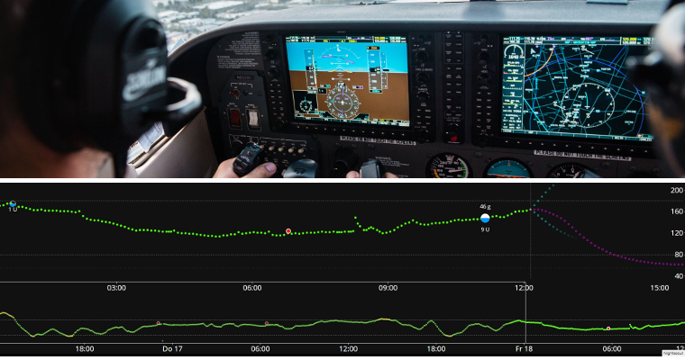
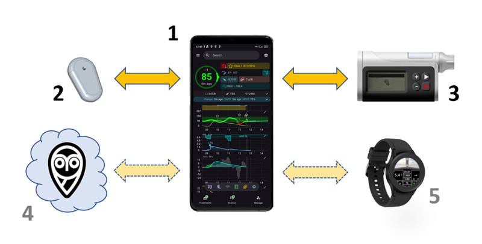
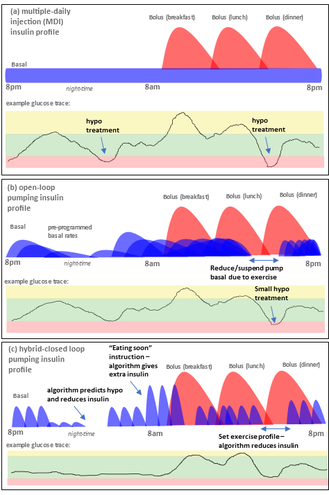
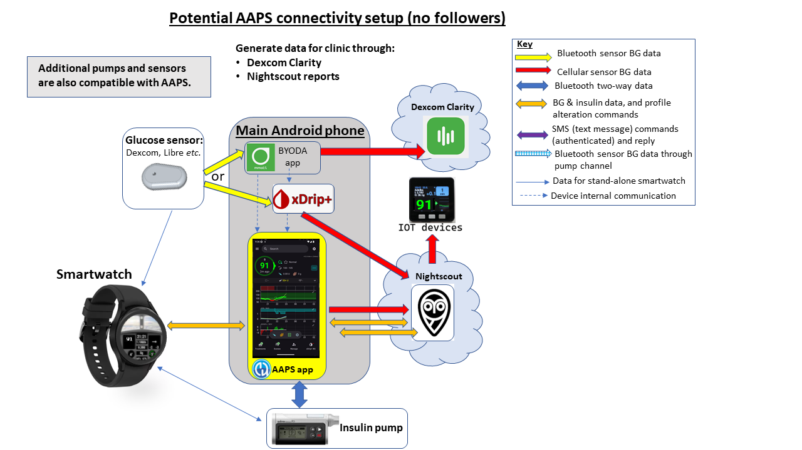
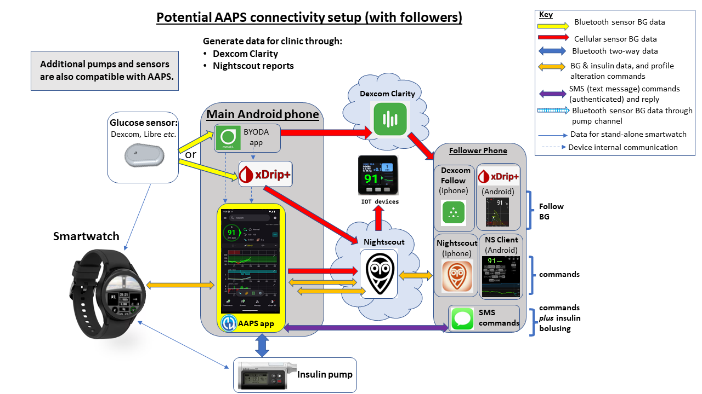

# Introducció a APS i AAPS

```{contents} In this page
:backlinks: entry
:depth: 2
```

## Què és un «sistema de pàncrees artificial»?

Un pàncrees humà fa moltes coses a més de regular la glucèmia. Tanmateix, el terme **«sistema de pàncrees artificial» (APS)** normalment es refereix a un sistema que treballa per mantenir la glucèmia automàticament dins de límits saludables.

La manera més bàsica de fer-ho és detectar els **nivells de glucèmia**, fer servir aquests valors per fer **càlculs** i després lliurar al cos la quantitat correcta (prevista) d'**insulina**. Repeteix el càlcul cada pocs minuts, 24 hores al dia, 7 dies a la setmana. Fa servir **alarmes** i **alertes** per informar l'usuari quan cal que intervingui o que hi pari atenció. Aquest sistema normalment està format per un **sensor de glucosa**, una **bomba d'insulina** i un **controlador** que fa els càlculs. A **AAPS** i a altres sistemes de codi obert, el controlador és una aplicació en un telèfon. A la majoria dels sistemes comercials és un programari integrat a la mateixa bomba, amb una aplicació de telèfon que serveix sobretot per veure les dades i controlar el sistema.

Per saber com es van desenvolupar els sistemes de llaç tancat i com funcionen, aquest article de revisió del 2022 és un bon punt de partida. Tingueu en compte que és anterior a la majoria dels sistemes disponibles avui, així que no és una guia del que hi ha actualment al mercat:

 [Closed-Loop Insulin Delivery Systems: Past, Present, and Future Directions](https://www.frontiersin.org/journals/endocrinology/articles/10.3389/fendo.2022.919942/full) (Templer, _Frontiers in Endocrinology_, 2022).

Els anomenats sistemes «bihormonals» infonen glucagó a més d'insulina, amb l'objectiu de prevenir hipoglucèmies greus i permetre un control encara més estricte de la glucèmia. Ja s'ha aprovat a Europa un primer sistema d'aquest tipus, però només es subministra a través d'estudis i projectes, i n'hi ha d'altres encara en desenvolupament. Encara no se'n ven cap al públic general.

Un pàncrees artificial es pot veure com un [«pilot automàtic per a la vostra diabetis»](https://www.artificialpancreasbook.com/). Què vol dir això?

En un avió, el pilot automàtic no fa tota la feina del pilot humà: el pilot no pot dormir durant tot el vol. El pilot automàtic ajuda el pilot en la seva feina. Li treu la càrrega d'haver de controlar l'avió constantment, i així el pilot es pot concentrar en una supervisió més àmplia. El pilot automàtic rep senyals de diversos sensors, un ordinador avalua les dades juntament amb les indicacions del pilot i fa els ajustos necessaris, i avisa el pilot si hi ha algun problema. El pilot ja no s'ha de preocupar de prendre decisions contínuament, i aquesta comparació es pot aplicar a **AAPS**.



(Introduction-what-does-hybrid-closed-loop-mean)=
## Què vol dir llaç tancat híbrid?

La millor solució per a la diabetis tipus 1 seria una «cura funcional» (probablement un implant de cèl·lules pancreàtiques protegides del sistema immunitari). Mentre la comunitat de persones amb diabetis tipus 1 (DT1) espera aquesta solució, un pàncrees artificial de «llaç tancat complet» és probablement la millor alternativa. Es tracta d'un sistema tecnològic que no necessita cap acció de l'usuari (com ara posar bolus d'insulina per als àpats o anunciar l'esport) i que regula bé la glucèmia. Gairebé tots els sistemes d'ús diari són de llaç tancat «híbrid», perquè combinen tecnologia automatitzada i accions de l'usuari. Els primers sistemes de llaç tancat complet es van aprovar a Europa el 2026, però encara no n'hi ha cap que estigui disponible de manera àmplia.

## Com i per què van començar els sistemes de llaç?

El desenvolupament de tecnologia comercial per a persones amb diabetis tipus 1 (DT1) és molt lent. El 2013, la comunitat DT1 va fundar el moviment #WeAreNotWaiting. Van desenvolupar ells mateixos sistemes amb tecnologia aprovada que ja existia (bombes d'insulina i sensors) per millorar el control de la glucèmia, la seguretat i la qualitat de vida. Es coneixen com a sistemes OS-AID (Open-Source Automated Insulin Delivery, lliurament automàtic d'insulina de codi obert), abans anomenats sistemes DIY, perquè no estan aprovats formalment per les autoritats sanitàries (FDA, NHS, etc.). Hi ha quatre sistemes OS-AID principals disponibles: [OpenAPS](https://openaps.org/what-is-openaps/), **AAPS**, [Loop](https://loopkit.github.io/loopdocs/#what-is-loop) i [Trio](https://triodocs.org).

Una molt bona manera d'entendre els fonaments dels llaços OS-AID és llegir el llibre de Dana Lewis «Automated Insulin Delivery». Podeu llegir-lo gratuïtament [aquí](https://www.artificialpancreasbook.com/) (o comprar el llibre en paper). Si voleu entendre millor [OpenAPS](https://openaps.org/what-is-openaps/), del qual s'ha desenvolupat **AAPS**, el [lloc web d'OpenAPS](https://openaps.org/what-is-openaps/) és un recurs molt bo.

També s'han llançat diversos sistemes comercials de llaç tancat híbrid. Són molt diferents dels sistemes OS-AID, sobretot perquè molts inclouen un «algoritme d'aprenentatge» que ajusta la quantitat d'insulina lliurada segons les vostres necessitats d'insulina dels dies anteriors. Moltes persones de la comunitat OS-AID ja han provat sistemes comercials i els han comparat amb el seu sistema OS-AID. Per saber més sobre les diferències entre els sistemes, podeu preguntar als grups de Facebook dedicats a aquests sistemes, al [grup de Facebook d'AAPS](https://www.facebook.com/groups/AndroidAPSUsers/) o a [Discord](https://discord.com/invite/4fQUWHZ4Mw).

## Què és Android APS (AAPS)?



**Figura 1**. Esquema bàsic d'Android APS (sistema de pàncrees artificial), AAPS.

Android APS (**AAPS**) és un sistema de llaç tancat híbrid, o sistema de pàncrees artificial (APS). Calcula les dosis d'insulina amb els algoritmes consolidats d'[OpenAPS](https://openaps.org/) (un conjunt de regles), desenvolupats per la comunitat DT1 #WeAreNotWaiting.

Com que OpenAPS només és compatible amb algunes bombes d'insulina antigues, **AAPS** (que es pot fer servir amb més tipus de bombes d'insulina) es va desenvolupar per primera vegada el 2016 per a un familiar amb diabetis tipus 1. Des d'aquells primers temps, un equip de desenvolupadors voluntaris i altres entusiastes relacionats amb el món de la diabetis tipus 1 ha continuat desenvolupant i millorant **AAPS**. Avui, molts milers de persones de tot el món fan servir **AAPS**. És un sistema molt personalitzable i versàtil i, com que és de codi obert, també és fàcilment compatible amb molts altres programes i plataformes de codi obert per a la diabetis. Els components fonamentals del sistema **AAPS** actual es mostren a la **Figura 1** de més amunt.


## Quins són els components bàsics d'AAPS?

El «cervell» d'AAPS és una **aplicació** que compileu vosaltres mateixos. Hi ha instruccions detallades pas a pas per fer-ho. Després instal·leu l'**aplicació AAPS** en un **telèfon intel·ligent Android** [compatible](../Getting-Started/Phones.md) (**1**). Alguns usuaris prefereixen tenir el llaç en un telèfon diferent del seu telèfon principal. Així, no cal que feu servir un telèfon Android per a tota la resta de la vostra vida, només per fer funcionar el vostre llaç AAPS.

Al **telèfon intel·ligent Android** també caldrà instal·lar una altra aplicació, a més d'**AAPS**. Aquesta [aplicació addicional](../Getting-Started/CompatiblesCgms.md) rep les dades de glucèmia d'un sensor (**2**) per Bluetooth i després les envia internament, dins del telèfon, a l'**aplicació AAPS**.

L'**aplicació AAPS** fa servir un procés de presa de decisions (**algoritme**) d'OpenAPS. Els principiants comencen amb l'algoritme bàsic **oref0**, però és possible passar a l'algoritme més nou **oref1** a mesura que avanceu amb AAPS. Quin algoritme feu servir (oref0 o oref1) depèn de quin s'adapta millor a la vostra situació.  En tots dos casos, l'algoritme té en compte molts factors i fa càlculs ràpids cada vegada que arriba una nova lectura del sensor. Després, l'algoritme envia per Bluetooth instruccions a la bomba d'insulina (**3**) sobre quanta insulina ha de lliurar. Tota la informació es pot enviar a internet (**4**) per dades mòbils o Wi-Fi. Si voleu, aquestes dades també es poden compartir amb seguidors i/o recollir per analitzar-les. Opcionalment, també podeu emparellar un [rellotge intel·ligent](../Getting-Started/Watches.md) (**5**) amb el telèfon per veure les vostres dades d'un cop d'ull i, amb alguns rellotges, enviar ordres bàsiques a **AAPS**.

## Quins avantatges té el sistema AAPS?

L'algoritme d'OpenAPS que fa servir **AAPS** controla la glucèmia sense accions de l'usuari, segons els paràmetres que l'usuari ha definit (els més importants són les taxes basals, els factors de sensibilitat a la insulina, les ràtios insulina:carbohidrats, la durada de l'acció de la insulina, etc.), i reacciona cada 5 minuts a les noves dades del sensor.

Alguns dels avantatges d'**AAPS** que esmenten els usuaris són les moltes opcions que es poden ajustar, les **automatitzacions** i una transparència més gran del sistema per al pacient/cuidador. Això pot donar un millor control de la vostra diabetis (o de la de la persona que cuideu), cosa que alhora pot millorar la qualitat de vida i donar més tranquil·litat.

Si hi dediqueu temps, **AAPS** us pot ajudar a aconseguir:

- menys estrès i menys càrrega en la gestió de la diabetis tipus 1;

- menys decisions rutinàries de les moltes que comporta la diabetis tipus 1;

- una dosificació d'insulina personalitzada i dinàmica, basada en dades en temps real, que pot reduir la necessitat de tractar hipoglucèmies i reduir els episodis d'hiperglucèmia;

- més coneixements sobre la gestió de la insulina i més confiança per ajustar millor la vostra configuració;

- la possibilitat de crear configuracions automàtiques (**automatitzacions**) adaptades al vostre estil de vida;

- una millor qualitat del son i, en general, menys intervencions durant la nit;

- monitoratge remot i administració del lliurament d'insulina per als cuidadors de persones amb diabetis tipus 1; i

- tenir tot el vostre equip portàtil per a la diabetis (receptor del monitor continu de glucosa i dispositius de control de la insulina) unificat en un telèfon Android controlat per **AAPS**.


Al final, **AAPS** pot ajudar les persones a gestionar millor la seva diabetis, amb glucèmies estables i una salut millor a llarg termini.

### Avantatges concrets:

#### 1) Seguretat integrada
Per llegir sobre les funcions de seguretat dels algoritmes, coneguts com a oref0 i oref1, [feu clic aquí](https://openaps.org/reference-design/). L'usuari controla els seus propis límits de seguretat.

#### 2) Flexibilitat de maquinari

**AAPS** funciona amb una gran varietat de bombes d'insulina i sensors i ofereix flexibilitat quan la vida canvia. Per exemple, si desenvolupeu una al·lèrgia a la cola del pegat del sensor Dexcom, podeu canviar a un sensor Libre. Els usuaris no han de tornar a compilar ni reinstal·lar l'aplicació **AAPS**: per canviar de maquinari, només cal seleccionar una altra bomba o un altre origen de glucèmia al **Configurador**. **AAPS** no depèn de controladors de bomba concrets i també inclou una «bomba virtual», perquè els usuaris puguin experimentar de manera segura abans de fer-lo servir amb ells mateixos.

#### 3) Molt personalitzable, amb paràmetres amplis

Els usuaris poden afegir o treure mòduls o funcions fàcilment, i **AAPS** es pot fer servir tant en mode de llaç obert com de llaç tancat. Aquests són alguns exemples de les possibilitats del sistema **AAPS**:

 a) La possibilitat de definir un objectiu de **glucèmia** més baix 30 min abans de menjar; podeu posar l'objectiu fins a 72 mg/dl (4,0 mmol/l).

 b) Si teniu resistència a la insulina i això us provoca glucèmies altes, **AAPS** us permet definir una regla d'**automatització** que s'activi quan la glucèmia pugi per sobre de 8 mmol/l (144 mg/dl) i que canviï (per exemple) a un perfil del 120% (cosa que augmenta un 20% la basal i també reforça altres factors, en comparació amb la configuració normal del vostre **perfil**). L'automatització durarà segons l'horari que hàgiu definit. Aquesta automatització es pot configurar perquè només estigui activa certs dies de la setmana, a certes hores del dia i fins i tot en certs llocs.

 c) Si el vostre fill salta al trampolí sense avisar, **AAPS** permet suspendre la insulina durant un temps determinat, directament des del telèfon.

 d) Després de tornar a connectar una bomba amb tub que s'ha desconnectat per nedar, **AAPS** calcularà la insulina basal que no s'ha lliurat mentre estava desconnectada i la lliurarà amb cura, segons la vostra glucèmia actual. La insulina que no calgui es pot evitar simplement «cancel·lant» la basal que no s'ha lliurat.

 e) **AAPS** us permet definir perfils diferents per a situacions diferents i canviar fàcilment d'un a l'altre. Per exemple, les funcions que fan que l'algoritme baixi més de pressa una glucèmia elevada (com els super micro bolus («**SMB**») i els àpats no anunciats («**UAM**»)) es poden configurar perquè només funcionin durant el dia, si us preocupen les hipoglucèmies nocturnes.

Tot això són exemples; el conjunt complet de funcions dona una gran flexibilitat per a la vida diària, incloent-hi l'esport, la malaltia, els cicles hormonals, _etc_. Al final, és l'usuari qui decideix com fer servir aquesta flexibilitat, i no hi ha cap automatització que serveixi per a tothom.

#### 4) Monitoratge remot
Hi ha diversos canals de monitoratge possibles (Sugarmate, Dexcom Follow, xDrip, Android Auto, _etc._) que són útils per a pares/cuidadors i per a adults en certes situacions (dormint/conduint) que necessiten alertes personalitzables. En algunes aplicacions (xDrip) també podeu desactivar del tot les alarmes. Això va molt bé si teniu un sensor nou en període d'adaptació («soaking») i encara no voleu fer servir el llaç amb ell.

#### 5) Control remot
Un avantatge important d'**AAPS** respecte als sistemes comercials és que els seguidors poden enviar moltes ordres al sistema **AAPS**, amb ordres de text autenticades (SMS) o amb una aplicació **AAPSClient** emparellada. Els pares de nens amb diabetis tipus 1 que fan servir **AAPS** utilitzen molt aquesta funció.

Les funcions de control remot poden ser molt útils: per exemple, al parc, si voleu posar un prebolus per a un berenar des del vostre propi telèfon mentre el vostre fill està ocupat jugant. També és possible vigilar el sistema des d'un rellotge intel·ligent (_p. ex._ Garmin) o enviar-li ordres bàsiques des del rellotge (_p. ex._ un rellotge Wear OS com el Samsung Galaxy Watch).

#### 6) Sense limitacions comercials, gràcies a interfícies d'aplicació obertes
A més de l'enfocament de codi obert, que permet veure el codi font d'**AAPS** en qualsevol moment, el principi general d'oferir interfícies de programació obertes també dona a altres desenvolupadors l'oportunitat d'aportar noves idees. **AAPS** està molt integrat amb Nightscout. Això accelera el desenvolupament i permet als usuaris afegir funcions per fer la vida amb diabetis encara més còmoda. Bons exemples d'aquestes integracions són [Nightscout](https://nightscout.github.io/), [Nightscout Reporter](https://nightscout-reporter.zreptil.de/), xDrip, [M5 stack](https://github.com/mlukasek/M5_NightscoutMon/wiki), etc. Hi ha un diàleg continu entre els desenvolupadors de codi obert i els que desenvolupen sistemes comercials. Els sistemes comercials adopten a poc a poc moltes de les innovacions OS-AID. En aquests sistemes, el desenvolupament és lògicament més lent, en part perquè les interfícies entre sistemes de diferents empreses (bombes, aplicacions, sensors, _etc_) s'han de negociar i llicenciar amb cura. Això també pot alentir innovacions que són pràctiques per al pacient (o per a un petit grup de pacients amb una necessitat molt específica) però que no generen cap benefici econòmic important.

#### 7) Interfície de l'aplicació detallada
Amb **AAPS** és fàcil controlar coses com: el nivell d'insulina de la bomba, l'edat de la cànula, l'edat del sensor, l'edat de la pila de la bomba, la insulina a bord, _etc_. Moltes accions es poden fer amb l'aplicació **AAPS** (encebar la bomba, desconnectar la bomba, _etc_.) en lloc de fer-les a la mateixa bomba. Així, la bomba es pot quedar a la butxaca o al cinturó (vostre o de la persona que cuideu).

#### 8) Accessibilitat i preu assequible
**AAPS** dona a les persones que ara no poden pagar-se un sistema, o que no tenen finançament/assegurança, accés a un sistema de llaç tancat híbrid que, conceptualment, està anys per davant dels sistemes comercials pel que fa al desenvolupament. Actualment necessiteu un servidor d'informes (Nightscout o Tidepool) per configurar **AAPS**, tot i que no cal per al funcionament diari del llaç **AAPS**. Molta gent continua fent servir Nightscout per recollir les seves dades i per al monitoratge remot. Tot i que **AAPS** és gratuït, configurar Nightscout en una de les diverses plataformes pot tenir un cost (0–12 €), segons el nivell de suport que vulgueu (vegeu la taula comparativa) i si voleu continuar fent servir Nightscout després de la configuració o no. **AAPS** funciona amb una gran varietat de [telèfons Android](https://docs.google.com/spreadsheets/u/1/d/e/2PACX-1vScCNaIguEZVTVFAgpv1kXHdsHl3fs6xT6RB2Z1CeVJ561AvvqGwxMhlmSHk4J056gMCAQE02sAWJvT/pubhtml?gid=683363241&single=true) assequibles (a partir d'uns 150 €). Hi ha versions diferents per a llocs i idiomes concrets, i AAPS també el poden fer servir persones [cegues](#accessibility-for-users-aaps-who-are-partially-or-completely-blind).

#### 9) Suport
Cap sistema de lliurament automàtic d'insulina és perfecte. Els sistemes comercials i els de codi obert tenen molts errors en comú, tant de comunicació com de fallades temporals del maquinari. Hi ha suport de la comunitat d'usuaris d'AAPS a Facebook, Discord i GitHub: persones de tot el món que han dissenyat, desenvolupat i fan servir actualment **AAPS**. Per als sistemes APS comercials també hi ha grups de suport a Facebook i ajuda de les clíniques i de les empreses. Val la pena parlar amb usuaris, o antics usuaris, d'aquests sistemes per saber quins errors comuns tenen, quina qualitat té el programa de formació i quin nivell de suport continu ofereixen.

#### 10) Previsibilitat, transparència i seguretat
**AAPS** és transparent, lògic i previsible. Això pot fer més fàcil saber quan una configuració és incorrecta i ajustar-la. Podeu veure exactament què fa el sistema i per què ho fa, i definir-ne els límits de funcionament. Així, el control (i la responsabilitat) és a les vostres mans. Això pot donar confiança a l'usuari i un son més tranquil.

#### 11) Accés a funcions avançades a través dels modes de desenvolupament (dev), inclòs el llaç tancat complet
Aquesta documentació d'**AAPS** se centra en la branca principal **«master»** d'**AAPS**. Tanmateix, la recerca i el desenvolupament no s'aturen mai. Els usuaris amb més experiència poden explorar les funcions experimentals de la branca de **desenvolupament**. Les innovacions en desenvolupament se centren en estratègies per al llaç tancat complet (sense haver de posar bolus per als àpats, _etc._) i, en general, en fer la vida amb diabetis tipus 1 tan còmoda com sigui possible.

#### 12) Possibilitat de contribuir vosaltres mateixos a noves millores
La diabetis tipus 1 pot ser molt frustrant i fer que us sentiu sols. Tenir el control de la vostra pròpia tecnologia per a la diabetis pot ser molt gratificant, també perquè, tan aviat com feu progressos, podeu «tornar el favor» ajudant altres persones en el seu camí. Podeu formar-vos, descobrir els obstacles, buscar novetats i fins i tot contribuir al desenvolupament i a la documentació. A la comunitat hi haurà altres persones amb el mateix objectiu amb qui podreu compartir idees i treballar. Aquesta és l'essència de #WeAreNotWaiting.

## Com es compara AAPS amb les MDI i amb el llaç obert?

Les múltiples injeccions diàries (MDI, (a) a la **Figura 2** de més avall) normalment consisteixen en una injecció d'insulina d'acció prolongada (_p. ex._ Tresiba) un cop al dia, i injeccions d'insulina d'acció més ràpida (_p. ex._ Novorapid, Fiasp) als àpats o per a correccions. La bomba en llaç obert (b) consisteix a fer servir una bomba que lliura la basal d'insulina d'acció ràpida a taxes programades i, a més, posar bolus amb la bomba als àpats o per a correccions. La base d'un sistema de llaç és que l'aplicació del llaç fa servir les dades de glucèmia del sensor per indicar a la bomba que aturi el lliurament d'insulina quan preveu que aneu cap a una hipoglucèmia, i que us doni insulina addicional si la glucèmia puja i es preveu que serà massa alta (c). Aquesta figura és molt més simple que la vida real, però vol mostrar les diferències clau entre els enfocaments. És possible aconseguir un control de la glucèmia excepcionalment bo amb qualsevol d'aquests tres enfocaments.




**Figura 2**. Visió general bàsica de (a) MDI, (b) bomba en llaç obert i (c) bomba en llaç tancat híbrid.

## Com es compara AAPS amb altres sistemes de llaç?

A 25 de juny de 2023, hi ha quatre sistemes principals de llaç tancat de codi obert disponibles: [OpenAPS](https://openaps.readthedocs.io/), **AAPS**, [Loop](https://loopkit.github.io/loopdocs/#what-is-loop) i [Trio](https://triodocs.org) (abans FreeAPS X). Les característiques dels diferents sistemes es mostren a la taula següent:


| Tipus de dispositiu | Nom                                                                             | [AAPS](https://wiki.aaps.app)               | [Llaç](https://loopkit.github.io/loopdocs/) | [Open APS](https://openaps.readthedocs.io/en/latest/) | [Trio](https://triodocs.org)                |
| ------------------- | ------------------------------------------------------------------------------- | ------------------------------------------- | ------------------------------------------- | ----------------------------------------------------- | ------------------------------------------- |
| Telèfon             | Android                                                                         |       |  |            |  |
| Telèfon             | iPhone                                                                          |  |       |            |       |
| Rig                 | ordinador petit (1)                                                             |  |  |                 |  |
| PUMP                | [Dana I](../CompatiblePumps/DanaRS-Insulin-Pump.md)                             |       |       |            |       |
| PUMP                | [Dana RS](../CompatiblePumps/DanaRS-Insulin-Pump.md)                            |       |       |            |       |
| PUMP                | [Dana R](../CompatiblePumps/DanaR-Insulin-Pump.md)                              |       |  |            |  |
| PUMP                | [Omnipod (Dash)](../CompatiblePumps/OmnipodDASH.md)                             |       |       |            |       |
| PUMP                | [Omnipod (Eros)](../CompatiblePumps/OmnipodEros.md)                             |       |       |            |       |
| PUMP                | [Diaconn G8](../CompatiblePumps/DiaconnG8.md)                                   |       |  |            |  |
| PUMP                | [EOPatch 2](../CompatiblePumps/EOPatch2.md)                                     |       |  |            |  |
| PUMP                | [Medtrum TouchCare Nano 200U](../CompatiblePumps/MedtrumNano.md)                |       |       |            |       |
| PUMP                | [Medtrum TouchCare 300U](../CompatiblePumps/MedtrumNano.md)                     |       |       |            |       |
| PUMP                | [Roche Combo](../CompatiblePumps/Accu-Chek-Combo-Pump-v2.md)                    |       |  |            |  |
| PUMP                | [Roche Insight](../CompatiblePumps/Accu-Chek-Insight-Pump.md)                   |       |  |            |  |
| PUMP                | [Medtronic antigues](../CompatiblePumps/MedtronicPump.md)                       |       |       |                 |       |
| PUMP                | [Equil 5.3](../CompatiblePumps/Equil5.3.md)                                     |       |  |            |  |
| PUMP                | [CareLevo](../CompatiblePumps/CareLevo.md)                                      |       |  |            |  |
| PUMP                | [AP550](../CompatiblePumps/AP550-Insulin-Pump.md)                               |       |  |            |  |
| CGM                 | [Dexcom G7/One+/Stelo](../CompatibleCgms/DexcomG7.md)                           |       |       |            |       |
| CGM                 | [Dexcom One](../CompatibleCgms/DexcomG6.md)                                     |       |       |            |       |
| CGM                 | [Dexcom G6](../CompatibleCgms/DexcomG6.md)                                      |       |       |                 |       |
| CGM                 | [Libre 3/3+](../CompatibleCgms/Libre3.md)                                       |       |       |            |       |
| CGM                 | [Libre 2/2+](../CompatibleCgms/Libre2.md)                                       |       |       |            |       |
| CGM                 | [Libre 1](../CompatibleCgms/Libre1.md)                                          |       |       |            |       |
| CGM                 | [Eversense](../CompatibleCgms/Eversense.md)                                     |       |       |            |       |
| CGM                 | [MM640g/MM630g](../CompatibleCgms/MM640g.md)                                    |       |  |            |  |
| CGM                 | [PocTech](../CompatibleCgms/PocTech.md)                                         |       |  |            |  |
| CGM                 | [Ottai](../CompatibleCgms/OttaiM8.md)                                           |       |  |            |  |
| CGM                 | [Syai Tag](../CompatibleCgms/SyaiTagX1.md)                                      |       |  |            |  |
| CGM                 | [Nightscout com a origen de glucèmia](../CompatibleCgms/CgmNightscoutUpload.md) |       |       |                 |       |

_Notes de la taula:_
1. Un **rig** és un ordinador petit, sense pantalla, que porteu a sobre. Un tipus de dispositiu compatible és Intel Edison + Explorer Board i l'altre és Raspberry Pi + Explorer HAT o Adafruit RFM69HCW Bonnet. Els primers sistemes APS es basaven en aquesta configuració, perquè els telèfons mòbils no podien executar els algoritmes necessaris. L'ús d'aquests sistemes ha disminuït, perquè la configuració als telèfons mòbils és més fàcil i els telèfons ja tenen pantalla. A més, Intel ha deixat de vendre l'Intel Edison. Els excel·lents algoritmes d'OpenAPS **oref0** i **oref1** ara estan incorporats a AAPS i a Trio.


Una declaració de consens internacional, revisada per experts, amb orientació pràctica sobre els sistemes de llaç de codi obert, va ser escrita per i per a professionals sanitaris i publicada el 2022 en una revista mèdica de referència: [_Lancet Diabetes Endocrinol_, 2022; 10: 58–74](https://www.ncbi.nlm.nih.gov/pmc/articles/PMC8720075/)(_1_). Val molt la pena llegir-lo (també per a la vostra clínica de diabetis): resumeix les principals diferències tècniques entre els diferents sistemes de llaç tancat híbrid de codi obert.

És difícil fer-se una idea de qualsevol sistema sense fer-lo servir o sense parlar amb persones que el fan servir. Per això, no dubteu a contactar amb altres usuaris a Facebook/Discord i preguntar. La majoria de la gent troba que **AAPS** és molt sofisticat en comparació amb altres sistemes de llaç tancat híbrid (sobretot els comercials), amb un gran nombre de configuracions i funcions personalitzables, com s'ha explicat més amunt. A algunes persones això els pot semblar una mica aclaparador al principi, però no cal investigar totes les possibilitats de cop. Podeu avançar tan a poc a poc o tan de pressa com vulgueu, i hi ha ajuda disponible a cada pas.


## AAPS fa servir intel·ligència artificial o algun algoritme d'aprenentatge?

La versió actual d'**AAPS** (4.0) no té cap algoritme d'aprenentatge automàtic, ni models de resposta a la insulina amb múltiples paràmetres, ni intel·ligència artificial. Per tant, el funcionament del sistema és obert i transparent, i el poden entendre no només els experts, sinó també els metges i els pacients. També vol dir que, si el vostre horari canvia molt (per exemple, passeu d'una setmana estressant a la feina a unes vacances relaxades) i probablement necessitareu una quantitat d'insulina molt diferent, podeu canviar immediatament **AAPS** a un perfil personalitzat més feble/més fort. Un «sistema d'aprenentatge» farà aquest ajust automàticament, però probablement trigarà més a ajustar el lliurament d'insulina.

(which-system-is-right-for-me-or-my-dependent)=
## Quin sistema és el millor per a mi o per a la persona que cuido?

A la pràctica, la vostra elecció de sistema sovint depèn de quina bomba ja teniu o podeu obtenir del vostre proveïdor mèdic, i del vostre telèfon (Apple o Android). Si encara no teniu bomba, podeu triar entre més sistemes. La tecnologia evoluciona contínuament: algunes bombes es deixen de fabricar i surten noves bombes i nous sensors. La majoria dels sistemes de codi obert funcionen amb els sensors principals (Libre i Dexcom) o s'adapten ràpidament als sensors nous, aproximadament un any després que surtin (amb una mica de retard per fer proves de seguretat i estabilitat).

La majoria dels usuaris d'**AAPS** diuen que tenen més temps en rang, una HbA1c més baixa i una millor qualitat de vida gràcies a un sistema que pot ajustar automàticament les taxes basals a la nit, mentre dormen. Això és cert per a la majoria dels sistemes de llaç tancat híbrid. Algunes persones prefereixen un sistema molt senzill i poc personalitzable (llavors potser preferireu un sistema comercial), i a d'altres aquesta falta de control els resulta molt frustrant (llavors potser preferireu un sistema de codi obert). Si vosaltres (o la persona que cuideu) acabeu de rebre el diagnòstic, un camí habitual és acostumar-se primer a les MDI amb un sensor de glucosa, després passar a una bomba que es pugui fer servir en llaç i després passar a **AAPS**. Però algunes persones (sobretot nens petits) poden passar directament a una bomba.

És important tenir en compte que l'usuari d'**AAPS** ha de ser proactiu per detectar i resoldre els problemes ell mateix, amb l'ajuda de la comunitat. Aquesta manera de pensar és molt diferent de la d'un usuari d'un sistema comercial. Amb **AAPS**, l'usuari té més control, però també més responsabilitat, i s'hi ha de sentir còmode.

## És segur fer servir sistemes de codi obert com AAPS?

### Seguretat del sistema AAPS
Probablement, una pregunta més precisa és: «És segur **en comparació** amb el meu sistema actual de lliurament d'insulina?», ja que cap mètode de lliurament d'insulina està lliure de riscos. **AAPS** té molts controls i mecanismes de seguretat. Un [article](https://www.liebertpub.com/doi/epub/10.1089/dia.2019.0375) recent va estudiar l'ús d'**AAPS** en una simulació per ordinador, que és una manera eficaç de provar objectivament com de segur i eficaç és el sistema. En general, molts milers de persones de tot el món fan servir sistemes de codi obert de lliurament automàtic d'insulina, i el seu ús continua creixent a tot el món.

Qualsevol dispositiu que faci servir comunicacions per ràdio podria ser piratejat, i això també és cert per a una bomba d'insulina sense llaç. Actualment no sabem de ningú que hagi intentat fer mal a persones piratejant el seu equip mèdic per a la diabetis. Tot i així, hi ha diverses maneres de protegir-se d'aquests riscos:

1.  A la configuració de la bomba, limiteu tant el bolus màxim permès com la basal temporal màxima als valors que considereu més segurs. Són límits fixos que creiem que cap pirata informàtic no es pot saltar.

2.  Activeu les alarmes del CGM tant per a glucèmia alta com baixa.

3.  Controleu el lliurament d'insulina en línia. Els usuaris de Nightscout poden definir alarmes addicionals per avisar en moltes situacions, incloses situacions molt més probables que un atac malintencionat. A més de les glucèmies altes i baixes, Nightscout pot mostrar dades de diagnòstic útils per comprovar que la bomba funciona com cal, com ara l'IOB actual, l'historial de basals temporals i l'historial de bolus de la bomba. També es pot configurar perquè avisi els usuaris de situacions no desitjades, com ara glucèmies altes i baixes previstes, poca insulina al reservori i pila de la bomba baixa.

Si hi hagués un atac malintencionat a la vostra bomba d'insulina, aquestes estratègies reduirien molt el risc. Cada possible usuari d'**AAPS** ha de valorar els riscos de fer servir **AAPS** en comparació amb els riscos de fer servir un altre sistema.

#### Seguretat: quan la glucèmia millora massa de pressa

Una reducció ràpida de l'HbA1c i un millor control de la glucèmia semblen atractius. Tanmateix, reduir la glucèmia mitjana _massa de pressa_ en començar qualsevol sistema de llaç tancat pot causar danys permanents, també als ulls, i una neuropatia dolorosa que no desapareix mai. Aquests danys es poden evitar simplement reduint els nivells més a poc a poc. Si ara teniu una HbA1c elevada i passeu a AAPS (o a qualsevol altre sistema de llaç tancat), parleu d'aquest possible risc amb el vostre equip mèdic abans de començar i acordeu-hi un calendari. Trobareu informació més general sobre com reduir la glucèmia de manera segura, amb enllaços a literatura mèdica, a la secció de seguretat, [aquí](#preparing-safety-first).

#### Seguretat mèdica: dispositius, consumibles i altres medicaments

Per a un llaç de pàncrees artificial, feu servir una bomba d'insulina i un CGM provats, que funcionin del tot i que estiguin aprovats per la FDA o tinguin el marcatge CE. Les modificacions de maquinari o de programari d'aquests components poden causar dosis d'insulina inesperades i un risc greu per a l'usuari. Si trobeu o us ofereixen bombes d'insulina o receptors de CGM trencats, modificats o fets a casa, no els feu servir per crear un sistema AAPS.

Feu servir consumibles originals, com ara insertors, cànules i reservoris d'insulina aprovats pel fabricant de la vostra bomba i del vostre CGM. Fer servir material no provat o modificat pot causar errors de lectura del CGM i errors en la dosi d'insulina. La insulina és molt perillosa si la dosi és incorrecta: no jugueu amb la vostra vida manipulant els consumibles.

No preneu inhibidors de l'SGLT-2 (gliflozines) quan feu servir **AAPS**, perquè fan baixar la glucèmia d'una manera que no es pot calcular. Combinar aquest efecte amb un sistema que redueix les taxes basals per fer pujar la glucèmia és perillós. Trobareu més detalls a la [secció principal de seguretat](#preparing-safety-first).

(introduction-how-can-i-approach-discussing-aaps-with-my-clinical-team)=
## Com puc parlar d'AAPS amb el meu equip mèdic?

Recomanem als usuaris que parlin amb els seus metges sobre la seva intenció de fer servir **AAPS**. No tingueu por de parlar amb sinceritat amb el vostre equip de diabetis si teniu intenció de fer servir **AAPS** (o qualsevol altre llaç OS-AID). La transparència i la confiança entre pacient i metge són fonamentals.

### Enfocament suggerit:
Comenceu una conversa amb el vostre metge per saber què coneix de la tecnologia per a la diabetis i quina actitud hi té: els CGM, les bombes, els llaços híbrids i els sistemes de llaç comercials. El vostre metge/endocrinòleg hauria de conèixer la tecnologia bàsica i estar disposat a parlar amb vosaltres dels avenços recents en els productes de llaç comercials disponibles a la seva regió.

#### Precedents locals

Pregunteu l'opinió dels vostres metges/endocrinòlegs sobre els llaços OS-AID _vs_ els llaços comercials, i valoreu què en saben. Coneixen **AAPS** i us poden explicar alguna experiència útil amb pacients que fan servir llaços OS-AID?

Pregunteu si el vostre equip té pacients que ja fan servir llaços OS-AID. Per la confidencialitat dels pacients, els metges no us poden donar les dades d'altres pacients sense el consentiment de la persona. Tanmateix, si voleu, **sí que** els podeu demanar que donin les **vostres** dades de contacte a un pacient que ja fa servir un llaç OS-AID, si n'hi ha algun amb qui el metge creu que us podeu entendre bé. Podeu dir que us agradaria que aquest pacient us contactés per parlar dels llaços OS-AID. Els metges no estan obligats a fer-ho, però alguns ho fan de gust, perquè entenen la importància del suport entre iguals en el tractament de la diabetis tipus 1. També us pot ser útil conèixer usuaris de llaços OS-AID de la vostra zona. Això, és clar, depèn de vosaltres i no és del tot necessari.

#### Precedents nacionals i internacionals

Si sentiu que el vostre equip no us dona suport per fer servir el llaç amb **AAPS**, aquests arguments us poden ajudar:

a) El sistema **AAPS** l'han dissenyat ELS PACIENTS i els seus cuidadors. S'ha dissenyat sobretot pensant en la seguretat, però també a partir de l'experiència profunda dels pacients. Hi ha molts milers d'usuaris d'**AAPS** a tot el món. Per tant, és probable que hi hagi altres pacients de la vostra clínica que fan servir llaços OS-AID (tant si la clínica ho sap com si no).

b) Una guia recent, revisada per experts i publicada a la revista mèdica internacional de referència [The Lancet](https://www.ncbi.nlm.nih.gov/pmc/articles/PMC8720075/pdf/nihms-1765784.pdf)(_1_), ha confirmat que els llaços OS-AID són **segurs** i **eficaços per millorar el control de la diabetis**, inclòs el temps en rang. Revistes de referència com [Nature](https://doi.org/10.1038/d41586-023-02648-9)(_3_) publiquen regularment articles que destaquen el progrés de la comunitat de llaços OS-AID.

c) Començar amb **AAPS** implica un pas _gradual_ des de la bomba en llaç «obert», passant per la suspensió per glucèmia baixa, fins al llaç «tancat» híbrid, completant una sèrie d'objectius. Per tant, hi ha un programa estructurat: l'usuari ha de demostrar un nivell de competència a cada etapa i ajustar bé la seva configuració bàsica (basal, ISF i ràtio I:C) abans de poder tancar el llaç.

d) La comunitat OS-AID us ofereix suport tècnic a través de GitHub, Discord i grups tancats de Facebook.

e) Podreu presentar **la informació tant del CGM com del llaç/bomba d'insulina** en informes combinats a les visites a la clínica (a través de Nightscout o Tidepool), impresos o a la pantalla (si porteu un portàtil/tauleta). Tenir junts les dades del CGM i les de la insulina permetrà aprofitar millor el temps del vostre metge per revisar els vostres informes i l'ajudarà a valorar el vostre progrés.

f) Si el vostre equip encara s'hi oposa fermament, doneu al vostre metge còpies impreses dels articles de referència enllaçats en aquest text, i també l'enllaç a la secció d'**AAPS** per a metges: [Per a professionals sanitaris – Introducció general i guia d'**AAPS**](../UsefulLinks/ClinicianGuideToAaps.md)

#### Suport d'altres metges als llaços OS-AID

L'article publicat a [Lancet Diabetes Endocrinology](https://www.ncbi.nlm.nih.gov/pmc/articles/PMC8720075/)(_1_) (codirigit pel King's i el Guy's and St Thomas' NHS Foundation Trust, i pel Dr. Sufyan Hussain, diabetòleg consultor i professor sènior honorari del King's de Londres) ofereix:

a) **Garantia** per als professionals que els sistemes de pàncrees artificial OS-AID / de codi obert són una opció de «tractament segur i eficaç» per a la diabetis tipus 1, i orientació sobre recomanacions, converses, suport i documentació;

b) **Reconeixement** que els sistemes de codi obert de lliurament automàtic d'insulina («AID») poden augmentar el temps en rang (TIR) i alhora reduir la variabilitat de la glucèmia i el nombre d'episodis d'hipoglucèmia i d'hiperglucèmia en diversos grups d'edat, gèneres i comunitats;

c) **Recomanació** que els professionals sanitaris **donin suport** als pacients amb diabetis tipus 1, o als seus cuidadors, que decideixen tractar la seva diabetis amb un sistema AID de codi obert;

d) Recomanació que els professionals sanitaris intentin conèixer totes les opcions de tractament que poden beneficiar els pacients, inclosos els sistemes AID de codi obert disponibles.  Si els professionals sanitaris no tenen recursos per formar-se, o tenen dubtes legals o normatius, haurien de pensar a **cooperar o formar equip amb altres professionals sanitaris** que sí que en tenen;

e) Èmfasi que tots els usuaris de CGM han de tenir accés obert i en temps real a **les seves pròpies dades de salut** en tot moment

f) Èmfasi que aquests sistemes de codi obert no han passat les mateixes avaluacions reguladores que les tecnologies mèdiques comercials, i que no hi ha suport tècnic comercial. Tanmateix, **hi ha un ampli suport de la comunitat**; i

g) Una recomanació que els **marcs reguladors i legals** s'actualitzin per deixar clar que es permet un tractament ètic i eficaç amb aquests sistemes de codi obert.

Un altre article a [Medical Law International, 2021](http://pure-oai.bham.ac.uk/ws/files/120241375/0968533221997510.pdf)(_4_) també destaca que la «guia de consentiment» del General Medical Council del Regne Unit posa molt d'èmfasi en el fet que el metge i el pacient prenguin les decisions junts. El metge hauria d'explicar els possibles beneficis, riscos, càrregues i efectes secundaris dels APS OS-AID, i pot recomanar una opció concreta sense pressionar el pacient.

Al final, és el pacient qui ha de valorar aquests factors, juntament amb qualsevol aspecte no clínic que l'afecti, i decidir quina opció de tractament accepta, si n'accepta alguna.

Si un metge descobreix a la consulta que el seu pacient fa servir un sistema OS-AID, no queda exempt de les seves obligacions de fer el seguiment del pacient pel simple fet de no haver receptat aquella tecnologia concreta; els metges han de continuar fent el seguiment dels pacients.

Als metges (almenys al Regne Unit) no se'ls prohibeix receptar medicaments sense llicència i poden fer servir el seu criteri clínic. Per tant, haurien de fer servir el seu criteri clínic per decidir si un APS OS-AID és adequat per a un pacient concret, i parlar amb el pacient dels pros i contres que hi veuen.

#### Els articles citats més amunt, i altres enllaços útils i declaracions de posició, es mostren a continuació:

1. Open-source automated insulin delivery: international consensus statement and practical guidance for health-care professionals [_Lancet Diabetes Endocrinol_, (2022) _10_, 58–74](https://www.ncbi.nlm.nih.gov/pmc/articles/PMC8720075/)
2. [In Silico Trials of an Open-Source Android-Based Artificial Pancreas: A New Paradigm to Test Safety and Efficacy of Do-It-Yourself Systems, 2020](https://www.liebertpub.com/doi/epub/10.1089/dia.2019.0375)
3. A DIY ‘bionic pancreas’ is changing diabetes care — what's next? [_Nature_ (2023), _620_, 940-941](https://doi.org/10.1038/d41586-023-02648-9)
4. Prescribing unapproved medical devices? The case of DIY artificial pancreas systems [_Medical law international_, (2021), _21_, 42-68](http://pure-oai.bham.ac.uk/ws/files/120241375/0968533221997510.pdf)
5. [Declaració de posició del Berlin Institute of Health, 2022](https://www.bihealth.org/en/notices/do-it-yourself-solutions-for-people-with-diabetes-are-safe-and-recommended)
6. Do-It-Yourself Automated Insulin Delivery: A Health-care Practitioner User’s Guide (posició i guia de Diabetes Canada) [_Canadian Journal of Diabetes_ (2023), _47_, E8, 389-397](https://www.canadianjournalofdiabetes.com/article/S1499-2671(23)00138-7/fulltext)
7.  Països Baixos (EN/NL) - per a metges - [com ajudar les persones que fan servir sistemes de codi obert de lliurament automàtic d'insulina](https://www.diabetotech.com/blog/how-to-help-people-on-open-source-automated-insulin-delivery-systems)
8. First Use of Open-Source Automated Insulin Delivery AndroidAPS in Full Closed-Loop Scenario: Pancreas4ALL Randomized Pilot Study [_Diabetes Technol. Ther._, 25, _5_, 2023](https://www.liebertpub.com/doi/pdf/10.1089/dia.2022.0562?casa_token=D13eFx5vCwwAAAAA:MYvO8hChbViXVJFgov1T11RXBPx2N_wOMThLHwl3TVUxbCuANegPrIFRC5R5VXx_S71FoQYW-qg)
9. Pre-school and school-aged children benefit from the switch from a sensor-augmented pump to an AndroidAPS hybrid closed loop: A retrospective analysis [_Pediatr. Diabetes_ 2021, _22_, 594-604. 2021](https://onlinelibrary.wiley.com/doi/epdf/10.1111/pedi.13190)
10. Resultats del projecte OPEN, un projecte finançat per la UE sobre els Outcomes of Patient’s Evidence with Novel, Do-it-Yourself Artificial Pancreas Technology (https://www.open-diabetes.eu/publications)


## Per què no puc simplement descarregar AAPS i fer-lo servir de seguida?

L'aplicació **AAPS** no és a Google Play: per motius legals, l'heu de compilar vosaltres mateixos a partir del codi font. **AAPS** no té llicència, és a dir, no té l'aprovació de cap autoritat reguladora de cap país. Es considera que, amb **AAPS**, feu un experiment mèdic amb vosaltres mateixos, i el feu sota la vostra pròpia responsabilitat.

Configurar el sistema demana paciència, determinació i anar adquirint coneixements tècnics a poc a poc. Tota la informació i el suport es poden trobar en aquests documents, en altres llocs d'internet o a través d'altres persones que ja ho han fet. Molts milers de persones de tot el món han compilat **AAPS** amb èxit i el fan servir actualment.

Els desenvolupadors d'**AAPS** es prenen la seguretat molt seriosament i volen que altres persones tinguin una bona experiència amb **AAPS**. Per això és essencial que cada usuari (o cuidador, si l'usuari és un nen):

- compili el sistema AAPS ell mateix i completi els **objectius**, de manera que tingui una configuració personal raonablement bona i entengui com funciona **AAPS** en general abans de «tancar el llaç»;

- faci una còpia de seguretat del sistema: exporti i desi els fitxers importants (com el magatzem de claus i el fitxer .json de configuració) en un lloc segur, per poder tornar a configurar-ho tot ràpidament si cal;

- actualitzi a les noves versions master quan estiguin disponibles; i

- mantingui i controli el sistema per assegurar-se que funciona correctament.

## Quina connectivitat té el sistema AAPS?

La **Figura 3 (a sota)** mostra un exemple del sistema **AAPS** per a un usuari que no necessita cap seguidor que interactuï amb el sistema. També es poden integrar altres programes i plataformes de codi obert que no es mostren aquí.




La **Figura 4 (a sota)** mostra tot el potencial del sistema **AAPS** per a un usuari que té seguidors i necessita controlar i ajustar el sistema a distància (com un nen amb diabetis tipus 1). També es poden integrar altres programes i plataformes de codi obert que no es mostren aquí.



## Com es desenvolupa i es millora contínuament AAPS?

La majoria dels usuaris d'**AAPS** fan servir la versió **master** d'AAPS, que està completament provada: s'ha revisat per trobar errors i problemes abans de publicar-la per a la comunitat. En segon pla, els desenvolupadors proven noves millores en versions de «desenvolupament» (**dev**) d'**AAPS**, amb una comunitat d'usuaris disposats a instal·lar actualitzacions de correcció d'errors amb poc temps d'avís. Si les millores funcionen bé, es publiquen com una nova versió «master» d'**AAPS**. Cada nova versió master s'anuncia al grup de Facebook, perquè els usuaris habituals d'**AAPS** puguin llegir-ne les novetats i actualitzar a la nova versió master.

Alguns usuaris d'**AAPS** amb experiència i confiança fan experiments amb tecnologies noves i amb versions dev de l'aplicació **AAPS**. Pot ser interessant llegir-ho per als usuaris menys aventurers, sense haver-ho de fer ells mateixos! La gent també sol compartir aquests experiments al grup de Facebook.

Podeu llegir més sobre alguns d'aquests experiments i debats sobre tecnologies noves aquí:

Tim Street [https://www.diabettech.com/](https://www.diabettech.com/)

David Burren [https://bionicwookie.com/](https://bionicwookie.com/)

## Qui es pot beneficiar d'AAPS?

| Tipus d'usuari                                             |
| ---------------------------------------------------------- |
| ✔️ persona amb diabetis tipus 1                            |
| ✔️ cuidador o pare/mare d'una persona amb diabetis tipus 1 |
| ✔️ usuaris cecs amb diabetis tipus 1                       |
| ✔️ *metges i professionals sanitaris                       |

La taula anterior suposa que l'usuari té accés tant a un monitor continu de glucosa com a una bomba d'insulina.

*Totes les dades d'**AAPS** es poden posar a disposició dels professionals sanitaris a través de plataformes per compartir dades, com Nightscout, que ofereix registre i monitoratge en temps real de les dades del CGM, el lliurament d'insulina, les entrades de carbohidrats, les prediccions i la configuració. Els registres de Nightscout inclouen informes diaris i setmanals que poden ajudar els professionals sanitaris a parlar amb els pacients amb diabetis tipus 1 amb dades més precises sobre el control glucèmic i sobre aspectes de comportament.

(accessibility-for-users-aaps-who-are-partially-or-completely-blind)=

### Accessibilitat per a usuaris d'AAPS amb ceguesa parcial o total

#### Ús diari d'AAPS:
AAPS el poden fer servir persones cegues. Als dispositius Android, el sistema operatiu té un programa anomenat TalkBack. Permet orientar-se a la pantalla amb sortida de veu, com a part del sistema operatiu. Amb TalkBack podeu fer servir tant el telèfon com AAPS sense necessitat de veure-hi.

#### Compilar l'aplicació AAPS:
Com a usuaris, compilareu l'aplicació AAPS amb Android Studio. Molta gent fa servir Microsoft Windows per a això. Windows té un lector de pantalla semblant a TalkBack. Com que Android Studio és una aplicació Java, cal activar el component «Java Access Bridge» al Tauler de control. Si no, el lector de pantalla de l'ordinador no llegirà res a Android Studio.

Com fer-ho depèn del vostre sistema operatiu. A continuació hi ha dos mètodes:

1) Al menú Inici de Windows, escriviu «Control Panel» (Tauler de control) al camp de cerca i obriu-lo amb Retorn. S'obre: «All Control Panel Items» (Tots els elements del Tauler de control).

Obriu «Ease of Access Centre» (Centre d'accessibilitat).

Després obriu «Use computer without a display» (Utilitzar l'ordinador sense pantalla) amb Retorn.

A **Hear text read aloud** (Escoltar el text en veu alta), seleccioneu **turn on narrator** (activar el Narrador) i **turn on audio display** (activar la descripció d'àudio), i després feu clic a **apply** (aplicar).

o bé:

2) Premeu la tecla Windows, escriviu «Control Panel» (Tauler de control) al camp de cerca i obriu-lo amb Retorn. S'obre: «All Control Panel Items» (Tots els elements del Tauler de control).

Premeu la lletra E per anar a «Ease of Access Centre» (Centre d'accessibilitat) i obriu-lo amb Retorn.

Després obriu «Use computer without a display» (Utilitzar l'ordinador sense pantalla) amb Retorn.

Allà, a la part de baix, trobareu la casella «Enable Java Access Bridge». Marqueu-la.

Fet! Només cal tancar la finestra. Ara el lector de pantalla hauria de funcionar.


Us interessa saber com començar a configurar AAPS? Doneu un cop d'ull a la secció [Preparació per començar amb AAPS](../Getting-Started/PreparingForAaps.md).
