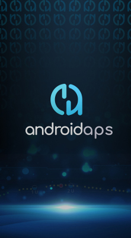

# Telèfons

<!-- List of hidden pages to avoid overcrowding the menu -->

```{toctree}
:hidden:

../CompatiblePhones/Jelly.md
../CompatiblePhones/Huawei.md
```

La versió actual d'**AAPS** (4.0) necessita un telèfon intel·ligent Android amb Google **Android 12.0 o posterior**. Si penseu comprar un telèfon nou (a data de gener de 2026), **és preferible Android 16**; no es recomana Android 15.

Consulteu [Facebook o Discord](../GettingHelp/WhereCanIGetHelp.md) per a les últimes novetats sobre aquest tema.

Per motius de seguretat, us recomanem molt que mantingueu actualitzada la vostra compilació d'**AAPS**. Tanmateix, per als usuaris que no poden fer servir un dispositiu amb Android 12.0 o posterior, continuen disponibles versions anteriors d'**AAPS** compatibles amb versions antigues d'Android; vegeu: [Notes de la versió](#maintenance-android-version-aaps-version).

- [Configuració del Jelly Pro](../CompatiblePhones/Jelly.md)
- [Configuració de Huawei](../CompatiblePhones/Huawei.md)

(Phones-list-of-tested-phones)=

## Llista de telèfons provats

Mantenim una llista de les [configuracions de maquinari provades](https://docs.google.com/spreadsheets/u/1/d/e/2PACX-1vScCNaIguEZVTVFAgpv1kXHdsHl3fs6xT6RB2Z1CeVJ561AvvqGwxMhlmSHk4J056gMCAQE02sAWJvT/pubhtml?gid=683363241&single=true) que podeu [explorar amb una interfície fàcil](https://vnniyb.github.io/androidAPS_testedHardwareEasyBrowser/). Col·laboreu emplenant el [formulari de Google](https://docs.google.com/forms/d/e/1FAIpQLSfoGKLYEx4aUAJ5RWL3xLJeNdmRyxtXmDzpGhuU3Rfcj2H_Jw/viewform) i afegint la vostra configuració!

Aquesta llista recull l'experiència dels usuaris amb un telèfon fent servir **AAPS** amb una bomba i un CGM concrets. Us pot ajudar a comprovar si altres usuaris ja han fet servir amb èxit el vostre telèfon / bomba / CGM.

El document és només de lectura. Amb CTRL-F podeu cercar dins del text del full de càlcul de Google.

Per registrar la vostra prova d'una configuració de maquinari, empleneu aquest [formulari](https://docs.google.com/forms/d/e/1FAIpQLSfoGKLYEx4aUAJ5RWL3xLJeNdmRyxtXmDzpGhuU3Rfcj2H_Jw/viewform). Després d'emplenar el formulari, el full s'actualitza automàticament cada 5 minuts.

Any problems with the spreadsheet, please contact its maintainer, *@theodoor5137*, on Discord, or see the page on [how to get help](../GettingHelp/WhereCanIGetHelp.md).

## No he trobat el meu telèfon

Si teniu preguntes sobre un model de telèfon concret, cerqueu o pregunteu a la nostra [comunitat de Facebook o Discord](../GettingHelp/WhereCanIGetHelp.md).

Per donar models de telèfons intel·ligents o de rellotges intel·ligents que encara s'han de provar, envieu un correu a <donations@androidaps.org>.

(Phones-phone-wallpaper)=

## Fons de pantalla del telèfon

Si voleu decorar el vostre telèfon amb més **AAPS**, podeu descarregar la imatge de fons [aquí](../images/bg_phone.jpg)!



Disseny: Thiago :)