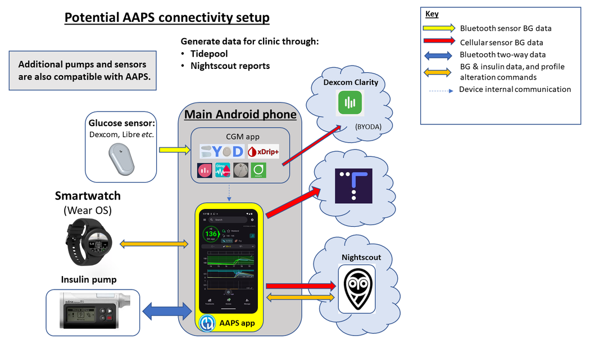
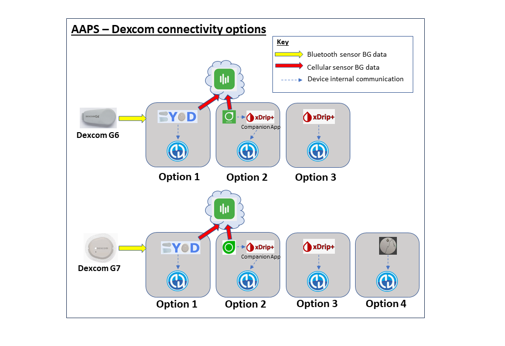
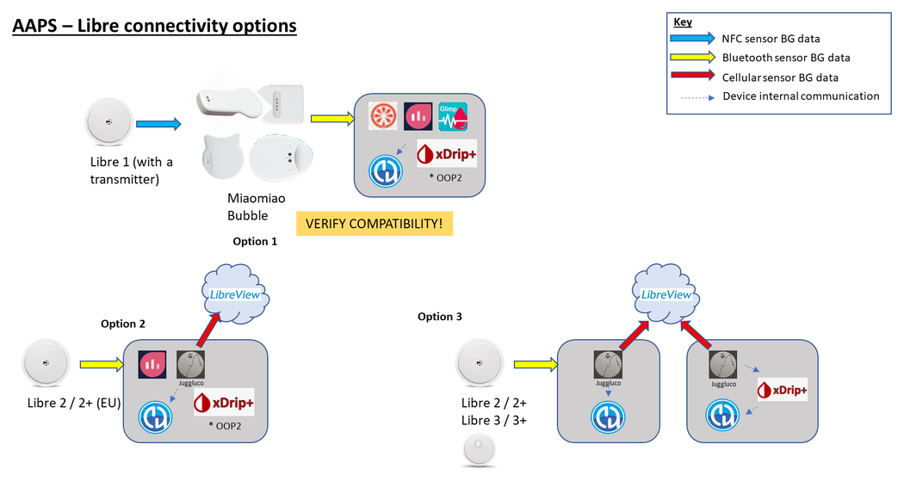
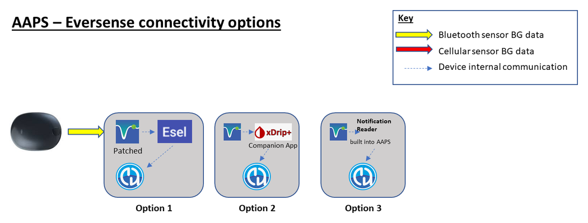

# Preparació per començar amb AAPS

Benvinguts. Aquesta documentació vol guiar els usuaris que es preparen per configurar i començar a fer servir el sistema de pàncrees artificial per a Android (**AAPS**).

## Com orientar-se a la documentació

Trobareu un **índex** i una explicació de l'estructura de la documentació [aquí](../index.md). També hi podeu arribar fent clic al símbol d'**AAPS** a dalt a l'esquerra de la documentació. Hi trobareu una visió general de per a què serveixen les diferents seccions de la documentació. També podeu fer servir els títols a l'esquerra d'aquesta pàgina per navegar per la documentació. Finalment, hi ha una funció de cerca molt pràctica just a sota del símbol d'**AAPS**.

Volem que sigui fàcil saber tant les possibilitats com les limitacions d'**AAPS**. Pot ser decebedor descobrir, després d'haver dedicat temps a llegir la documentació, que potser no teniu una bomba d'insulina o un CGM compatibles, o que **AAPS** ofereix funcions diferents de les que esperàveu.

Molts detalls de la documentació d'**AAPS** que depenen de l'experiència s'entenen millor quan feu servir **AAPS** de veritat, en temps real. Igual que és difícil aprendre un esport només llegint les regles, cal combinar l'aprenentatge de les bases de les regles per fer servir **AAPS** amb seguretat i, després, aprendre a aplicar millor aquestes regles quan comenceu a fer servir **AAPS**.

(preparing-safety-first)=

## Primer, la seguretat
«Un gran poder comporta una gran responsabilitat…»

### Seguretat tècnica
**AAPS** té un ampli conjunt de funcions de seguretat. Aquestes funcions tenen restriccions que es treuen a poc a poc a mesura que completeu, per etapes, una sèrie d'[objectius](../SettingUpAaps/CompletingTheObjectives.md), que inclouen provar paràmetres concrets i respondre preguntes de resposta múltiple. Les funcions d'**AAPS** es desbloquegen a mesura que completeu els objectius. Aquest procés permet a l'usuari passar de manera segura i per etapes del llaç obert al llaç tancat, mentre aprèn les diferents funcions d'**AAPS**.

Els [objectius](../SettingUpAaps/CompletingTheObjectives.md) s'han dissenyat per oferir la millor introducció possible a **AAPS**, tenint en compte els errors típics i les tendències generals que els desenvolupadors d'**AAPS** han observat en els nous usuaris. Es poden cometre errors perquè el principiant no té experiència i té massa pressa per començar amb **AAPS**, o perquè no ha tingut en compte punts clau. Els [objectius](../SettingUpAaps/CompletingTheObjectives.md) volen reduir al mínim aquests problemes.

### Seguretat mèdica
```{admonition} Avoid permanent and painful damage to your eyes and nerves
:class: danger
Compte amb les millores ràpides del control de la glucèmia i la baixada ràpida de l'HbA1c 
```

Un aspecte de seguretat important és que **una reducció ràpida de l'HbA1c i una millora del control de la glucèmia en persones que han tingut la glucèmia alta durant un temps poden causar danys permanents**. Moltes persones amb diabetis no ho saben, i no tots els metges informen els seus pacients d'aquest problema.

Aquests danys poden incloure **pèrdua de visió i neuropatia permanent (dolor)**. Es poden evitar aquests danys baixant la glucèmia mitjana més a poc a poc. Si ara teniu una HbA1c alta i passeu a **AAPS** (o a qualsevol altre sistema de llaç tancat), _si us plau_, parleu d'aquest risc amb el vostre equip mèdic abans de començar i acordeu-hi un calendari amb objectius de glucèmia segurs que baixin a poc a poc. Al principi podeu posar fàcilment objectius de glucèmia més alts a **AAPS** (ara mateix, l'objectiu més alt que podeu triar és 11,1 mmol/l, però si cal també podeu mantenir expressament un perfil feble) i després baixar l'objectiu a mesura que passen els mesos.

#### Amb quina rapidesa puc reduir la meva HbA1c sense risc de danys permanents?

One retrospective [study](https://pubmed.ncbi.nlm.nih.gov/1464975/) of 76 patients reported that the risk of progression of retinopathy increased by 1.6 times, 2.4 times and 3.8 times if the HbA1c dropped 1%, 2% or 3% respectively over a 6 month period. Van suggerir que **«la baixada del valor d'HbA1c en qualsevol període de 6 mesos s'ha de limitar a menys del 2% per evitar la progressió de la retinopatia... Una baixada massa ràpida a l'inici del control glucèmic pot causar un agreujament greu o transitori de la progressió de la retinopatia.»**

N. B. Si feu servir altres unitats d'HbA1c (mmol/mol en lloc de %), feu clic [aquí](https://www.diabetes.co.uk/hba1c-units-converter.html) per a una calculadora d'HbA1c.

En una altra [avaluació](https://academic.oup.com/brain/article/138/1/43/337923) retrospectiva de 954 pacients, els investigadors van observar que:

**«Amb una baixada de l'HbA1c de 2–3 punts percentuals en 3 mesos, hi havia un risc absolut del 20% de desenvolupar neuropatia induïda pel tractament de la diabetis; amb una baixada de l'HbA1c de >4 punts percentuals en 3 mesos, el risc absolut de desenvolupar neuropatia induïda pel tractament de la diabetis superava el 80%.»**

Un [comentari](https://academic.oup.com/brain/article/138/1/2/340563) sobre aquest treball coincidia que, per evitar complicacions, **l'objectiu ha de ser reduir l'A1c <2% en 3 mesos.** Podeu llegir altres revisions sobre el tema [aquí](https://www.ncbi.nlm.nih.gov/pmc/articles/PMC6587545/pdf/DOM-21-454.pdf) i [aquí](https://www.mdpi.com/1999-4923/15/7/1791).

En general, s'accepta que les persones amb diabetis tipus 1 _recentment_ diagnosticades (que sovint tenen una HbA1c molt alta en el diagnòstic, abans de començar la teràpia amb insulina) poden reduir ràpidament la seva HbA1c just després del diagnòstic sense tenir aquests riscos en la mateixa mesura, perquè no han tingut la glucèmia alta durant tant de temps. Tot i així, és un aspecte que heu de parlar amb el vostre metge.

(PreparingForAaps-no-sglt-2-inhibitors)=
### Cap inhibidor de l'SGLT-2

```{admonition} NO SGLT-2 inhibitors
:class: danger
Els inhibidors de l'SGLT-2, també anomenats gliflozines, inhibeixen la reabsorció de glucosa al ronyó. Les gliflozines baixen la glucèmia de manera impossible de calcular, i per això NO les HEU de prendre mentre feu servir un sistema de llaç tancat com AAPS! Hi hauria un risc important de cetoacidosi i/o d'hipoglucèmia! La combinació d'aquest medicament amb un sistema que baixa les taxes basals per fer pujar la glucèmia és especialment perillosa. 

In a nutshell:
- **Example 1: risk of Hypo**
>During lunch, you use **AAPS** to bolus based on consuming 45 g of carbs. El problema és que, sense que AAPS ho sàpiga, els inhibidors fan que el cos elimini una part dels carbohidrats. Això deixa el cos amb massa insulina en comparació amb els carbohidrats absorbits, i el resultat és una hipoglucèmia.

- **Exemple 2: risc de cetoacidosi**
>Els inhibidors eliminen una part dels carbohidrats en segon pla, i això fa baixar la glucèmia. **AAPS** indicarà automàticament a la bomba que redueixi el lliurament d'insulina, inclosa la basal. Amb el temps, això pot fer que la glucèmia es mantingui per sota de l'objectiu, fins al punt que el cos no tingui prou insulina de fons per absorbir els carbohidrats, i el resultat és una cetoacidosi. Normalment, la cetoacidosi apareix en pacients amb DT1 perquè la bomba falla, cosa que activaria alertes al telèfon i es notaria per una glucèmia alta. Però el perill de les gliflozines és que AAPS no donaria cap alerta, perquè la bomba continua funcionant i la glucèmia es pot mantenir dins de l'objectiu.

Alguns noms comercials habituals d'inhibidors de l'SGLT-2 són: Invokana, Farxiga, Jardiance, Glyxambi, Synjardy, Steglatro i Xigduo XR, entre d'altres.
```


### Principis clau del llaç amb AAPS

Cal entendre els principis i els conceptes clau del llaç abans de fer servir **AAPS**. Això s'aconsegueix dedicant temps personal a llegir la documentació d'**AAPS** i completant els objectius, que volen donar-vos una base sòlida per a un ús segur i eficaç d'**AAPS**. La quantitat de documentació d'**AAPS** pot semblar aclaparadora al principi, però tingueu paciència i confieu en el procés: amb el mètode adequat, ho aconseguireu!

La velocitat de progrés depèn de cada persona, però tingueu en compte que completar tots els objectius sol trigar de 6 a 9 setmanes. Moltes persones comencen a compilar, instal·lar i configurar **AAPS** molt abans de començar a fer-lo servir. Per ajudar-vos, el sistema té una «bomba virtual» que podeu fer servir durant els primers objectius. Així us podeu familiaritzar amb **AAPS** sense fer-lo servir realment per lliurar insulina. A continuació teniu el calendari detallat. Tingueu en compte que a l'objectiu 7 d'**AAPS** ja feu servir el llaç tancat; els objectius posteriors afegeixen funcions com **SMB** i les **automatitzacions**, que són útils per a alguns usuaris, però no són essencials per a la funció principal d'**AAPS**.

L'èxit amb **AAPS** requereix una actitud proactiva, ganes de reflexionar sobre les dades de glucèmia i flexibilitat per fer els ajustos necessaris a **AAPS** per millorar els vostres resultats. De la mateixa manera que és gairebé impossible aprendre un esport només llegint-ne les regles, passa el mateix amb **AAPS**.

#### Preveieu retards i petits problemes per tenir-ho tot configurat i en funcionament

En les primeres etapes amb **AAPS**, potser tindreu dificultats perquè tots els components del llaç es comuniquin bé entre ells (i amb els possibles seguidors), i també quan ajusteu la vostra configuració. Alguns problemes no es poden resoldre fins que **AAPS** es fa servir en la vida diària, però hi ha molta ajuda disponible al grup de Facebook i a Discord. Planifiqueu-ho bé i trieu moments «bons» per detectar i resoldre problemes, com un matí tranquil de cap de setmana (és a dir, no tard a la nit o quan esteu cansats, ni abans d'una reunió important o d'un viatge).

#### Compatibilitat de la tecnologia

**AAPS** només és compatible amb alguns tipus de bombes d'insulina, CGM i telèfons, i alguna tecnologia pot no estar disponible en alguns països. Per evitar decepcions o frustracions, llegiu les seccions de [CGM](../Getting-Started/CompatiblesCgms.md), de [bombes](../Getting-Started/CompatiblePumps.md) i de [telèfons](../Getting-Started/Phones.md).

#### Temps de compilació de l'aplicació i progrés fins al llaç complet

The time to build the **AAPS** app depends on your level of expertise and technical ability. Normalment, per a usuaris sense experiència, compilar **AAPS** pot trigar fins a mig dia o un dia sencer (amb l'ajuda de la comunitat). El procés serà molt més ràpid per a les noves versions d'**AAPS**, a mesura que tingueu més experiència.

Diverses parts d'aquesta documentació us ajuden durant el procés de compilació:

- [Compilar AAPS](../SettingUpAaps/BuildingAaps.md) us guia pas a pas per compilar l'aplicació i instal·lar-la al telèfon;

- les [Preguntes freqüents](../UsefulLinks/FAQ.md) responen preguntes habituals i expliquen els errors més probables; i

- la pàgina [Resolució de problemes](../GettingHelp/GeneralTroubleshooting.md) recull solucions als problemes més freqüents, ordenades per tema.

El temps per arribar al llaç tancat depèn de cada persona; [més avall](#preparing-how-long-will-it-take) trobareu un calendari aproximat per arribar al llaç complet amb **AAPS**.


#### Magatzem de claus i fitxer d'exportació de la configuració

Un «magatzem de claus» (fitxer .jks) és un fitxer xifrat amb contrasenya, únic per a la vostra pròpia còpia d'**AAPS**. El vostre telèfon Android el fa servir per assegurar que ningú més pugui actualitzar la vostra còpia sense el magatzem de claus. En resum, com a part de la compilació d'**AAPS**, heu de:

1.  Deseu el vostre fitxer de magatzem de claus (fitxer .jks que serveix per signar l'aplicació) en un lloc segur;

2.  Anotar la contrasenya del vostre fitxer de magatzem de claus.

La manera de desar el magatzem de claus depèn del vostre mètode de compilació:

- **Compilació amb Android Studio (ordinador)**: el magatzem de claus es crea durant la compilació. Vegeu [Generar l'APK signat](#Building-APK-generate-signed-apk) per saber on desar-lo.
- **AAPS Builder**: guardeu el fitxer de còpia de seguretat `aaps-keystore.jks` que us va oferir la pàgina de configuració quan vau crear la clau, juntament amb la contrasenya i l'àlies. Si vau pujar el vostre propi magatzem de claus, guardeu aquell fitxer.
- **Compilació al navegador amb un fork**: feu servir el workflow específic [Export keystore](#ci-keystore-export) per descarregar-ne una còpia al vostre Google Drive.

Així podreu fer servir exactament el mateix fitxer de magatzem de claus cada vegada que es creï una versió actualitzada d'**AAPS**. De mitjana, caldrà actualitzar **AAPS** 2 vegades l'any.

A més, **AAPS** permet [exportar tota la vostra configuració](../Maintenance/ExportImportSettings.md). Així podreu recuperar el vostre sistema de manera segura quan canvieu de telèfon o actualitzeu/reinstal·leu l'aplicació, amb les mínimes molèsties. 

#### Resolució de problemes

No dubteu a contactar amb la comunitat d'AAPS si teniu qualsevol dubte: no hi ha preguntes ximples! Animem tots els usuaris, amb qualsevol nivell d'experiència, a fer preguntes. Normalment les respostes arriben ràpid, perquè hi ha molts usuaris d'**AAPS**.

##### [pregunteu al grup de Facebook d'AAPS](https://www.facebook.com/groups/AndroidAPSUsers/)

##### [pregunteu al canal de Discord d'AAPS](https://discord.gg/4fQUWHZ4Mw)


#### [Where to go for help](../GettingHelp/WhereCanIGetHelp.md)?

Aquesta secció vol donar als nous usuaris enllaços a recursos per obtenir ajuda, inclòs el suport de la comunitat, formada per usuaris nous i experimentats que poden aclarir dubtes i resoldre els problemes habituals d'AAPS.

#### [Secció per a professionals sanitaris](../UsefulLinks/ClinicianGuideToAaps.md)

Aquesta és una [secció específica per a professionals sanitaris](../UsefulLinks/ClinicianGuideToAaps.md) que volen saber més sobre AAPS i sobre la tecnologia de pàncrees artificial de codi obert. A la pàgina d'introducció també trobareu consells sobre [com parlar amb el vostre equip mèdic](#introduction-how-can-i-approach-discussing-aaps-with-my-clinical-team).

## Què compilarem i instal·larem?

Aquest diagrama dona una visió general dels components clau (maquinari i programari) del sistema **AAPS**:




A més dels tres components bàsics de maquinari (telèfon, bomba, sensor de glucosa), també necessitem: 1) L'aplicació **AAPS** 2) Un servidor d'informes i 3) Una aplicació de monitor continu de glucosa (CGM)

### 1) Una aplicació per a telèfon Android: **AAPS**

**AAPS** és una aplicació que funciona en telèfons intel·ligents i dispositius Android. Compilareu vosaltres mateixos l'aplicació **AAPS** (un fitxer apk) amb una guia pas a pas: descarregareu el codi font d'**AAPS** de GitHub, instal·lareu els programes necessaris (Android Studio, GitHub Desktop) a l'ordinador i compilareu la vostra pròpia còpia de l'aplicació **AAPS**. Després transferireu l'aplicació **AAPS** al vostre telèfon intel·ligent (per correu electrònic, cable USB _etc._) i la instal·lareu.

### 2) Un servidor d'informes: Nightscout (Tidepool*)

Per aprofitar del tot **AAPS**, cal configurar un servidor Nightscout. Podeu [fer-ho vosaltres mateixos](https://nightscout.github.io/nightscout/new_user/#free-diy) o bé pagar una petita quota perquè us configurin un [servei Nightscout gestionat](https://nightscout.github.io/#nightscout-as-a-service). Nightscout serveix per recollir les dades d'**AAPS** al llarg del temps i pot generar informes detallats que relacionen els patrons del CGM i de la insulina. Els cuidadors també poden fer servir Nightscout per comunicar-se a distància amb l'aplicació **AAPS** i supervisar la gestió de la diabetis del seu fill. Aquestes funcions de comunicació a distància inclouen el monitoratge en temps real de la glucèmia i de la insulina, bolus d'insulina a distància (per SMS) i anuncis d'àpats. Intentar analitzar el control de la diabetis mirant les dades del CGM per separat de les dades de la bomba és com conduir un cotxe amb un conductor cec mentre el passatger li descriu el que veu. Tidepool també és disponible com a alternativa a Nightscout.

### 3) Aplicació del sensor CGM

Segons el vostre sensor de glucosa/CGM, necessitareu una aplicació compatible que rebi les lectures de glucèmia i les enviï a **AAPS**. Les diferents opcions es mostren a continuació, i trobareu més informació a la secció [CGM compatibles](../Getting-Started/CompatiblesCgms.md):

  

### Manteniment del sistema **AAPS**

Cal actualitzar tant **Nightscout** com **AAPS** aproximadament un cop l'any, quan surten versions millorades. En alguns casos, l'actualització es pot ajornar; en d'altres, és molt recomanable o es considera essencial per a la seguretat. Aquestes actualitzacions s'anuncien als grups de Facebook i als servidors de Discord. Les notes de la versió expliquen clarament quin és el cas. Probablement molta gent tindrà preguntes semblants a les vostres en el moment de l'actualització, i tindreu ajuda per fer les actualitzacions.

(preparing-how-long-will-it-take)=
## Quant de temps caldrà per configurar-ho tot?

Com hem dit abans, fer servir **AAPS** és més aviat un «viatge» que requereix dedicar-hi temps personal. No és una configuració que es fa una sola vegada. Segons les estimacions actuals, compilar **AAPS**, instal·lar i configurar **AAPS** i el programari del **CGM**, i passar del llaç obert al llaç tancat híbrid amb **AAPS** porta en total uns 4 a 6 mesos. Per això us recomanem compilar l'aplicació **AAPS** i començar els primers objectius com més aviat millor, encara que continueu fent servir un altre sistema de lliurament d'insulina (podeu fer servir una bomba virtual fins a l'objectiu 5).

Alguns objectius requereixen que passin un nombre determinat de dies, per assegurar que entengueu les noves funcions. No es pot saltar aquest temps d'espera; aquests temps mínims s'han establert per a la vostra seguretat.

Aquí teniu un calendari aproximat:

| Tasques                                                                    |          Temps aprox.           |
| -------------------------------------------------------------------------- |:-------------------------------:|
| Lectura inicial de la documentació                                         |            1–2 dies             |
| Configurar GitHub per permetre la compilació al navegador                  |            1–4 hores            |
| Configurar un servidor d'informes                                          |             1 hora              |
| Instal·lar una aplicació de CGM (xDrip, BYODA, …)                          |             1 hora              |
| Configuring CGM → xDrip → AAPS initially                                   |             1 hora              |
| Configurar AAPS → bomba (inicial)                                          |             1 hora              |
| Configurar AAPS → Nightscout/Tidepool (només informes)                     |             1 hora              |
| Optional: Configuring Nightscout ↔ **AAPS** & NSFollowers                  |             1 hora              |
| Objectiu 1: Configuració de visualització i monitorització                 |             1 hora              |
| Objectiu 2: Aprendre a controlar AAPS                                      |             2 hours             |
| Objectiu 3: Demostreu els vostres coneixements                             |         Fins a 14 dies          |
| Objectiu 4: Iniciant llaç obert                                            |         Mínim de 7 dies         |
| Objectiu 5: Entendre el vostre llaç obert                                  |             7 dies              |
| Objectiu 6: Començant a tancar el llaç (LGS, suspensió per glucèmia baixa) |   Mínim de 5, fins a 14 dies    |
| Objectiu 7: Ajustant el llaç tancat                                        |  Mínim d'1 dia, fins a 7 dies   |
| Objectiu 8: Ajustar basals i ràtios, activar Autosens                      | Mínim de 7 dies, fins a 14 dies |
| Objectiu 9: Activar Super Micro Bolus (SMB)                                |        Mínim de 28 dies         |
| Objectiu 10: Automatització                                                |        Mínim de 28 dies         |

Quan ja feu servir **AAPS** plenament, encara haureu d'ajustar la configuració regularment per millorar la gestió general de la vostra diabetis.

## Requisits

### Consideracions mèdiques

A més dels avisos mèdics de la [secció de seguretat](#preparing-safety-first), també hi ha paràmetres diferents segons la insulina que feu servir a la bomba.

#### Elecció de la insulina

Els càlculs d'**AAPS** es basen en una concentració d'insulina de 100 U/ml (la mateixa que l'estàndard de les bombes). Configureu la vostra insulina a **Gestionar → Configuració d'insulina**: establiu el **Pic** i la **DIA**, o feu servir **Carregar el pic de** per omplir el temps de pic estàndard d'una de les opcions predefinides:

- **Novorapid** (també per a Humalog i NovoLog)
- **Fiasp**
- **Lyumjev**

Els usuaris avançats poden introduir directament qualsevol temps de pic (de 35 a 120 minuts), per exemple per a una barreja d'insulines. Vegeu [Configuració d'insulina](#Config-Builder-insulin).


### Aspectes tècnics

Aquesta documentació vol reduir al mínim absolut els coneixements tècnics necessaris. Per compilar l'aplicació **AAPS** teniu diverses opcions. Vegeu [Compilar AAPS](../SettingUpAaps/BuildingAaps.md) per a una visió general:

- **Compilació al navegador** (recomanada): compileu l'aplicació directament des del telèfon amb GitHub Actions, sense ordinador ni Android Studio. Amb [AAPS Builder](../SettingUpAaps/BrowserBuildAapsBuilder.md) només necessiteu un compte de GitHub: descarregueu l'aplicació directament de GitHub. El mètode amb fork també necessita un compte de Google per desar l'aplicació al vostre Google Drive.
- **Compilació amb Android Studio**: compileu l'aplicació a l'ordinador amb Android Studio. Això ho fan servir sobretot els desenvolupadors que volen fer canvis al codi.
- **Compilació des de la línia d'ordres**: per als usuaris que prefereixen compilar localment sense instal·lar Android Studio.

A més de compilar l'aplicació, també cal configurar un servidor d'informes, configurar diverses aplicacions al telèfon Android i adquirir experiència en la gestió de la diabetis. Això es pot aconseguir avançant pas a pas, amb paciència i amb l'ajuda de la comunitat d'**AAPS**. Si ja sabeu navegar per internet i gestionar el vostre correu de Gmail, compilar **AAPS** és una tasca factible. Preneu-vos-ho amb calma.

### Telèfons intel·ligents

#### AAPS i versions d'Android

La versió actual d'**AAPS** (4.0) necessita un telèfon intel·ligent amb **Android 12.0 o superior** de Google. Si penseu comprar un telèfon nou (a gener de 2026), es recomana Android 16.<br/> Us recomanem molt mantenir actualitzada la vostra compilació d'**AAPS** per motius de seguretat. Tot i així, per als usuaris que no poden fer servir un dispositiu amb Android 12.0 o més recent, hi ha versions anteriors d'**AAPS** compatibles amb versions antigues d'Android. Vegeu: [Notes de la versió](#maintenance-android-version-aaps-version).

#### Elecció del model de telèfon
El model exacte que compreu depèn de les funcions que vulgueu. A la [pàgina Telèfons](../Getting-Started/Phones.md) trobareu recomanacions i opinions d'usuaris sobre configuracions que funcionen.

Us recomanem mantenir actualitzada la versió d'Android del vostre telèfon, incloses les actualitzacions de seguretat. Tot i així, si sou nous amb **AAPS** o no sou experts en tecnologia, potser és millor esperar a actualitzar el telèfon fins que altres usuaris ho hagin fet i hagin confirmat als nostres fòrums que és segur.

```{admonition} Delaying Samsung phone updates
:class: warning
Samsung té un mal historial d'actualitzacions forçades als seus telèfons, que poden causar problemes de connexió Bluetooth. Per desactivar aquestes actualitzacions forçades, cal posar el telèfon en «mode de desenvolupador»:

1. Aneu a **Settings** > **About phone** > **Software information** (Configuració, Informació del telèfon, Informació del programari) i toqueu **Build number** (Número de compilació) fins que confirmi que heu desbloquejat el mode de desenvolupador.
2. Torneu al menú principal **Settings**, on hauríeu de veure una nova opció de menú **Developer options** (Opcions de desenvolupador).
3. Obriu **Developer options**, desplaceu-vos fins a **Auto system update** (Actualització automàtica del sistema) i desactiveu-la.
```

```{admonition} Google Play Protect potential issue
:class: warning
Hi ha hagut diversos informes que Google Play Protect tanca **AAPS** sense motiu cada matí. Si us passa això, haureu d'anar a les opcions de Google Play i desactivar **Google Play Protect**. No tots els models de telèfon ni totes les versions d'Android es veuen afectats.
```

```{admonition} Android developer verification
:class: note
Des de setembre de 2026, Google introdueix a poc a poc la [verificació de desenvolupadors d'Android](#android-developer-verification), que canvia la manera d'instal·lar al telèfon una aplicació compilada per un mateix. La compilació d'**AAPS** no es veu afectada, i continuen disponibles mètodes d'instal·lació gratuïts. Vegeu la pàgina enllaçada per als detalls.
```

