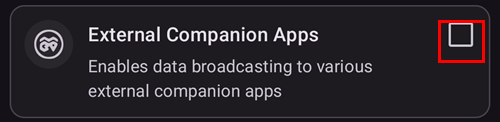
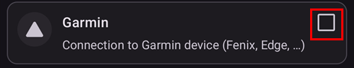
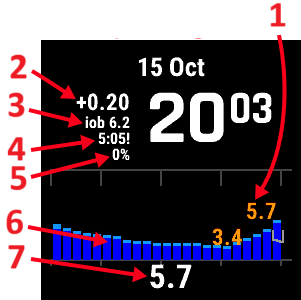
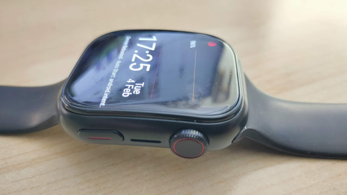

# Rellotges intel·ligents i AAPS

Diversos rellotges intel·ligents poden mostrar part de la informació disponible a **AAPS** o fer accions a distància.

Per controlar **AAPS** (bomba i sensor) directament des d'un rellotge intel·ligent, cal un rellotge Android complet (que es considera com un petit [telèfon intel·ligent](./Phones.md)).

Alguns rellotges intel·ligents us permeten introduir tractaments, o fer més coses, però és el telèfon qui continua gestionant **AAPS**.

Cada vegada més persones fan servir rellotges intel·ligents amb **AAPS**, _tant_ adults amb diabetis com cuidadors i pares de nens amb diabetis.

## Avantatges generals de fer servir rellotges intel·ligents amb **AAPS**


Segons el model, els rellotges intel·ligents es poden fer servir de moltes maneres diferents amb **AAPS**. Es poden fer servir per controlar **AAPS** del tot o en part, o simplement per consultar a distància els nivells de glucèmia, la insulina a bord i altres paràmetres.

Integrar un rellotge intel·ligent amb **AAPS** pot ser útil en moltes situacions, per exemple quan conduïu un cotxe o una moto (o bicicleta) i quan feu esport. Algunes persones troben que mirar un rellotge (en una reunió, una festa, a taula, etc.) és més discret que mirar un telèfon. Pel que fa a la seguretat, un rellotge intel·ligent també pot ser útil quan us moveu: podeu guardar el telèfon d'**AAPS** fora de la vista (per exemple, dins d'una bossa) i fer servir el rellotge per al control remot.

## Avantatges específics per a pares i cuidadors que fan servir **AAPS**

For a child - if their **AAPS** phone is nearby - a caregiver can use a smartwatch to monitor or make modifications without needing to use the **AAPS** phone. Això pot ser útil, per exemple, si el telèfon d'**AAPS** està guardat dins d'un cinturó per a la bomba.

Un rellotge intel·ligent es pot fer servir _a més de_ les opcions basades en el TELÈFON per al control remot o per [només seguir](../RemoteFeatures/FollowingOnly.md), o _en lloc_ d'elles.

A més, a diferència dels telèfons seguidors dels pares o cuidadors (que depenen de la xarxa mòbil o de la connexió Wi-Fi), els rellotges intel·ligents connectats per Bluetooth poden ser útils en llocs aïllats, com una cova, un vaixell o a mitja muntanya. Si els dos dispositius (telèfon d'**AAPS** i rellotge intel·ligent) són a la mateixa xarxa Wi-Fi, també poden fer servir el Wi-Fi.

## Diferents tipus d'interacció entre el rellotge intel·ligent i AAPS

Actualment hi ha cinc maneres principals de fer servir rellotges intel·ligents juntament amb **AAPS**. Es mostren a la taula següent: 

| Configuració del rellotge | Funcions                                                    | Requisits                                                                                                                                                                                                                                                                                                                                                              |
| ------------------------- | ----------------------------------------------------------- | ---------------------------------------------------------------------------------------------------------------------------------------------------------------------------------------------------------------------------------------------------------------------------------------------------------------------------------------------------------------------- |
| Autònom                   | AAPS sense telèfon                                          | Rellotge intel·ligent Android complet (comproveu la versió mínima d'Android)</br> Amb **app-fullRelease**                                                                                                                                                                                                                                                              |
| Control remot complet     | La majoria de funcions d'AAPS                               | Rellotge Android **Wear OS** (comproveu Android/API)</br>Amb **wear-fullRelease**                                                                                                                                                                                                                                                                                      |
| Control remot             | Funcions d'AAPSClient                                       | Rellotge Android **Wear OS** (comproveu Android/API)</br>Amb **[wear-aapsclientRelease](https://github.com/nightscout/AndroidAPS/releases)**                                                                                                                                                                                                                           |
| Control remot             | Algunes funcions d'AAPSClient                               | Rellotges Garmin</br>(només configuracions antigues de Samsung Tizen i Fitbit, no recomanades)</br>Vegeu més avall.                                                                                                                                                                                                                                                    |
| Visualització             | Glucèmia, tendència, IOB, COB, estat del llaç i de la bomba | Molts rellotges intel·ligents, a través d'una aplicació complementària al telèfon d'**AAPS** que rep les dades de la difusió [Apps complementàries externes](#watches-external-companion-apps): [WatchDrip+](https://bigdigital.home.blog/) (Xiaomi, Amazfit), [GlucoDataHandler](https://github.com/pachi81/GlucoDataHandler) (Wear OS), G-Watch</br>Vegeu més avall. |

## Abans de comprar un rellotge intel·ligent…

El model exacte de rellotge intel·ligent que compreu depèn de les funcions que vulgueu. Podeu trobar informació útil a la [pàgina Telèfons](#Phones-list-of-tested-phones), que inclou una llista de telèfons provats on també hi ha alguns rellotges intel·ligents.

Algunes marques de rellotges populars són Samsung Galaxy, Garmin, Fossil i Mi Band. Les diferents opcions resumides a la taula de més amunt s'expliquen amb més detall a continuació, per ajudar-vos a decidir quin rellotge intel·ligent és el més adequat per a la vostra situació.

Si voleu integrar un rellotge intel·ligent amb **AAPS** en un telèfon per interactuar a distància amb **AAPS**, també heu de comprovar si els dos dispositius són compatibles entre si, sobretot si teniu un telèfon antic o poc habitual.

En general, si només voleu seguir els valors de glucèmia i no interactuar amb **AAPS**, hi ha molts més rellotges senzills i assequibles que podeu fer servir.

La millor manera de triar un rellotge intel·ligent és buscar publicacions sobre «watch» als grups d'**AAPS** a Discord o Facebook. Llegiu les experiències d'altres persones i publiqueu les vostres preguntes concretes si les publicacions anteriors no les responen.

## Android complet

Sembla una opció atractiva, oi? However, at present, only a few enthusiasts are experimenting with **AAPS** on a stand-alone watch. Hi ha pocs rellotges intel·ligents amb una interfície raonable que també funcionin bé fent servir **AAPS** i l'aplicació del CGM de manera autònoma. Alguns models populars són el LEMFO LEM 15 Pro i el 16. Haureu d'instal·lar al rellotge l'APK «full» d'**AAPS** (l'APK que normalment s'instal·la al telèfon intel·ligent) en lloc de l'APK «wear» d'**AAPS**.

No hi ha cap especificació clara que us digui si un rellotge funcionarà bé per fer servir **AAPS** de manera autònoma, però aquests paràmetres us poden ajudar:

1)  Android 12 o més recent. 2)  Que es pugui treure el watchface del mode «quadrat» perquè el text sigui més gran i més fàcil de llegir. 3)  Una durada de la bateria molt bona. 4)  Un bon abast Bluetooth.

La majoria de les frustracions amb els rellotges **AAPS** autònoms vénen d'haver d'interactuar amb una pantalla molt petita i del fet que la interfície actual de l'aplicació AAPS completa no està dissenyada per a un rellotge. You may prefer to use a stylus to edit **AAPS** settings on the watch, due to the restricted screen size, and some AAPS buttons may not be visible on the watch screen.

Altres dificultats són que costa aconseguir prou durada de bateria, i els rellotges amb prou bateria sovint són grans i gruixuts. Els usuaris expliquen que han de lluitar amb el sistema operatiu i la configuració d'estalvi d'energia, que costa iniciar sensors al rellotge, que l'abast Bluetooth és pobre (per mantenir la connexió amb el sensor i amb la bomba) i que la resistència a l'aigua és dubtosa. A les fotos següents en podeu veure exemples.


If you are interested in setting up a standalone watch, read the posts and comments on the **AAPS** Facebook group (good search options are “standalone” and “Lemfo”) and Discord for more information.

## Wear OS

El codi d'**AAPS** conté una extensió de l'aplicació que es pot instal·lar en [rellotges intel·ligents **Wear OS**](https://wearos.google.com/#oem-carousel).


Comproveu que el vostre rellotge intel·ligent compleix els [requisits](#maintenance-android-version-aaps-version) d'**AAPS**.

### Què _és_ Wear OS?

Les tres primeres opcions de rellotge intel·ligent necessiten que el rellotge tingui **Wear OS** instal·lat.

**Wear OS** és el sistema operatiu que funciona en alguns rellotges intel·ligents Android moderns. Si la descripció del rellotge intel·ligent només indica _compatibilitat_ amb Android i iOS, això no vol dir que funcioni amb Wear OS. Pot ser un altre sistema operatiu propi del fabricant que no és compatible amb **AAPS**. Per poder instal·lar i fer servir qualsevol versió d'**AAPS** o d'**AAPSClient**, el rellotge intel·ligent ha de funcionar amb **Wear OS 3.0, 3.2 o 3.5** (Android 11, nivell d'API 30) **o més recent**. Cada versió de Wear OS segueix la versió d'Android en què es basa: **Wear OS 3** és Android 11 (nivell d'API 30), **Wear OS 4** és Android 13 (nivell d'API 33), **Wear OS 5** és Android 14 (nivell d'API 34) i **Wear OS 6** és Android 16 (nivell d'API 36). Els rellotges amb Wear OS 2 no poden fer funcionar **AAPS**.

Si instal·leu el wear.apk d'**AAPS** en un rellotge **Wear OS**, podeu triar entre diversos watchfaces personalitzats d'**AAPS**. També podeu fer servir un watchface normal de rellotge intel·ligent, amb la informació d'**AAPS** inclosa en petits requadres anomenats «complicacions» a l'esfera. Una complicació és qualsevol element que es mostra a un watchface a més de l'hora.

```{note}
Els canvis recents de **Wear OS** fan que els watchfaces personalitzats d'**AAPS** funcionin cada vegada pitjor (com més alta és la versió de Wear OS, més greu és el problema), però les **complicacions** continuen funcionant. Abans de comprar o actualitzar un rellotge, llegiu [Canvis dels watchfaces a Wear OS](#wearos-watchface-changes).
```


### Com pot ser el meu rellotge intel·ligent?

Després d'[instal·lar **AAPS** al rellotge](../WearOS/WearOsSmartwatch.md), podreu triar directament el watchface que preferiu entre aquests watchfaces dedicats d'**AAPS**. A la majoria de rellotges, només cal mantenir premuda la pantalla d'inici fins que la pantalla es fa petita i lliscar cap a la dreta per triar una altra pantalla:


Aquestes són les pantalles bàsiques incloses a **AAPS**; hi ha [més watchfaces](#WearOS_changing-to-AAPS-watchface) i també podeu fer servir [complicacions](#Watchfaces-complications).

### Com faig servir un rellotge Wear OS en el dia a dia?

Trobareu més detalls sobre els watchfaces i l'ús diari, i també com crear (i compartir) el vostre propi watchface personalitzat, a la secció [Configurar AAPS al vostre rellotge Wear OS](../WearOS/WearOsSmartwatch.md).

(Watchfaces-tizen)= (watches-external-companion-apps)=

## Apps complementàries externes

**AAPS** pot difondre el seu estat a altres aplicacions instal·lades al mateix telèfon: glucèmia i tendència, IOB, COB, basal i basal temporal, nom del perfil, estat del llaç, bateria del telèfon i pila de la bomba, nivell del reservori i progrés del bolus. Diverses aplicacions complementàries per a rellotges llegeixen aquesta difusió i mostren les dades en rellotges que **AAPS** no admet directament. Per enviar les dades, activeu **Apps complementàries externes** a **Configurador** > **Comunicació** (vegeu [Apps complementàries externes](#external-companion-apps) a la pàgina del Configurador). La difusió s'envia amb cada valor nou i no es pot demanar: un botó d'actualitzar a l'aplicació complementària no té cap efecte sobre **AAPS**.



Aplicacions complementàries que fan servir aquesta difusió:

- [WatchDrip+](https://bigdigital.home.blog/) per a rellotges Xiaomi i Amazfit; vegeu [Rellotges Xiaomi i Amazfit](#watches-xiaomi-amazfit) més avall.
- [GlucoDataHandler](https://github.com/pachi81/GlucoDataHandler) per a rellotges Wear OS, com a complicació o com a widget. És una bona alternativa en les versions de Wear OS on els watchfaces d'**AAPS** no són fiables; vegeu [Configurar AAPS al vostre rellotge Wear OS](../WearOS/WearOsSmartwatch.md). La seva aplicació complementària GlucoDataAuto mostra les mateixes dades al cotxe amb Android Auto.
- [Aplicació G-Watch](https://play.google.com/store/apps/details?id=sk.trupici.g_watch) per a rellotges Samsung Tizen, i la seva versió posterior per a Wear OS. En versions anteriors d'**AAPS**, el plugin s'anomenava **Samsung Tizen** per aquesta aplicació.

```{warning}
L'**aplicació G-Watch** i la seva versió per a **Wear OS** ja no es mantenen, i Samsung ha passat els seus rellotges intel·ligents de Tizen a Wear OS. G-Watch només és útil per a configuracions antigues que ja existeixen i no es recomana per a una instal·lació nova. Consulteu el [grup de Facebook](https://www.facebook.com/groups/gwatchapp) dedicat per veure les últimes novetats.
```

(Watchfaces-garmin)=

## Garmin

Hi ha algunes watchfaces per a Garmin que s'integren amb [AAPS](https://apps.garmin.com/search?keywords=androidaps), a la botiga Garmin ConnectIQ.



[AAPS Glucose Watch](https://apps.garmin.com/apps/3d163641-8b13-456e-84c3-470ecd781fb1) s'integra directament amb **AAPS**. Mostra dades de l'estat del llaç (insulina a bord, basal temporal) a més dels valors de glucèmia, i envia la freqüència cardíaca a **AAPS**. Està disponible a la botiga ConnectIQ; activeu el plugin **Garmin** a **Configurador → Comunicació**. 

1. Valors de glucèmia més alt i més baix del gràfic
2. Canvi de glucèmia per minut
3. Insulina a bord (IOB)
4. Temps des de l'últim valor de glucèmia (minuts:segons)
5. Basal temporal, com a percentatge de la taxa basal del perfil
6. Gràfic de glucèmia de les últimes 2 hores
7. Valor actual de glucèmia


## Fitbit

```{warning}
Google està passant Fitbit a Google Health i està eliminant les aplicacions i watchfaces de tercers dels rellotges Fitbit a la UE. Per això, els watchfaces de Fitbit **ja no són una opció recomanada**, i no es recomana comprar un Fitbit per fer-lo servir amb **AAPS**.
```

Per als rellotges Fitbit que ja teniu, les [pàgines web de Nightscout](https://nightscout.github.io/nightscout/wearable/#fitbit) mostren algunes opcions només per monitorar, com [Glance](https://glancewatchface.com/). També són watchfaces de tercers, així que també s'hi aplica la mateixa restricció de la UE.

## Només seguiment

Aquests rellotges intel·ligents mostren part de la informació d'**AAPS**; alguns necessiten altres aplicacions.

Hi ha molts rellotges intel·ligents assequibles que només poden mostrar dades. Si feu servir Nightscout, trobareu un bon resum de totes les opcions [aquí](https://nightscout.github.io/nightscout/wearable/#)

A continuació teniu algunes opcions de rellotges només per seguir que són populars entre els usuaris d'**AAPS**:

(watches-xiaomi-amazfit)=
### Rellotges Xiaomi i Amazfit

**WatchDrip+** és una aplicació complementària feta per la comunitat que mostra dades de glucèmia i del llaç en diversos models de rellotges intel·ligents, sobretot de les marques Xiaomi (_per exemple_, Mi Band) i Amazfit:


Des de la versió 0.5, **WatchDrip+** llegeix les dades directament d'**AAPS**, sense passar per xDrip+. Al telèfon d'**AAPS**:

1. Activeu **Apps complementàries externes** a **Configurador** > **Comunicació**; vegeu [més amunt](#watches-external-companion-apps). Proporciona la glucèmia actual, la delta, la fletxa de tendència, l'IOB i l'estat de la bomba.
2. Activeu el plugin **xDrip** a **Configurador** > **Comunicació** i activeu **Enviar estat a xDrip+** a la seva configuració. Proporciona la línia d'estat IOB/COB, i el gràfic de glucèmia del rellotge s'omple després d'alguns valors.
3. Si teniu xDrip+ instal·lat al telèfon, desactiveu-ne el **Broadcast Service API** (xDrip+ > Settings > Inter-app settings) perquè el rellotge no rebi les dades dues vegades. Si xDrip+ només passava dades al rellotge, el podeu desinstal·lar.

El botó d'actualitzar de WatchDrip+ no té cap efecte amb **AAPS**: les dades arriben amb cada valor nou.


Podeu llegir-ne més, i també com configurar-los, al [lloc web de WatchDrip+](https://bigdigital.home.blog/). L'avantatge d'aquests rellotges és que són petits i relativament assequibles. Són una opció popular sobretot per a nens i per a persones amb el canell petit.

### Rellotge Pebble


Els rellotges Pebble ([ja no es fabriquen](https://en.wikipedia.org/wiki/Pebble_(watch))) es van vendre del 2013 al 2016, i potser encara es poden trobar de segona mà. Fitbit es va quedar els actius de Pebble. Els usuaris de Pebble poden fer servir el watchface Urchin per veure les dades de Nightscout. Les dades que es poden mostrar inclouen l'IOB, la taxa basal temporal activa i les prediccions. If open looping you can use IFTTT to create an applet that says if a Notification has been received from **AAPS** then send either an SMS or pushover notification.

### [Rellotges Bluejay](https://bluejay.website/)





Són aparells tecnològics únics que poden rebre les dades de glucèmia **directament** del transmissor Dexcom. Poca gent sap que els transmissors Dexcom G6/G7 en realitat emeten les dades de glucèmia actuals per _dos_ canals separats: un canal per al telèfon i un canal mèdic. Els rellotges Bluejay es poden configurar per rebre les dades de glucèmia per qualsevol dels dos canals; així, si **AAPS** fa servir el canal del telèfon, els rellotges Bluejay poden fer servir el canal mèdic.

El principal avantatge és que el rellotge és independent tant del telèfon com del sistema de llaç. Així, per exemple, si desconnecteu la bomba i el telèfon d'**AAPS** a la platja o en un parc temàtic, i esteu fora de l'abast del telèfon d'**AAPS**, encara podeu rebre els valors del Dexcom directament al rellotge Bluejay.

El **Bluejay GTS** original ja no es fabrica i no pot llegir el Dexcom G7. Els models posteriors (U1 i després l'actual **U3**, que en el moment d'escriure això es ven en accés anticipat) són rellotges Android complets amb xDrip, que reben les dades directament del Dexcom G6 i G7. El fabricant descriu el rellotge com una eina de recerca, no per a ús mèdic. Els inconvenients que s'expliquen són que no sempre rep un valor cada 5 minuts i que la bateria s'ha de carregar sovint. Consulteu el [lloc web de Bluejay](https://bluejay.website/) per veure el model actual i la disponibilitat.

### Apple Watch

Consulteu [Nightscout al vostre rellotge](https://nightscout.github.io/nightscout/wearable/#).

L'Apple Watch ara admet la connexió directa amb el G7 i es pot fer servir alhora que **AAPS**.

