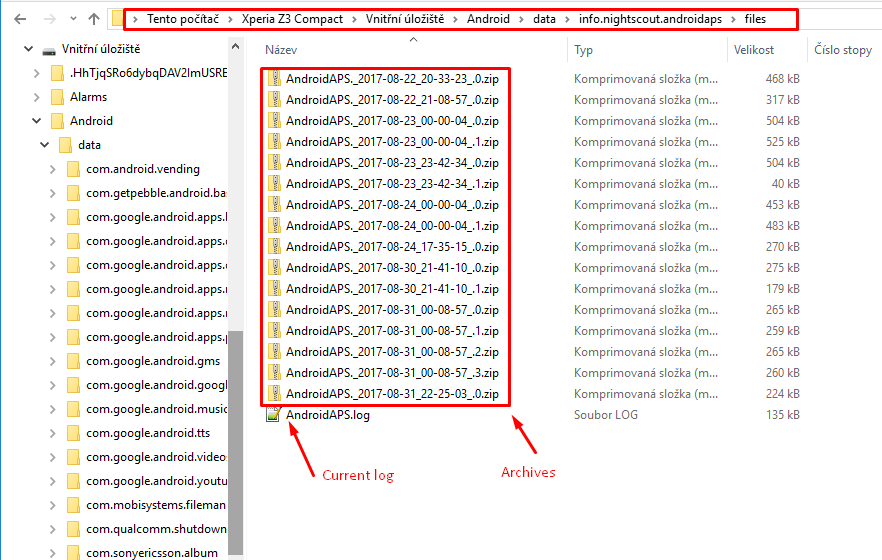

(Accessing-logfiles-accessing-logfiles)=

# Accés als fitxers de registre

* Connecteu el telèfon a un ordinador en mode de transferència de fitxers
* Busqueu els fitxers de registre al directori de dades d'AAPS, a `Android\data\info.nightscout.androidaps\files`.  
    El nom de la carpeta arrel de l'emmagatzematge pot variar una mica segons el telèfon.
* Per a l'[AAPSClient](#RemoteControl_aapsclient), la ubicació és `Android\data\info.nightscout.aapsclient\files`.
* Note: log location has changed in **AAPS 3.3**. Si cal, consulteu la documentació de les versions anteriors.

* The current log is a .log file which can be viewed in a number of ways such as [LogCat](https://developer.android.com/studio/debug/am-logcat.html) within Android Studio, any log viewer Android app, or simply as plain text. 
* Els fitxers de registre anteriors es comprimeixen en zip i es desen en carpetes per ordre de data i hora. 
* Si compartiu el vostre fitxer de registre a [Discord](https://discord.gg/4fQUWHZ4Mw) per parlar d'un possible error, descomprimiu i pugeu el fitxer amb la data d'abans que passés l'error.