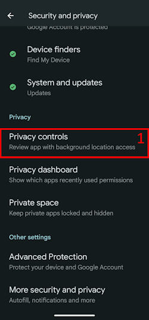
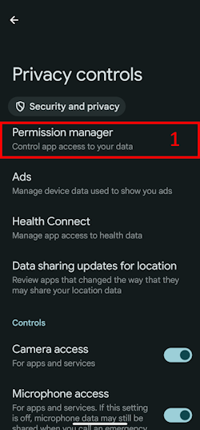

(bluetoothtroubleshooting-bluetooth-related-issues)=

# Problemes relacionats amb el Bluetooth

Alguns usuaris han tingut problemes amb errors d'activació de l'Omnipod DASH, problemes de connexió de la Medtrum Nano i altres errors del pod relacionats amb el Bluetooth. Molts d'aquests problemes tenen l'origen en una de les causes següents.

Algunes d'aquestes causes probablement afecten també altres bombes d'insulina Bluetooth. La Medtrum Nano té problemes coneguts amb el permís de dispositius propers, igual que l'Omnipod DASH.

---

(bluetoothtroubleshooting-cannot-start-omnipod-with-android-16)=

## No es pot iniciar l'Omnipod amb Android 16
- Android 16 needs at a minimum **AAPS** version 3.3.2.1 for the Omnipod DASH to work correctly, as this version has fixes added to specifically address known problems introduced in Android 16 for Omnipod.

---

(bluetoothtroubleshooting-bluetooth-battery-optimisation)=

## Optimització de bateria del Bluetooth

Newer versions of Android have enabled Battery optimisation for the system Bluetooth app. Se sap que això causa alguns problemes a bombes i CGM Bluetooth.

If you followed the [Setup Wizard](../SettingUpAaps/SetupWizard.md) and followed the configuration settings in the [Bluetooth Battery Optimisation](#setup-wizard-bluetooth-battery-optimisation) section then this setting should be correct, however if you followed an older version of this guide it's possible you have not changed this setting.

Verify this is correctly configured if you have pump and CGM disconnections.

---

(bluetoothtroubleshooting-apps-using-nearby-device-permission)=

## Les aplicacions que fan servir el permís d'Android «Dispositius propers» poden provocar talls de connexió i problemes d'activació del pod

Android us permet controlar què pot fer o a què pot accedir cada aplicació del telèfon amb un sistema de permisos. Per a cada aplicació instal·lada podeu permetre o denegar permisos concrets, per exemple accedir als fitxers del dispositiu, accedir al Bluetooth, cercar dispositius propers, etc.

**AAPS** requires a number of specific permissions to function, one which is required to ensure that Pods work is the "Nearby devices" permission. Moltes altres aplicacions també necessiten aquest permís. La comunitat ha vist que, en alguns dispositius, diverses aplicacions amb aquest permís concedit poden provocar problemes en activar pods nous.

(bluetoothtroubleshooting-apps-using-nearby-device-permission-known-apps)=

### Aplicacions que fan servir el permís «Dispositius propers» i que se sap que han causat problemes:

Les aplicacions d'aquesta llista s'han esmentat en un o més llocs de la comunitat perquè causen problemes amb l'Omnipod DASH i, en alguns casos, també amb la Medtrum Nano.

```{admonition} Updating the list
:class: note
Escriviu a @XiTatiON al canal de Discord #omnipod-dash per parlar d'aplicacions que s'han d'afegir a aquesta llista.
```

- **myBMW** MyBMW interrompia la Medtrum Nano i l'Omnipod DASH. L'aplicació MyBMW demana el permís «trobar dispositius propers» només una vegada. Si no el concediu, l'aplicació continua funcionant perfectament.

- **Amazon Alexa**  Removing "Nearby devices" for Alexa app resolved problem for some people but will break the ability to pair Matter IoT devices

- **MINI app**  Appears the app is based on myBMW app and might mirror its behavior as a result

- **BM2** Solar Battery Monitoring app, used in some camper van and camping solar setups: when the app was running, it prevented activation of a new Pod. Force Stopping the app while activating a new pod is a workaround to the issue. Després d'això, fer servir l'aplicació no semblava afectar el funcionament del Dash (en un Pixel 8 Pro amb Android 16).

(bluetoothtroubleshooting-revoke-nearby-device-permission)=

### Com retirar el permís «Dispositius propers» a altres aplicacions:
If you are facing issues activating a new Pod and you are running on the correct supported version of **AAPS** for your version of Android, it may be necessary to revoke the permission for other apps while activating a new Pod.

Follow this procedure to revoke the "Nearby device" permission for all apps except **AAPS**:

```{admonition} Menus and settings
:class: note
Les captures de pantalla i les instruccions d'aquesta guia són d'una instal·lació d'Android 16 estàndard (Vanilla) en un Google Pixel 8 Pro. Other manufacturers and devices will likely not exactly match these menus and settings descriptions, adjust the steps to suit the device you have and if you are stuck see [Where to get help for dash](#omnipod-dash-where-to-get-help-for-dash) section on how to reach out to the community for support.
```

1. Obriu la configuració d'Android al telèfon, desplaceu-vos cap avall i premeu **Seguretat i privadesa (1)**.

    

2. Desplaceu-vos cap avall i premeu **Controls de privadesa (1)**.

   

3. Premeu **Gestor de permisos (1)**.

   

3. Desplaceu-vos cap avall i premeu **Dispositius propers (1)**.

   

4. Mireu la llista d'aplicacions i premeu l'aplicació a la qual voleu retirar el permís **Dispositius propers**.

   En aquesta guia, **Android Auto (1)** és l'aplicació a la qual retirarem el permís.

   Per no fer malbé més pods, al principi recomanem a tothom retirar el permís a totes les aplicacions excepte **AAPS**.

```{admonition} Which app to select?
:class: tip
Si no sabeu quina aplicació us causa el problema, desactiveu-les totes (mireu també la llista d'aplicacions problemàtiques conegudes i comenceu per aquestes). Si podeu permetre perdre alguns pods pel camí, activeu el permís a una aplicació nova abans de cada activació d'un pod nou, fins que trobeu quina aplicació concreta causa els problemes amb el pod. Si trobeu noves aplicacions problemàtiques, digueu-nos-ho al canal de Discord #omnipod-dash.
```

   

5. Per retirar el permís, premeu **No permetis (1)** i després premeu **No permetis igualment (2)**. Si ho heu fet bé, veureu **No permetis (3)** com a opció seleccionada. Ara podeu tornar al menú **Dispositius propers** prement la **fletxa Enrere (4)** i canviar aquesta opció a altres aplicacions si cal.

      

(bluetoothtroubleshooting-re-enable-nearby-device-permission)=

### Com tornar a activar el permís «Dispositius propers» per a aplicacions del sistema i altres aplicacions:

1. If required Reference the **"How to revoke 'Nearby device' permissions for other apps"** section on how to get to the app privacy settings, then once in the **Nearby device** configuration proceed to 2.

2. Mireu la llista d'aplicacions i premeu l'aplicació a la qual voleu permetre el permís **Dispositius propers**.

   En aquesta guia, **Android Auto (1)** és l'aplicació a la qual permetrem el permís.

   Veureu que **Android Auto (1)** no apareix a la llista d'aplicacions després de retirar el permís. Això passa perquè l'aplicació **Android Auto** és una **aplicació del sistema**, i les aplicacions del sistema estan amagades per defecte.

   

3. Per mostrar les aplicacions del sistema amagades, premeu el **menú de tres punts (⋮) (1)** a la cantonada superior dreta i després premeu **«Mostra el sistema» (2)**. Ara hauríeu de veure l'aplicació del sistema amagada a la llista: **Android Auto (3)**.

```{admonition} Find your app
:class: tip
Si a una aplicació se li ha retirat el permís, haureu de desplaçar-vos cap avall fins que vegeu la llista d'aplicacions sense permís, més avall a la llista.
```

     

5. Follow the guidance in **"How to revoke 'Nearby device' permissions for other apps"** in reverse to re-enable permissions for each app.

---

(bluetoothtroubleshooting-android-15-bluetooth-connection-problems)=

## Android 15: problemes freqüents de connexió Bluetooth

Després d'actualitzar Android o de passar a un telèfon recent, **AAPS** perd sovint la connexió Bluetooth amb la bomba. El problema desapareix durant un temps quan reinicieu el telèfon. Si feu servir un **Omnipod DASH** i el telèfon té Android 15, activar l'opció **Vinculació Bluetooth** pot ajudar a millorar l'estabilitat de la connexió Bluetooth. Per activar-la:

```{admonition} Android 16
:class: warning
Activeu la **Vinculació Bluetooth** només a Android 15, i només si teniu problemes de connexió. NO activeu la vinculació a Android 16.
```

1. Obriu la [configuració del Dash](#omnipod-dash-settings): obriu la pantalla de la bomba DASH amb **Gestionar** > **Bomba** i premeu la icona de **Configuració** (engranatge) a la cantonada superior dreta.

   

2. Obriu la secció **Configuració avançada** i activeu **Vinculació Bluetooth**.

   

3. Si el telèfon mostra una sol·licitud d'emparellament, accepteu-la.

4. Reinicieu el telèfon.
