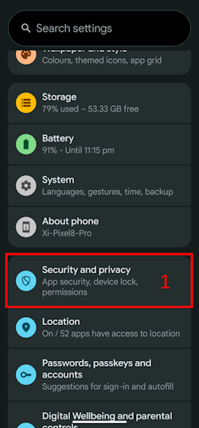
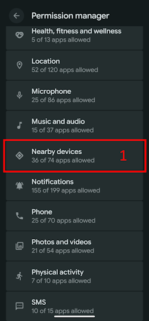
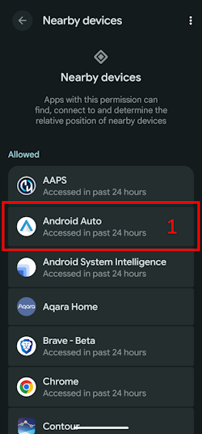
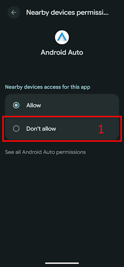
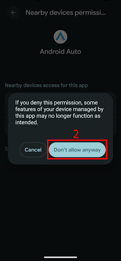
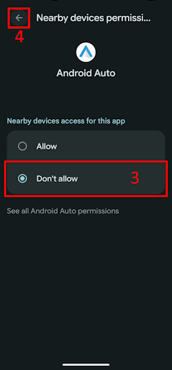
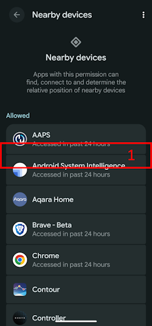
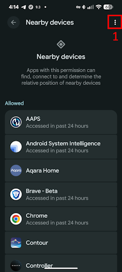
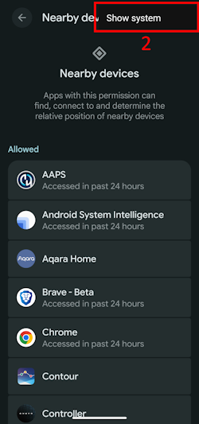
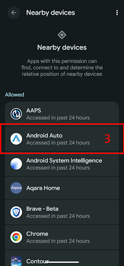

(bluetoothtroubleshooting-bluetooth-related-issues)=

# Problemes relacionats amb el Bluetooth

Alguns usuaris han tingut problemes amb errors d'activació de l'Omnipod DASH, problemes de connexió de la Medtrum Nano i altres errors del pod relacionats amb el Bluetooth. Molts d'aquests problemes tenen l'origen en una de les causes següents.

Algunes d'aquestes causes probablement afecten també altres bombes d'insulina Bluetooth. La Medtrum Nano té problemes coneguts amb el permís de dispositius propers, igual que l'Omnipod DASH.

---

(bluetoothtroubleshooting-cannot-start-omnipod-with-android-16)=

## No es pot iniciar l'Omnipod amb Android 16
- Android 16 necessita com a mínim la versió 3.3.2.1 d'**AAPS** perquè l'Omnipod DASH funcioni bé, ja que aquesta versió inclou correccions per als problemes coneguts que Android 16 va introduir per a l'Omnipod.

---

(bluetoothtroubleshooting-bluetooth-battery-optimisation)=

## Optimització de bateria del Bluetooth

Les versions noves d'Android tenen activada l'optimització de bateria per a l'aplicació del sistema Bluetooth. Se sap que això causa alguns problemes a bombes i CGM Bluetooth.

Si heu seguit l'[Assistent de configuració d'AAPS](../SettingUpAaps/SetupWizard.md) i la configuració de la secció [Optimització de bateria del Bluetooth](#setup-wizard-bluetooth-battery-optimisation), aquesta opció ja hauria d'estar bé. Però si vau seguir una versió antiga d'aquesta guia, és possible que no l'hàgiu canviada.

Comproveu que estigui ben configurada si teniu desconnexions de la bomba o del CGM.

---

(bluetoothtroubleshooting-apps-using-nearby-device-permission)=

## Les aplicacions que fan servir el permís d'Android «Dispositius propers» poden provocar talls de connexió i problemes d'activació del pod

Android us permet controlar què pot fer o a què pot accedir cada aplicació del telèfon amb un sistema de permisos. Per a cada aplicació instal·lada podeu permetre o denegar permisos concrets, per exemple accedir als fitxers del dispositiu, accedir al Bluetooth, cercar dispositius propers, etc.

**AAPS** necessita diversos permisos concrets per funcionar. Un d'ells, necessari perquè els pods funcionin, és el permís «Dispositius propers». Moltes altres aplicacions també necessiten aquest permís. La comunitat ha vist que, en alguns dispositius, diverses aplicacions amb aquest permís concedit poden provocar problemes en activar pods nous.

(bluetoothtroubleshooting-apps-using-nearby-device-permission-known-apps)=

### Aplicacions que fan servir el permís «Dispositius propers» i que se sap que han causat problemes:

Les aplicacions d'aquesta llista s'han esmentat en un o més llocs de la comunitat perquè causen problemes amb l'Omnipod DASH i, en alguns casos, també amb la Medtrum Nano.

```{admonition} Updating the list
:class: note
Escriviu a @XiTatiON al canal de Discord #omnipod-dash per parlar d'aplicacions que s'han d'afegir a aquesta llista.
```

- **myBMW** MyBMW interrompia la Medtrum Nano i l'Omnipod DASH. L'aplicació MyBMW demana el permís «trobar dispositius propers» només una vegada. Si no el concediu, l'aplicació continua funcionant perfectament.

- **Amazon Alexa**  Treure el permís «Dispositius propers» a l'aplicació Alexa va resoldre el problema per a algunes persones, però impedeix emparellar dispositius IoT Matter.

- **Aplicació MINI**  Sembla que l'aplicació es basa en l'aplicació myBMW i, per tant, pot tenir el mateix comportament.

- **BM2** Aplicació de control de bateries solars, que es fa servir en algunes instal·lacions solars d'autocaravanes i de càmping: quan l'aplicació estava en marxa, impedia activar un pod nou. Forçar l'aturada de l'aplicació mentre activeu un pod nou evita el problema. Després d'això, fer servir l'aplicació no semblava afectar el funcionament del Dash (en un Pixel 8 Pro amb Android 16).

(bluetoothtroubleshooting-revoke-nearby-device-permission)=

### Com retirar el permís «Dispositius propers» a altres aplicacions:
Si teniu problemes per activar un pod nou i feu servir la versió d'**AAPS** compatible amb la vostra versió d'Android, pot ser que calgui retirar el permís a altres aplicacions mentre activeu un pod nou.

Seguiu aquest procediment per retirar el permís «Dispositius propers» a totes les aplicacions excepte **AAPS**:

```{admonition} Menus and settings
:class: note
Les captures de pantalla i les instruccions d'aquesta guia són d'una instal·lació d'Android 16 estàndard (Vanilla) en un Google Pixel 8 Pro. Altres fabricants i dispositius probablement no tindran exactament aquests menús i opcions. Adapteu els passos al vostre dispositiu i, si us encalleu, mireu la secció [On trobar ajuda per al Dash](#omnipod-dash-where-to-get-help-for-dash) per saber com demanar ajuda a la comunitat.
```

1. Obriu la configuració d'Android al telèfon, desplaceu-vos cap avall i premeu **Seguretat i privadesa (1)**.

    

2. Desplaceu-vos cap avall i premeu **Controls de privadesa (1)**.

   

3. Premeu **Gestor de permisos (1)**.

   

3. Desplaceu-vos cap avall i premeu **Dispositius propers (1)**.

   

4. Mireu la llista d'aplicacions i premeu l'aplicació a la qual voleu retirar el permís **Dispositius propers**.

   En aquesta guia, **Android Auto (1)** és l'aplicació a la qual retirarem el permís.

   Per no fer malbé més pods, al principi recomanem a tothom retirar el permís a totes les aplicacions excepte **AAPS**.

```{admonition} Which app to select?
:class: tip
Si no sabeu quina aplicació us causa el problema, desactiveu-les totes (mireu també la llista d'aplicacions problemàtiques conegudes i comenceu per aquestes). Si podeu permetre perdre alguns pods pel camí, activeu el permís a una aplicació nova abans de cada activació d'un pod nou, fins que trobeu quina aplicació concreta causa els problemes amb el pod. Si trobeu noves aplicacions problemàtiques, digueu-nos-ho al canal de Discord #omnipod-dash.
```

   

5. Per retirar el permís, premeu **No permetis (1)** i després premeu **No permetis igualment (2)**. Si ho heu fet bé, veureu **No permetis (3)** com a opció seleccionada. Ara podeu tornar al menú **Dispositius propers** prement la **fletxa Enrere (4)** i canviar aquesta opció a altres aplicacions si cal.

      

(bluetoothtroubleshooting-re-enable-nearby-device-permission)=

### Com tornar a activar el permís «Dispositius propers» per a aplicacions del sistema i altres aplicacions:

1. Si cal, consulteu la secció **«Com retirar el permís "Dispositius propers" a altres aplicacions»** per saber com arribar a la configuració de privadesa de les aplicacions. Un cop a la configuració de **Dispositius propers**, continueu al pas 2.

2. Mireu la llista d'aplicacions i premeu l'aplicació a la qual voleu permetre el permís **Dispositius propers**.

   En aquesta guia, **Android Auto (1)** és l'aplicació a la qual permetrem el permís.

   Veureu que **Android Auto (1)** no apareix a la llista d'aplicacions després de retirar el permís. Això passa perquè l'aplicació **Android Auto** és una **aplicació del sistema**, i les aplicacions del sistema estan amagades per defecte.

   

3. Per mostrar les aplicacions del sistema amagades, premeu el **menú de tres punts (⋮) (1)** a la cantonada superior dreta i després premeu **«Mostra el sistema» (2)**. Ara hauríeu de veure l'aplicació del sistema amagada a la llista: **Android Auto (3)**.

```{admonition} Find your app
:class: tip
Si a una aplicació se li ha retirat el permís, haureu de desplaçar-vos cap avall fins que vegeu la llista d'aplicacions sense permís, més avall a la llista.
```

     

5. Seguiu les indicacions de **«Com retirar el permís "Dispositius propers" a altres aplicacions»** a l'inrevés per tornar a activar el permís a cada aplicació.

---

(bluetoothtroubleshooting-android-15-bluetooth-connection-problems)=

## Android 15: problemes freqüents de connexió Bluetooth

Després d'actualitzar Android o de passar a un telèfon recent, **AAPS** perd sovint la connexió Bluetooth amb la bomba. El problema desapareix durant un temps quan reinicieu el telèfon. Si feu servir un **Omnipod DASH** i el telèfon té Android 15, activar l'opció **Vinculació Bluetooth** pot ajudar a millorar l'estabilitat de la connexió Bluetooth. Per activar-la:

```{admonition} Android 16
:class: warning
Activeu la **Vinculació Bluetooth** només a Android 15, i només si teniu problemes de connexió. NO activeu la vinculació a Android 16.
```

1. Obriu la [configuració del Dash](#omnipod-dash-settings): obriu la pantalla de la bomba DASH amb **Gestionar** > **Bomba** i premeu la icona de **Configuració** (engranatge) a la cantonada superior dreta.

   

2. Obriu la secció **Configuració avançada** i activeu **Vinculació Bluetooth**.

   

3. Si el telèfon mostra una sol·licitud d'emparellament, accepteu-la.

4. Reinicieu el telèfon.
