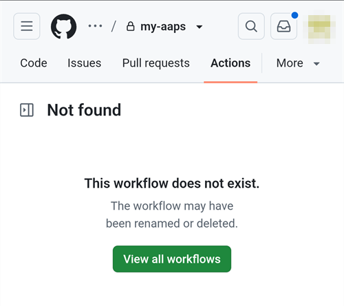
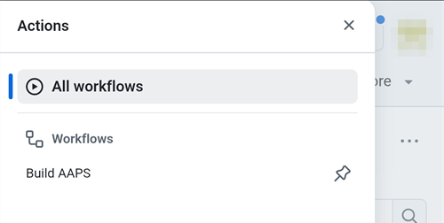
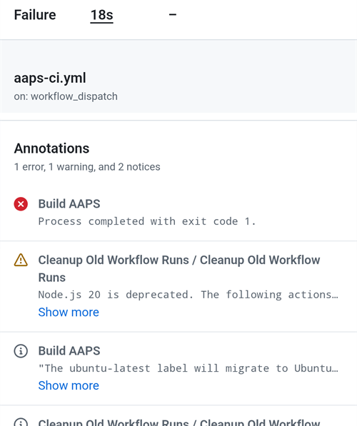
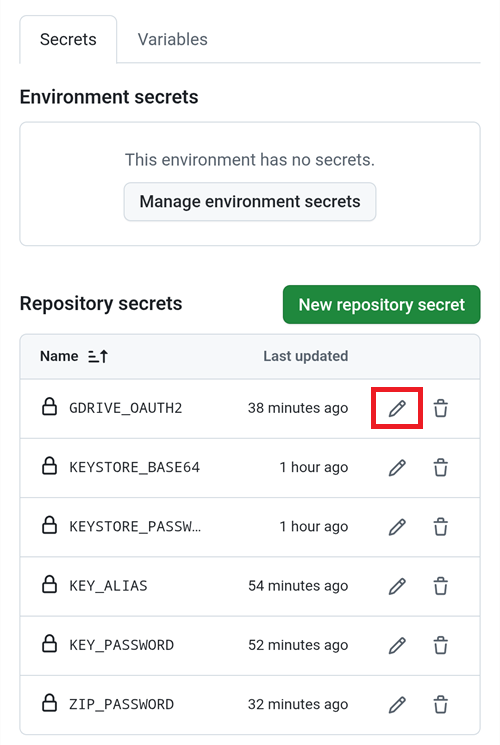
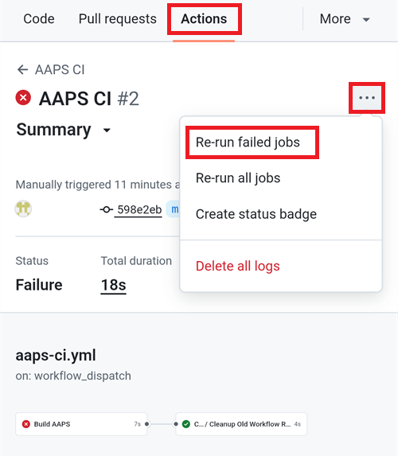
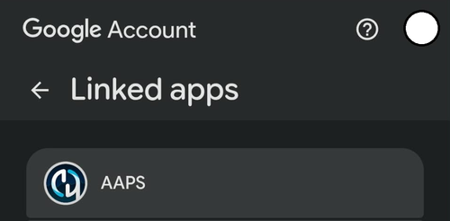

(aaps-ci-troubleshooting)=

# Compilació al navegador: resolució de problemes

```{note}
Aquesta pàgina recull consells per resoldre problemes de la [Compilació al navegador](../SettingUpAaps/BrowserBuild.md).
```

(aaps-builder-troubleshooting)=

## AAPS Builder

### Pas 1: el repositori

(aaps-builder-ts-repo-exists)=

#### «my-aaps already exists in this account»


Ja teniu aquest repositori, per exemple d'un intent anterior. Tanqueu la pestanya de GitHub, conserveu aquest nom al pas 1 de la pàgina de configuració i continueu. Si ja heu fet els passos 2 i 3 per a aquest repositori, la vostra clau encara hi és: continueu amb el [pas 4](#aaps-builder-step4). Si es va crear amb una versió anterior de la pàgina de configuració, actualitzeu-ne el workflow una vegada com s'explica a [Actualitzar AAPS](#aaps-builder-updates). Preferiu començar de nou? Escriviu un altre nom, per exemple `my-aaps-2`, i feu servir el mateix magatzem de claus al pas 2.

(aaps-builder-ts-user-not-found)=

#### «No hi ha cap usuari de GitHub amb aquest nom»


- **«No hi ha cap usuari de GitHub amb aquest nom»** al pas 1: escriviu el vostre nom d'usuari de GitHub, tal com apareix al vostre perfil de GitHub, no el vostre correu electrònic.
- **No hi ha cap botó "Build AAPS" ni "Run workflow", o el repositori és buit**: el repositori no s'ha creat a partir de la plantilla. Elimineu-lo (**Settings** → part de baix de la pàgina → **Delete this repository**) i torneu a fer el [pas 1](#aaps-builder-step1) amb el botó **Crear el meu repositori privat**.

### Pas 3: el secret

(aaps-builder-ts-404)=

#### «Page not found» (404)


- **«Page not found» (404) quan la pàgina de configuració obre GitHub**: inicieu la sessió a github.com al mateix navegador (GitHub mostra 404 per als repositoris privats quan no heu iniciat la sessió). Si heu iniciat la sessió, el nom d'usuari o el nom del repositori del pas 1 de la pàgina de configuració no coincideix amb el vostre repositori. Escriviu els noms exactes.

### Pas 4: la compilació

(aaps-builder-ts-workflow-not-found)=

#### «This workflow does not exist»



Just després de crear el repositori, és possible que GitHub encara no n'hagi llegit el fitxer de workflow: **Build AAPS** no apareix a la pestanya **Actions** i no hi ha cap botó **Run workflow**. Qualsevol canvi petit al fitxer fa que GitHub el llegeixi:

1. Al vostre repositori, obriu **Code**, després la carpeta `.github`, després `workflows` i després el fitxer `build.yml`.
2. Toqueu el menú **⋯** de dalt a la dreta del fitxer i després **Edit file… In place** (en un ordinador, feu clic al llapis).

   

3. Toqueu just al final del text i afegiu-hi una línia buida (Retorn). Toqueu **Commit changes…** a dalt.

   

4. Toqueu **Commit changes** una altra vegada.

   

5. Torneu a obrir la pestanya **Actions**: ara **Build AAPS** és a la llista de workflows (en un telèfon, la llista s'obre amb la icona que hi ha a l'esquerra d'**All workflows**). Toqueu-lo i després toqueu **Run workflow**.

   

(aaps-builder-ts-build-failed)=

#### La compilació ha fallat (creu vermella)

1. A la pàgina de configuració, toqueu **Obrir les meves compilacions** i toqueu la compilació amb la creu vermella.

   

2. La pàgina de la compilació mostra **Failure** i quina part ha fallat: **AAPS / Check** (el repositori, el secret, la versió o la variant: no s'ha compilat res) o **AAPS / Build AAPS**.

   

3. Baixeu fins a **Annotations**, amb el dit sobre el text, no sobre el diagrama. Les línies vermelles expliquen el problema: toqueu **Show more** per llegir tot el missatge i després busqueu-lo aquí sota.

   

- **«Secret KEYSTORE_SET is missing»**: feu el pas 3 de la pàgina de configuració.
- **La compilació s'atura amb «This repository is PUBLIC»**: al vostre repositori, obriu **Settings** → **General** → **Danger Zone** → **Change visibility** → **Private** i després torneu a compilar.
- **«Version … does not exist»**: només es poden compilar versions publicades d'**AAPS**, les de la [pàgina d'etiquetes (tags)](https://github.com/nightscout/AndroidAPS/tags) de nightscout/AndroidAPS, com ara `3.3.2.0`. Un nom de branca com `dev` no funciona. Feu servir `latest`, o escriviu una etiqueta exactament com apareix a la llista.
- **«Variant … is not supported»**: el vostre fitxer de workflow és una versió antiga. Substituïu-lo com s'explica a [Actualitzar AAPS](#aaps-builder-updates).
- **«The secret is too short»**, **«The secret is not a valid code»** o **«The secret does not contain a keystore»**: s'ha enganxat un text incorrecte al secret, sovint la paraula `KEYSTORE_SET` mateixa, o només una part del codi. Al vostre repositori, obriu **Settings** → **Secrets and variables** → **Actions**, editeu `KEYSTORE_SET` i torneu a enganxar el codi llarg de **Copiar secret** (si heu tancat la pàgina de configuració, primer torneu a fer el pas 2).
- **«Keystore, password or alias is wrong»**: comproveu la contrasenya i l'àlies del vostre magatzem de claus i després torneu a fer els passos 2 i 3 de la pàgina de configuració.
- **«Google Drive access has expired or was revoked»**: torneu a fer el [pas 6](#aaps-builder-google-drive) i actualitzeu el secret `GDRIVE_OAUTH2`.
- **«Process completed with exit code 1» i una línia vermella només amb un enllaç a `services.gradle.org`**, en menys d'un minut: la compilació no ha pogut descarregar Gradle, una eina que necessita per compilar l'aplicació. El lloc web de Gradle no responia. El vostre repositori i la vostra configuració estan bé. Espereu mitja hora i després [torneu a executar la compilació](#aaps-ci-rerun).
- **Un altre error**: [llegiu el registre de la compilació](#aaps-ci-read-the-logs) i després [torneu a executar la compilació](#aaps-ci-rerun). Si torna a fallar de la mateixa manera, demaneu ajuda amb el nom del pas que ha fallat i les línies de l'error. No compartiu mai el contingut dels vostres secrets.

### Pas 5: l'aplicació

- **No hi ha cap enllaç Download, o s'ha obert l'aplicació GitHub**: l'aplicació GitHub no pot descarregar compilacions. Obriu la compilació a Chrome com s'explica al [pas 5](#aaps-builder-step5). Perquè els enllaços de GitHub no s'obrin a l'aplicació: **Configuració** d'Android → **Aplicacions** → **GitHub** → **Obre de manera predeterminada** → desactiveu **Obre els enllaços compatibles**.

## Resolució de problemes d'AAPS-CI

(aaps-ci-read-the-logs)=
### Primer: esbrineu què ha fallat

Quan una compilació falla, GitHub guarda un registre de cada pas. El registre us diu quin pas ha fallat i per què. Llegiu-lo abans de provar res més: el missatge d'error és el que heu de buscar en aquesta pàgina, i el que us demanaran les persones que us ajudin.

1. A la vostra còpia d'AndroidAPS a GitHub, obriu **Actions**. Una compilació fallida té una creu vermella. Toqueu-ne el nom.

   

2. El resum de l'execució mostra **Failure** i, a sota, la feina que ha fallat (**Build AAPS**, amb una creu vermella).

   

3. Baixeu fins a **Annotations** i toqueu la línia vermella **Build AAPS**.

   

4. S'obre la feina. Els passos amb una marca grisa han funcionat. El pas amb la creu vermella és el que ha fallat: GitHub us l'obre. Els passos de després s'han saltat (cercle gris).

   

5. Llegiu les línies just a sobre de `Error: Process completed with exit code 1.`: expliquen el problema. En aquest exemple, el pas **Retrieving Google Drive access token** ha fallat amb `invalid_grant` i `Token has been expired or revoked.`, vegeu [El token d'actualització de Google ha caducat](#aaps-ci-google-token-expired).

   

```{tip}
Demaneu ajuda? Compartiu el nom del pas que ha fallat i les línies de l'error (n'hi ha prou amb una captura de pantalla com la de dalt). No compartiu mai el contingut dels vostres secrets.
```

(aaps-ci-update-secret)=
#### Actualitzar un secret

Moltes solucions consisteixen a substituir el valor d'un secret. A la vostra còpia d'AndroidAPS a GitHub, aneu a **Settings** → **Secrets and variables** → **Actions** i toqueu el llapis que hi ha al costat del secret.



Introduïu o enganxeu el valor nou i toqueu **Update secret**. GitHub no mostra mai el valor antic: el camp sempre està buit.


(aaps-ci-rerun)=
#### Tornar a executar la compilació després d'una solució

Quan hàgiu resolt la causa, no cal començar de zero: obriu l'execució fallida, toqueu **...** (a dalt a la dreta) i després **Re-run failed jobs**.



Toqueu **Re-run jobs**. També podeu iniciar una compilació nova amb **Run workflow**, com sempre.


(aaps-ci-preparation-web)=
### Pàgina web aaps-ci-preparation
  - La pàgina de preparació la mostra un servidor local temporal (per exemple Simple Web Server en un ordinador), que també rep el token d'actualització de Google.
  - Si veieu la pantalla de sota, el servidor local s'ha aturat o no és accessible.
  - Tanqueu la pàgina de preparació, comproveu que el servidor local funciona i després torneu a obrir aaps-ci-preparation.html de la mateixa manera que al pas 2 i completeu els passos que queden. Això cal sobretot quan creeu la primera connexió amb Google durant la configuració.

  

(aaps-ci-google-token-expired)=
### El token d'actualització de Google ha caducat
  - Els tokens d'actualització d'OAuth2 de Google caduquen si no es fan servir durant 6 mesos, i també poden deixar de ser vàlids en altres casos (per exemple, si heu canviat la contrasenya del compte de Google o si n'heu revocat l'accés manualment). Per a més detalls, vegeu la [documentació d'OAuth2 de Google](https://developers.google.com/identity/protocols/oauth2).
  - Al [registre de la compilació](#aaps-ci-read-the-logs), el pas **Retrieving Google Drive access token** falla amb `invalid_grant` i `Token has been expired or revoked.`:

  

  - Si la compilació falla perquè el token d'actualització de Google ha caducat o s'ha revocat, haureu de repetir els passos d'[autorització de Google Drive](#aaps-ci-google-drive-auth) per obtenir un token `GDRIVE_OAUTH2` nou, [actualitzar el secret](#aaps-ci-update-secret) al vostre repositori de GitHub i després [tornar a executar la compilació](#aaps-ci-rerun).
  - Si l'autorització torna a fallar, o Google ja no us demana el consentiment, primer elimineu l'accés d'AAPS del vostre compte de Google, vegeu [més avall](#aaps-ci-google-remove-access).

(aaps-ci-google-remove-access)=
### Elimineu l'accés d'AAPS del vostre compte de Google i torneu a començar l'autorització
  - Si l'autorització de Google Drive continua fallant, o voleu tornar a començar des de zero, primer elimineu l'accés que havíeu donat a AAPS i després torneu a fer l'autorització.
  - Al telèfon, obriu [https://myaccount.google.com](https://myaccount.google.com), toqueu **Security**, baixeu fins a **Your connections to third-party apps & services** i obriu la llista d'aplicacions connectades. També podeu anar directament a [https://myaccount.google.com/connections](https://myaccount.google.com/connections).
  - Toqueu **AAPS** a la llista.

  

  - La pàgina mostra l'accés que heu donat a AAPS (els fitxers de Google Drive que fa servir l'aplicació). Toqueu **Delete all** per eliminar la connexió, o toqueu **See details** per revisar-la abans.

  

  - A la pàgina de detalls, toqueu **Remove all access**.

  

  - Toqueu **Confirm**.

  

  - Google confirma que AAPS ja no té accés. AAPS ja no apareix a la llista d'aplicacions connectades.

  

  - Ara torneu a començar l'autorització des de zero: tanqueu **tant** la pàgina de preparació com l'aplicació de gestió de fitxers, torneu a obrir aaps-ci-preparation.html des del gestor de fitxers i repetiu els passos d'[autorització de Google Drive](#aaps-ci-google-drive-auth). Google us tornarà a demanar que doneu accés i la pàgina us donarà un token `GDRIVE_OAUTH2` nou.
  - [Actualitzeu el secret `GDRIVE_OAUTH2`](#aaps-ci-update-secret) al vostre repositori de GitHub amb el token nou i després [torneu a executar la compilació](#aaps-ci-rerun).

(aaps-ci-disable-software)=
### Desactiveu el programari que pot interferir amb la verificació OAuth
  - Desactiveu qualsevol VPN o aplicació de seguretat (tallafoc, antimalware...) del telèfon abans d'intentar obtenir la clau OAuth.

(aaps-ci-actions-permission)=
### Comproveu la configuració de permisos de GitHub Actions
  - Assegureu-vos que les polítiques de GitHub Actions estan configurades com a «Allow all actions and reusable workflows» (Settings → Actions → General). Si el canvieu, premeu **Save** a sota de les opcions.

  

`actions/checkout@v4` and `actions/setup-java@v4` are not allowed to be used in `xxxxx/AndroidAPS`. Actions in this workflow must be: within a repository owned by `xxxxx`

(aaps-ci-workflow-permissions)=
### Comproveu la configuració de permisos dels workflows de GitHub
  - Si la compilació falla de seguida amb un error «Invalid workflow file» semblant al de sota, els permisos per defecte dels workflows del vostre repositori són massa restrictius:

```
Invalid workflow file
The workflow is not valid. .github/workflows/aaps-ci.yml (Line: 361, Col: 3):
Error calling workflow 'xxxxx/AndroidAPS/.github/workflows/cleanup-workflow-runs.yml@...'.
The nested job 'cleanup' is requesting 'actions: write', but is only allowed 'actions: none'.
```

  - Assegureu-vos que Workflow permissions està configurat com a «Read and write permissions» (Settings → Actions → General → Workflow permissions); després deseu i torneu a executar el workflow de compilació.

  

(aaps-ci-password-special-characters)=
### La compilació falla en comprovar la contrasenya del magatzem de claus
  - Al [registre de la compilació](#aaps-ci-read-the-logs), el pas **Validating keystore, alias and password** falla amb `Either KEYSTORE_BASE64, KEYSTORE_PASSWORD, KEY_PASSWORD, or KEY_ALIAS is incorrect`, seguit de `Keystore was tampered with, or password was incorrect`. La compilació s'atura aquí: el magatzem de claus i les contrasenyes es comproven abans de compilar AAPS.

  

  - El workflow de compilació conserva intactes tots els caràcters de les vostres contrasenyes. Introduïu `KEYSTORE_PASSWORD` i `KEY_PASSWORD` exactament com són, sense afegir cap barra inversa ni cap altre caràcter d'escapament. Si hi heu afegit barres inverses, [actualitzeu els secrets](#aaps-ci-update-secret) amb la contrasenya exactament com és. L'exemple de sota és incorrecte: la contrasenya és `Example2026` i s'hi ha afegit la barra inversa.

  

  - Si la compilació continua fallant en signar l'APK encara que la contrasenya és correcta, i la contrasenya conté `$`, un accent greu (backtick), `"` o `\`, el fitxer de workflow del vostre fork és anterior a setembre de 2026 i encara interpreta aquests caràcters. [Sincronitzeu el vostre fork](#Update-to-new-version-update-your-repo) amb la darrera versió de dev i després torneu a executar el workflow de compilació.
  - La barra vertical `|` és un cas especial. La pàgina de preparació de l'[opció 1](#aaps-ci-option1) ajunta el magatzem de claus, les contrasenyes i l'àlies en un sol secret `KEYSTORE_SET`, separats per `|`, i el workflow el divideix per aquest caràcter. La contrasenya que genera la pàgina de preparació només conté lletres i xifres, així que això no pot passar amb l'opció 1. Només pot passar si heu muntat vosaltres mateixos un secret `KEYSTORE_SET` amb una contrasenya que conté `|`. En aquest cas, elimineu `KEYSTORE_SET` i introduïu els secrets separats de l'[opció 2](#aaps-ci-option2).
