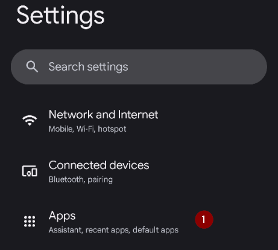
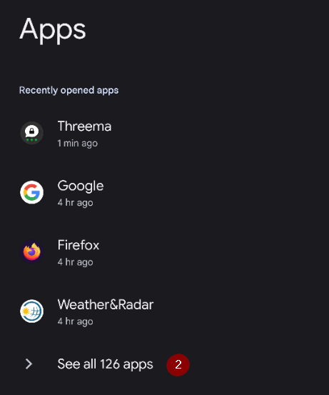
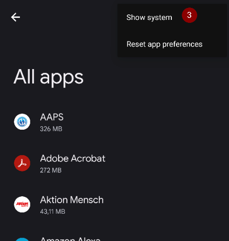
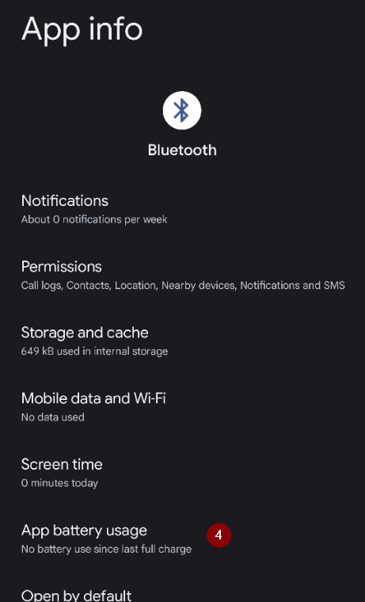
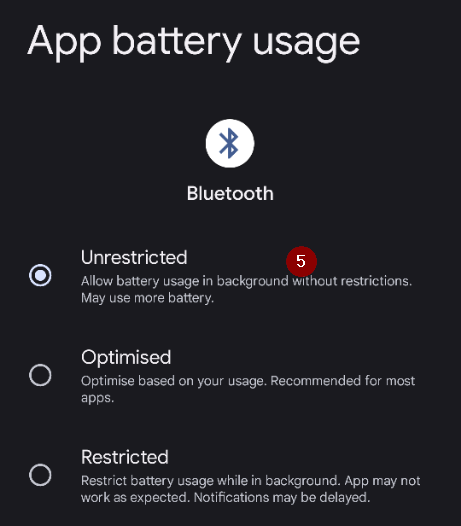
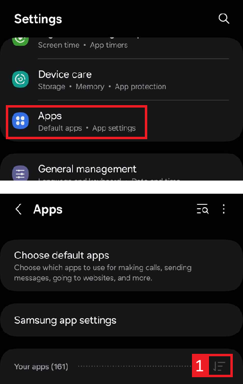
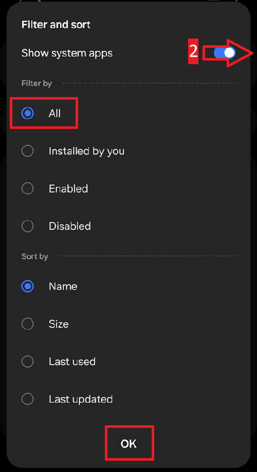
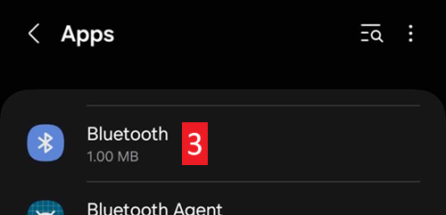
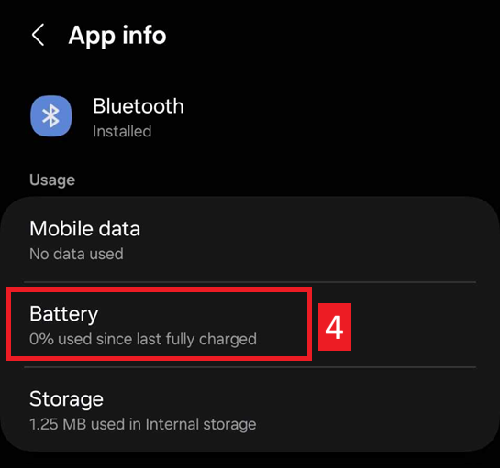
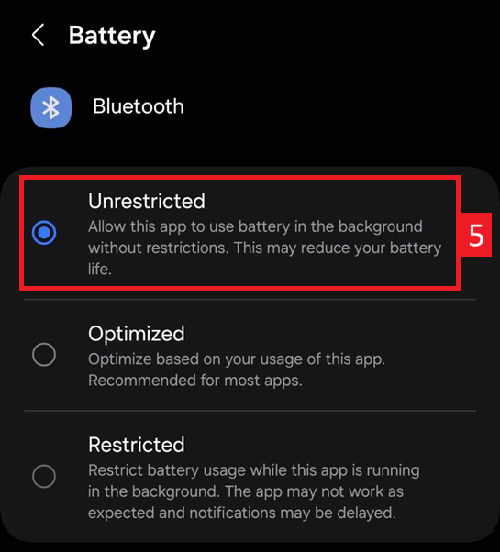

(generaltroubleshooting)=

# Resolució de problemes

**Comenceu aquí quan alguna cosa no funciona.** La informació per resoldre problemes és en moltes pàgines de la documentació. Aquesta pàgina la reuneix: és una sola col·lecció d'enllaços, ordenats per tema, per ajudar-vos a resoldre els problemes més freqüents.

Si no trobeu la resposta a continuació, consulteu també:

* les [Preguntes freqüents per a usuaris del llaç](../UsefulLinks/FAQ.md) per a respostes a preguntes habituals, i
* la guia [Ajustar el perfil d'AAPS](ProfileTuning.md) si el vostre llaç funciona però el control de la glucèmia ha de millorar.

```{admonition} Still stuck?
:class: tip
Si cap dels enllaços no resol el vostre problema, consulteu [On puc trobar ajuda?](WhereCanIGetHelp.md) per preguntar a la comunitat (Facebook, Discord), o envieu els vostres [fitxers de registre](AccessingLogFiles.md) als desenvolupadors.
```

---

(generaltroubleshooting-aaps-app)=

## Aplicació AAPS

### Compilar i actualitzar

* Si la compilació falla, consulteu [Si la compilació falla](#building-aaps-troubleshooting): hi trobareu la secció de resolució de problemes de cada mètode de compilació:
  * [AAPS Builder](#aaps-builder-troubleshooting)
  * [Compilació al navegador](#aaps-ci-troubleshooting)
  * [Android Studio](TroubleshootingAndroidStudio.md)
* Magatzem de claus perdut o nou: [Reinstal·lar AAPS amb un nou magatzem de claus](#reinstall-aaps)
* Actualitzar **AAPS**: [amb AAPS Builder](#aaps-builder-updates), [amb una compilació al navegador (fork)](#update-browser-build-troubleshooting), [amb Android Studio](#update-computer-build-troubleshooting)

### Instal·lar

* [Avís de Google Play Protect](#transferring-installing-play-protect-warning): l'aplicació apareix com a no segura.
* Instal·lació **bloquejada** amb un missatge sobre un desenvolupador no verificat: consulteu [Verificació de desenvolupadors d'Android](#android-developer-verification) per conèixer els mètodes d'instal·lació gratuïts.

### Configuració

* [Perfil: «La taxa basal no és compatible amb la bomba actual»](#your-aaps-profile-basal-not-compatible)
* [Bomba: «Dades procedents d'una altra bomba»](#config-builder-wrong-pump-data)
* [Nightscout Client](TroubleshootingNsClient.md)
* **«No es pot llegir la configuració d'AAPS»** en iniciar: la configuració està xifrada amb una clau que Android guarda per a **AAPS**, i aquesta clau ja no la pot obrir, per exemple després que s'hagi restablert el magatzem de claus del telèfon. Mentre es mostra aquesta pantalla, **AAPS** no funciona i no controla la bomba. Toqueu **Reintentar**: tanca **AAPS** i el torna a iniciar. Si això no ajuda, reinicieu el telèfon. Feu servir **Començar de nou** només quan no hi hagi cap altra solució: aparta el fitxer de configuració que no es pot llegir (el canvia de nom i el conserva) i inicia **AAPS** amb la configuració buida. Després importeu la vostra última [exportació de la configuració](../Maintenance/ExportImportSettings.md).

### Ús

* [Valors de carbohidrats incorrectes (absorció lenta de carbohidrats)](#CobCalculation-detection-of-wrong-cob-values)
* [Automatització](#automations-troubleshooting)
* [Llaç tancat complet](#full-closed-loop-troubleshooting)

---

(generaltroubleshooting-bluetooth-related-issues)=


## Problemes relacionats amb el Bluetooth

Per a problemes coneguts amb connexions Bluetooth, talls de connexió amb bombes o pods, o problemes d'activació i connexió, vegeu [Problemes relacionats amb el Bluetooth](../GettingHelp/BluetoothTroubleshooting.md)

---

(generaltroubleshooting-android-related-issues)=

## Problemes relacionats amb Android

### Optimització de la bateria

**AAPS** us pot ajudar a trobar la configuració correcta per al vostre telèfon: obriu el **menú** (☰) > **Quant a** i toqueu **Don't kill my app?**. S'obren les instruccions per a la marca del vostre telèfon a [Don't kill my app](https://dontkillmyapp.com/). L'[Assistent de configuració](#setup-wizard-bluetooth-battery-optimisation) també us demana que desactiveu l'optimització de la bateria per a **AAPS** i el Bluetooth.

Android té una configuració d'estalvi de bateria que està activada per defecte. Aquesta configuració atura o posa en pausa automàticament les aplicacions que el sistema no necessita per funcionar, per estalviar la bateria que fan servir les aplicacions que no cal que funcionin tot el temps.

Si està activada, és molt probable que causi problemes a **AAPS** i a altres aplicacions que l'ajuden, com **xDrip**.

És important comprovar que heu desactivat l'optimització de la bateria, perquè **AAPS** i les altres aplicacions que l'ajuden estiguin sempre actives.

Segons el model i la marca del telèfon, pot haver-hi més d'un lloc i més d'una opció on cal desactivar-ho.

***NOTA:** Seguiu els passos de més avall per desactivar l'optimització de la bateria per al servei Bluetooth si el vostre telèfon té aquesta opció. Podeu fer servir els mateixos passos per desactivar-la per a **AAPS** i altres aplicacions, però les captures de pantalla només mostren com fer-ho per al servei Bluetooth.*

#### Telèfons Pixel (Android de fàbrica)

* Aneu a la configuració d'Android i seleccioneu «Aplicacions».

  

* Seleccioneu «Mostra totes les aplicacions» (See all apps)

  

* Al menú de la dreta, seleccioneu «Mostra el sistema» (Show system).

  

* Ara cerqueu i seleccioneu l'aplicació «Bluetooth».

  

* Feu clic a «Ús de la bateria de l'aplicació» i seleccioneu «Sense restriccions» (en algunes versions antigues d'Android es diu «No optimitzada»).

  


#### Telèfons Samsung

* Aneu a la configuració d'Android i seleccioneu «Aplicacions»

* A la icona que, en principi, canvia l'ordre de la llista (1), seleccioneu «Mostra les aplicacions del sistema» (2).

  

  

* Ara cerqueu l'aplicació Bluetooth i seleccioneu-la per veure'n la configuració.

  

* Seleccioneu «Bateria».

  

* Poseu-la a «Sense restriccions» (en algunes versions antigues d'Android es diu «No optimitzada»).

  

#### Telèfons Huawei

Consulteu aquesta guia per a [l'optimització del Bluetooth i la bateria a Huawei](../CompatiblePhones/Huawei.md)

---

(generaltroubleshooting-cgm)=

## Monitor continu de glucosa (CGM)

Enllaços útils sobre problemes coneguts dels CGM i els passos per resoldre'ls.

* [General](#general-cgm-troubleshooting)
* [Dexcom G6](#DexcomG6-troubleshooting-g6)
* [Libre 2 amb Minimal Looper](#minimallooper-troubleshooting)
* [Libre 3](#libre3-experiences-and-troubleshooting)
* [xDrip: no hi ha dades del CGM](#xdrip-identify-receiver)
* [xDrip: resolució de problemes amb Dexcom](#xdrip-troubleshooting-dexcom-g5-g6-and-xdrip)

---

(generaltroubleshooting-pumps)=

## Bombes

Enllaços útils sobre problemes coneguts de les bombes i els passos per resoldre'ls

* [Accu-Chek Combo](#combov2-tips-for-basic-usage)
* [Accu-Chek Insight](#Accu-Chek-Insight-Pump-insight-specific-errors)
* [CareLevo](#carelevo-alarms-and-notifications)
* [DanaRS](#DanaRS-Insulin-Pump-dana-rs-specific-errors)
* [Diaconn G8](#diaconn-g8-bluetooth-troubleshooting)
* [EOPatch2](#eopatch2-alarms-and-warnings)
* [Medtronic + RileyLink](#MedtronicPump-what-to-do-if-i-loose-connection-to-rileylink-and-or-pump)
* [Medtrum Nano](#medtrum-nano-troubleshooting)
* [Omnipod DASH](#omnipod-dash-troubleshooting)
* [Omnipod Eros](#OmnipodEros-troubleshooting)

---

(generaltroubleshooting-phones)=

## Telèfons

Enllaços útils sobre problemes coneguts dels telèfons i els passos per resoldre'ls

* [Llista de configuracions de telèfons i dispositius provades](https://docs.google.com/spreadsheets/u/1/d/e/2PACX-1vScCNaIguEZVTVFAgpv1kXHdsHl3fs6xT6RB2Z1CeVJ561AvvqGwxMhlmSHk4J056gMCAQE02sAWJvT/pubhtml?gid=683363241&single=true)
* [Jelly](../CompatiblePhones/Jelly.md)
* [Optimització del Bluetooth i la bateria a Huawei](../CompatiblePhones/Huawei.md)

---

(generaltroubleshooting-remote-control)=

## Control remot

* [AAPSClient i control remot (emparellament, ordres que no arriben)](#client-master-control-troubleshooting)
* [Problemes amb el «Token d'accés de Nightscout»](#remotecontrol-nightscout-access-token)
* [Ordres SMS](#SMSCommands-troubleshooting)
* [Android Auto](#android-auto-troubleshooting)

---

(generaltroubleshooting-smartwatches)=

## Rellotges intel·ligents

Enllaços útils sobre problemes coneguts dels rellotges intel·ligents i els passos per resoldre'ls

* [Resolució de problemes de l'aplicació per al rellotge](#Watchfaces-troubleshooting-the-wear-app)
* [El rellotge i el telèfon no es comuniquen](#wear-os-watch-phone-communication)
* [Wear OS 5](#wear-os-5-troubleshooting)
* [Compilar l'aplicació per al rellotge](#building-aaps-wear-os-troubleshooting)
