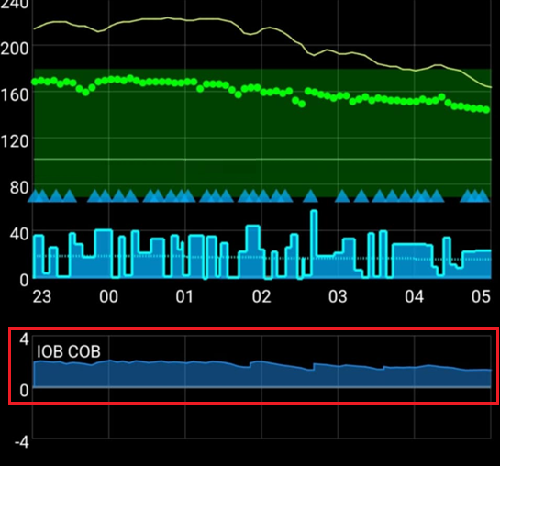
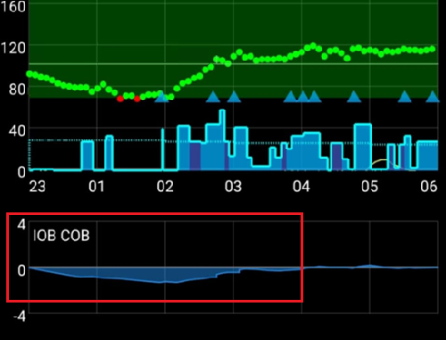
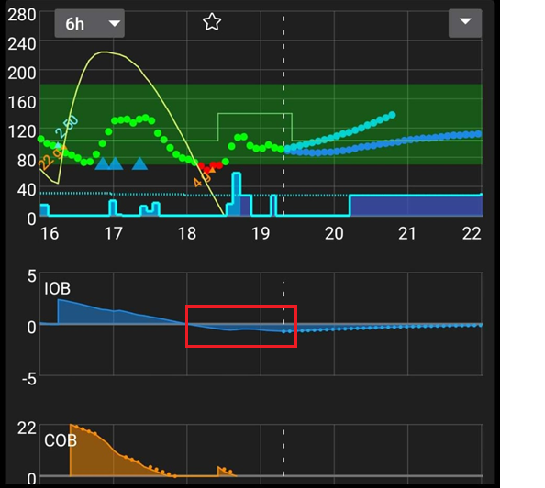
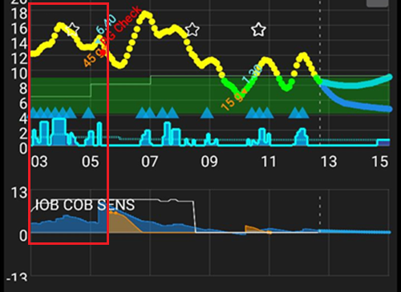
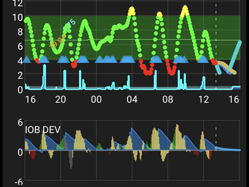
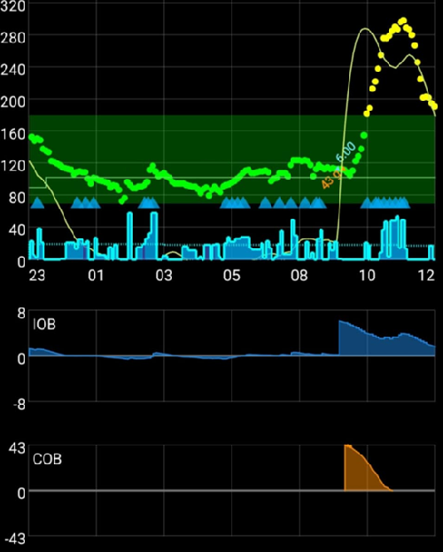

# Ajustar el perfil d'AAPS

```{admonition} This is NOT a medical advice
:class: warning
Treballeu amb el vostre equip mèdic per tenir suport i consell sobre el control de la vostra diabetis.</br>
Feu servir aquesta guia només quan ja hàgiu [configurat correctament el vostre **perfil**](https://androidaps.readthedocs.io/en/latest/SettingUpAaps/YourAapsProfile.md), seguint tots els objectius d'**AAPS**.
```

Aquesta guia explica la lògica dels resultats de l'algoritme OpenAPS amb un __perfil__ donat, i diu quins valors d'**AAPS** es poden ajustar quan s'observen certes situacions o patrons. Els consells sobre les proves de basal que trobareu més avall poden ser diferents del que us aconselli el vostre equip mèdic.

Fer servir el **llaç tancat** pot fer més fàcils les proves de basal i pot reduir molt el risc d'hipoglucèmia si la basal del vostre __perfil__ és massa forta.

## Com fer canvis a la configuració del perfil

1. Assegureu-vos que heu llegit i entès la configuració i els consells recomanats per __AAPS__ que trobareu més avall. Si no seguiu aquests consells, el procés d'ajust pot ser difícil i és menys probable que obtingueu un __perfil__ ben ajustat
2. Observeu i compareu amb atenció, **durant uns quants dies**, què passa amb la vostra __glucèmia__ i el vostre __IOB__.
3. Fixeu-vos en els patrons d'**AAPS** que passen (gairebé) cada dia a la mateixa hora.
4. És important fer-ho durant uns quants dies. Si decidiu els ajustos del __perfil__ amb dades d'un sol dia, normalment el resultat és dolent.
5. Només quan hàgiu vist un patró que es repeteix, per exemple a les 13:00 veieu un pic de __glucèmia__ o un valor d'__IOB__ negatiu, comenceu a fer petits canvis al vostre __perfil__.
6. És important fer només un canvi cada vegada. P. ex. augmenteu la basal un 10% cap a les 13:00.
7. Després de cada canvi, és important vigilar l'efecte en la vostra __glucèmia__ i el vostre __IOB__ durant els dies següents.
8. Repetiu aquest procés: observeu, decidiu i torneu a ajustar si cal

No tingueu pressa, aneu a poc a poc!

## Configuració i consells recomanats mentre ajusteu la basal

- Feu totes les proves amb el [llaç tancat activat](#AapsScreens-loop-status).
- **<u>DESACTIVEU</u> totes les [automatitzacions](../DailyLifeWithAaps/Automations.md)**
- **<u>DESACTIVEU</u> [DynISF](#Open-APS-features-DynamicISF), [AutoISF](#Open-APS-features-auto-isf) i [AutoSens](#Open-APS-features-autosens)** perquè no intentin adaptar el vostre perfil.
- No feu accions manuals (bolus manual, objectius temporals, etc.) durant les proves: deixeu que el sistema faci servir només la configuració del **perfil**.
- For the [additional graphs](#AapsScreens-section-g-additional-graphs): on graph 1, use Insulin On Board and Basal. On graph 2, use Carbs On Board (and Sensitivity change). On graph 3, use Deviations and Blood Glucose Impact. Quan demaneu consell, incloeu-los sempre a les vostres captures de pantalla.
- COB=0[*](#profiletuning-cob-zero)

Altres coses que l'ideal és evitar, perquè influeixen en les dades i poden portar a conclusions errònies:
- Sense activitat física.
- Sense estrès.
- Sense malaltia.
- Sense temps extrem, com temperatures molt altes o molt baixes.
- Sense sessions fallides de bomba ni de CGM.
- Sense carbohidrats no anunciats.

Tingueu en compte també:
- Si el vostre [perfil de taxa basal](#your-aaps-profile-basal-rates) és correcte, quan sou a l'objectiu amb COB=0[*](#profiletuning-cob-zero) i IOB=0, us mantindreu sempre a l'objectiu sigui quin sigui el vostre **ISF** (l'**ISF** només es fa servir quan sou per sobre del vostre objectiu de **glucèmia**).
- Heu de comprovar l'**IOB** actual, però també el gràfic de l'**IOB**, per veure com ha canviat l'**IOB** durant les últimes hores.

(profiletuning-cob-zero)=

***COB = 0**

Vol dir que l'àpat ja s'ha digerit i que ja no queden carbohidrats al vostre cos.

**AAPS** pot indicar [COB=0 quan encara teniu carbohidrats a bord](../DailyLifeWithAaps/CobCalculation.md).

## Definicions del [perfil](../SettingUpAaps/YourAapsProfile.md)

Un **perfil massa fort** indica alguna combinació del següent:

- El número de l'[ISF](#your-aaps-profile-insulin-sensitivity-factor) és massa petit.
- El número de la [basal](#your-aaps-profile-basal-rates) és massa gran.
- El número de la [ràtio I:C](#your-aaps-profile-insulin-to-carbs-ratio) és massa petit.

## Observacions de l'IOB

*Nota: també podeu fer servir el gràfic d'IOB de Loopalyzer als informes de Nightscout per veure l'IOB de diversos dies.*

Si després d'uns quants dies observeu els patrons següents, penseu en fer aquests canvis:

### IOB positiu

- La basal del **perfil** pot no ser prou forta (també pot ser per coses com menjar no anunciat, malaltia, mala absorció al punt d'infusió, etc.)



### IOB negatiu

- Basal massa forta.
- Pot ser l'efecte d'esport o activitat física anterior.



- Àpat anterior: massa bolus (cosa que ha portat a una basal temporal zero molt llarga)



## Observacions de l'objectiu de glucèmia

### Encallada alta

- El número de l'__ISF__ és alt i no prou fort (la insulina calculada és massa feble)



- La basal del __perfil__ pot no ser prou forta (els **SMB** no tenen prou «reserva de basal» per fer servir)
- Potser s'ha activat una seguretat ([MaxIOB](#Open-APS-features-maximum-total-iob-openaps-cant-go-over)?) que limita la insulina que s'injecta. Comproveu-ho a la pantalla del plugin **APS** (**Configurador → APS → Obrir plugin**); vegeu [SMB](#Open-APS-features-super-micro-bolus-smb).
- Problema tècnic: absorció al punt d'infusió, set d'infusió, ...

### Encallada baixa

- __ISF__ massa fort: cal augmentar el número
- Basal del __perfil__ massa forta (si també hi ha IOB negatiu)

### Muntanya russa (pujades i baixades)

- **ISF** massa fort? Vegeu el vostre [perfil d'AAPS](#your-aaps-profile-insulin-sensitivity-factor)



## Observacions de la glucèmia després dels àpats

### Pujada ràpida i glucèmia alta

- L'àpat conté carbohidrats ràpids (com suc de fruita).
- Penseu en fer un prebolus o un prebolus una mica abans.
- Bolus (IC o % injectat) no prou fort.



### Pujada ràpida i després glucèmia baixa

- Penseu en fer un prebolus; el vostre **perfil** pot ser massa agressiu (correcció excessiva de la pujada)
- Bolus massa fort.


## [Com calcular la vostra ràtio I:C](#your-aaps-profile-insulin-to-carbs-ratio)

1. Primer necessiteu la configuració basal correcta al vostre **perfil**.
2. Comenceu a l'objectiu, millor sense IOB negatiu.
3. Record the total insulin given in **Manage → Pump** (or pump history) and call it Start insulin. Mesureu amb molta precisió una porció coneguda de carbohidrats i apunteu l'hora d'inici i l'IOB inicial. Then enter carbs and bolus information into **AAPS** using the wizard (with the current configured I:C). No us oblideu de menjar els carbohidrats ;)
4. Després d'unes hores, quan COB=0[*](#profiletuning-cob-zero) i torneu a ser a l'objectiu, apunteu l'hora final i l'IOB final, comproveu la insulina total lliurada igual que abans i anomeneu-la insulina final. *NOTA: la durada NO és important, sempre que sigui més llarga que la vostra digestió*
5. A la diferència entre la insulina inicial i la final, resteu/sumeu la diferència IOB final - IOB inicial. Després resteu la insulina basal calculada amb la configuració del vostre **perfil**.
6. Si la __glucèmia__ és a l'objectiu, tindreu la insulina total que s'ha fet servir per «digerir» els carbohidrats. Calculeu la vostra **ràtio I:C**.

### Explicació dels càlculs de la ràtio I:C

- Amb un **perfil** que té la taxa basal correcta, en qualsevol període us hauríeu de mantenir a l'objectiu i tenir un IOB proper a 0. Només rebeu la basal del vostre **perfil**.
- A això hi afegiu carbohidrats i un bolus. Espereu fins que el vostre cos hagi digerit tots els carbohidrats i torneu a ser a l'objectiu de **glucèmia**. La insulina que feu servir serà la suma de la basal més la insulina necessària per als carbohidrats. Calculeu la insulina feta servir per a la basal (amb el vostre **perfil**) i la resta serà la insulina feta servir per digerir els carbohidrats.
- Si el període és massa curt, quedaran carbohidrats sense digerir i per tant la vostra «insulina necessària per als carbohidrats» serà incorrecta.
- Si el període és massa llarg, no passarà res dolent. Fareu servir tots els carbohidrats i rebreu més basal. Al final, restareu la basal de la insulina total feta servir, i per això el període més llarg (amb més basal) no afectarà el resultat.

Escrit originalment per @Robby (Discord) amb consells i trucs per ajudar-vos a ajustar el vostre **perfil d'AAPS**, revisat i editat per la comunitat (gràcies!).
