(reinstall-aaps)=
# Reinstal·lar AAPS amb un nou magatzem de claus

Cada apk d'**AAPS** està signat amb un **magatzem de claus** (keystore). Una actualització només s'instal·la sobre l'**AAPS** actual si està signada amb el **mateix magatzem de claus**: llavors es conserven tota la configuració i totes les dades. Per això es recomana guardar el magatzem de claus i la seva contrasenya en un lloc segur.

Si intenteu instal·lar un apk signat amb un magatzem de claus diferent de l'anterior, rebreu un missatge d'error que diu que la instal·lació ha fallat!

(reinstall-aaps-when)=
## Quan cal reinstal·lar?

Heu de desinstal·lar i tornar a instal·lar **AAPS** quan el nou apk està signat amb un magatzem de claus diferent, per exemple:

- No trobeu el vostre magatzem de claus antic o la seva contrasenya.
- Heu creat un nou magatzem de claus, per exemple amb l'[opció 1 de la compilació al navegador](../SettingUpAaps/BrowserBuildKeystore.md) o amb **Crear una clau nova** a [AAPS Builder](../SettingUpAaps/BrowserBuildAapsBuilder.md).
- Compileu en un ordinador nou i no hi heu copiat el vostre magatzem de claus.

Si encara teniu el vostre magatzem de claus, no necessiteu aquesta pàgina: torneu-lo a fer servir i [actualitzeu **AAPS**](../Maintenance/UpdateToNewVersion.md) directament.

(reinstall-aaps-before)=
## Abans de començar

- Desinstal·lar **AAPS** elimina tota la seva configuració, els vostres [objectius](../SettingUpAaps/CompletingTheObjectives.md) i la connexió actual amb la bomba. Els recupereu important el vostre **fitxer de configuració**, així que assegureu-vos que en teniu un de recent.
- El fitxer de configuració no conté l'historial de tractaments i de glucèmia. Si envieu les dades a [Nightscout](../SettingUpAaps/SettingUpTheReportingServer.md), les podeu tornar a carregar després de la reinstal·lació (pas 8).
- Necessiteu la vostra [**clau mestra**](#Preferences-master-password): el fitxer de configuració està encriptat amb ella. Restablir una clau mestra oblidada no ajuda aquí: un fitxer de configuració només es pot importar amb la contrasenya amb què es va exportar (vegeu [Com restablir la clau mestra?](#FAQ-reset-master-password)).
- **Usuaris d'Omnipod i Medtrum:** primer llegiu [Bombes sense tub](#ExportImportSettings-tubeless-pumps). El fitxer de configuració s'ha d'haver exportat durant el pod o el patch que porteu ara.
- Si cal, [configureu el receptor del vostre CGM / origen de glucèmia](../Getting-Started/CompatiblesCgms.md) abans de començar.

(reinstall-aaps-steps)=
## Passos

Les imatges mostren el pas d'**AAPS** 3.4 (passos 1 a 3) a **AAPS** 4 (passos 6 a 8). Altres versions es veuen una mica diferents.

(reinstall-aaps-export)=
### 1. Exporteu la vostra configuració

Exporteu la configuració amb l'**AAPS** que teniu instal·lat ara al telèfon. Vegeu [Exportar la configuració](#ExportImportSettings-Settings-Export) per a més detalls.

A **AAPS** 3.4: obriu **Manteniment** i premeu **Opcions d'exportació**. A **Configuració de l'usuari**, marqueu **Emmagatzematge local** i premeu **OK**.

*Nota: també podeu fer servir l'[emmagatzematge al núvol](#preferences-maintenance-cloud) per tenir una còpia de seguretat addicional. És una bona idea, però mantingueu l'emmagatzematge local per recuperar la configuració ràpidament.*

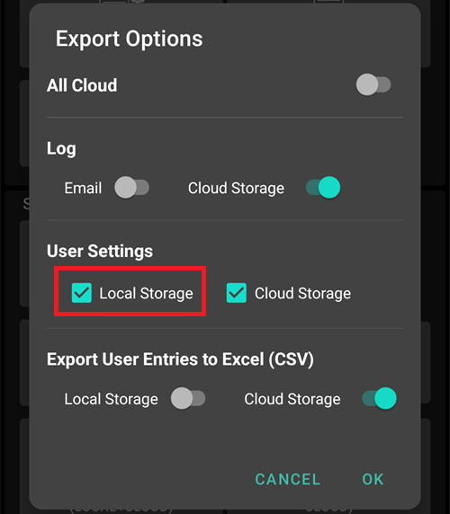

Ara el botó diu **Exportar configuració (local)**. Toqueu-lo.

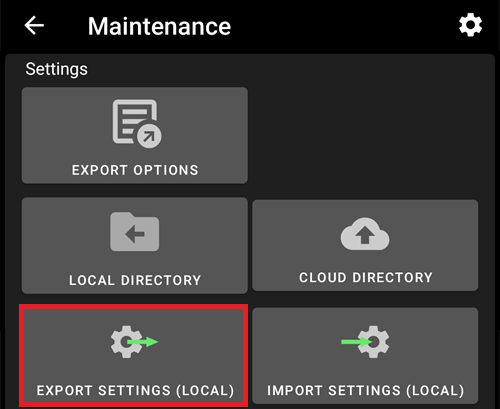

**AAPS** mostra el nom del fitxer que crearà. Premeu **OK**, escriviu la vostra clau mestra i premeu **OK**.

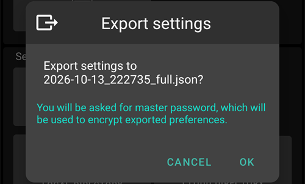

A **AAPS** 4: obriu **Manteniment**, seleccioneu el xip **Local** al costat d'**Exportar configuració** i premeu **Exportar configuració**.

(reinstall-aaps-copy)=
### 2. Copieu el fitxer de configuració fora del telèfon

El fitxer és a la carpeta **preferences** del vostre [directori d'**AAPS**](#SetupWizard-StoragePermission), amb un nom com `2026-10-13_222735_full.json`. Copieu-lo o pugeu-lo a un lloc extern (per exemple el vostre ordinador, un servei d'emmagatzematge al núvol...). Normalment el fitxer es queda al telèfon després de desinstal·lar, però per si de cas guardeu-ne una còpia en un altre lloc.

(reinstall-aaps-nightscout-before)=
### 3. Sincronitzeu amb Nightscout

Aquest pas no és obligatori, però es recomana si feu servir [DynISF](#Open-APS-features-DynamicISF): us permetrà continuar directament amb la configuració actual, en lloc d'esperar 5 dies a tenir les dades que necessita el plugin. NSClient V3 ha d'estar [activat i configurat](../SettingUpAaps/SettingUpTheReportingServer.md).

Assegureu-vos que Nightscout té totes les vostres dades abans de desinstal·lar.

Obriu **NSClient**, premeu el botó **Sincronització completa** a la part de baix de la pantalla i després **OK**.

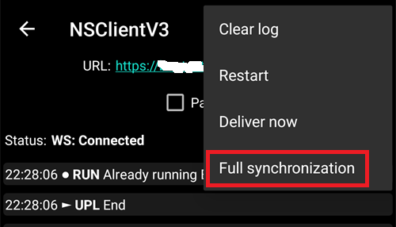

*Nota: el temps que cal depèn del vostre servei d'allotjament de Nightscout.*

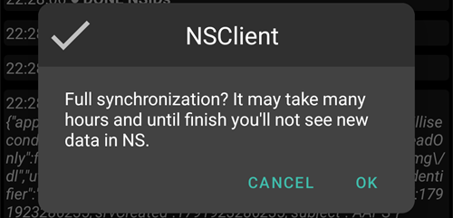

Després **AAPS** ofereix netejar la seva base de dades. **OK** elimina del telèfon les dades de més de 3 mesos, i així la sincronització és molt més ràpida. **Cancel·lar** sincronitza sense netejar. De tota manera, la base de dades del telèfon s'elimina quan desinstal·leu, així que totes dues opcions són correctes.

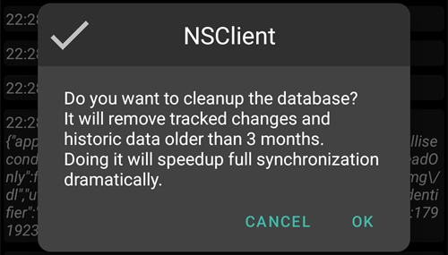

Deixeu **AAPS** en marxa fins que acabi la sincronització.

(reinstall-aaps-build)=
### 4. Compileu el nou apk

[Compileu](../SettingUpAaps/BuildingAaps.md) un nou apk signat amb el vostre nou magatzem de claus i transferiu-lo al telèfon.

(reinstall-aaps-uninstall)=
### 5. Desinstal·leu AAPS

Al telèfon, a **Configuració** > **Aplicacions** > **AAPS**, premeu **Desinstal·la** i confirmeu amb **D'acord**.

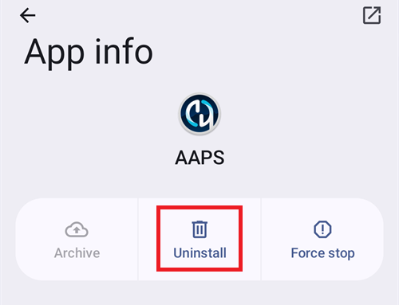

(reinstall-aaps-install)=
### 6. Instal·leu i inicieu el nou AAPS

[Instal·leu](../SettingUpAaps/TransferringAndInstallingAaps.md) el nou apk i inicieu **AAPS**. L'[assistent de configuració](../SettingUpAaps/SetupWizard.md) demana els permisos que necessita **AAPS**: premeu **Concedir** per a cadascun. Això també torna a desactivar l'[optimització de la bateria](#setup-wizard-bluetooth-battery-optimisation).

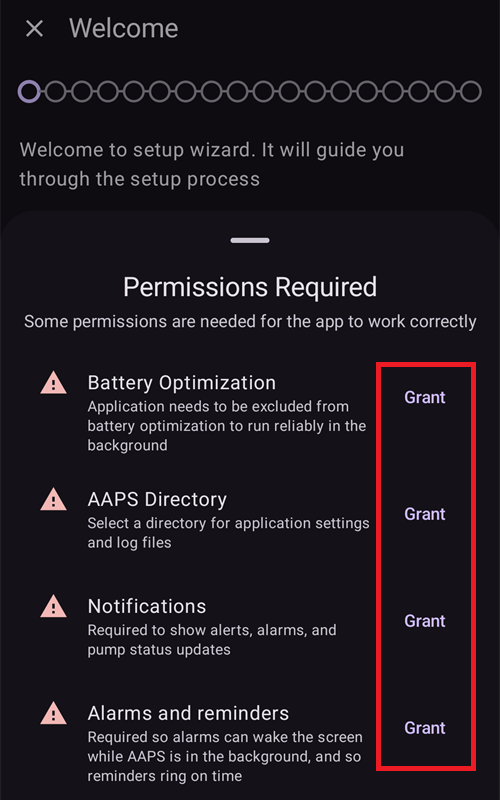

A **Directori AAPS**, seleccioneu la mateixa carpeta d'**AAPS** que abans (la que té la carpeta **preferences** a dins), premeu **Utilitza aquesta carpeta** i **Permet**.

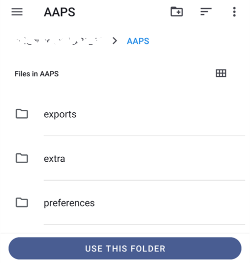

Quan **AAPS** troba la configuració exportada, l'assistent de configuració mostra una pantalla [Trobada configuració emmagatzemada](#setup-wizard-import-settings) on la podeu importar. També podeu tancar l'assistent i importar-la des de **Manteniment**, com es descriu a continuació.

(reinstall-aaps-import)=
### 7. Importeu la configuració

Si el fitxer de configuració ja no és al telèfon, torneu-lo a copiar a la carpeta **preferences** del vostre directori d'**AAPS**.

Obriu el menú (☰) > **Manteniment**, seleccioneu el xip **Local** al costat d'**Importar configuració** i premeu **Importar configuració**.

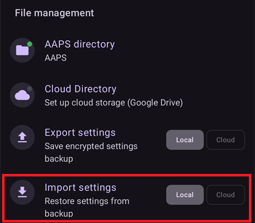

La llista mostra cada fitxer amb la seva versió d'**AAPS** i l'antiguitat. Trieu el fitxer que heu exportat al pas 1.

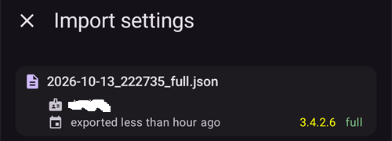

No cal que primer definiu una clau mestra al nou **AAPS**. Escriviu la clau mestra que vau fer servir per a l'exportació a **Contrasenya de desencriptació** i premeu **Desencriptar**. El missatge **L'arxiu es va encriptar amb una contrasenya diferent** és normal: el nou **AAPS** encara no coneix la vostra contrasenya. La importació la restaura juntament amb la resta de la configuració.

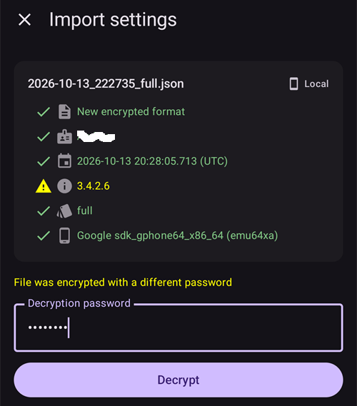

Marqueu **Substituir també la configuració de la bomba**: si no ho feu, la bomba i la seva configuració no es restauren. Usuaris d'Omnipod i Medtrum: marqueu-ho només si el fitxer es va exportar durant el pod o el patch actual (vegeu [Bombes sense tub](#ExportImportSettings-tubeless-pumps)).

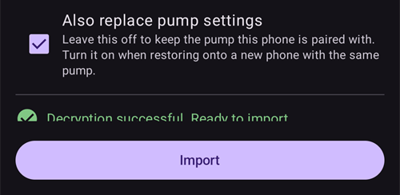

Premeu **Importar**, després **OK** per aplicar la configuració i un altre cop **OK** a **Configuració aplicada**.

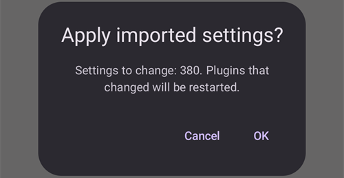

(reinstall-aaps-nightscout-after)=
### 8. Recupereu l'historial des de Nightscout

Obriu el menú (☰) > [**Configurador**](../SettingUpAaps/ChangeAapsConfiguration.md) > **Comunicació** i premeu **Obrir plugin** a **NSClientV3**. Comproveu que l'estat mostra **Connectat**. Si no és així, vegeu [Resolució de problemes de NSClient](TroubleshootingNsClient.md).

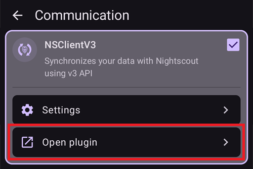

Premeu el botó **Sincronització completa** a la part de baix de la pantalla i **OK**. La base de dades és nova, així que podeu respondre la pregunta de neteja com vulgueu.

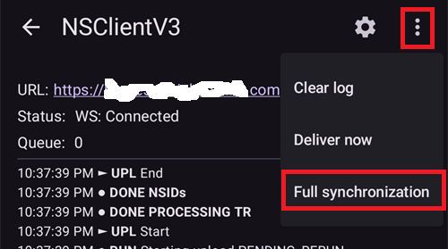

**AAPS** carrega les vostres dades des de Nightscout. Quan acaba, el registre mostra **Full sync finished**.

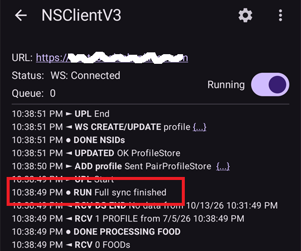

(reinstall-aaps-check)=
### 9. Comproveu-ho i continueu amb el llaç

Comproveu que la bomba està connectada i que arriben els valors del CGM, i després continueu amb el llaç.

(reinstall-aaps-afterwards)=
## Després

A partir d'ara feu servir sempre el vostre nou magatzem de claus, i guardeu-lo amb la seva contrasenya en un lloc segur, fora del telèfon. Vegeu [Crear i restaurar còpies de seguretat](../Maintenance/ExportImportSettings.md).
