(troubleshooting_androidstudio-troubleshooting-android-studio)=

# Resolució de problemes d'Android Studio

```{contents} List of common issues
:depth: 2
:local: true
```

(troubleshooting_androidstudio-lost-keystore)=
## Magatzem de claus perdut
Si heu perdut el magatzem de claus o la seva contrasenya, un apk signat amb un magatzem de claus nou no pot actualitzar el vostre **AAPS** actual: l'heu de desinstal·lar i tornar a instal·lar. Vegeu [Reinstal·lar AAPS amb un nou magatzem de claus](#reinstall-aaps).

## Ha fallat Gradle Sync
Gradle Sync pot fallar per diversos motius. Quan rebeu un missatge que diu 'gradle sync failed', obriu la pestanya «Build» (1) a la part inferior d'Android Studio i comproveu quin missatge d'error (2) es mostra.

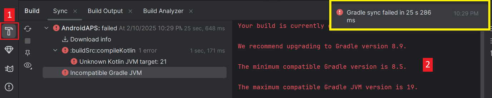

```{contents} Likely reasons for gradle sync failures are:
:depth: 1
:local: true
```

*Important*: Després de seguir les instruccions per al vostre problema concret, heu de tornar a iniciar la [sincronització de Gradle](#gradle-resync).

(troubleshooting_androidstudio-uncommitted-changes)=
### Canvis sense confirmar (uncommitted changes)

Si rebeu un missatge d'error com aquest:

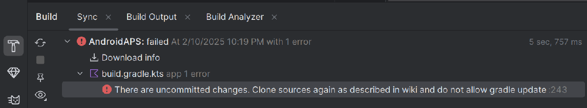

```
Build file 'C:\Data\50-Android\AndroidAPS\app\build.gradle.kts' line: 243

There are uncommitted changes.
Torneu a clonar el codi font tal com es descriu a la documentació i no permeteu l'actualització de Gradle
```

#### Pas 1 - Comproveu la instal·lació de Git
  * Obriu la pestanya del terminal (1) a la part inferior d'Android Studio, copieu el text següent i enganxeu-lo o escriviu-lo al terminal (2).
    ```
    git --version
    ```

    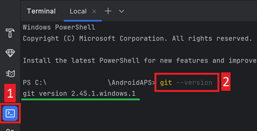

    Nota: hi ha un espai i dos guions entre git i version!

  * Heu de rebre un missatge que indica quina versió de Git està instal·lada, com es veu a la captura de pantalla de dalt. En aquest cas, aneu al [Pas 2](#troubleshooting-android-studio-check-for-uncommitted-changes).

  * In case you get a message saying
    ```
    Git: command not found
    ```
    la vostra instal·lació de Git no és correcta.

  * [Comprovar la instal·lació de Git](#BuildingAaps-steps-for-installing-git)

  * If you are on Windows and Git was just installed, you should restart your computer to make Git globally available after the installation

  * If Git is installed, you have restarted (if on Windows), and Git still cannot be found:

  * Cerqueu a l'ordinador un fitxer «git.exe».

    Apunteu-vos en quin directori està desat.

  * Go to the Environment variables in Windows, select the variable "PATH" and click edit. Afegiu el directori on heu trobat la vostra instal·lació de Git.

  * Deseu i tanqueu.

  * Reinicieu Android Studio.

(troubleshooting-android-studio-check-for-uncommitted-changes)=
#### Pas 2: Comproveu si hi ha canvis sense confirmar.

  * A Android Studio, obriu la pestanya «Commit» (1) a la part esquerra. 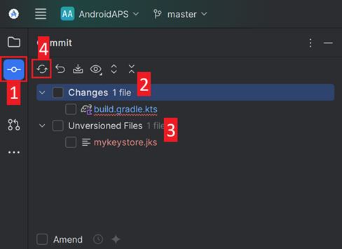
  * Hi podeu veure «Changes» (anomenat «Default changeset» a les versions antigues d'Android Studio) (2) o «Unversioned Files» (3):

    * Si hi ha «Changes», probablement heu actualitzat 'Gradle' o heu canviat per error el contingut d'algun fitxer.

    * Feu clic amb el botó dret a «Changes» i seleccioneu «Rollback…» (1)

      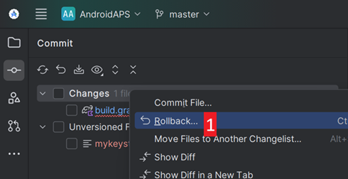

    * Els fitxers es tornen a descarregar del servidor Git. Si no hi ha cap altre canvi a la pestanya Commit, aneu al [Pas 3](#gradle-resync).

  * Si veieu «Unversioned Files», potser heu desat fitxers per error al directori del codi font. Potser són fitxers importants, com el fitxer del magatzem de claus, que s'haurien de moure a un altre lloc. Si no sabeu què són aquests fitxers i no els heu creat vosaltres, els podeu eliminar.

    * Feu servir l'explorador de fitxers habitual de l'ordinador per moure aquest fitxer (o tallar-lo i enganxar-lo) a un lloc segur.

    * Torneu a Android Studio i feu clic al botó Refresh (4) de la pestanya Commit per assegurar-vos que el fitxer ja no és al directori d'**AAPS**.

      Si no hi ha cap altre canvi a la pestanya Commit, aneu al [Pas 3](#gradle-resync).


#### Pas 3: Torneu a sincronitzar Gradle (una altra vegada)

Seguiu les instruccions de [Tornar a sincronitzar Gradle](#gradle-resync).

### Git Pull Failed - Please tell me who you are

Si veieu aquest missatge, Git necessita que us identifiqueu.

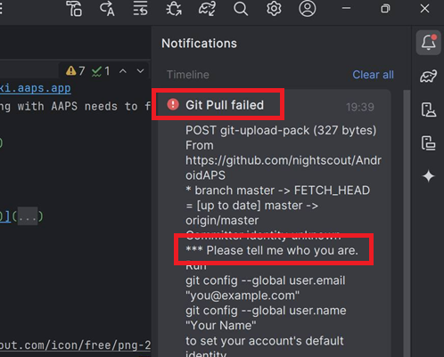

Obriu el terminal i escriviu les dues ordres següents, una després de l'altra.

```
git config --global user.name "Your name here"
git config --global user.email your.email@here.com
```

El vostre nom s'ha d'escriure entre cometes.

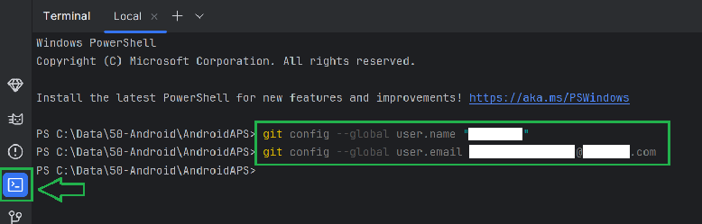

(troubleshooting_androidstudio-android-gradle-plugin-requires-java-11-to-run)=

(incompatible-gradle-jvm)=
### Gradle JVM incompatible

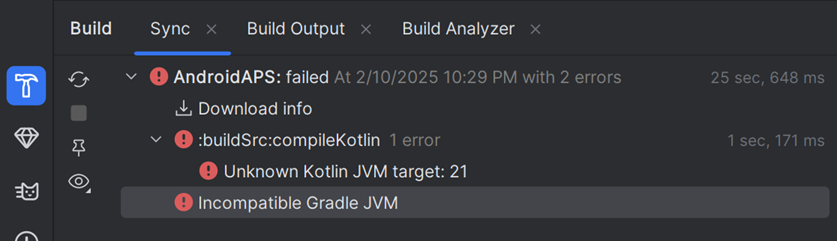

```
Your build is currently configured to use incompatible Java 21.0.3 and Gradle 8.2.
Cannot sync the project.

We recommend upgrading to Gradle version 8.9.

The minimum compatible Gradle version is 8.5.

The maximum compatible Gradle JVM version is 19.
```

O bé:

```
Cause: error: invalid source release: 21
```

If you experience the above error message, you need to download a correct JVM version before you can try to rebuild:

1.  Comproveu a la [taula de requisits](#Building-APK-recommended-specification-of-computer-for-building-apk-file) quina versió de JVM necessiteu per a la versió d'**AAPS** que compileu, i apunteu-la.

2. Obriu la vista Gradle fent clic a l'elefant (1) a la dreta d'Android Studio, obriu la configuració (2) i seleccioneu **Gradle Settings** (3):


3.  Al camp **Gradle JDK**, comproveu si està seleccionada la versió adequada (1). Si no ho està, feu clic al camp i mireu si ja és a la llista. L'exemple de sota mostra que la JVM 21 té l'etiqueta «jbr-21». Si la trobeu, seleccioneu-la i ja està. Si no hi és, seleccioneu **Download JDK** (2).


4. A Version (1), seleccioneu el JDK que necessita la vostra versió d'**AAPS** (el que vau apuntar quan vau comprovar la taula de requisits). A Vendor (2), seleccioneu qualsevol proveïdor. Location (3): no la canvieu. Feu clic a **Download** (4).

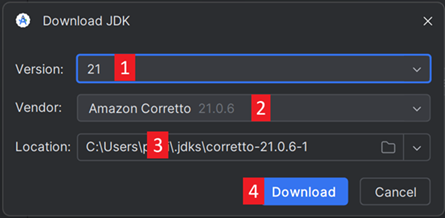

5.  Tanqueu el diàleg **Settings** amb **OK**.
6. Ara heu de tornar a iniciar Gradle Sync. Seguiu les instruccions de [Tornar a sincronitzar Gradle](#gradle-resync).

(incompatible-version-of-android-gradle-plugin)=
### Versió incompatible del plugin Android Gradle

  Si rebeu el missatge d'error següent

`The project is using an incompatible version (AGP x.x.x) of the Android Gradle plugin. Latest supported version is AGP x.x.x`

  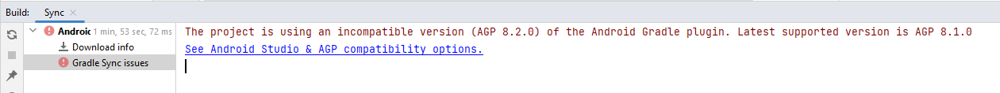

  Feu servir una versió antiga d'Android Studio. Al menú, aneu a Help > Check for updates i instal·leu totes les actualitzacions que es trobin d'Android Studio i dels seus plugins.

(troubleshooting_androidstudio-could-not-resolve-no-cached-version)=
### Could not resolve / No cached version

  És possible que rebeu aquest missatge d'error:

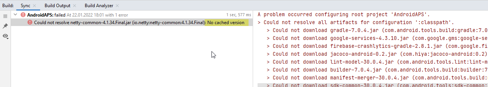

  * A la dreta, obriu la pestanya Gradle (1).

    Assegureu-vos que el botó que es mostra a (2) *NO* està seleccionat.

    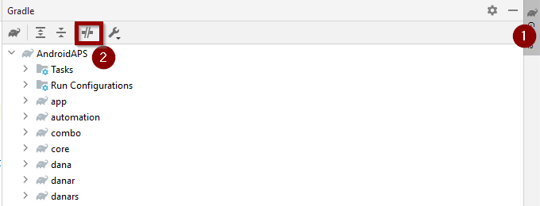

  * Ara heu de [tornar a sincronitzar Gradle](#gradle-resync)

(troubleshooting_androidstudio-unable-to-start-daemon-process)=
### Unable to start daemon process

  Si veieu un missatge d'error com el de sota, probablement feu servir un sistema Windows 10 de 32 bits. Android Studio 3.5.1 i posteriors no ho admeten i, per desgràcia, els desenvolupadors d'**AAPS** no hi poden fer res!

  A internet hi ha informació sobre com saber si teniu un sistema operatiu de 32 o de 64 bits, p. ex. [aquesta](https://support.microsoft.com/en-us/windows/32-bit-and-64-bit-windows-frequently-asked-questions-c6ca9541-8dce-4d48-0415-94a3faa2e13d).

  

(gradle-resync)=
### Tornar a sincronitzar Gradle

  Si encara veieu el missatge que diu que gradle sync ha fallat, seleccioneu ara l'enllaç **Try again** (1). 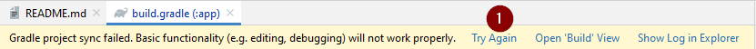


  Si ja no veieu el missatge, encara podeu iniciar-ho manualment:

  * Obriu la pestanya Gradle (1) a la vora dreta d'Android Studio.

    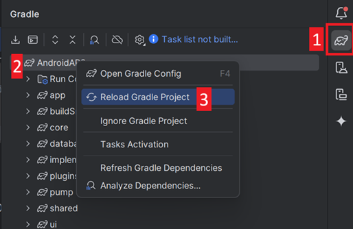

  * Feu clic amb el botó dret sobre AAPS (2)

  * Feu clic a «Reload Gradle Project» (3)

## Generate Signed APK s'ha completat amb 0 variants de compilació

When you generate the signed apk, you might get the notification that generation was successful but that '0 build variants' were generated:

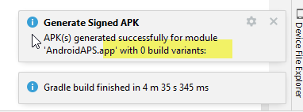

És un avís fals. Comproveu el directori que heu triat com a «Destination folder» per a la generació (pas [Generate Signed APK](#Building-APK-generate-signed-apk)) i hi trobareu l'apk generat!


## L'aplicació s'ha creat amb avisos del compilador o de Kotlin

Si la compilació s'ha completat correctament però rebeu avisos del compilador o de Kotlin (indicats amb un signe d'exclamació groc o blau), podeu ignorar aquests avisos.

 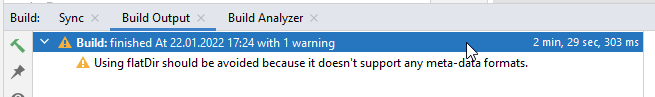

El vostre apk s'ha compilat correctament i es pot transferir al telèfon!


## AAPS no rep dades del CGM

* Si feu servir l'aplicació Dexcom G6 modificada (patched): aquesta aplicació està obsoleta. Feu servir l'aplicació [BYODA](#DexcomG6-if-using-g6-with-build-your-own-dexcom-app).

* Si feu servir xDrip: identifiqueu el receptor tal com es descriu a la pàgina [Configuració de xDrip](#xdrip-identify-receiver).


## L'apk no s'ha instal·lat

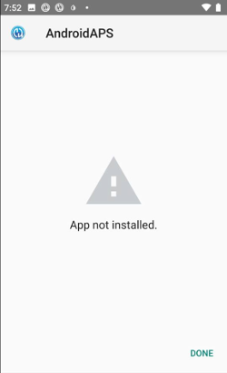

* Assegureu-vos que heu transferit el fitxer «app-full-release.apk» al vostre telèfon.
* Aquest error normalment vol dir que el nou apk està signat amb un magatzem de claus diferent del de l'**AAPS** que teniu instal·lat. Si encara teniu el magatzem de claus anterior, seleccioneu-lo i torneu a compilar. Si no, vegeu [Reinstal·lar AAPS amb un nou magatzem de claus](#reinstall-aaps).
* Si el telèfon mostra «App not installed» (aplicació no instal·lada), seguiu aquests passos:

1. [Exportar configuració](../Maintenance/ExportImportSettings.md) (a la versió d'AAPS que ja teniu instal·lada al telèfon)
2. Desinstal·leu **AAPS** del telèfon.
3. Activeu el mode d'avió i desactiveu el Bluetooth.
4. Instal·leu la nova versió («app-full-release.apk»)
5. [Importar configuració](../Maintenance/ExportImportSettings.md)
6. Torneu a activar el Bluetooth i desactiveu el mode d'avió

## L'apk s'ha instal·lat però és la versió antiga

If you built the app successfully, transferred it to your phone and installed it successfully but the version number stays the same then you might have forgotten to [update your local copy](#Update-to-new-version-update-your-local-copy)

## Res de tot això no ha funcionat

Si cap dels consells anteriors no us ha ajudat, podeu provar de compilar l'apk des de zero:

1. [Exportar configuració](../Maintenance/ExportImportSettings.md) (a la versió d'AAPS que ja teniu instal·lada al telèfon)

2. Tingueu a punt la contrasenya de la clau i la contrasenya del magatzem de claus.

    O simplement feu servir un magatzem de claus nou.

3. Compileu l'apk des de zero tal com es descriu [aquí](#Building-APK-download-AAPS-code).

4. Quan hàgiu compilat l'apk correctament, elimineu l'apk que hi ha al telèfon, transferiu-hi el nou apk i instal·leu-lo.
5. Torneu a [importar la configuració](../Maintenance/ExportImportSettings.md) per recuperar els objectius i la configuració.
6. Comproveu les opcions d'optimització de la bateria i torneu-les a desactivar.

## En el pitjor dels casos

Si això no resol el problema de compilació, podeu provar de desinstal·lar completament Android Studio i tornar a compilar des de zero.  Alguns usuaris han vist que això pot resoldre el problema de compilació.  Quan elimineu Android Studio, no elimineu la configuració d'usuari d'Android i **assegureu-vos de desinstal·lar tots els fitxers associats a Android Studio.** Si no elimineu completament Android Studio amb tots els fitxers ocults, la desinstal·lació pot causar problemes nous en lloc de resoldre els que ja teniu. Podeu trobar instruccions en línia per desinstal·lar-lo completament, p. ex.

[https://stackoverflow.com/questions/39953495/how-to-completely-uninstall-android-studio-from-windowsv10](https://stackoverflow.com/questions/39953495/how-to-completely-uninstall-android-studio-from-windowsv10).

Instal·leu Android Studio des de zero tal com es descriu [aquí](#Building-APK-install-android-studio).
