# Crear i restaurar còpies de seguretat

Quan instal·leu AAPS al telèfon, aquest es converteix en un «dispositiu mèdic» del qual depeneu cada dia. És molt recomanable tenir un pla d'emergència per si el telèfon s'espatlla, us el roben o el perdeu. Therefore, it is essential to prepare by asking yourself: "What if?"

Per restaurar la configuració d'AAPS en un telèfon existent o nou, és important guardar els elements següents en un lloc segur (és a dir, no al telèfon). El millor és tenir com a mínim dues còpies de seguretat separades: en un disc dur local, en un llapis USB i (preferiblement) en un emmagatzematge al núvol com Google Drive o Microsoft 365 OneDrive. Si guardeu les còpies de seguretat al núvol, sempre tindreu tot el que cal accessible des del telèfon per restaurar la configuració on sigui i quan sigui.

Penseu a tenir un segon telèfon de reserva i a practicar la restauració d'AAPS, per assegurar-vos que el telèfon de reserva funciona com cal. Aquest pas us donarà la confiança que el vostre pla d'emergència funciona i que podeu continuar utilitzant AAPS sense problemes si el vostre telèfon principal deixa d'estar disponible.

```{admonition} Android backups and phone-transfer tools do not carry your AAPS settings
:class: warning
Since **AAPS** 4.0 the settings are kept in an encrypted store on the phone, and they are left out of the Google backup and of the phone-to-phone transfer of a new phone. A settings export, as described on this page, is the only way to carry them over.
```

Per poder restaurar, és important tenir a mà els elements següents:

- El vostre **fitxer del magatzem de claus d'Android Studio** i la seva **contrasenya**: necessaris per (tornar a) compilar el fitxer d'instal·lació .APK d'AAPS.
- Una còpia recent de l'**instal·lador .APK d'AAPS**
- Un fitxer recent d'**exportació de la configuració**: per restaurar la configuració important (també els vostres objectius!).
- La vostra **clau mestra d'AAPS**
- Còpies de seguretat d'altres eines: per exemple BYODA i/o xDrip.
- Notes personals sobre la vostra configuració.

A continuació trobareu els elements dels quals és recomanable tenir còpies de seguretat.

## Crear còpies de seguretat

### Fitxer del magatzem de claus de l'ordinador amb què vau compilar l'APK
Quan compileu el fitxer d'instal·lació .APK amb Android Studio, s'utilitzen el **fitxer del magatzem de claus i la contrasenya per signar el fitxer d'instal·lació .APK**. Per actualitzar la instal·lació actual d'AAPS, cal signar el fitxer d'instal·lació .APK de l'actualització amb el mateix magatzem de claus que es va fer servir per a la primera instal·lació. En actualitzar, es conserven tota la configuració i la base de dades d'AAPS. Tingueu en compte que, sense això, primer haureu de desinstal·lar l'aplicació actual i després [reinstal·lar](#reinstall-aaps) i tornar a configurar AAPS.

Si guardeu el magatzem de claus i la seva contrasenya, en el futur actualitzar l'APK serà molt més senzill, sobretot si heu de compilar l'aplicació en un ordinador nou. Vegeu la secció [Actualitzar a una nova versió o branca](../Maintenance/UpdateToNewVersion.md) per saber com s'utilitza el magatzem de claus quan compileu un APK nou.

**Quan fer la còpia de seguretat:** Feu una còpia de seguretat del magatzem de claus després de compilar per primera vegada el fitxer d'instal·lació .APK d'**AAPS**.

**Com fer la còpia de seguretat:** Busqueu el camí del magatzem de claus. Si no el recordeu, el podeu trobar a Android Studio seleccionant **Build > APK > Next**. El camí apareix a «Key store path». Amb l'explorador de fitxers, aneu a aquest camí i feu una còpia del fitxer del magatzem de claus (amb l'extensió `.jks`). Deseu-lo en un lloc segur al núvol, per si el vostre ordinador deixa de funcionar. Apunteu també la contrasenya del magatzem de claus, l'àlies de la clau i la contrasenya de la clau.

### Còpies de l'APK més recent
Si perdeu o s'espatlla el vostre telèfon principal d'**AAPS**, amb una còpia de l'APK podreu tornar a utilitzar **AAPS** ràpidament en un telèfon nou. Nota: també necessitareu una còpia de seguretat de la configuració, com s'explica més avall.

**Quan fer la còpia de seguretat:** Guardeu una còpia de seguretat de l'APK més recent que heu instal·lat al vostre telèfon principal d'**AAPS**. També podeu guardar una versió anterior, per si per algun motiu heu de tornar-hi.

**Com fer la còpia de seguretat:** Guardeu una còpia a l'ordinador amb què compileu l'APK amb Android Studio. A més, us recomanem fer servir una plataforma al núvol per guardar una còpia de l'APK d'instal·lació. Assegureu-vos que sabeu on trobar les dues còpies de seguretat quan les necessiteu. Penseu a crear carpetes dedicades per guardar aquestes còpies de seguretat.

### Fitxer de configuració d'AAPS (també anomenat «Preferences»)

```{admonition} Where are preferences stored on my phone?
:class: tip
Trobareu la configuració al **Directori d'AAPS** que vau seleccionar durant la [configuració d'AAPS](#SetupWizard-StoragePermission).</br>
També podeu canviar el **Directori d'AAPS** a la pantalla **Manteniment** (**menú** (☰) > **Manteniment**), vegeu [Definir el directori local d'AAPS](#preferences-maintenance-logdirectory).
```

Amb una còpia del fitxer d'instal·lació APK (vegeu més amunt) i el vostre fitxer de **Configuració**, podeu tornar a funcionar ràpidament en un telèfon existent o nou.

El fitxer de **Configuració** serveix per adaptar l'aplicació AAPS al vostre equip concret. Inclouen detalls com la configuració del **Configurador**, l'estat dels objectius, la configuració de la comunicació amb altres serveis (per exemple, Nightscout, Tidepool), les automatitzacions i els perfils.

Si exporteu la configuració d'AAPS a un fitxer, podeu restaurar-la tal com era en un moment concret. Com s'ha dit, a més de tota la configuració, el fitxer d'exportació també conté l'estat dels vostres objectius, que heu de restaurar quan **(re)instal·leu** AAPS. Sense això, haureu de tornar a fer tots els objectius des del principi per activar el llaç tancat. Els fitxers de configuració també us permeten restaurar l'última configuració «que funcionava bé» per desfer qualsevol canvi de configuració.

**Quan fer una còpia de seguretat de la configuració d'AAPS:**
* Cada vegada que completeu un objectiu, per no perdre el vostre progrés. _Sense una còpia de la vostra **Configuració**, haureu de completar de nou tots els objectius si heu de reinstal·lar AAPS o substituir el telèfon._

* Cada vegada que vulgueu fer canvis importants a la configuració (canviar la configuració d'SMB, canviar el tipus d'insulina, canviar de bomba, modificar automatitzacions), feu una còpia de seguretat de la **Configuració** abans i després dels canvis. Així teniu la configuració més recent i també una còpia de com era abans dels canvis, per si heu de tornar-hi.

* Tubeless pumps (Such as Omnipod and Medtrum) users only: the **Settings** file contains connection details on your current pod and can be used to restore connection to that pod with a new phone. Si no teniu una còpia de la configuració exportada després d'iniciar el pod actual, haureu d'iniciar un pod nou si heu de substituir el telèfon.

**Com fer la còpia de seguretat manualment:**

1. If this is your first time importing or exporting **Settings** you will need to set a master password in [Settings > Protection](#Preferences-master-password). Definiu una contrasenya i guardeu-la en un lloc segur. _Sense aquesta contrasenya no podreu accedir a les còpies de seguretat de la **Configuració**._

2. A la pantalla principal d'**AAPS**, obriu el **menú** (☰) > **Manteniment**. Trieu on es desa el fitxer amb els xips **Local** i **Núvol** al costat d'**Exportar configuració** (vegeu **Exportar o importar la configuració** més avall) i després toqueu **Exportar configuració**. **AAPS** mostra on anirà el fitxer: el nom del fitxer per a **Local** i **Google Drive** per a **Núvol**. Toqueu **OK**.

   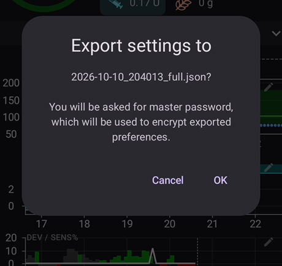

   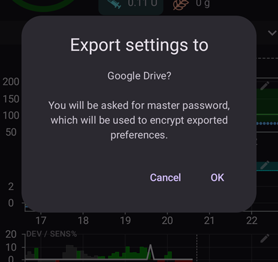

   Escriviu la clau mestra definida abans i toqueu **OK**.

   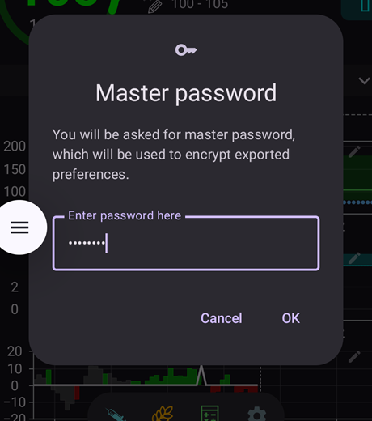

   El missatge **Configuració exportada** (local) o **Exportació al núvol correcta** (núvol) confirma l'exportació.

   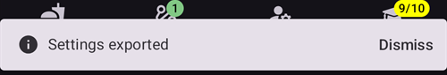

   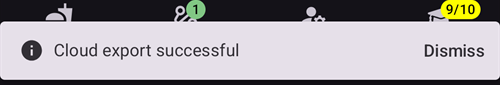

3. Amb l'explorador de fitxers del telèfon (normalment s'anomena «Fitxers» o «Els meus fitxers»), aneu a Emmagatzematge intern > AAPS > preferences. Aquí veureu una còpia de tots els fitxers de configuració exportats. El nom del fitxer ha de ser `YYYY-MM-DD_Time_appname.json`. Pugeu aquest fitxer a la plataforma al núvol que preferiu. Després, des de la plataforma al núvol, descarregueu també una còpia al vostre ordinador.

(ExportImportSettings-Settings-Export)=

## Exportar la configuració

```{admonition} Where are preferences stored on my phone?
:class: tip
Trobareu la configuració al **Directori d'AAPS** que vau seleccionar durant la [configuració d'AAPS](#SetupWizard-StoragePermission).</br>
També podeu canviar el **Directori d'AAPS** a la pantalla **Manteniment** (**menú** (☰) > **Manteniment**), vegeu [Definir el directori local d'AAPS](#preferences-maintenance-logdirectory).
```

Us recomanem exportar la configuració regularment, sobretot abans i després de fer canvis a la configuració. Podeu fer les exportacions **manualment o (preferiblement) amb una automatització**. Apunteu la vostra clau mestra d'AAPS i feu còpies de seguretat dels fitxers de configuració copiant-los fora del telèfon, per exemple a un emmagatzematge al núvol.

**Nota**: _La configuració exportada es xifra amb la vostra clau mestra d'AAPS: sense la clau mestra que vau fer servir en exportar no podreu importar el fitxer de configuració!_

If you forgot your master password, you can [reset it](#FAQ-reset-master-password), but settings files exported with the old password still need the old one.

### Exportar o importar la configuració
Per exportar o importar la configuració, obriu el **menú** (☰) i seleccioneu **Manteniment**. A **Gestió d'arxius**, els xips **Local** i **Núvol** al costat d'**Exportar configuració** i **Importar configuració** trien on es desa o d'on es llegeix el fitxer de configuració: **Local** és el directori d'AAPS al telèfon, i **Núvol** està disponible quan heu configurat una [Carpeta al núvol](#preferences-maintenance-cloud). Si toqueu un xip, l'activeu o el desactiveu; sempre en queda com a mínim un seleccionat, i les dues files comparteixen la mateixa tria. Després toqueu **Exportar configuració** o **Importar configuració** per començar.

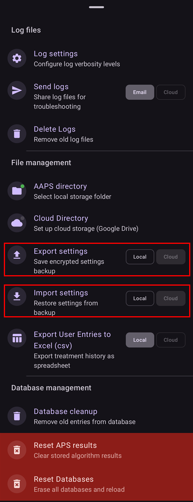

(ExportImportSettings-Automating-Settings-Export)=
### Automatitzar l'exportació de la configuració

To automate settings exports [(**see Automation**)](../DailyLifeWithAaps/Automations.md#automating-preference-settings-export) open [**Settings** > **Maintenance**](#preferences-maintenance-settings), expand **Unattended Settings Export** and switch on **Enable automated settings export**.

Ara podeu configurar l'[Automatització](../DailyLifeWithAaps/Automations.md#automating-preference-settings-export) perquè exporti la configuració, de manera regular (_per exemple_, cada setmana) o després d'un canvi de pod.

_**Note:** On importing settings, the user always needs to enter the AAPS master password!_

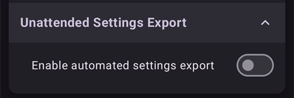

(ExportImportSettings-restoring-from-your-backups-on-a-new-phone-or-fresh-installation-of-aaps)=
## Restaurar les còpies de seguretat en un telèfon nou o en una instal·lació nova d'AAPS

```{admonition} Where are preferences stored on my phone?
:class: tip
Trobareu la configuració al **Directori d'AAPS** que vau seleccionar durant la [configuració d'AAPS](#SetupWizard-StoragePermission).</br>
També podeu canviar el **Directori d'AAPS** a la pantalla **Manteniment** (**menú** (☰) > **Manteniment**), vegeu [Definir el directori local d'AAPS](#preferences-maintenance-logdirectory).</br>
Si **AAPS** perd l'accés a aquest directori (pot passar després d'una reinstal·lació o després d'esborrar l'emmagatzematge de l'aplicació), mostra l'avís **S'ha perdut l'accés al directori AAPS** i deixa de desar la configuració al telèfon fins que [torneu a seleccionar el directori](#preferences-maintenance-logdirectory).
```

Feu servir aquestes instruccions si teniu una còpia de seguretat de l'APK i de la **Configuració** que voleu carregar en un telèfon nou, o si per algun motiu heu hagut d'eliminar i reinstal·lar l'APK al telèfon actual.

_Si actualitzeu **AAPS** amb un APK compilat amb el mateix magatzem de claus, no cal seguir aquest procés. Tot i així, us recomanem fer una còpia de seguretat abans d'aplicar l'actualització._

Si actualitzeu **AAPS** després d'haver perdut o substituït el magatzem de claus original (per exemple, amb un ordinador de compilació nou sense haver-hi passat el magatzem de claus), feu primer una còpia de seguretat de tota la configuració com s'explica més amunt i després desinstal·leu la versió actual d'**AAPS** del telèfon. Vegeu [Reinstal·lar AAPS amb un nou magatzem de claus](#reinstall-aaps) per al procediment complet.

Si cal, [configureu el receptor del CGM / de l'origen de glucèmia](../Getting-Started/CompatiblesCgms.md) abans de fer els passos següents

(ExportImportSettings-tubeless-pumps)=
```{admonition} Tubeless pumps (Omnipod and Medtrum) users
:class: warning
El fitxer de **Configuració** conté la sessió del pod o del patch que estava actiu quan el vau exportar.
- **Exporteu just després de cada activació d'un pod o d'un patch** i copieu el fitxer fora del telèfon.
- **Mateix telèfon, el pod continua funcionant:** deixeu **Substituir també la configuració de la bomba** sense marcar. Es conserva el pod actual i només s'importa la resta de la configuració.
- **Un telèfon nou es fa càrrec del pod:** marqueu **Substituir també la configuració de la bomba** i feu servir només un fitxer exportat durant el pod que porteu ara. Un fitxer d'un pod anterior substitueix la sessió del pod actual, i haureu d'iniciar un pod nou.
- **S'ha importat per error una sessió de pod antiga:** **AAPS** continua intentant connectar amb aquell pod i no en podeu activar un de nou. Desactiveu-lo; si no funciona, descarteu-lo (vegeu per exemple [Descartar un pod](#omnipod-dash-discard-pod) per a Omnipod DASH).
```

```{admonition} Pump settings are kept unless you say otherwise
:class: note
Per defecte, una importació no toca la configuració de la bomba: la bomba seleccionada al **Configurador**, el seu emparellament i tota la resta de la seva configuració es queden com estan en aquest telèfon. Marqueu **Substituir també la configuració de la bomba** a la pantalla d'importació només quan restaureu en un telèfon nou que s'ha de fer càrrec de la mateixa bomba. Una importació no elimina mai la configuració que no és al fitxer.
```

1. Amb la còpia de seguretat de l'APK de més amunt, seguiu les instruccions per a una [instal·lació nova](../SettingUpAaps/TransferringAndInstallingAaps.md)

2. Obriu **AAPS** i concediu tots els permisos que demani

3. Sortiu de l'assistent de configuració. Importarem tota la configuració necessària des de la còpia de seguretat de la **Configuració**

4. From the **AAPS** main screen press **Grant** and allow all permissions listed in the **Permissions Required** panel on the top

5. A la pantalla principal d'**AAPS**, definiu la clau mestra a [Configuració > Protecció](#Preferences-master-password) amb la mateixa contrasenya que vau fer servir per a les còpies de seguretat.

6. Si encara no ho heu fet, [definiu el **Directori d'AAPS**](#preferences-maintenance-logdirectory): a la pantalla principal d'**AAPS**, obriu el **menú** (☰) > **Manteniment** > **Directori d'AAPS**.

7. A la pantalla principal d'**AAPS**, obriu el **menú** (☰) > **Manteniment** > **Exportar configuració** > escriviu la clau mestra definida abans > **OK**. Això crea la carpeta preferences si encara no existeix al vostre telèfon.

8. Descarregueu de la plataforma al núvol la còpia de seguretat del vostre fitxer de **Configuració**.

9. Amb l'explorador de fitxers (normalment s'anomena «Fitxers» o «Els meus fitxers»), moveu el fitxer de les baixades a `/internal storage/AAPS/preferences` si el vostre **Directori d'AAPS** és `/internal storage/AAPS`

10. A la pantalla principal d'**AAPS**, obriu el **menú** (☰) > **Manteniment** i toqueu **Importar configuració**. Seleccioneu el fitxer de configuració que voleu restaurar (el més recent és a dalt de tot). Assegureu-vos de seleccionar el fitxer de configuració correcte: es mostren tots els fitxers .json de la carpeta preferences (o de la carpeta al núvol, amb **Núvol**).

    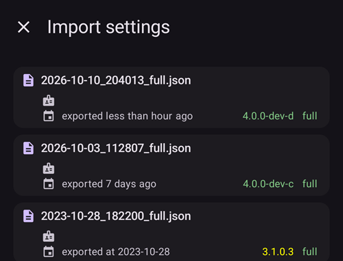

    **AAPS** mostra els detalls del fitxer. Escriviu la clau mestra definida abans i toqueu **Desencriptar i revisar**.

11. Quan el fitxer s'ha desencriptat, decidiu què feu amb la configuració de la bomba. En un telèfon nou que es fa càrrec de la mateixa bomba, marqueu **Substituir també la configuració de la bomba** perquè l'emparellament i la configuració de la bomba vinguin del fitxer. Deixeu la casella sense marcar per conservar la bomba amb què aquest telèfon ja està emparellat. Després toqueu **Importar**.

    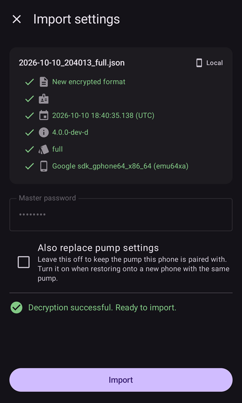

12. **AAPS** pregunta **Aplicar la configuració importada?** i us diu quantes opcions de configuració canviaran i, si heu deixat la casella sense marcar, quantes opcions de la bomba es conserven. Encara no s'ha escrit res, així que **Cancel·lar** deixa el telèfon exactament com estava. Toqueu **OK** per aplicar-la.

    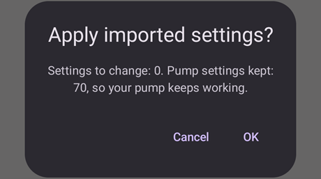

13. **AAPS** aplica la configuració importada immediatament, sense reiniciar. Només es reinicien els plugins la configuració dels quals ha canviat. Mentre això passa, **AAPS** mostra **Aplicant la configuració…**; si la bomba està ocupada, mostra **Esperant la bomba…** i aplica la configuració quan la bomba queda lliure. Si la bomba encara està ocupada al cap d'un minut, **AAPS** ofereix tornar-ho a provar. El missatge **Configuració aplicada** confirma que la configuració importada ja s'està utilitzant. Qualsevol tractament que estigués a la cua mentre es feia la importació es descarta, i **AAPS** us avisa que s'ha cancel·lat, perquè no s'enviï res dues vegades a la bomba.

    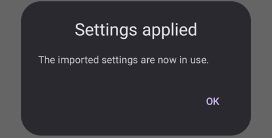

Si el fitxer seleccionava una bomba que aquesta versió d'**AAPS** no té, **AAPS** passa a la **Bomba virtual** i us ho diu. Torneu a seleccionar la vostra bomba al **Configurador** i comproveu-ne la configuració.

14. Només per a usuaris de bombes sense tub (Omnipod i Medtrum): si heu marcat **Substituir també la configuració de la bomba** i la còpia de seguretat de la **Configuració** no és del mateix pod que feu servir ara, haureu d'iniciar un pod nou per començar el lliurament d'insulina.

**Resolució de problemes:** si no podeu activar un perfil des de la pantalla principal d'**AAPS**, obriu el **menú** (☰) a dalt a l'esquerra > **Configurador** > **Bomba** > canvieu a **Bomba virtual** > després torneu a canviar al vostre tipus de bomba

### Nota per als usuaris de Dana RS

- Si heu marcat **Substituir també la configuració de la bomba**, també s'importa la configuració de connexió de la bomba: **AAPS** al telèfon nou ja «coneixerà» la bomba i per això no començarà una cerca Bluetooth.
- Emparelleu el telèfon nou i la bomba manualment.