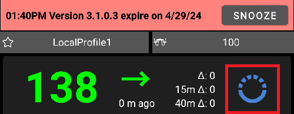
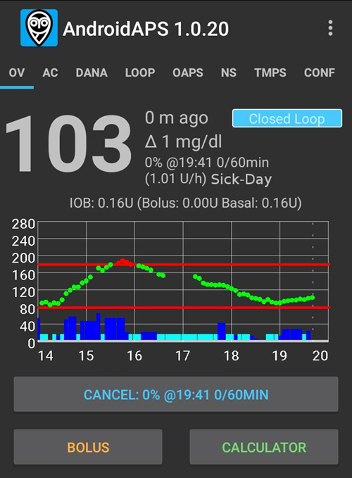

# Notes de la versió

```{toctree}
:hidden:

Update2_7.md
Update3_0.md
UpdateAaps3204.md
```

Seguiu les instruccions del [manual d'actualització](UpdateToNewVersion.md) per actualitzar a una versió nova. La secció de resolució de problemes de la pàgina del manual d'actualització també tracta les dificultats més habituals en actualitzar **AAPS**.

```{admonition} Upgrading from AAPS v3?
:class: tip
Vegeu [Què ha canviat a AAPS v4](V4Changes.md) per als canvis de comportament importants: funcions que s'han mogut, que tenen un nom nou o que s'han eliminat.
```

Quan hi hagi una actualització nova disponible, rebreu una notificació com aquesta:



Si no actualitzeu abans de la data de caducitat, **AAPS** passarà a llaç obert.

Vegeu [Fi del suport](EndOfLife.md) per a les dates de fi de cada versió d'AAPS.

**No ignoreu la notificació.** Les versions noves d'**AAPS** porten correccions de seguretat importants. Per això, tots els usuaris d'**AAPS** han d'actualitzar a l'última versió tan aviat com sigui possible. És un esforç per millorar la seguretat de cada usuari d'**AAPS** i de la comunitat DIY. Gràcies per la vostra comprensió.

(maintenance-android-version-aaps-version)=

## Versió d'Android i versió d'AAPS

Si el vostre telèfon té una versió d'Android anterior a Android 12, no podreu fer servir AAPS v3.4 o posterior, perquè necessita com a mínim Android 12.

Perquè els usuaris amb un Android més antic puguin fer servir una versió més antiga d'AAPS, s'han publicat versions noves que només canvien la comprovació de la versió. No inclouen cap altra millora.

Busqueu la vostra versió d'Android a la taula de sota i feu servir la versió d'**AAPS** corresponent. El codi es descarrega de <https://github.com/nightscout/AndroidAPS> amb la branca indicada.

| La vostra versió d'Android | Versió d'AAPS que heu de fer servir | Branca que heu de descarregar                                    |
| -------------------------- | ----------------------------------- | ---------------------------------------------------------------- |
| Android 12 i posterior     | Última versió                       | [master](https://github.com/nightscout/AndroidAPS) (per defecte) |
| Android 11                 | **3.3.2.1**                         | [3.3.2.1](https://github.com/nightscout/AndroidAPS/tree/3.3.2.1) |
| Android 9, 10              | **3.2.0.4**                         | [3.2.0.4](https://github.com/nightscout/AndroidAPS/tree/3.2.0.4) |
| Android 8                  | **2.8.2.1**                         | [2.8.2.1](https://github.com/nightscout/AndroidAPS/tree/2.8.2.1) |
| Android 7                  | **2.6.2**                           | [2.6.2](https://github.com/nightscout/AndroidAPS/tree/2.6.2)     |

## Versió de WearOS

- AAPS necessita WearOS 3.0, 3.2 o 3.5 (Android 11, nivell d'API 30) o posterior. Els rellotges amb WearOS 2 no són compatibles.

```{tip}
WearOS 5, nivell d'API 34 (Android 14) té [limitacions](#BuildingAapsWearOs-WearOS5).
```

Les versions amb encapçalament són l'última publicació per a cada versió d'Android (vegeu la taula de dalt). Les altres versions apareixen entremig, amb les seves notes o un enllaç a GitHub.

(latestrelease)=

(version400)=

## Versió 4.0.0

Data de publicació: 31-10-2026

**Funcions noves**

- Nova interfície d'usuari: l'aplicació del telèfon s'ha refet amb Jetpack Compose @MilosKozak
- [Cerca global](../DailyLifeWithAaps/GlobalSearch.md) @MilosKozak
- Migració a Kotlin Multiplatform, client per a escriptori Windows, Mac i Linux i per a iOS @MilosKozak
- [Escenes](../DailyLifeWithAaps/Scenes.md): deseu un conjunt d'accions i executeu-les juntes @MilosKozak
- [Control principal ↔ client](../RemoteFeatures/ClientMasterControl.md): envieu ordres d'un telèfon client al telèfon principal @MilosKozak
  - [Rols del client](#client-master-control-roles): Només lectura, Àpats, Cuidador o Admin per a cada client @MilosKozak
  - [Mode reforçat](#client-master-control-hardened-mode): amb el control des del client activat, el telèfon principal només accepta canvis dels clients emparellats @MilosKozak
  - Emparellament amb un codi QR que també configura Nightscout al client, o amb un PIN; el secret d'emparellament se substitueix just després d'emparellar @MilosKozak
  - [Token de Nightscout propi](#client-master-control-own-token) per a cada client, només amb els permisos que el client necessita @MilosKozak
- Suport de [concentració d'insulina](../AdvancedOptions/InsulinConcentration.md) (U200, U500) a les bombes, a l'assistent i als perfils @Philoul @MilosKozak
- Gestió de la insulina: catàleg d'insulines, noms curts, selecció al perfil i a l'assistent @Philoul
- Plugin de calibració @MilosKozak
- [Suavitzat](../CompatibleCgms/SmoothingBloodGlucoseData.md): filtre de Kalman Unscented (UKF) @piecycle
- Noves [accions d'automatització](#automations-automation-action): **Canviar el suavitzat** @olorinmaia, i **Executar**, **Activar** o **Desactivar escena** @MilosKozak
- [Rotació de punts d'inserció](#Aapsscreens-site-rotation): registreu i aneu canviant els punts d'infusió @Philoul @MilosKozak
- [Autotune](../AdvancedOptions/Autotune.md) refet @Philoul
- [Widgets](../DailyLifeWithAaps/Widgets.md) nous @MilosKozak @t1dude
- Accessibilitat: l'aplicació del telèfon funciona amb un lector de pantalla: controls amb nom, estat llegit en veu alta, descripcions dels gràfics i encapçalaments per navegar ràpidament @MilosKozak
- [Importació de la configuració](../Maintenance/ExportImportSettings.md): pot mantenir la configuració de la bomba @MilosKozak
- La notificació permanent fa servir les actualitzacions en directe d'Android, amb suport per a la Now bar de Samsung i la delta @premnirmal
- Gràfic de glucèmia: [mantingueu premut](#aaps-screens-graph-press-and-hold) per veure els valors d'una lectura, a tots els gràfics del resum @t1dude @olorinmaia
- Millores de rendiment @MilosKozak
- E-carbs automàtics a la calculadora de bolus @MilosKozak

**Dispositius nous**

- **CareLevo**: nou [controlador de bomba](../CompatiblePumps/CareLevo.md) @Kisu-Choi @MilosKozak
- **Dana-i2**: suport @MilosKozak
- **Instara**: nova font de glucèmia (CGM) @leohunt

**Millores dels controladors de bomba**

- Pantalles de resum de la bomba refetes per a Insight, Medtronic, Medtrum, Omnipod, Dana, Diaconn i Equil @MilosKozak
- **Omnipod DASH**: codis Ref a l'estil de la PDM i descripcions d'errors fàcils de llegir, compensació de la deriva sempre activa, millor informe del tipus de bolus @nl-ruud
- **Omnipod**: data de fi fixa per a Dash i Eros @mcnelson
- **DanaR, RS**: emulador de bomba per a proves @MilosKozak
- **Equil**: emulador de bomba per a proves @MilosKozak
- Moltes correccions de bombes i del llaç @MilosKozak i altres

**Wear OS**

- [Aplicació del rellotge](../WearOS/WearOsSmartwatch.md) refeta amb Compose, mosaics i complicacions nous, instal·lació automàtica de watchfaces (Watch Face Push) a Wear OS 6 o posterior @olorinmaia @Philoul
- CustomWatchface disponible per a WearOS 6.0 (GW7, GW8, GW9...) amb un watchface WFF dedicat @Philoul @olorinmaia
- CustomWatchface ara pot incloure 5 espais de complicació que podeu personalitzar (funció nova només disponible per a rellotges més antics) @Philoul
- Nova [watchface WFF basada en les complicacions d'AAPS](#wearos-complications-watchface-setup) @olorinmaia
- Correccions al resultat de la calculadora de bolus i de l'assistent ràpid @olorinmaia
- Nou gràfic de glucèmia i activitat del mode de funcionament al menú principal @olorinmaia
- Calculadora de bolus: pàgina de [tipus d'àpat](#WearOsSmartwatch-wizard-meal-type) que reparteix els carbohidrats com la calculadora del telèfon, i [hora dels carbohidrats](#WearOsSmartwatch-wizard-carb-time) amb el recordatori *hora de menjar* al rellotge @olorinmaia
- [Alarmes del telèfon al rellotge](#WearOsSmartwatch-phone-alarms): el rellotge mostra l'alarma i ofereix Silenciar i Silenciar 5 min @olorinmaia

**Compilació**

- Workflows de CI per a compilacions d'etiquetes i branques, correspondència de versions de JDK @Angus-repo

**Col·laboradors**

@MilosKozak @Philoul @olorinmaia @Kisu-Choi @leohunt @piecycle @Angus-repo @mcnelson @t1dude @premnirmal @nl-ruud

Llista completa de canvis: <https://github.com/nightscout/AndroidAPS/compare/3.4.2.6...4.0.0>

---

(version3426)=

## Versió 3.4.2.6

- Equil: millora de l'estabilitat @MilosKozak

---

(version3425)=

**Versió 3.4.2.5**

- Equil: correcció d'una condició de carrera @MilosKozak

---

(version3424)=

**Versió 3.4.2.4**

- Correccions d'Equil @MilosKozak
- Correcció de la sincronització de perfils amb NS @MilosKozak

---

(version3423)=

**Versió 3.4.2.3**

- Dash: resolució de la deriva @nl-ruud
- NSClientV3: correcció del buit de dades després de reconnectar @MilosKozak
- Automatització: correcció de la deserialització @MilosKozak
- Equil: correcció de l'informe de la bateria @MilosKozak
- Neteja del workflow @vanelsberg
- Equil: millora de la recuperació d'errors @MilosKozak
- DanaRS: correcció de la comunicació amb la bomba domèstica @MilosKozak
- Insight: correcció de la sincronització de TBR @MilosKozak
- Dash: correcció d'un error d'activació @nl-ruud

---

(version3422)=

**Versió 3.4.2.2**

- Correcció de problemes amb Equil i Medtronic
- Millora de la seguretat de Medtrum

---

(version3421)=

**Versió 3.4.2.1**

- Equil: correcció de l'emparellament i del diàleg de progrés @MilosKozak

---

(version3420)=

**Versió 3.4.2.0**

Data de publicació: 02-04-2026

- Equil: correcció de la resistència per a models diferents @hhfcvmars
- Tidepool: correcció de la sessió @MilosKozak
- Medtrum: correcció del procés d'activació per evitar omplir dues vegades @MilosKozak
- COB: correcció del càlcul del COB (cobreix un cas límit perillós) @MilosKozak

---

(version3410)=

**Versió 3.4.1.0**

Data de publicació: 08-03-2026

**Nucli**

- Correcció del tractament de l'horari d'estiu @MilosKozak
- Millora i unificació de la identificació de l'objectiu normal (mgdl > 99, mmol > 5.5) @MilosKozak
- SMS: protecció de RESTART amb PIN @MilosKozak
- Manteniment: avís si se selecciona un directori incorrecte @MilosKozak

**Millores dels controladors de bomba**

- **Omnipod DASH**: el codi del controlador BLE es mou al mòdul omnipod/common @jwoglom
- **Omnipod DASH**: intent de corregir l'estat de la connexió @MilosKozak
- **Omnipod**: es valida el perfil abans de l'activació del pod per no malbaratar pods (#4534) @brianV
- **Medtronic**: correcció del mateix tipus de codificació mostrat al diàleg de configuració @mifi100
- **Medtronic**: preparació de classes comunes de bomba (preparació per a Tandem) @andy-rozman
- **RileyLink**: correcció de la codificació (#4519) @mifi100
- **Equil**: més bombes compatibles segons el prefix del número de sèrie (#4510) @hhfcvmars
- **Equil**: s'afegeix registre @MilosKozak
- **Diaconn G8**: correcció d'un error de sincronització del registre i suport per al firmware 3.58 o posterior @miyeongkim
- **Diaconn**: correcció de la conversió d'unitats de la durada de la TBR @miyeongkim
- **Diaconn**: s'usa commandQueue.loadEvents() per a la sincronització de l'historial @miyeongkim
- Es permet lliurar insulina quan el llaç està suspès però la bomba està disponible @cschuijt

**Núvol / còpia de seguretat**

- Còpia de seguretat a Google Drive @Angus-repo
- S'avisa la interfície quan canvia l'estat d'error de l'emmagatzematge al núvol @Angus-repo
- Es permet fer servir alhora l'emmagatzematge local i el del núvol @Angus-repo

**Tidepool**

- Millora de la migració a OAuth2 de Tidepool @MilosKozak
- Correcció de l'estat BLOCKED indefinit de Tidepool, correcció del rebuig de SSID buits @michaeln-synapse

**NSClient**

- NSCv3: millora de la reconnexió @MilosKozak

**Wear OS**

- Es mostra la nova IOB al resultat de la calculadora si la IOB s'usa en els càlculs @olorinmaia
- Correcció de BolusProgress al rellotge amb la quantitat total @Philoul

**Interfície**

- Millora de la icona ic_none per a la rotació de punts d'inserció @Philoul
- Correcció: no s'usava l'opció de bomba de la gestió de la rotació de punts d'inserció @samfundev

**Col·laboradors**

@MilosKozak @Philoul @olorinmaia @jwoglom @mifi100 @andy-rozman @Angus-repo @brianV @cschuijt @hhfcvmars @miyeongkim @samfundev @michaeln-synapse

---

(version3400)=

**Versió 3.4.0.0**

Data de publicació: 31-12-2025

**Abans d'actualitzar:**

* Aquesta versió necessita Google Android 12.0 o posterior. Comproveu la versió del vostre telèfon abans d'intentar actualitzar.
* Actualitzeu a l'última versió d'Android Studio o, millor, feu servir la compilació al navegador.

**Funcions noves**

* Mode de funcionament @MilosKozak
  * Es mostra l'[historial de l'estat del llaç](#AapsScreens-running-mode) a les pestanyes de tractaments
  * Es mostra i es pot canviar l'[estat del llaç des d'AAPSClient](#RemoteControl_aapsclient).<br>NB: cal l'opció [NSClient > Sincronització > Rebre esdeveniments de mode de funcionament](#Preferences-nsclient-synchronization)
* [CGM nous](../Getting-Started/CompatiblesCgms.md): Glunovo, Intelligo, Sinocare
* Suport de [rotació de punts d'inserció](#Aapsscreens-site-rotation) @Philoul
* Nova [acció d'automatització](#automations-automation-action): activar o desactivar els SMB @MilosKozak
* El CGM Syai és una [font de confiança](#GettingStarted-TrustedBGSource) i admet filtratge avançat @MilosKozak

**Millores de Wear OS**

* consum de bateria molt més baix @MilosKozak
* millores i correccions de la interfície @olorinmaia
* codi reescrit gairebé del tot per adaptar-lo a les biblioteques actuals (abans WearOS 2) @MilosKozak
* 2 complicacions noves per a dades ampliades @Philoul
* Migració a un proveïdor de complicacions modern amb DataStore @MilosKozak

**Correccions de fuites de memòria**

* S'han corregit fuites de memòria al codi @MilosKozak
* S'ha afegit l'informe de fuites de memòria de LeakCanary a Firebase Crashlytics @MilosKozak

**Millores dels controladors de bomba**

* **DanaI**: s'han corregit problemes de desconnexió @MilosKozak
* **RileyLink**: comunicació més ràpida reduint les esperes @mifi100
* **Medtrum**: s'ha afegit l'hora d'activació i l'edat del patch @vanelsberg, correcció de les majúscules de la contrasenya @MilosKozak
* **Combo**: s'han corregit condicions de carrera a les proves @MilosKozak @dv1
* **Equil**: connectivitat optimitzada, menys consum de bateria @MilosKozak

**Sincronització amb Nightscout**

* Millor eliminació de duplicats quan NS falla @MilosKozak

**Millores d'interfície i d'experiència d'usuari**

* diverses millores @MilosKozak @Philoul @olorinmaia

**Automatització**

* Nova acció de control d'SMB: activar o desactivar SMB amb una automatització @MilosKozak

**Proves**

* S'han afegit proves unitàries completes per a les bombes Equil, Eopatch, Dana i Medtronic @MilosKozak
* Millor estabilitat i cobertura de les proves en diversos mòduls @MilosKozak

**Tidepool**

* Tidepool OAUTH2 (suport per a la nova autenticació de Tidepool) @MilosKozak

---

(version3321)=

## Versió 3.3.2.1

Data de publicació: 13-08-2025

- S'ha corregit la connexió Bluetooth d'Omnipod a Android 16
- Procés de CI (compilació al navegador)
- Correcció de la conversió mmol-mgdl
- Correcció de la selecció d'hora incorrecta als diàlegs en algunes zones horàries
- Correcció de la lectura de claus en mode simple
- Correcció de prediccions que faltaven al rellotge
- Configurador millorat
- Sincronització completa de NSCv3 millorada

---

(version3300)=

**Versió 3.3.2.0**

Data de publicació: 27-03-2025

**Com actualitzar**

* Per compilar aquesta versió cal la [versió d'Android Studio anomenada "Meerkat"](#Building-APK-recommended-specification-of-computer-for-building-apk-file) o una de més nova. Si ja heu compilat una versió 3.3.x, heu de tornar a actualitzar Android Studio.

(version-enforcement)=

**A partir d'aquesta versió, les notificacions i l'obligació d'actualitzar s'han simplificat i suavitzat, i funcionen així:**

*  No hi ha caducitat quan el dispositiu està fora de línia (sense connexió a internet). Això vol dir que ja no hi ha períodes de gràcia de 60 i 90 dies.
*  Després de la caducitat, s'imposa el mode LGS
*  Rebreu avisos i notificacions menys sovint:
   - Queden 28 dies o més: cada 7 dies
   - Queden 27-14 dies: cada 3 dies
   - després, un cop al dia
   - La notificació es genera després del migdia per no molestar-vos a la nit
* Només hi ha 2 tipus de notificació
   - Hi ha una versió nova disponible (no té cap efecte a AAPS)
   - L'aplicació caducarà en una data futura (encara sense efecte a AAPS) / ha caducat (AAPS passarà al mode LGS)

**Novetats**

* Ordre SMS RESTART @MilosKozak
* Paràmetres del canvi de perfil al rellotge @olorinmaia
* Watchface AAPS V2 en mode fosc @olorinmaia
* Millores de l'intercanvi de dades del G7 @olorinmaia
* Configuració dels widgets @MilosKozak
* Millores de la interfície dels botons d'opció @olorinmaia
* Automatització: tria de la posició al mapa @MilosKozak
* Versió visible a les pantalles principals @MilosKozak
* S'obliga a compilar amb el sistema git existent (sense descàrregues zip)
* Es mostra la versió a la pantalla principal @MilosKozak
* Millores de l'enviament a Tidepool @ConstantinMatheis

**Correccions d'errors**

* Correcció de la desvinculació de Dash @Andreas
* Correccions de Garmin @robertbuessow @suside
* Correcció de com es mostra la IOB als diàlegs @olorinmaia
* Millores de l'ortografia i de la validació dels objectius @MilosKozak
* S'ha corregit la representació de les TBR emulades @MilosKozak
* S'ha corregit una manera de saltar-se la seguretat @tdrkDev

---

**Versió 3.3.1.3**

Data de publicació: 21-01-2025

**Correccions d'errors**

* Dash: la vinculació (bonding) és opcional (desactivada per defecte) @MilosKozak
* Equil: correcció dels bolus de 10 U o més, millores de les alarmes @EquilHack
* Garmin: millores del rellotge @swissalpine
* Millores del rellotge @olorinmaia
* Control de l'estat del llaç des del rellotge @tdrkDev
* Millores d'estabilitat

*  **Pot ser que calgui una nova [configuració de l'autenticador](#sms-commands-authenticator-setup).**

---

**Versió 3.3.1.2**

Data de publicació: 15-01-2025

**Com actualitzar**

* Per compilar aquesta versió cal la [versió d'Android Studio anomenada "Ladybug Feature Drop"](#Building-APK-recommended-specification-of-computer-for-building-apk-file) o una de més nova. **No és el mateix que "Ladybug" sense més.** Si ja heu compilat una versió 3.3.x, heu de tornar a actualitzar Android Studio.

**Correccions d'errors**

* Dash: s'usa la vinculació (bonding) a Android 15 o posterior
* S'ha recuperat el botó de Dexcom al resum
* Equil: es permet eliminar una bomba que no funciona
* Avís quan el factor d'ajust de DynISF és zero
* NSCv3: solució de la comunicació websocket en telèfons amb l'hora una mica diferent
* Ordres SMS: correcció de OneTimePassword. **Pot ser que calgui una nova [configuració de l'autenticador](#sms-commands-authenticator-setup).**
* Correcció d'un problema pel qual algunes opcions ja no es podien editar.
* Correcció del restabliment de la clau mestra amb la bomba virtual.
* S'ha corregit la importació de fitxers grans de còpia de seguretat de la configuració.

---

**Versió 3.3.1.0**

Data de publicació: 06-01-2025

**Canvis a la interfície**

* [S'han afegit colors per distingir AAPSClient i AAPSClient2](#RemoteControl_aapsclient) @MilosKozak
* Disseny i icones millorats a les accions de l'usuari

**Altres funcions**

* Nou activador d'automatització: [nombre de passos](#screen-heart-rate-steps) @Roman Rihter
* Es permet rebre-ho tot en la sincronització completa de NSCv3 (també dades que abans no se sincronitzaven, com les TBR) @MilosKozak
* NSClient v3: els avisos ja funcionen (_és a dir_, d'AAPSClient a AAPS) @MilosKozak

**Canvis tècnics i correccions d'errors**

* Correcció d'un tancament inesperat d'Insight @philoul
* Correcció de la creació de massa entrades deviceStatus a Nightscout @MilosKozak
* Correcció de l'absorció de carbohidrats @MilosKozak
* S'ha corregit el color dels botons d'opció i de les caselles @MilosKozak
* S'ha corregit un error en la migració del percentatge de DynISF @MilosKozak
* S'ha resolt un avís de DynISF que apareixia en un lloc equivocat @MilosKozak
* S'ha corregit un error als watchfaces @philoul

---

**Versió 3.3.0.0**

Data de publicació: 29-12-2024

**Funcions principals**

* La funció **[ISF dinàmic](../DailyLifeWithAaps/DynamicISF.md)** ja no és un plugin separat, sinó que ara és una opció del plugin [OpenAPS SMB](#Config-Builder-aps), amb alguns canvis en el seu comportament:
  * El **canvi de perfil** i el **percentatge del perfil** ara es tenen en compte a l'**ISF dinàmic** pel que fa a la intensitat de la sensibilitat dinàmica
  * Es calcula l'**ISF** mitjà de les últimes 24 h i aquest valor es fa servir a la calculadora de bolus i al càlcul del **COB**. El valor d'**ISF del perfil** no es fa servir gens (excepte com a valor de reserva quan no hi ha dades de l'historial)
  * La pàgina de documentació de DynamicISF s'ha reescrit. Llegiu la secció important [Coses a tenir en compte en activar l'ISF dinàmic](#dyn-isf-things-to-consider-when-activating-dynamicisf).
* [Activar «SMB sempre» i «SMB després de carbohidrats»](#Open-APS-features-enable-smb-always) per als usuaris de FreeStyle Libre 2 i Libre 3
  * Nota: cal l'última versió de xDrip+ o de Juggluco.
* Nous activadors d'**Automatització**
* Exportacions automàtiques de la configuració

**Com actualitzar**

* Abans d'actualitzar:
  * **<span style="color:red">Aquesta versió necessita Google Android 11.0 o posterior</span>**. Comproveu la versió del vostre telèfon abans d'intentar actualitzar.
  * Si feu servir el controlador Combo «antic» amb el dispositiu ruffy, passeu al [controlador Combo natiu](../CompatiblePumps/Accu-Chek-Combo-Pump-v2.md) abans d'actualitzar
  * En actualitzar perdreu els [gràfics addicionals](#AapsScreens-section-g-additional-graphs) de la pantalla d'inici: si cal, anoteu a mà la configuració actual per poder-los tornar a crear després d'actualitzar.
  * Els [problemes de connexió Bluetooth que tenen algunes persones amb Android 15](../Getting-Started/Phones.md) **NO** es resolen amb aquesta versió (és un problema d'Android, no d'**AAPS**). Hi ha una correcció a la 3.3.1.2.
  * El botó de BYODA de la pantalla d'inici ja no està disponible per limitacions d'Android. Això es corregeix a la 3.3.1.2.
* Instruccions d'actualització: seguiu la guia [Actualitzar a una nova versió o branca](../Maintenance/UpdateToNewVersion.md).
  * Per compilar aquesta versió cal la [versió d'Android Studio anomenada "Ladybug"](#Building-APK-recommended-specification-of-computer-for-building-apk-file) o una de més nova. Si ja teniu instal·lada una versió més antiga d'Android Studio, potser haureu de <span style="color:red">configurar la versió de JVM a 21</span>. Vegeu [Resolució de problemes d'Android Studio > Incompatible Gradle JVM](#incompatible-gradle-jvm).
  * Consell: si no voleu perdre l'historial d'**AAPS**, feu SEMPRE una ACTUALITZACIÓ i NO una DESINSTAL·LACIÓ/INSTAL·LACIÓ. Per precaució, feu una còpia de seguretat de la configuració actual d'**AAPS** i guardeu l'APK antic per poder tornar a la versió antiga si alguna cosa va malament.
* Després d'actualitzar:
  * Poseu la nova [opció «Directori d'AAPS»](#preferences-maintenance-logdirectory) a la pestanya Manteniment.

**Canvis detallats**

**CGM i bombes**

* [Activar «SMB sempre» i «SMB després de carbohidrats»](#Open-APS-features-enable-smb-always) per als usuaris de FreeStyle Libre 2 i Libre 3 @MilosKozak
* Millores del [controlador Medtrum](../CompatiblePumps/MedtrumNano.md) @jbr77rr
  * Millores de comunicació, amb una opció nova per evitar problemes en alguns telèfons
  * Es mostra el nivell del reservori a l'inici de l'activació
  * Correcció d'un error pel qual l'activació tornava a l'inici i l'usuari no la podia acabar
  * Informació sobre l'estat de la sincronització i altres aclariments
* Nova bomba compatible: [Equil 5.3](../CompatiblePumps/Equil5.3.md) @EquilHack
* Nous CGM compatibles: [Ottai](../CompatibleCgms/OttaiM8.md) @ottai-developer i [Syai Tag](../CompatibleCgms/SyaiTagX1.md) @syai-dev
* Controlador d'Insight reescrit en Kotlin @Philoul
* S'ha eliminat l'antic controlador Combo que depenia de ruffy

**Canvis a la interfície**

* [Mode simple](#preferences-simple-mode) activat per defecte en una instal·lació nova @MilosKozak
* Noves opcions de l'[assistent ràpid](#Preferences-quick-wizard) @radicalb
  * L'assistent ràpid ara fa servir la mateixa lògica que la calculadora per calcular i mostrar el bolus. Ara podeu fer servir el camp «hora dels carbohidrats» de l'assistent ràpid per fer un prebolus.
* Nou [menú d'escala del gràfic](#aaps-screens-main-graph); millores de la interfície del [menú de gràfics addicionals](#AapsScreens-activate-optional-information) @Philoul
* [Millora del disseny del Configurador](../SettingUpAaps/ConfigBuilder.md) @MilosKozak
  * Ara les seccions estan plegades per defecte. Feu servir la fletxa per desplegar-les.
* Sensibilitat variable visible a AAPSClient
* Millores de la interfície de la calculadora de bolus @kenzo44
* Correcció del text a les pestanyes de la bomba amb el tema clar @jbr77rr

**Altres funcions**

* [Exportacions automàtiques de la configuració](#ExportImportSettings-Automating-Settings-Export) @vanelsberg
* Nou [activador d'automatització](#automations-automation-triggers) @vanelsberg
  * Activació del pod (només bombes patch)
* Nous [activadors d'automatització](#automations-automation-triggers) @jbr77rr
  * Edat de la cànula, edat de la insulina, edat de la bateria, edat del sensor, nivell del reservori, nivell de la pila de la bomba
* Es permet introduir carbohidrats negatius @MilosKozak
* Nou paràmetre [«Directori d'AAPS»](#preferences-maintenance-settings) per triar un directori d'emmagatzematge diferent del predeterminat.
* Es permeten [registres d'insulina quan la bomba està suspesa](#aaps-screens-buttons-insulin) @jbr77rr
* [Objectiu 2](#objectives-objective2) actualitzat @MilosKozak
  * Comprovar que la clau mestra està establerta i que la coneixeu
* Carbohidrats aleatoris en mode de prova @MilosKozak
* S'ha corregit un error en el càlcul de la TDD @MilosKozak
* Ordres SMS: es permet [**no** enviar SMS pels canvis de perfil](#sms-commands-too-many-messages) que vénen de NS @MilosKozak

**Rellotges intel·ligents**

* millores del rellotge i dels watchfaces @Philoul @MilosKozak @olorinmaia
* Mosaics del rellotge a partir d'accions d'automatització @Philoul
* Watchfaces combinades d'AAPS, AAPSClient i AAPSClient2 per seguir més pacients @Philoul @MilosKozak
* EXTRA: show\_user\_actions\_on\_watch\_only @MilosKozak

**Canvis tècnics**

* [canvi d'ubicació dels fitxers de registre](#Accessing-logfiles-accessing-logfiles)
* nova estructura de mòduls interns @MilosKozak
* capa de persistència separada del codi principal @MilosKozak
* fitxers de compilació reescrits en kts @MilosKozak
* algoritmes reescrits en Kotlin per a un rendiment millor @MilosKozak
* moltíssimes proves unitàries noves @MilosKozak i altres
* més codi convertit a Kotlin @MilosKozak
* nova gestió de les opcions, xml \-\> kotlin @MilosKozak
* nova configuració de CI, CI als servidors propis @MilosKozak
* biblioteques actualitzades a l'última versió, toml @MilosKozak
* migració a Kotlin 2.0, Java 21 @MilosKozak

---

(version3204)=

## [Versió 3.2.0.4](https://github.com/nightscout/AndroidAPS/releases/tag/3.2.0.4)

Data de publicació: 27-02-2024

Aquesta versió és l'última que funciona amb Android 10. Si no podeu actualitzar a Android 11, [actualitzeu AAPS a 3.2.0.4](#update-aaps-3204).

**Canvis**

- Suport per a xDrip G7
- Correccions de Medtrum
- Correcció de la icona d'automatització
- Correcció per superar l'objectiu 1

---

(version3200)=

**Versió 3.2.0.0 dedicada a @Philoul**

Data de publicació: 23-10-2023

**Indicacions importants**

- Cal NS 15
- Quan es fan servir websockets al plugin NS v3, els tractaments introduïts a la interfície de NS (botó més) i a altres aplicacions que fan servir l'API v1 no s'envien a AAPS. Això es corregirà en una versió futura de NS. Feu servir sempre el mateix client (v1 o v3) a AAPS i a AAPSClient fins que NS passi del tot a v3 internament. El mateix val per a AAPS i AAPSClient.
- Els websockets al plugin v3 funcionen de manera semblant al plugin v1. Sense websockets activats, AAPS programa descàrregues regulars de NS, cosa que hauria de reduir el consum d'energia perquè NS no està connectat tota l'estona. D'altra banda, això vol dir retards en l'intercanvi de dades. Llegiu [aquí](#Important-comments-on-using-v3-versus-v1-API-for-Nightscout-with-AAPS) els comentaris importants de l'equip de desenvolupament abans de fer-lo servir!
- Si feu servir xDrip com a font de CGM, l'heu de tornar a seleccionar després d'actualitzar per canvis interns
- Tidepool es pot fer servir en lloc de NS per superar el primer objectiu
- Si envieu dades a xDrip+, heu de configurar el plugin de sincronització amb xDrip. Per rebre glucèmies d'AAPS a xDrip, cal seleccionar «xDrip+ Sync Follower» com a font
- Si voleu passar al controlador ComboV2, heu de desinstal·lar Ruffy i tornar a emparellar la bomba amb AAPS
- Per fer servir el plugin DynISF heu d'iniciar l'objectiu 11 (tots els anteriors han d'estar acabats per poder iniciar l'11)

**Canvis**

- Controlador de bomba EOPatch2 / GlucomenDay @jungsomyeonggithub @MilosKozak
- Controlador de bomba ComboV2 (no cal Ruffy) @dv1
- Controlador Medtrum Nano @jbr7rr
- Suport per a DanaI coreana @MilosKozak
- Suport per al CGM Glunovo @christinadamianou
- Suport per al G7 @MilosKozak @rICTx-T1D @khskekec
- Plugin NSClient v3 @MilosKozak
- Suport per a Tidepool @MilosKozak
- Plugin de suavitzat @MilosKozak, @justmara, suavitzat exponencial @nichi (Tsunami), suavitzat per mitjana @jbr7rr
- Plugin DynamicISF @Chris Wilson, @tim2000s
- Watchface de Garmin i suport de freqüència cardíaca @buessow
- Logotip nou @thiagomsoares
- Watchface nova @Philoul
- s'han corregit moltíssims problemes de la versió 3.1
- es poden afegir notes en més llocs @Sergey Zorchenko
- Correccions de la interfície @MilosKozak @osodebailar @Andries-Smit @yodax @Philoul @dv1 @paravoid
- noves ordres SMS LOOP LGS/CLOSED @pzadroga
- traduccions del rellotge @Andries-Smit
- la comunicació amb xDrip s'ha mogut a un mòdul separat @MilosKozak
- canvis interns: versions de biblioteques actualitzades, migració a rx3, nova estructura de mòduls @MilosKozak
- Correccions del controlador Diaconn @miyeongkim
- més opcions de manteniment de la base de dades @MilosKozak
- AAPSClient informa si el telèfon principal està connectat al corrent @MilosKozak
- Canvi a la calculadora de bolus. Si el CGM no està disponible, s'ignora el percentatge (és a dir, s'usa el 100%)
- migració al sistema de compilació kts @MilosKozak
- integració de CI millorada @MilosKozak @buessow
- neteja de proves @ryanhaining @MilosKozak
- més de 110.000 línies de codi noves, 240.000 línies canviades, 6884 fitxers canviats

(Important-comments-on-using-v3-versus-v1-API-for-Nightscout-with-AAPS)= **Comentaris importants sobre l'ús de l'API v3 en lloc de la v1 per a Nightscout amb AAPS**

v1 és el protocol antic que es fa servir per intercanviar dades entre el lloc web de NS i el servidor de NS. Té moltes limitacions
- v1 només envia 2 dies de dades
- v1 envia tots els 2 dies de dades a cada reconnexió
- cal fer servir websockets = connexió permanent, més consum de bateria
- quan hi ha desconnexions freqüents de NS, la connexió es pausa 15 minuts per evitar un consum alt de dades

v3 és el protocol nou. Més segur i eficient
- amb tokens podeu definir millor els permisos d'accés
- el protocol és més eficient als dos costats (AAPS i NS)
- Pot llegir fins a 3 mesos de dades de NS
- podeu triar si feu servir websockets o no a cada dispositiu (fer-los servir vol dir actualitzacions més ràpides; no fer-los servir vol dir menys consum d'energia, però actualitzacions més lentes, és a dir, de minuts)
- NSClient no es pausa quan hi ha desconnexions

LIMITACIONS
- Amb AAPS 3.2 cal fer servir NS 15
- v3 no veu les actualitzacions fetes amb el protocol v1 (probablement es resoldrà en alguna versió futura de NS)
- en sentit contrari, per l'antic mètode poc eficient de seguir els canvis, v1 sí que veu els canvis fets amb v3
- recordeu que, de moment, NS encara fa servir v1 internament, per tant no es poden introduir dades a la interfície web de NS si feu servir v3. Si voleu introduir dades a distància, heu de fer servir AAPSClient o SMS

CONFIGURACIÓ RECOMANADA
- per tot el que s'ha dit, heu de triar un sol mètode i fer-lo servir a tots els dispositius (recordeu que, quan es va escriure això, tots els altres programes que envien dades feien servir v1). Si decidiu passar a v3, seleccioneu v3 a AAPS i a tots els AAPSClient
- es prefereix v3 perquè és més eficient
- fer servir websockets o no amb v3 depèn de la vostra preferència
- és MOLT recomanable deixar que AAPS reculli totes les dades i després les enviï a NS com a únic programa que envia dades. Tots els altres dispositius i aplicacions només haurien de llegir de NS. Així evitareu conflictes i errors de sincronització. Això també val per enviar dades de glucèmia a NS amb el connector Dexcom Share, etc.

---

(version3100)=

**Versió 3.1.0**

Data de publicació: 19-07-2022

[Notes de la versió](https://github.com/nightscout/AndroidAPS/releases/tag/3.1.0)

---

**Versió 3.0.0**

Data de publicació: 31-01-2022

[Notes de la versió](https://github.com/nightscout/AndroidAPS/releases/tag/3.0.0)

---

(version2821)=

## Versió 2.8.2.1

Data de publicació: 05-10-2021

Aquesta versió és l'última que funciona amb Android 8. [Notes de la versió](https://github.com/nightscout/AndroidAPS/releases/tag/2.8.2.1)

---

**Versió 2.8.2**

Data de publicació: 23-01-2021

[Notes de la versió](https://github.com/nightscout/AndroidAPS/releases/tag/2.8.2)

---

(version-2811)= (important-hints-2-8-1-1)=

**Versió 2.8.1.1**

Data de publicació: 12-01-2021

[Notes de la versió](https://github.com/nightscout/AndroidAPS/releases/tag/2.8.1.1)

---

(Releasenotes-version-2-8-0)=

**Versió 2.8.0**

Data de publicació: 01-01-2021

[Notes de la versió](https://github.com/nightscout/AndroidAPS/releases/tag/2.8.0)

---

(Releasenotes-version-2-7-0)=

**Versió 2.7.0**

Data de publicació: 24-09-2020

[Notes de la versió](https://github.com/nightscout/AndroidAPS/releases/tag/2.7.0)

---

(Releasenotes-version-2-6-1-4)=

**Versió 2.6.1.4**

Data de publicació: 04-05-2020

[Notes de la versió](https://github.com/openaps/AndroidAPSdocs/blob/e7e2e73cae3dd16af3391ce770fb48b3b3388c1b/docs/EN/Maintenance/ReleaseNotes.md#version-2614)

---

**Versió 2.6.1.3**

Data de publicació: 03-05-2020

[Notes de la versió](https://github.com/openaps/AndroidAPSdocs/blob/e7e2e73cae3dd16af3391ce770fb48b3b3388c1b/docs/EN/Maintenance/ReleaseNotes.md#version-2613)

---

**Versió 2.6.1.2**

Data de publicació: 19-04-2020

[Notes de la versió](https://github.com/openaps/AndroidAPSdocs/blob/e7e2e73cae3dd16af3391ce770fb48b3b3388c1b/docs/EN/Maintenance/ReleaseNotes.md#version-2612)

---

**Versió 2.6.1.1**

Data de publicació: 06-04-2020

[Notes de la versió](https://github.com/openaps/AndroidAPSdocs/blob/e7e2e73cae3dd16af3391ce770fb48b3b3388c1b/docs/EN/Maintenance/ReleaseNotes.md#version-2611)

---

**Versió 2.6.1**

Data de publicació: 21-03-2020

[Notes de la versió](https://github.com/openaps/AndroidAPSdocs/blob/e7e2e73cae3dd16af3391ce770fb48b3b3388c1b/docs/EN/Maintenance/ReleaseNotes.md#version-261)

---

(Releasenotes-version-2-6-0)=

**Versió 2.6.0**

Data de publicació: 29-02-2020

[Notes de la versió](https://github.com/openaps/AndroidAPSdocs/blob/e7e2e73cae3dd16af3391ce770fb48b3b3388c1b/docs/EN/Maintenance/ReleaseNotes.md#version-260)

---

**Versió 2.5.1**

Data de publicació: 31-10-2019

[Notes de la versió](https://github.com/openaps/AndroidAPSdocs/blob/e7e2e73cae3dd16af3391ce770fb48b3b3388c1b/docs/EN/Maintenance/ReleaseNotes.md#version-251)

---

(Releasenotes-version-2-5-0)=

**Versió 2.5.0**

Data de publicació: 26-10-2019

[Notes de la versió](https://github.com/openaps/AndroidAPSdocs/blob/e7e2e73cae3dd16af3391ce770fb48b3b3388c1b/docs/EN/Maintenance/ReleaseNotes.md#version-250)

---

**Versió 2.3**

Data de publicació: 25-04-2019

[Notes de la versió](https://github.com/openaps/AndroidAPSdocs/blob/e7e2e73cae3dd16af3391ce770fb48b3b3388c1b/docs/EN/Maintenance/ReleaseNotes.md#version-23)

---

**Versió 2.2.2**

Data de publicació: 07-04-2019

[Notes de la versió](https://github.com/openaps/AndroidAPSdocs/blob/e7e2e73cae3dd16af3391ce770fb48b3b3388c1b/docs/EN/Maintenance/ReleaseNotes.md#version-222)

---

**Versió 2.2**

Data de publicació: 29-03-2019

[Notes de la versió](https://github.com/openaps/AndroidAPSdocs/blob/e7e2e73cae3dd16af3391ce770fb48b3b3388c1b/docs/EN/Maintenance/ReleaseNotes.md#version-22)

---

**Versió 2.1**

Data de publicació: 03-03-2019

[Notes de la versió](https://github.com/openaps/AndroidAPSdocs/blob/e7e2e73cae3dd16af3391ce770fb48b3b3388c1b/docs/EN/Maintenance/ReleaseNotes.md#version-21)

---

**Versió 2.0**

Data de publicació: 03-11-2018

[Notes de la versió](https://github.com/openaps/AndroidAPSdocs/blob/e7e2e73cae3dd16af3391ce770fb48b3b3388c1b/docs/EN/Maintenance/ReleaseNotes.md#version-20)

---

**Versió 1.0**

```{admonition} First version of **AAPS**
:class: note

La primera versió de prova va començar el 2015 i la primera publicació va ser el 2016.

Ara mateix no tenim la cronologia exacta d'aquestes versions, però com que s'ha preguntat diverses vegades, la documentem aquí.

```

