# Revisar les vostres dades

## Historial d'AAPS

**AAPS** guarda tot el vostre historial (**glucèmia**, tractaments, basal, objectius, **canvis de perfil**, …) en una base de dades local al telèfon. Aquesta base de dades no forma part de l'[exportació de la configuració](../Maintenance/ExportImportSettings.md). La podeu revisar al mateix **AAPS** amb l'**Historial** i amb la pantalla **Estadístiques** que es descriuen més avall. Per a revisions i informes a llarg termini, envieu les vostres dades a [Nightscout](../SettingUpAaps/Nightscout.md) o a [Tidepool](../SettingUpAaps/Tidepool.md).

L'historial d'**AAPS** es pot revisar a l'**Historial**: obriu el **menú** (☰) i seleccioneu **Historial**.

- Toqueu la **targeta de la data** per triar el dia que voleu revisar.
- Els gràfics s'obren allunyats per mostrar **tot el dia seleccionat**. Pessigueu per apropar una part del gràfic.
- Feu servir les fletxes **<** i **>** per anar un dia enrere o endavant, i **Ara** per tornar al dia actual.
- Els gràfics mostren les mateixes dades que els gràfics de la pantalla principal (glucèmia, tractaments, basal, IOB, COB, activitat, desviacions...).

(reviewing-statistics)=
## Estadístiques d'AAPS

**AAPS** ofereix estadístiques bàsiques de seguiment.

La majoria dels valors es basen en les [recomanacions](https://diabetesjournals.org/care/article/46/Supplement_1/S97/148053/6-Glycemic-Targets-Standards-of-Care-in-Diabetes) de l'ADA 2023.

Per obrir-les, obriu el **menú** (☰) i seleccioneu **Estadístiques**.

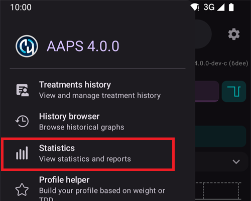

La pantalla **Estadístiques** té quatre pestanyes: **Insulina**, **Temps en rang**, **Glucèmia** i **Cicle**. Toqueu una pestanya, o llisqueu a l'esquerra o a la dreta per passar d'una a una altra.

(reviewing-tdd)=
### Pestanya Insulina: Dosi diària total

La targeta **Dosi diària total** mostra una línia per dia per als dies anteriors (fins a una setmana) dels quals **AAPS** té dades d'insulina, després la seva **Mitjana** i després **Avui** fins ara. Just després d'instal·lar **AAPS**, només es mostra **Avui**. Les columnes són:

- **Basal**: només la basal.
- **Bolus**: la suma dels tractaments de bolus i dels SMB.
- **TDD Total**: la dosi diària total d'insulina (**TDD**), la suma de la insulina de bolus i de basal lliurada durant el dia.
- **Carbs**: els tractaments de carbohidrats i d'e-carbs introduïts.

La secció **TDD** es calcula quan obriu la pàgina i el càlcul triga uns segons. Toqueu **Recalcular** per tornar-la a calcular.

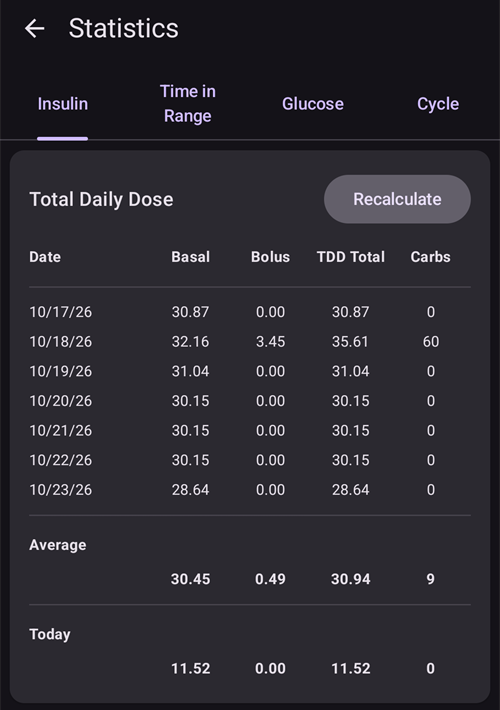

La **TDD** és la vostra insulina de bolus més la de basal per dia. Alguns metges fan servir, sobretot per a qui comença amb bomba, una proporció basal-bolus de 50:50: la basal base total (**TBB**, la suma de les vostres taxes basals durant 24 hores) hauria de ser llavors aproximadament la meitat de la TDD. Altres prefereixen una TBB del 32% al 37% de la TDD.

Com la majoria de regles pràctiques, té una validesa real limitada. La vostra diabetis pot ser diferent!

### Pestanya Temps en rang

Temps en rang (**TIR**): 70–180 mg/dl o 3,9–10 mmol/l.

La informació del **TIR** està disponible per a 7 i 30 dies, segons la quantitat de dades que hi hagi a la base de dades d'**AAPS**.

Més avall hi ha les estadístiques del temps en rang estret (TITR), 70–140 mg/dl o 3,9–7,8 mmol/l (la pantalla mostra aquest rang com a 70–141).

**Parleu dels objectius amb el vostre endocrinòleg**

La vostra diabetis pot ser diferent. Qualsevol objectiu proposat s'ha de parlar amb el vostre endocrinòleg o amb el vostre equip mèdic. Si es fan servir bé, les estadístiques d'AAPS poden ser una eina eficaç per seguir les tendències de la __glucèmia__ i el vostre progrés.

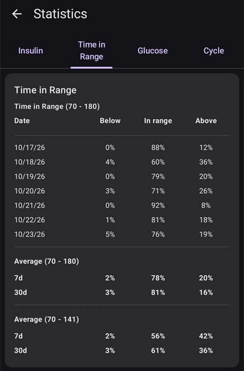

Més avall, la targeta **Dexcom TIR** mostra estadístiques detallades del **TIR** de 14 dies.

**SD**: desviació estàndard, un [indicador](https://www.ncbi.nlm.nih.gov/pmc/articles/PMC3125941/) de la variabilitat de la glucèmia (com més alta, pitjor).

HbA1c: l'estimació de l'hemoglobina glicada resultant, basada en la mitjana de les mesures del CGM. És un valor orientatiu que pot no coincidir amb les anàlisis d'HbA1c en sang.

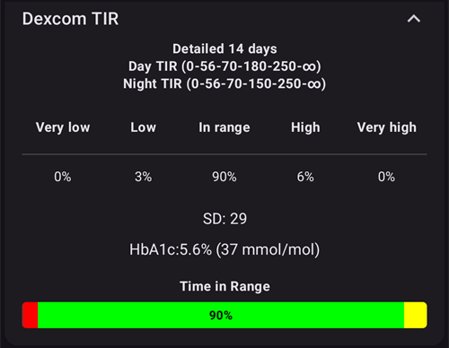

(reviewing-statistics-agp)=
### Pestanya Glucèmia: Perfil ambulatori de glucosa (AGP)

El **Perfil ambulatori de glucosa** (**AGP**) mostra com es mou normalment la vostra glucèmia durant el dia. Trieu el període amb els botons de dalt: **Avui**, **24h**, **7d**, **30d** o **90d**.

- **El gràfic**: un dia, de mitjanit a mitjanit. La línia és la **Mediana** (la meitat de les vostres lectures a aquella hora eren més baixes i l'altra meitat més altes). Al voltant, una franja conté la meitat central de les vostres lectures (**25–75%**) i una franja més ampla en conté la majoria (**10–90%**). Una franja estreta vol dir que la vostra glucèmia és semblant d'un dia a l'altre a aquella hora. Les línies discontínues marquen el vostre **Límit BAIX**, 140 mg/dl (7,8 mmol/l) i el vostre **Límit ALT**.
- **Resum glucèmic**: el temps dins del vostre rang, dins del rang estret (70–140 mg/dl o 3,9–7,8 mmol/l), per sobre i per sota del vostre rang, i després la vostra glucèmia **Mitjana** i **Mediana**. El vostre rang és el **Límit BAIX** i el **Límit ALT** definits a [Rang de visualització](#Preferences-range-for-visualization).
- **eA1c** and **GMI**: two estimates of HbA1c calculated from your CGM readings, shown in % with the same value in mmol/mol below it. Com l'HbA1c de més amunt, poden no coincidir amb les vostres anàlisis d'HbA1c en sang.
- **SD** (desviació estàndard) i **CV** (coeficient de variació): quant varia la vostra glucèmia. Un valor més baix vol dir una glucèmia més estable.
- **Dies**: quants dies de dades del CGM s'han fet servir.

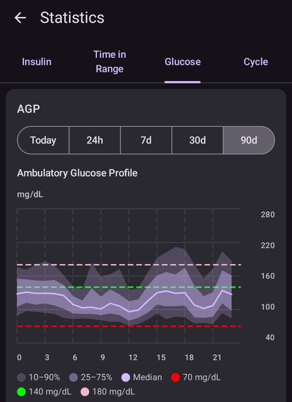 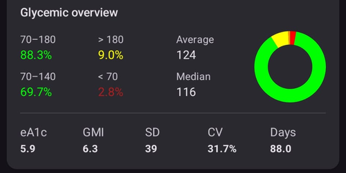

Sota l'AGP, la targeta **Pentàgon de glucosa (CGP)** dibuixa cinc mesures dels vostres darrers 14 dies de glucèmia en forma de pentàgon. Un pentàgon més petit vol dir un millor control de la glucèmia.

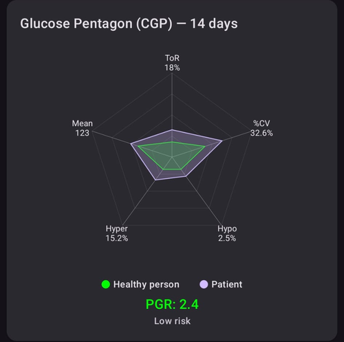

### Pestanya Cicle: Patró cíclic de TDD

**Patró cíclic de TDD** superposa els vostres totals diaris d'insulina en cicles de 28 dies, per ajudar-vos a veure patrons que es repeteixen. Cada cicle es dibuixa com una línia (**Cicles individuals**), juntament amb la seva mitjana.

- **TDD brut** / **TDD net**: trieu la dosi diària total tal com s'ha lliurat, o la TDD sense la insulina per als carbohidrats.
- **Desplaçament del cicle**: mou l'inici del cicle (de 0 a 27 dies).

Calen almenys 56 dies de dades (2 cicles). Amb menys dades, la targeta mostra **No hi ha prou dades (calen almenys 56 dies per a 2 cicles)**. El patró només es calcula quan obriu la pestanya **Cicle**, perquè llegeix 168 dies de dades.

(aaps-screens-treatments)=
## Historial de tractaments

Obriu el **menú** (☰) a l'angle superior esquerre de la pantalla principal i seleccioneu **Historial de tractaments**. En aquesta vista podeu veure i modificar l'historial dels tractaments següents, cadascun a la seva pestanya (llisqueu la fila de pestanyes per veure-les totes):

* Carbohidrats i bolus
* [Bolus estès](#Extended-Carbs-extended-bolus-and-switch-to-open-loop-dana-and-insight-pump-only)
* Basal temporal
* [Objectiu temporal](../DailyLifeWithAaps/TempTargets.md)
* [Canvi de perfil](../DailyLifeWithAaps/ProfileSwitch-ProfilePercentage.md)
* Portal de cures: notes i entrades del portal de cures
* Mode de funcionament: historial de l'estat del llaç
* Entrada d'usuari: altres notes que no s'envien a Nightscout

Al final de cada línia, unes icones petites mostren d'on vénen les dades o on s'han enviat:
* Icona **Nightscout** (el logotip de Nightscout): les dades vénen de Nightscout o s'hi han registrat
* Icona **Bomba**: les dades vénen de l'historial de la bomba (la bomba les ha processat)
* Icona **Paperera**: l'entrada s'ha eliminat (només es mostra quan mostreu les entrades eliminades amb la icona de l'**ull** a dalt a la dreta)

(screens-bolus-carbs)=
### Carbohidrats i bolus

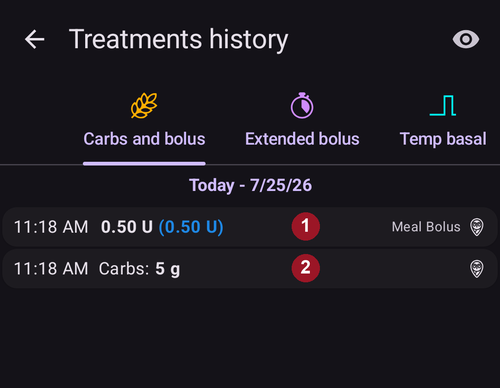

En aquesta pestanya podeu veure el registre de bolus i carbohidrats. Cada bolus (línia **1**) mostra l'IOB associat que queda al costat de la quantitat d'insulina. L'origen del bolus pot ser:
* Àpat (introduït manualment amb els botons Insulina, Assistent ràpid o Calculadora de bolus)
* SMB, quan es fa servir la funció SMB

Les entrades de carbohidrats (línia **2**) es mostren amb la quantitat en grams.

Si heu fet servir la [Calculadora de bolus](#aaps-screens-bolus-wizard) per calcular la dosi d'insulina, podeu prémer el text «Calc» a la línia del bolus per veure els detalls de com s'ha calculat el bolus.

Segons la bomba que feu servir, la insulina i els carbohidrats es poden mostrar en una sola línia o en diverses línies: una per al detall del càlcul, una per als carbohidrats i una per al bolus mateix.

L'historial de tractaments es pot fer servir per corregir entrades de carbohidrats errònies (_per exemple_, si heu sobreestimat o subestimat els carbohidrats). Tingueu en compte que no es pot editar una entrada existent; heu de seguir aquest procés:

1. Comproveu i recordeu el COB i l'IOB actuals a la pantalla principal.
2. Segons la bomba, els carbohidrats es poden mostrar juntament amb la insulina en una línia o com a entrada separada (per exemple, amb la Dana RS).
3. Elimineu l'entrada amb la quantitat de carbohidrats errònia: premeu la icona de la paperera, seleccioneu les línies que voleu eliminar i torneu a prémer la icona de la paperera per acabar.
4. Assegureu-vos que els carbohidrats s'han eliminat bé tornant a comprovar el COB a la pantalla principal.
5. Feu el mateix amb l'IOB si hi ha una sola línia amb carbohidrats i insulina.

   → Si els carbohidrats no s'eliminen com cal i afegiu més carbohidrats com s'explica aquí (6.), el COB serà massa alt i això pot portar a lliurar massa insulina.

6. Torneu a introduir la quantitat correcta de carbohidrats (**Tractaments → Carbs** a la barra de navegació inferior, o un botó **Carbs** d'[Accés ràpid](#quicklaunch)) i assegureu-vos de posar l'hora correcta de l'esdeveniment.
7. Si hi ha una sola línia amb carbohidrats i insulina, també heu d'afegir la quantitat d'insulina. Assegureu-vos de posar l'hora correcta de l'esdeveniment i comproveu l'IOB a la pantalla principal després de confirmar la nova entrada.

### Basal temporal

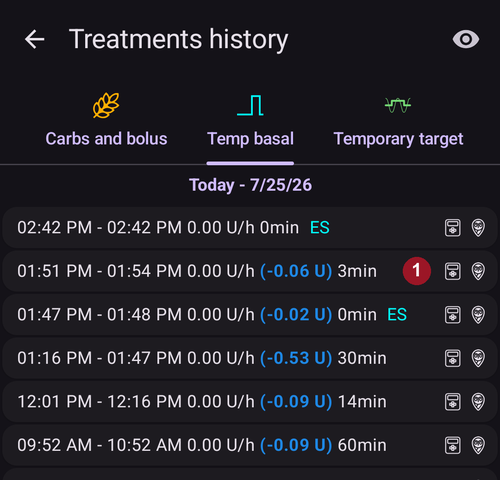

Aquí es mostren les **basals temporals** aplicades pel llaç. Quan una entrada encara té efecte sobre l'IOB, la informació es mostra al costat de la taxa (línia **1**). Pot ser:
* IOB positiu si la basal temporal era més alta que la definida al perfil
* IOB negatiu per a una basal temporal zero (com a la línia **1**) o si la basal temporal era més baixa que la definida al perfil

Eliminar les entrades només afecta els vostres informes a Nightscout i probablement falsejarà el vostre IOB real; no es recomana.

A l'esquerra d'una línia, una S vermella vol dir «Suspend» (suspès): passa quan la basal no s'està lliurant en aquest moment. Per exemple, és una situació normal durant el canvi d'un pod.

### Objectiu temporal

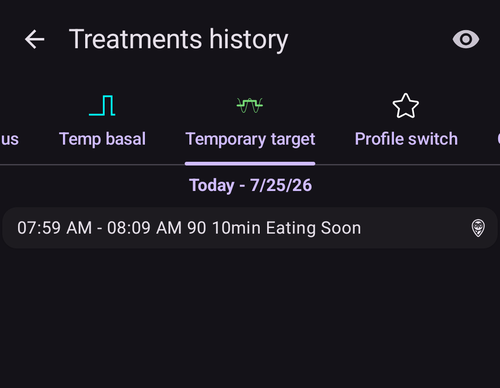

Aquí es pot veure l'historial dels objectius temporals.

### Canvi de perfil

Aquí es pot veure l'historial dels canvis de perfil. Podeu veure diverses entrades cada vegada que canvieu de perfil: la línia **1**, desada tant a NS com a l'historial de la bomba, correspon al canvi real. La línia **2**, desada a Nightscout però no a l'historial de la bomba, correspon a la sol·licitud de canvi de perfil feta per l'usuari.

Eliminar les entrades només afecta els vostres informes a Nightscout i mai no canviarà realment el perfil actual.

Podeu fer servir el botó **Duplicar** que es mostra a la línia **2** per fer una còpia d'un **canvi de perfil**. Per a més informació, vegeu [El vostre perfil d'AAPS > Gestionar els vostres perfils](#your-aaps-profile-clone-profile-switch).

### Portal de cures

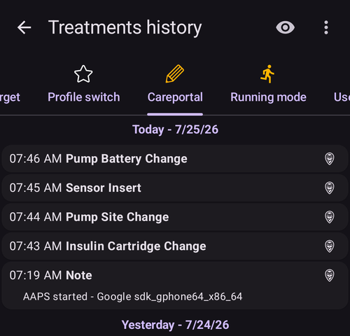

Aquesta pestanya mostra totes les notes i entrades del portal de cures registrades a Nightscout.

(AapsScreens-running-mode)= (aaps-screens-running-mode)=
### Mode de funcionament

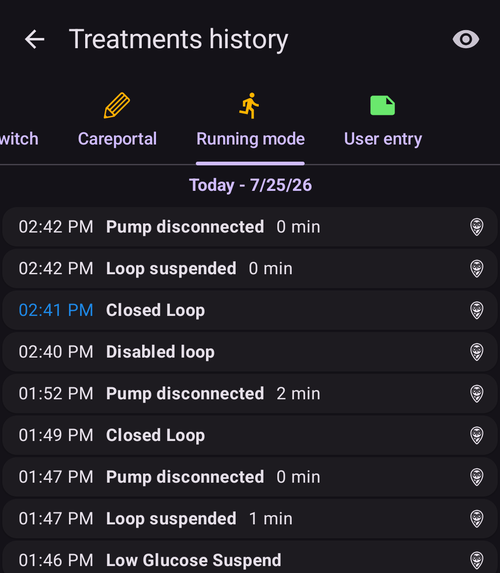

Aquesta pestanya mostra l'historial de canvis de l'[estat del llaç](#AapsScreens-loop-status): obert, tancat, LGS, suspès, desconnectat.

### Entrada d'usuari

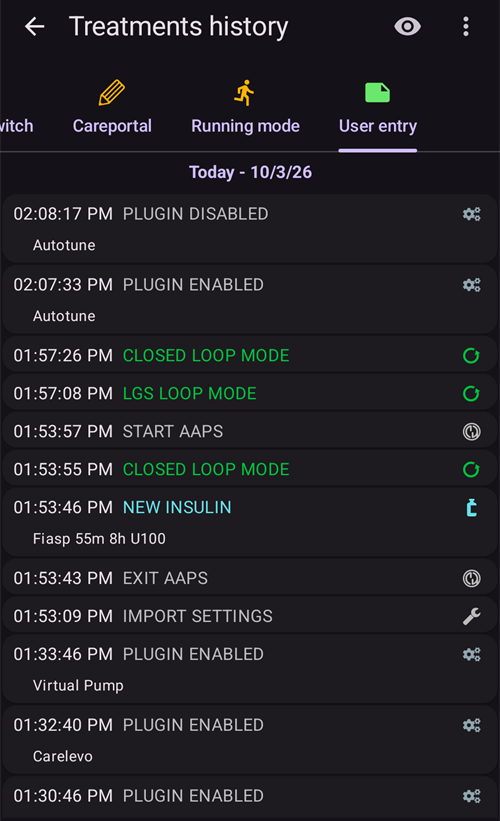

Aquesta pestanya llista les accions fetes a **AAPS** per l'usuari o per una **Automatització** (canvis del mode del llaç, canvis de perfil, tractaments, exportacions de la configuració...). Aquestes entrades no s'envien a Nightscout.

------

## Quina és la diferència entre Nightscout i Tidepool?

Nightscout pot facilitar a l'usuari l'emmagatzematge de les dades d'**AAPS** i ofereix moltes [eines d'informes](https://nightscout.github.io/nightscout/reports/).

En canvi, Tidepool permet a l'usuari [revisar les seves dades](https://www.tidepool.org/viewing-your-data) i [compartir-les fàcilment amb el vostre equip d'endocrinologia](https://www.tidepool.org/providers/how-it-works#tidepool-data-platform).