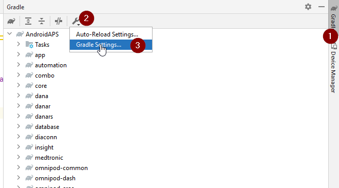
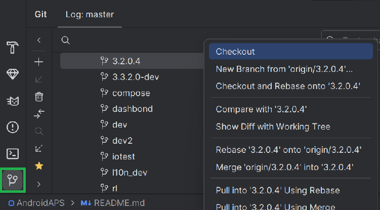
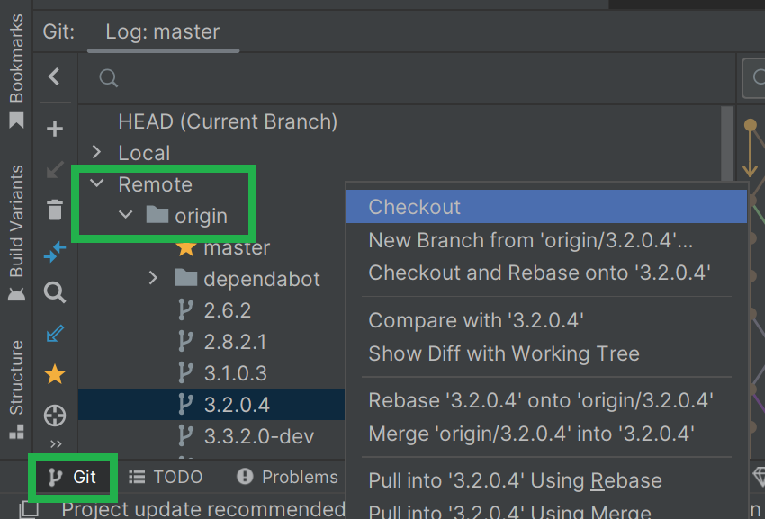
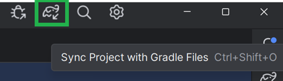
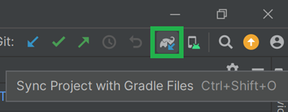

# Actualitzar a AAPS 3.2.0.4

(update-aaps-3204)=

## Compileu-la vosaltres mateixos en lloc de descarregar-la

**L'aplicació AAPS (un fitxer apk) no es pot descarregar, per les normes sobre dispositius mèdics. És legal compilar l'aplicació per al vostre ús propi, però no en podeu donar una còpia a altres persones!**

Vegeu la [pàgina de preguntes freqüents](../UsefulLinks/FAQ.md) per a més detalls.

## Requisits de l'ordinador i del programari per compilar AAPS 3.2.0.4

* Pot ser que calgui una versió concreta d'**[Android Studio](https://developer.android.com/studio/)** per compilar l'apk.

| Versió d'AAPS           | Versió<br/>d'Android Studio<br/>preferida | Versió<br/>d'Android Studio<br/>alternativa | Gradle | JVM |
| ----------------------- | ----------------------------------------------------- | ------------------------------------------------------- | ------ |:--- |
| [3.2.0.4](#version3204) | Hedgehog (2023.1.1)                                   | fins a Meerkat                                          | 8.2    | 17  |

La «versió preferida» inclou la versió de JVM adequada. La versió preferida també és la versió mínima que podeu fer servir per compilar **AAPS**. **NO** podreu compilar amb una versió més antiga que la «preferida». Si feu servir una altra versió, pot ser que tingueu problemes amb la versió de JVM. Vegeu la pàgina [Resolució de problemes d'Android Studio](#incompatible-gradle-jvm) per resoldre aquests problemes. Si la vostra versió actual d'Android Studio no és a la taula, primer l'heu d'actualitzar.

La versió de Gradle va lligada al codi font: sempre tindreu la versió de Gradle correcta quan descarregueu o actualitzeu el codi font. Només s'indica aquí com a referència, no cal que hi feu res.

* Android Studio no admet els [sistemes Windows de 32 bits](#troubleshooting_androidstudio-unable-to-start-daemon-process). Tingueu en compte que **una CPU de 64 bits i un sistema operatiu de 64 bits són condicions obligatòries.** Si el vostre sistema NO compleix aquesta condició, haureu de canviar el maquinari o el programari afectat, o tot el sistema.

<table class="tg">
<tbody>
  <tr>
    <th class="tg-baqh">Sistema operatiu (només 64 bits)</th>
    <td class="tg-baqh">Windows 8 o més nou</td>
    <td class="tg-baqh">Mac OS 10.14 o més nou</td>
    <td class="tg-baqh">Qualsevol Linux compatible amb Gnome, KDE o Unity DE;&nbsp;&nbsp;GNU C Library 2.31 o més nova</td>
  </tr>
  <tr>
    <th class="tg-baqh"><p align="center">CPU (només 64 bits)</th>
    <td class="tg-baqh">Arquitectura de CPU x86_64; Intel Core de 2a generació o més nou, o CPU AMD compatible amb <br><a href="https://developer.android.com/studio/run/emulator-acceleration#vm-windows" target="_blank" rel="noopener noreferrer"><span style="text-decoration:var(--devsite-link-text-decoration,none)">Windows Hypervisor</span></a></td>
    <td class="tg-baqh">Xips basats en ARM, o Intel Core de 2a generació o més nou compatible amb <br><a href="https://developer.android.com/studio/run/emulator-acceleration#vm-mac" target="_blank" rel="noopener noreferrer"><span style="text-decoration:var(--devsite-link-text-decoration,none)">Hypervisor.Framework</span></a></td>
    <td class="tg-baqh">Arquitectura de CPU x86_64; Intel Core de 2a generació o més nou, o processador AMD compatible amb AMD Virtualization (AMD-V) i SSSE3</td>
  </tr>
  <tr>
    <th class="tg-baqh"><p align="center">RAM</th>
    <td class="tg-baqh" colspan="3"><p align="center">8 GB o més</td>
  </tr>
  <tr>
    <th class="tg-baqh"><p align="center">Disc</th>
    <td class="tg-baqh" colspan="3"><p align="center">Com a mínim 30 GB d'espai lliure. Es recomana un SSD.</td>
  </tr>
  <tr>
    <th class="tg-baqh"><p align="center">Resolució</th>
    <td class="tg-baqh" colspan="3"><p align="center">Mínim 1280 x 800<br></td>
  </tr>
  <tr>
    <th class="tg-baqh"><p align="center">Internet</th>
    <td class="tg-baqh" colspan="3"><p align="center">Banda ampla</td>
  </tr>
</tbody>
</table>

**Es recomana molt (no és obligatori) fer servir un SSD (disc d'estat sòlid) en lloc d'un HDD (disc dur), perquè la compilació del fitxer apk d'AAPS trigarà menys.**  També podeu fer servir un HDD per compilar el fitxer apk d'**AAPS**. En aquest cas, la compilació pot trigar molt, però un cop ha començat, la podeu deixar funcionant sola.

## Ajuda i suport durant la compilació de la 3.2.0.4

Si teniu dificultats per compilar l'aplicació **AAPS**, hi ha una secció específica de [**Resolució de problemes d'Android Studio**](https://androidaps.readthedocs.io/en/3.2/GettingHelp/TroubleshootingAndroidStudio.html). Consulteu-la primer.

Si creieu que alguna cosa de les instruccions de compilació és incorrecta, hi falta o és confusa, o si encara teniu problemes, contacteu amb el grup d'usuaris d'**AAPS** a [Facebook](https://www.facebook.com/groups/AndroidAPSUsers) o a [Discord](https://discord.gg/4fQUWHZ4Mw). Si voleu canviar alguna cosa vosaltres mateixos (actualitzar captures de pantalla, _etc._), envieu una [pull request (PR)](../SupportingAaps/HowToEditTheDocs.md).

```{note}
Aquesta pàgina mostra imatges d'exemple tant de la interfície **New** (nova) d'Android Studio com de l'antiga (**Classic**).
```

## Resum de l'actualització de 3.2.0.x a 3.2.0.4

```{contents} Steps for updating to 3.2.0.4
:depth: 1
:local: true
```

### Exporteu la configuració actual

Exporteu la configuració des de la versió d'**AAPS** que teniu ara al telèfon. Potser no la necessitareu, però és millor prevenir que curar.

Si no recordeu com fer-ho, vegeu la pàgina [Crear i restaurar còpies de seguretat](ExportImportSettings.md).

### Actualitzeu la vostra còpia local d'AAPS

* Obriu el vostre projecte AAPS existent amb Android Studio. Potser haureu de seleccionar el vostre projecte. Feu (doble) clic al projecte AAPS.


<br>


* A la barra de menús d'Android Studio, seleccioneu Git -> Fetch


<br>


* A la cantonada de baix a la dreta veureu un missatge que diu que el Fetch s'ha fet correctament.


<br>


* Ara, a la barra de menús, seleccioneu Git -> Pull


<br>


* Deixeu totes les opcions com estan (origin/master) i seleccioneu Pull


<br>


* Espereu mentre es fa la descàrrega; ho veureu com a informació a la barra de baix. Quan acabi, veureu un missatge d'èxit.

  ```{note}
  Els fitxers actualitzats poden ser diferents! Això no indica cap problema.
  ```


<br>


* Es farà una sincronització de Gradle (Gradle Sync) per descarregar algunes dependències. Espereu que acabi.


<br>


### Seleccioneu la versió 17 de JVM

- Obriu la vista Gradle fent clic a l'elefant (1) a la dreta d'Android Studio, obriu la configuració (2) i seleccioneu **Gradle Settings** (3):


<br>



- Al camp **Gradle JDK** (1), comproveu que està seleccionada la versió adequada: **jbr-17**. Si no ho està, feu clic al camp i mireu si ja és a la llista. Si no és a la llista (la captura de pantalla de sota mostra un ordinador on només hi ha **jbr-21**), seleccioneu **Download JDK...** (2).


- A Version (1), seleccioneu **17**. A Vendor (2), seleccioneu JetBrains Runtime o qualsevol proveïdor. Location (3): no la canvieu.


- Tanqueu el diàleg **Settings** amb **OK**.

### Seleccioneu la branca AAPS 3.2.0.4

- A baix a l'esquerra, seleccioneu el símbol de Git, feu clic amb el botó dret a 3.2.0.4 i seleccioneu Checkout.



<br>



### Sincronitzeu el projecte amb Gradle

```{admonition} WARNING!
:class: warning
**No actualitzeu mai Gradle.** Sincronitzeu-lo sempre amb el projecte.
```

A la interfície nova, feu servir la icona de l'elefant i Sync Project with Gradle Files (o seguiu [aquestes instruccions](#gradle-resync)).



O bé ([aquestes instruccions](https://androidaps.readthedocs.io/en/3.2/GettingHelp/TroubleshootingAndroidStudio.html#gradle-resync)) a la interfície clàssica.



### Compileu l'APK signat de la 3.2.0.4

El vostre codi font ara és la versió publicada actual, i ja s'han comprovat tots els requisits previs. Ara és el moment de compilar l'apk signat tal com es descriu a la [secció de compilació de l'apk signat](#Building-APK-generate-signed-apk).

### Transferiu i instal·leu l'APK de la 3.2.0.4

Heu de transferir l'apk al telèfon per poder-lo instal·lar.

```{note}
Si heu compilat a Android Studio amb el mateix magatzem de claus que ja teníeu, no cal que elimineu l'aplicació que hi ha al telèfon. Quan instal·leu l'apk, seguiu les indicacions per instal·lar les actualitzacions.
En altres casos, per exemple si heu creat un nou magatzem de claus a Android Studio per a l'apk signat, haureu d'eliminar l'aplicació antiga abans d'instal·lar l'apk. **Assegureu-vos d'exportar la configuració!**
```

Vegeu les instruccions de [Transferir i instal·lar AAPS al vostre telèfon](../SettingUpAaps/TransferringAndInstallingAaps.md)

### Comproveu la versió 3.2.0.4 d'AAPS al telèfon

Després d'instal·lar el nou apk, podeu comprovar la versió d'AAPS al telèfon fent clic al menú de tres punts, a dalt a la dreta, i després a Quant a. Hauríeu de veure la versió actual.

