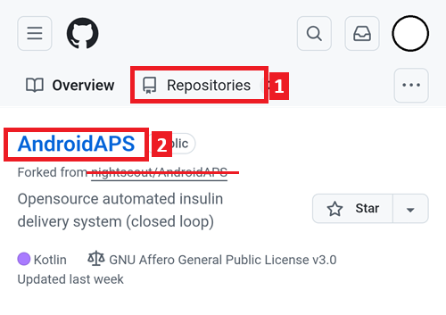
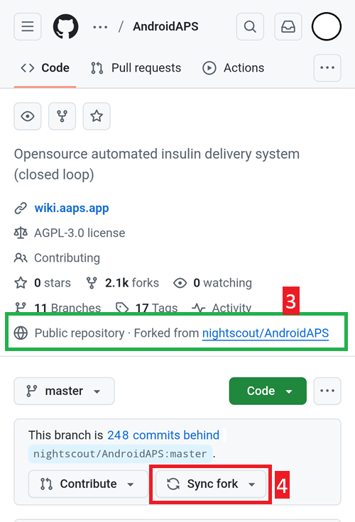
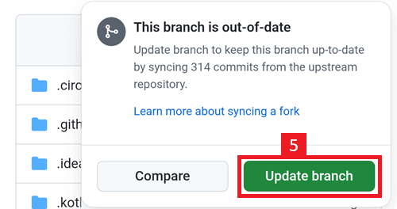
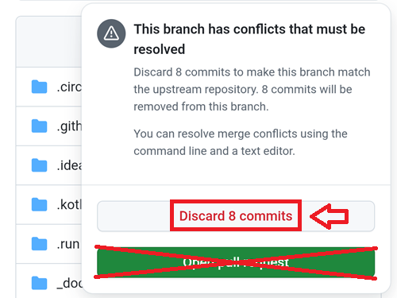
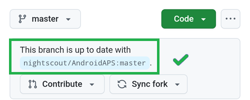

# Actualitzar amb el navegador (fork)

```{tip}
Heu compilat AAPS amb **AAPS Builder**? No necessiteu aquesta pàgina: vegeu [Actualitzar AAPS amb AAPS Builder](#aaps-builder-updates).
```

## Compileu-la vosaltres mateixos en lloc de descarregar-la

**AAPS** no es pot descarregar a causa de les normes sobre dispositius mèdics. És legal compilar l'aplicació per al vostre ús propi, però no en podeu donar una còpia a altres persones! Vegeu la [pàgina de preguntes freqüents](../UsefulLinks/FAQ.md) per a més detalls.

```{note}
In case you want to upgrade **AAPS** with a browser for the first time: copy your back-up keystore file to your Google Drive. Llavors seguiu el [procediment de compilació d'**AAPS** al navegador](../SettingUpAaps/BrowserBuild.md) en lloc d'aquesta guia. En lloc de crear un nou magatzem de claus, heu de seleccionar el que heu copiat del vostre ordinador.
Aquest pas només és obligatori la primera vegada; per a les actualitzacions següents podreu seguir aquesta guia.
```

```{tip}
**Voleu passar a AAPS Builder?** [AAPS Builder](../SettingUpAaps/BrowserBuildAapsBuilder.md) és la compilació al navegador més senzilla: no cal sincronitzar cap fork i descarregueu l'aplicació directament des de GitHub. No cal que canvieu: aquesta guia continua funcionant. Si canvieu, primer obteniu una còpia del vostre magatzem de claus des del vostre fork, com s'explica a [Si veniu de la compilació al navegador anterior](#aaps-builder-from-fork). Si no ho feu, la nova compilació no podrà actualitzar l'AAPS del vostre telèfon.
```

## Resum de com actualitzar a una nova versió d'AAPS amb un navegador

```{contents} Steps for updating to a new version of AAPS
:depth: 1
:local: true
```

In case you experience problems, see separate page for [browser build troubleshooting](../GettingHelp/BrowserBuildTroubleshooting.md).

### Exporteu la vostra configuració

Exporteu la configuració des de la versió d'**AAPS** que teniu ara al telèfon. Potser no la necessitareu, però és millor prevenir que curar.

Si no recordeu com fer-ho, vegeu la pàgina [Crear i restaurar còpies de seguretat](ExportImportSettings.md).

(Update-to-new-version-update-your-repo)=
### Actualitzeu el vostre repositori de GitHub

[Inicieu sessió a GitHub](https://github.com/login).

1. Seleccioneu Repositories.
2. Desplaceu-vos cap avall i seleccioneu el vostre propi repositori AndroidAPS.



3. Comproveu que feu servir la vostra pròpia còpia d'AndroidAPS (Forked from nightscout/AndroidAPS)
4. Premeu Sync Fork per actualitzar-la (el nombre de commits endarrerits pot ser diferent del de la imatge)




5. Premeu Update Branch



Nota: si heu modificat la vostra còpia d'AndroidAPS per error, veureu aquesta pantalla. Descarteu tots els canvis (commits) per tornar a la versió publicada.



You have now synchronized (updated) your own copy with the latest release of **AAPS**. Molt bé.



### Executeu el workflow per compilar l'APK signat

1. A la vostra còpia d'AndroidAPS a GitHub, seleccioneu Actions.
2. Obriu All Workflows.
3. Seleccioneu AAPS-CI


4. Desplaceu-vos cap avall i premeu Run Workflow.


5. Keep the branch set to master. In **Select AAPS Version**, check that **4.0.0**, the newest version at the top of the list, is selected. If your fork is not up to date, the preselected version is an older one: if you run the workflow with the form as it opens, you rebuild that older version and your app is not updated. Choose the [variant](#browserbuild-variant) (fullRelease), and then tap Run workflow.

   ```{note}
   The list of versions is part of the workflow in your fork. If **4.0.0** is missing, your fork is not synchronized yet: go back to [Update your GitHub repository](#Update-to-new-version-update-your-repo).
   ```


6. Veureu el missatge Workflow run was successfully requested. Actualitzeu la pàgina del navegador i podreu seguir el progrés de la compilació. Quan l'acció acabi, l'acció AAPS CI mostrarà una marca verda. You have successfully built the updated version of **AAPS**. Això vol dir que l'apk principal i l'apk de Wear es desen directament al vostre Google Drive (com es mostra a continuació). L'apk d'AAPSClient es pot descarregar des de Github > nightscout > AndroidAPS [aquí](https://github.com/nightscout/AndroidAPS/releases)


### Instal·leu l'APK d'AAPS

1. Obriu el vostre Google Drive
2. Entreu a la carpeta AAPS, seleccioneu la carpeta de la nova versió i hi trobareu la versió per al telèfon i la versió per a Android Wear.


```{note}
A partir de setembre de 2026, la [verificació de desenvolupadors d'Android](#android-developer-verification) de Google pot impedir instal·lar l'APK tocant el fitxer, segons el vostre país. En aquella pàgina s'expliquen solucions gratuïtes.
```

Continueu [aquí](#Update-to-new-version-check-aaps-version-on-phone)

(update-browser-build-troubleshooting)=

## Resolució de problemes

Si alguna cosa va malament, no us espanteu.

Respireu a fons!

Then check if your problem is already documented: see [AAPS Builder troubleshooting](#aaps-builder-troubleshooting) if you build with **AAPS Builder**, or [Browser build troubleshooting](#aaps-ci-troubleshooting) otherwise.

Si necessiteu més ajuda, contacteu amb altres usuaris d'**AAPS** a [Facebook](https://www.facebook.com/groups/AndroidAPSUsers) o a [Discord](https://discord.gg/4fQUWHZ4Mw).
