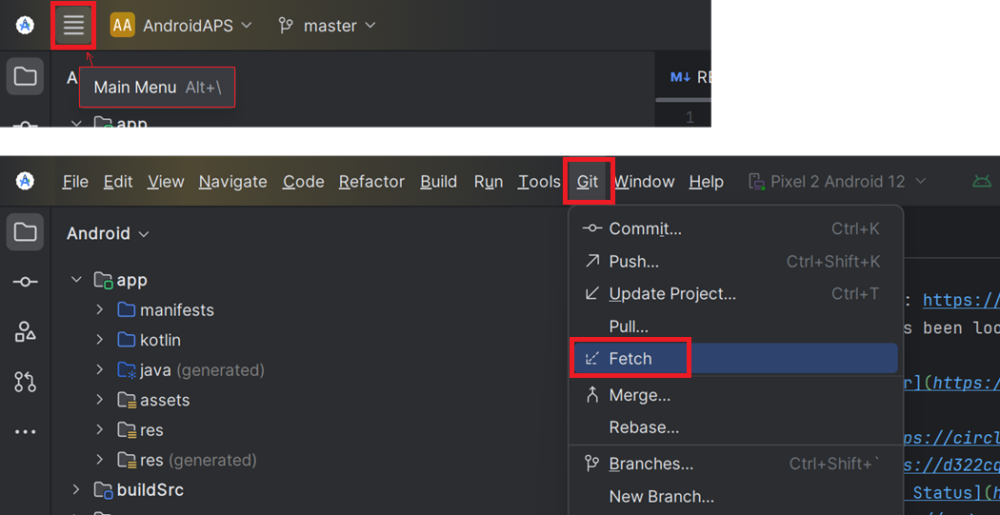

# Actualitzar amb Android Studio

## Compileu-la vosaltres mateixos en lloc de descarregar-la

**AAPS** no es pot descarregar a causa de les normes sobre dispositius mèdics. És legal compilar l'aplicació per al vostre ús propi, però no en podeu donar una còpia a altres persones! Vegeu la [pàgina de preguntes freqüents](../UsefulLinks/FAQ.md) per a més detalls.

```{note}
Si voleu compilar **AAPS** en un ordinador nou: copieu el fitxer de còpia de seguretat del vostre magatzem de claus a l'ordinador nou. Després seguiu el [procediment de compilació inicial d'**AAPS**](../SettingUpAaps/BuildingAaps.md) en lloc d'aquesta guia. L'única diferència és que, en lloc de crear un magatzem de claus nou, podeu seleccionar el que heu copiat a l'ordinador nou.
```

## Visió general de l'actualització a una nova versió d'AAPS amb Android Studio

```{contents} Steps for updating to a new version of AAPS
:depth: 1
:local: true
```

Si teniu problemes, consulteu la pàgina separada [Resolució de problemes d'Android Studio](../GettingHelp/TroubleshootingAndroidStudio.md).

### Exporteu la vostra configuració

Exporteu la configuració des de la versió d'**AAPS** que teniu ara al telèfon. Potser no la necessitareu, però és millor prevenir que curar.

Si no recordeu com fer-ho, vegeu la pàgina [Crear i restaurar còpies de seguretat](ExportImportSettings.md).

### Comproveu la vostra versió d'Android Studio

La versió mínima necessària es descriu a les [instruccions de compilació](#Building-APK-recommended-specification-of-computer-for-building-apk-file). Si la vostra versió és més antiga, [actualitzeu primer Android Studio](#Building-APK-install-android-studio)!

(Update-to-new-version-update-your-local-copy)=
### Actualitzeu la vostra còpia local

* Obriu el vostre projecte AAPS existent amb Android Studio. Potser haureu de seleccionar el vostre projecte. Feu (doble) clic al projecte AAPS.

  

* A la barra de menús d'Android Studio, seleccioneu Git -> Fetch

   

* A la cantonada de baix a la dreta veureu un missatge que diu que el Fetch s'ha fet correctament.

   

* Ara, a la barra de menús, seleccioneu Git -> Pull

   

* Deixeu totes les opcions com estan (origin/master) i seleccioneu Pull

   

* Espereu mentre es fa la descàrrega; ho veureu com a informació a la barra de baix. Quan acabi, veureu un missatge d'èxit.

  ```{note}
  Els fitxers actualitzats poden ser diferents! Això no indica cap problema.
  ```

   

* Es farà una sincronització de Gradle (Gradle Sync) per descarregar algunes dependències. Espereu que acabi.

  

### Comproveu la versió de JVM

Aquesta comprovació és especialment recomanable si ja heu compilat una versió anterior d'**AAPS** al mateix ordinador.

Consulteu a les [instruccions de compilació](#Building-APK-recommended-specification-of-computer-for-building-apk-file) la versió de JVM necessària per a la versió d'**AAPS** que compileu ara. Després seguiu els passos descrits a [JVM de Gradle incompatible](#incompatible-gradle-jvm) per assegurar-vos que feu servir la versió correcta.

(Update-to-new-version-build-the-signed-apk)=
### Compileu l'APK signat

El vostre codi font ara és la versió publicada actual, i ja s'han comprovat tots els requisits previs. Ara és el moment de compilar l'apk signat tal com es descriu a la [secció de compilació de l'apk signat](#Building-APK-generate-signed-apk).

(Update-to-new-version-transfer-and-install)=

### Transferiu i instal·leu l'APK
Heu de transferir l'apk al telèfon per poder-lo instal·lar.

```{note}
Si heu compilat a Android Studio amb el mateix magatzem de claus que ja teníeu, no cal que elimineu l'aplicació que hi ha al telèfon. Quan instal·leu l'apk, seguiu les indicacions per instal·lar les actualitzacions.
En altres casos, per exemple si heu creat un nou magatzem de claus a Android Studio per a l'apk signat, haureu d'eliminar l'aplicació antiga abans d'instal·lar l'apk. **Assegureu-vos d'exportar la configuració!**
```

Consulteu les instruccions a [Transferir i instal·lar AAPS al vostre telèfon](../SettingUpAaps/TransferringAndInstallingAaps.md). Allà on s'aplica la [verificació de desenvolupadors d'Android](#android-developer-verification) de Google (a partir de setembre de 2026, segons el vostre país), instal·leu amb [ADB](#android-developer-verification-adb) en lloc de tocar el fitxer APK.

Continueu [aquí](#Update-to-new-version-check-aaps-version-on-phone).

(update-computer-build-troubleshooting)=

## Resolució de problemes

Si alguna cosa va malament, no us espanteu.

Respireu a fons!

Després comproveu si el vostre problema ja està documentat a la pàgina separada [Resolució de problemes d'Android Studio](../GettingHelp/TroubleshootingAndroidStudio.md).

Si necessiteu més ajuda, contacteu amb altres usuaris d'**AAPS** a [Facebook](https://www.facebook.com/groups/AndroidAPSUsers) o a [Discord](https://discord.gg/4fQUWHZ4Mw).