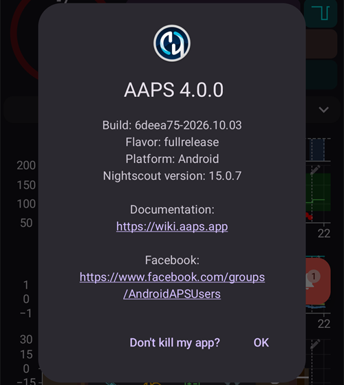

# Actualitzar a una nova versió o branca

## Compileu-la vosaltres mateixos en lloc de descarregar-la

**AAPS** no es pot descarregar, per la normativa sobre dispositius mèdics. És legal compilar l'aplicació per al vostre ús propi, però no en podeu donar una còpia a altres persones! Vegeu la [pàgina de preguntes freqüents](../UsefulLinks/FAQ.md) per a més detalls.

## Notes importants

- Actualitzeu a la nova versió d'**AAPS** com més aviat millor quan hi hagi una nova versió disponible.
- Quan hi hagi una nova versió disponible, rebreu un bàner informatiu sobre la nova versió a la mateixa aplicació **AAPS**.
- La nova versió també s'anunciarà a Facebook quan surti.
- Quan surti la versió, llegiu amb atenció les [Notes de la versió](ReleaseNotes.md) i aclariu els dubtes amb la comunitat a Facebook o Discord abans de fer l'actualització.
- Updating from **AAPS** 3.x? Read [What changed in AAPS v4](V4Changes.md) first: it lists the features that moved, were renamed or were removed.
- Do not forget to [export your settings](ExportImportSettings.md). When you import them again after the update, you choose whether the pump settings are replaced too.

## Actualitzar AAPS amb la compilació al navegador

Ja vau compilar la vostra aplicació AAPS amb un navegador? Seguiu les instruccions del mètode que vau fer servir:

- **AAPS Builder**: you build from the **Build AAPS** page of your private repository (usually named `my-aaps`) and download the app from GitHub. Follow [Updating AAPS with AAPS Builder](#aaps-builder-updates). No hi ha cap fork per sincronitzar.
- **Fork and preparation file**: you run the **AAPS-CI** workflow in your own copy (fork) of AndroidAPS, a repository named `AndroidAPS` in your GitHub account, and the app lands in your Google Drive. Follow [Update with a browser (fork)](./UpdateBrowserBuild.md).

## Actualitzar AAPS amb Android Studio

Follow [these instructions](./UpdateComputerBuild.md).

## Actualitzar AAPS amb la línia d'ordres

Feu servir les [mateixes instruccions](../SettingUpAaps/CLIBuild.md) que quan vau compilar AAPS abans, però descarregueu els canvis nous amb git.

(Update-to-new-version-check-aaps-version-on-phone)=

## After the update

These steps are the same for every build method. Comproveu a les [Notes de la versió](../Maintenance/ReleaseNotes.md) si hi ha instruccions específiques després de l'actualització.

Després d'instal·lar el nou apk:

- you can check the **AAPS** version on your phone by opening the **menu** (☰) on the top left and then **About** (as per the screenshot below). The current **AAPS** version can be viewed;
- make sure you have imported your settings; and
- please check your **AAPS** settings under **Settings** and ensure these remain accurate.

