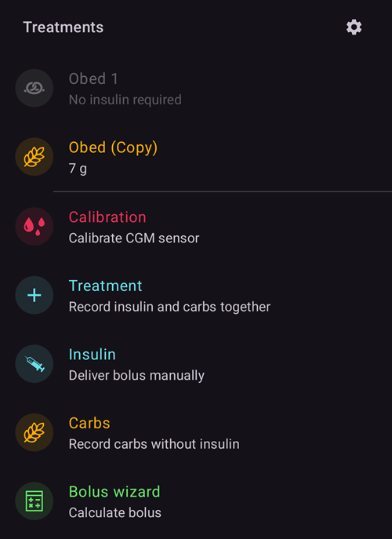
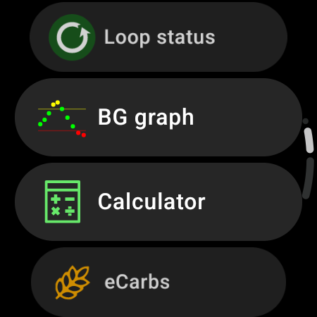
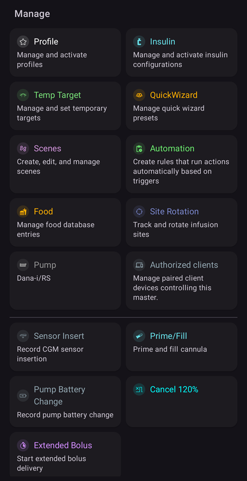
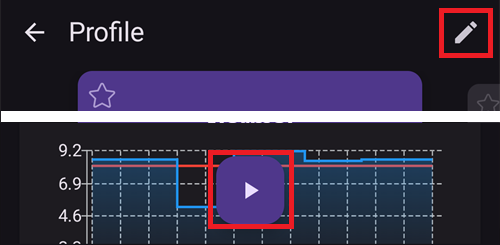

(v4-changes)=
# Què ha canviat a AAPS v4

Aquesta pàgina recull els **canvis de funcionament** més importants entre **AAPS** v3 i v4 (coses que funcionen d'una altra manera, que s'han mogut o que s'han eliminat), perquè els usuaris actuals sàpiguen què poden esperar quan actualitzin. Vegeu també les [Notes de la versió](ReleaseNotes.md) i la guia [Actualitzar a una nova versió o branca](UpdateToNewVersion.md).

```{contents} Table of contents
:depth: 2
:local: true
```

---

## S'ha eliminat NSClient v1

**AAPS** v3 incloïa **dos** plugins de sincronització amb Nightscout:

- **NSClient**: el client antic (l'antiga API REST / socket.io de Nightscout, també anomenada *«v1»*), i
- **NSClientV3**: el client per a la nova **API v3** de Nightscout.

A **AAPS** v4 s'ha **eliminat** el plugin antic **NSClient (v1)**. Per sincronitzar amb Nightscout només queda **NSClientV3**.

```{admonition} What you need to do
:class: important
Si vosaltres (o el vostre seguidor amb **AAPSClient**) encara sincronitzàveu amb l'antic plugin **NSClient (v1)**, canvieu a **NSClientV3** abans o després d'actualitzar:

- Obriu **[Configurador](../SettingUpAaps/ConfigBuilder.md) → Comunicació → NSClientV3**.
- Introduïu la vostra **URL de Nightscout** i un **token d'accés** (NSClientV3 fa servir un token d'accés, *no* l'antic API secret; vegeu [com crear un token](https://nightscout.github.io/nightscout/security/#create-a-token)).
- El vostre lloc de Nightscout ha de ser compatible amb l'**API v3** (Nightscout 15 o posterior).
- Si feu servir **websockets**, activeu-los o desactiveu-los a **tots dos**, el principal i el seguidor, mai només en un.
- Els websockets són **obligatoris** per al control remot des d'**AAPSClient**, als dos telèfons.
```

Això només afecta la manera com l'aplicació es comunica amb Nightscout; les vostres dades a Nightscout no canvien.

---

## La navegació inferior: Tractaments, Escenes i Gestionar

A **AAPS** v3 us movíeu per l'aplicació amb una fila de **pestanyes** (Resum, Accions, Tractaments, …), i diverses funcions eren **plugins** que activàveu al Config Builder (**Accions**, **Automatització**, **Aliments**, …).

A **AAPS** v4 les pestanyes ja no hi són, i tampoc la casella de l'ull del Config Builder que mostrava un plugin com a pestanya. La pantalla principal és el **Resum**, i una **barra de navegació inferior** us dona tres fulls. **Accions, Automatització i Aliments ja no són plugins**: no cal activar res al [Configurador](../SettingUpAaps/ConfigBuilder.md) (el Config Builder amb un nom nou); les seves funcions ara són en aquests fulls.

(v4changes-treatments)=
### Tractaments — introduir i lliurar

El full **Tractaments** és on registreu o lliureu un tractament: **Calculadora de bolus**, **Insulina** (bolus manual), **Carbs**, **Tractament** (insulina i carbohidrats junts), **Calibració**, **CGM** (obre l'aplicació del CGM, si n'hi ha una configurada) i els vostres **[Assistents ràpids](../DailyLifeWithAaps/QuickWizards.md)**.



En un **rellotge Wear OS**, els mateixos tractaments s'introdueixen des del **menú AAPS** del rellotge (Calculadora de bolus / Calculadora, e-carbs, Tractament, …):



### Escenes

Les vostres configuracions per a cada situació; vegeu [Escenes (configuracions per a cada situació)](../DailyLifeWithAaps/Scenes.md).

(v4changes-manage)=
### Gestionar — gestionar i activar

El full **Gestionar** és on gestioneu i activeu tota la resta: **[Perfil](../DailyLifeWithAaps/ProfileSwitch-ProfilePercentage.md)**, **Configuració d'insulina** (les vostres configuracions d'insulina), **[Objectiu temporal](../DailyLifeWithAaps/TempTargets.md)**, configuracions d'**[Assistent ràpid](../DailyLifeWithAaps/QuickWizards.md)**, **[Escenes](../DailyLifeWithAaps/Scenes.md)**, **Automatització**, **Aliments**, **Rotació de punts d'inserció**, **Bomba**, **[Clients autoritzats](../RemoteFeatures/ClientMasterControl.md)**; i també les accions de la bomba que abans eren a la pestanya *Accions* (**Bolus estès**, **Cancel·lar basal temporal**, **Encebar**, **Inserció del sensor**, **Canvi de pila de la bomba**).



Es conserven totes les vostres regles d'automatització i els aliments que ja teníeu; només ha canviat la manera d'arribar a aquestes funcions.

(screens-action-tab)=
#### On és la pestanya Accions?

**AAPS** 3.x tenia una pestanya «Accions». A **AAPS** 4 les seves funcions són en altres llocs:

* **Canvi de perfil** i **Percentatge de perfil**: toqueu el [nom del perfil](#aaps-screens-profile--target) a la pantalla principal, o **Gestionar → Perfil**. Vegeu [Canviar el percentatge del perfil](#ProfileSwitch-change-percentage).
* **Objectiu temporal**: premeu l'[objectiu](#aaps-screens-profile--target) a la pantalla principal, o **Gestionar → Objectiu temporal**.
* **Encebar**, **Inserció del sensor**, **Control glucèmia** i les altres entrades del portal de cures: al [panell d'estat](#aaps-screens-careportal) desplegat, a **Gestionar** o com a botons d'[Accés ràpid](../DailyLifeWithAaps/QuickLaunch.md).
* **Historial**, **Estadístiques** (TDD): al **menú** (☰).

```{admonition} Profile switch and profile percentage
:class: note
A **AAPS** v3, una pulsació llarga sobre el nom del perfil obria el diàleg de canvi de perfil (percentatge, durada, objectiu temporal d'activitat). A **AAPS** v4, **toqueu** el nom del perfil (o **Gestionar → Perfil**) i després toqueu el botó rodó **▶** a baix a la dreta per obrir les mateixes opcions. Vegeu [Canviar el percentatge del perfil](#ProfileSwitch-change-percentage).
```

---

(v4changes-read-only-management)=
## La protecció de la configuració ara també bloqueja les pantalles de gestió

A **AAPS** v3, la [Protecció de la configuració](#Preferences-settings-protection) us demanava la contrasenya només quan obríeu la configuració. Sense contrasenya, encara podíeu afegir o editar perfils a la pestanya **Perfil local**.

A **AAPS** v4, la protecció de la configuració també cobreix l'edició a les pantalles de gestió: **Perfil**, **Configuració d'insulina**, **Objectiu temporal** i **Assistent ràpid**. Si la vostra configuració està bloquejada, aquestes pantalles s'obren **només de lectura**:

- Podeu veure les entrades, fer-les servir o prémer **▶ Activar**.
- Els botons **Afegir / Editar / Duplicar / Eliminar** estan **amagats**. Només el **✏️ llapis** de la barra superior mostra que podeu desbloquejar l'edició.



```{admonition} What you need to do
:class: important
Per afegir, editar, duplicar o eliminar una entrada, toqueu el **✏️ llapis** de la barra superior i introduïu la contrasenya de configuració (o feu servir la biometria). Apareixen els botons.

Si no necessiteu protegir la configuració, podeu desactivar la protecció de la configuració a **Configuració → Protecció**.
```

---

(v4changes-active-insulin)=
## La insulina en ús no es pot editar

A **AAPS** v3 podíeu canviar en qualsevol moment la DIA de la insulina que fèieu servir.

A **AAPS** v4, la insulina marcada com a **ACTIU** a **Gestionar → Configuració d'insulina** apareix en gris: no la podeu editar ni eliminar.

Quan actualitzeu, **AAPS** conserva la insulina i la DIA que ja tenien guardades els canvis de perfil de la v3. Si troba registres antics amb la insulina coneguda però sense DIA, per a aquests registres utilitza una DIA per defecte i mostra un missatge una sola vegada, per exemple *Els registres antics no tenien durada de la insulina, per això s'han utilitzat 9,0 hores per a Lyumjev. Comproveu la configuració d'insulina: els registres ja migrats no s'actualitzen després.* Quan vegeu aquest missatge, comproveu la configuració d'insulina.

When you [import settings](../Maintenance/ExportImportSettings.md) exported from **AAPS** 3.x, **AAPS** adds the insulin of that backup to your insulin list and tells you which one, for example *Added to your insulin list from the backup: Free-Peak Oref 38m 6h U100.* This insulin is not in use yet: select the right insulin when you activate your profile, and do this before Nightscout downloads your older treatments.

```{admonition} What you need to do
:class: important
Per canviar la DIA o el pic, afegiu una insulina nova amb **+**, ajusteu-la, deseu-la i feu **▶ Activar**. Vegeu [Canviar la insulina en ús](#Config-Builder-insulin-change-active).
```

---

(v4changes-remote-control)=
## El control remot des d'AAPSClient necessita emparellament

A **AAPS** v3, **AAPSClient** controlava **AAPS** escrivint tractaments del portal de cures a Nightscout, i no podia lliurar bolus.

A **AAPS** v4, el client i el telèfon principal s'**emparellen** una vegada, i cada ordre va signada. El telèfon principal comprova i confirma cada ordre, i ara un client també pot lliurar un bolus.

- Cada client té un **[rol](#client-master-control-roles)** que limita el que pot fer.
- Mentre el control des del client està activat, el telèfon principal és en **[mode reforçat](#client-master-control-hardened-mode)**: els tractaments i canvis introduïts directament a Nightscout (el lloc web, altres aplicacions) ja no s'apliquen.
- Cada client rep un **[token de Nightscout propi](#client-master-control-own-token)** amb només els permisos que necessita.

```{admonition} What you need to do
:class: important
Empareleu cada **AAPSClient** amb el telèfon principal: vegeu [Control principal ↔ client (control remot signat)](#client-master-control). Amb un token d'administrador al telèfon principal, el telèfon principal mostra un codi QR que configura i empareja el client amb un sol escaneig. Si abans introduïeu tractaments al lloc web de Nightscout, ara introduïu-los en un client emparellat.
```

---

## Les dades de glucèmia duplicades ara canvien el llaç a suspensió per glucèmia baixa

Quan **AAPS** rep la mateixa lectura de glucèmia dues vegades (una insígnia vermella d'avís a la drecera de l'origen de glucèmia de la barra inferior), no pot calcular la tendència de manera fiable, i per això deixa de donar insulina de correcció.

A **AAPS** v3 això passava en silenci: el llaç continuava mostrant-se com a **Llaç tancat**, tot i que ja no podia corregir.

A **AAPS** v4 el canvi és visible. Un llaç tancat canvia al mode **Suspensió per glucèmia baixa (LGS)**, i el diàleg del llaç us diu per què: *«Mode LGS per valors duplicats a l'origen de glucèmia»*. **AAPS** encara pot reduir o suspendre la basal per protegir-vos de les hipoglucèmies.

```{admonition} What you need to do
:class: important
Trobeu i elimineu les lectures duplicades; vegeu [Senyal d'avís de glucèmia](#aaps-screens-bg-warning-sign).

Quan ja no hi siguin, **AAPS** continua en **Suspensió per glucèmia baixa (LGS)**. No torna sol a **Llaç tancat**: manteniu premuda la icona del llaç i torneu a seleccionar **Llaç tancat**.
```

---

(v4changes-tidepool)=
## Tidepool: les dades ara apareixen amb el nom de dispositiu AAPS

A **AAPS** v3, les dades enviades a [Tidepool](../SettingUpAaps/Tidepool.md) es mostraven a Tidepool amb un altre nom de dispositiu.

A **AAPS** v4, les dades es mostren amb el nom de dispositiu **AAPS**. Després de l'actualització, **AAPS** comença un conjunt de dades nou a Tidepool. Les dades antigues es queden a Tidepool amb el nom de dispositiu antic.

```{admonition} What you need to do
:class: important
Normalment no cal fer res: les dades noves simplement apareixen amb el nom **AAPS**.

**No** executeu «**Sincronització completa**» mentre les dades antigues encara siguin a Tidepool: llavors les mateixes dades hi serien dues vegades. Si voleu totes les dades amb el nom nou, primer feu servir el botó «**Esborrar totes les dades**» de la [pantalla de Tidepool](#tidepool-menu) (també elimina les dades antigues enviades per **AAPS**), i després executeu «**Sincronització completa**». Només es poden tornar a enviar les dades que encara estan guardades a **AAPS** al vostre telèfon.
```

---


<!-- =====================================================================
     This page is a growing list of v4 behavioral changes.
     Add new changes as their own "## " section, newest grouping as agreed.
     Maintainers: relocate page + images and fix cross-links as needed.
     ===================================================================== -->
