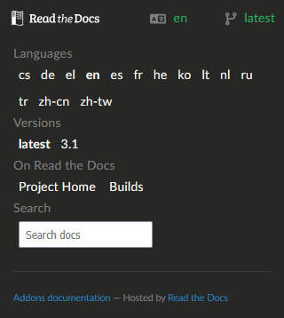

# Canviar l'idioma i la versió

La documentació que esteu llegint està disponible en diversos idiomes i correspon a una versió concreta d'**AAPS**. Podeu canviar tant l'idioma com la versió des del menú de la part inferior dreta de la pantalla.

```{note}
Feu clic a la barra de la part inferior dreta de la pantalla per obrir el menú de selecció d'idioma i versió.
```



## Canviar l'idioma

Al menú, seleccioneu l'idioma en què voleu llegir la documentació.

Us convidem a unir-vos als traductors i revisors de [Crowdin](https://crowdin.com/project/androidapsdocs) per ajudar a traduir la documentació al vostre idioma.

## Canviar la versió

La versió actual es mostra a la part inferior dreta de la pantalla. Per canviar a una altra versió, feu clic a la versió actual i seleccioneu la versió que necessiteu.

```{warning}
Quan canvieu l'idioma o la versió (o tots dos), és possible que obtingueu un error 404 - Pàgina no trobada, si la pàgina no existeix en aquell idioma o versió. Això passa sovint quan canvieu de versió, però no hauria de passar quan canvieu d'idioma: si la pàgina encara no està traduïda, es mostrarà en anglès.
```
