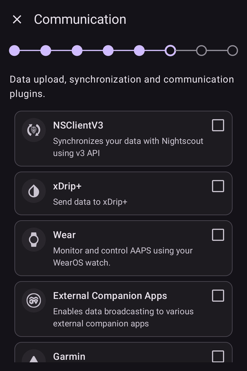
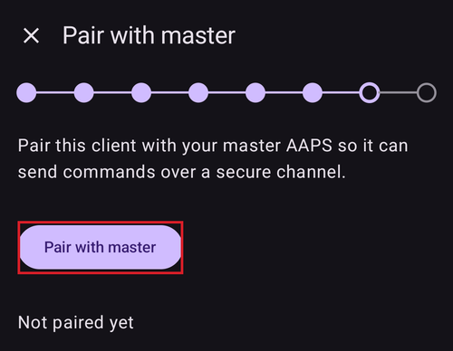
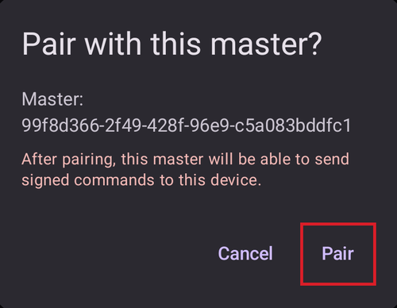
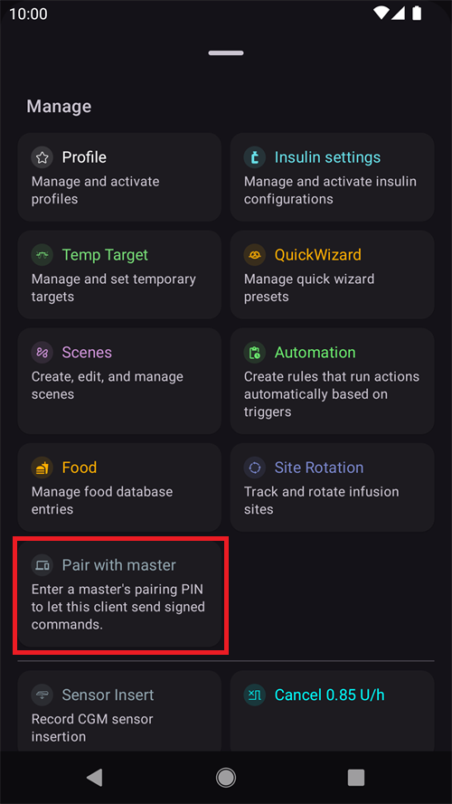

(aapsclient-app)=
# L'aplicació AAPSClient

**AAPSClient** és l'aplicació complementària d'**AAPS**: una aplicació per a un segon telèfon (normalment el d'un cuidador) que **segueix** la persona que fa servir **AAPS**. A partir de la versió 4 d'**AAPS**, el cuidador també pot **controlar** el llaç a distància amb ordres signades. Els dos telèfons es comuniquen a través del vostre lloc de **Nightscout**; no cal cap connexió directa entre els telèfons.

```{admonition} Wording used on this page
:class: note
- **Client** = un telèfon amb **AAPSClient**.
- **Principal** = el telèfon principal amb **AAPS**, que controla la bomba i executa el llaç.
```

```{admonition} Which devices can run AAPSClient?
:class: note
A partir de la versió 4 d'**AAPS**, **AAPSClient** funciona en telèfons i tauletes Android, en rellotges Wear OS i en ordinadors (Windows, Mac i Linux). A l'iPhone no hi ha cap fitxer preparat per descarregar: heu de compilar l'aplicació vosaltres mateixos. Vegeu la [taula de descàrregues per dispositiu](#aapsclient-platforms).
```

```{contents} Table of contents
:depth: 2
:local: true
```

## Què és AAPSClient (i què no és)

**AAPSClient** s'assembla a **AAPS** i funciona de manera semblant, però **no té llaç propi**:

- No conté **cap algoritme APS**, ni **Objectius**, ni **controladors de bomba**: mai no administra insulina pel seu compte.
- Tampoc no inclou els plugins que només fa servir l'aplicació principal (**Comunicador SMS**, **Tidepool**, **Open Humans**).
- El que *sí* conté: la sincronització **NSClientV3**, els plugins d'origen de glucèmia, l'enviament de dades a **xDrip+** i els connectors de **Wear OS** / **Garmin**: tot el que cal per seguir i per transmetre ordres. Un rellotge **Garmin** connectat a un client pot mostrar les dades, però els carbohidrats que envia no s'introdueixen i no pot connectar ni desconnectar la bomba: el client mostra un missatge, i els heu d'introduir a **AAPS**.

Tot el que inicieu des d'**AAPSClient** ho comprova, ho limita, ho confirma i **ho executa el dispositiu principal** (el telèfon amb la bomba). La pàgina [Control principal ↔ client (control remot signat)](ClientMasterControl.md) explica com funciona: com emparellar els dos telèfons, com el dispositiu principal escriu el text de confirmació que veieu, com es lliura un bolus iniciat al client i què passa quan el dispositiu principal està fora de línia.

## Versions: AAPSClient, AAPSClient2 i AAPSClient3

Es poden instal·lar fins a tres aplicacions client una al costat de l'altra al mateix telèfon seguidor, i cadascuna segueix una persona **diferent**: **AAPSClient** (icona de mussol groc), **AAPSClient2** (mussol blau) i, nova a la versió 4 d'**AAPS**, **AAPSClient3** (mussol verd). Funcionen exactament igual. Només canvien el nom i el color (icona de l'aplicació, fons del widget i la secció d'estat de la pantalla d'inici), perquè les pugueu distingir. Cada aplicació s'emparella amb el seu propi dispositiu principal. Vegeu [Sobre AAPSClient, AAPSClient2 i AAPSClient3](#remotecontrol-aapsclient-versions) per a més detalls.

(aapsclient-platforms)=
## Obtenir l'aplicació

Tots els fitxers preparats són a la llista *Assets* de la darrera versió publicada a [GitHub](https://github.com/nightscout/AndroidAPS/releases/) (feu clic a *Assets* a la part inferior de la versió per desplegar-la). A la taula, *x.y.z* és el número de versió. Trieu el fitxer que correspon al vostre dispositiu:

| Device                    | Fitxer per descarregar              | Notes                                                                                                                                                                                                                     |
| ------------------------- | ----------------------------------- | ------------------------------------------------------------------------------------------------------------------------------------------------------------------------------------------------------------------------- |
| Telèfon o tauleta Android | `app-aapsclient-release_x.y.z.apk`  | Instal·leu-lo com l'aplicació principal: vegeu [Descàrrega i instal·lació d'AAPSClient](#RemoteControl_aapsclient) i [Transferir i instal·lar AAPS al vostre telèfon](../SettingUpAaps/TransferringAndInstallingAaps.md). |
| Rellotge Wear OS          | `wear-aapsclient-release_x.y.z.apk` | Va amb l'aplicació AAPSClient del telèfon. Vegeu [Configurar AAPS al vostre rellotge Wear OS](../WearOS/WearOsSmartwatch.md).                                                                                             |
| Ordinador Windows         | `AAPSClient-x.y.z.msi`              | Obriu el fitxer per instal·lar-lo.                                                                                                                                                                                        |
| Mac                       | `AAPSClient-x.y.z.dmg`              | Vegeu la nota sobre macOS sota la taula.                                                                                                                                                                                  |
| Linux (Debian, Ubuntu)    | `aapsclient_x.y.z_amd64.deb`        | Instal·leu-lo amb el vostre gestor de paquets.                                                                                                                                                                            |
| iPhone                    | cap                                 | No hi ha cap versió a l'App Store ni cap descàrrega. Heu de compilar l'aplicació vosaltres mateixos, vegeu [AAPSClient a l'iPhone](#aapsclient-iphone).                                                                   |

**Seguiu dues persones?** Cada fitxer de dalt també existeix com a *aapsclient2* / *AAPSClient2*. És una segona aplicació client que s'instal·la al costat de la primera, perquè un dispositiu pugui seguir dues persones (vegeu [Sobre AAPSClient, AAPSClient2 i AAPSClient3](#remotecontrol-aapsclient-versions)). **AAPSClient3** no és als fitxers de la versió publicada: compileu-la vosaltres mateixos ([variants de compilació](#browserbuild-variant)).

**Fitxers que cal ignorar:** els fitxers *pumpcontrol* (`app-pumpcontrol-release_…`, `wear-pumpcontrol-release_…`) no són un client. No els feu servir.

**Mac: el primer inici.** L'aplicació no està notaritzada per Apple, per això macOS la bloqueja la primera vegada que l'obriu. Feu clic a *Done*, després obriu *System Settings → Privacy & Security*, desplaceu-vos cap avall i feu clic a *Open Anyway* (en català: Fet, Configuració del sistema → Privacitat i seguretat, Obrir igualment).

**Ordinador: com connectar.** Un ordinador no té càmera, per tant no es pot escanejar el codi QR. Configureu **Nightscout** al client, després al dispositiu principal afegiu el client amb un **PIN** i escriviu el PIN de 8 xifres al client (**Emparellar amb el dispositiu principal**). Vegeu [Emparellament amb el dispositiu principal](#aapsclient-pairing-with-the-master).

**La mateixa versió a tot arreu.** El dispositiu principal i tots els seus clients han de tenir la mateixa versió d'**AAPS**. Quan actualitzeu el dispositiu principal, actualitzeu també els clients.

(aapsclient-iphone)=
### AAPSClient a l'iPhone

No hi ha **AAPSClient** a l'App Store ni cap fitxer preparat per descarregar, per tant heu de compilar l'aplicació vosaltres mateixos:

- Necessiteu un Mac amb **Xcode** i un compte de desenvolupador d'Apple.
- El projecte és la carpeta `ios` del [repositori d'AndroidAPS a GitHub](https://github.com/nightscout/AndroidAPS/tree/master/ios).
- Una compilació per a un iPhone real es signa amb el vostre propi equip de desenvolupador d'Apple. Una compilació per al simulador d'iPhone no en necessita.
- Encara no hi ha cap guia pas a pas. Aquesta pàgina s'actualitzarà quan n'hi hagi una.

La versió per a iPhone s'emparella amb el dispositiu principal com les altres. A diferència de les versions per a ordinador, l'iPhone pot escanejar el codi QR del dispositiu principal amb la càmera.

## Primer inici: un assistent de configuració més curt

En el primer inici, **AAPSClient** executa el mateix **Assistent de configuració** que ja coneixeu d'**AAPS**, però amb molts menys passos: en un seguidor no es configura el perfil, la insulina, la bomba, l'APS ni els objectius:

1. **Benvinguts**, **acord de llicència**, **permisos** i **clau mestra**: igual que a l'aplicació principal, vegeu l'[Assistent de configuració d'AAPS](../SettingUpAaps/SetupWizard.md).
2. El client **no** demana les **unitats** ni els **límits baix/alt**: els agafa del telèfon principal tan aviat com està connectat a Nightscout. Els podeu veure més tard a **Configuració**, on una petita **icona de telèfon** indica que estan [sincronitzats amb el telèfon principal](#client-master-config-prefs). Només es poden editar mentre el dispositiu principal és accessible.
3. **Configurar des del dispositiu principal**: al dispositiu principal, obriu **Gestionar → Clients autoritzats**, afegiu aquest telèfon amb un **codi QR** i toqueu **Escanejar el codi QR** aquí. Un sol escaneig configura Nightscout amb un token propi d'aquest telèfon i, amb un codi d'emparellament, també emparella el telèfon. El telèfon també agafa com a nom d'instància el nom amb què es va afegir al dispositiu principal (les lletres amb accent es converteixen en lletres simples: «Miloš» es converteix en «Milos»). **Després de l'escaneig, la configuració s'ha acabat**: l'assistent es tanca, perquè els passos següents només mostrarien el que el codi ja ha fet. Sense codi QR, ometeu aquest pas. (No en un ordinador: no té càmera, vegeu [Obtenir l'aplicació](#aapsclient-platforms).)

   

4. **Comunicació**: la llista de plugins només ofereix el que necessita un seguidor (NSClientV3, xDrip+, Wear, Apps complementàries externes, Garmin). Si no heu escanejat cap codi QR, activeu **NSClientV3** i introduïu la **mateixa URL de Nightscout** que al telèfon principal i un token d'accés, amb els **websockets** activats, exactament com es descriu a [Sincronització](#RemoteControl_aapsclient). Els websockets són **obligatoris** per al control remot des d'**AAPSClient**, als dos telèfons.

   

5. **Emparellar amb el dispositiu principal**: aquest pas existeix **només** al client. Connecta aquest dispositiu amb el dispositiu principal pel canal segur d'ordres, amb el PIN, i agafa el nom amb què es va afegir el telèfon al dispositiu principal, igual que el codi QR. **Després de l'emparellament, la configuració s'ha acabat.** També podeu ometre aquest pas i emparellar més tard en qualsevol moment des de **Gestionar → Emparellar amb el dispositiu principal**.

   

6. **Qui fa servir aquest telèfon?**: només si no heu emparellat a l'assistent; el nom de la persona que fa servir aquest telèfon. Serveix per distingir aquesta instància als informes i a la sincronització.

(aapsclient-pairing-with-the-master)=

## Emparellament amb el dispositiu principal

Al **dispositiu principal**, obriu **Gestionar → Clients autoritzats** i afegiu un client. Hi ha dues maneres d'emparellar:

- **Amb un codi QR** (la més ràpida, si el telèfon té càmera): escanegeu el codi al pas de l'assistent «**Configurar des del dispositiu principal**» o des de **Gestionar → Emparellar amb el dispositiu principal → Escanejar codi QR**, i confirmeu amb «**Utilitzar**». També configura Nightscout.
- **Amb el PIN**: al **client**, obriu el pas de l'assistent d'abans (o **Gestionar → Emparellar amb el dispositiu principal**), escriviu el PIN d'un sol ús que es mostra al dispositiu principal i premeu «**Emparellar**». Després el client mostra en qui confiarà; confirmeu amb «**Emparellar**»:



Des de l'assistent, un emparellament correcte acaba la configuració i obre la pantalla d'inici. Al dispositiu principal, el client apareix com a **Actiu** a la llista [Clients autoritzats](#client_master_master_setup). Després, **Gestionar → Emparellar amb el dispositiu principal** mostra «*Ja emparellat*», el rol del telèfon i si el mode reforçat està activat:

 El procediment complet d'emparellament, els detalls de seguretat i la resolució de problemes són a [Control principal ↔ client (control remot signat)](#client_master_client_setup).

Després de l'emparellament, el client rep del dispositiu principal un token de Nightscout propi (si el dispositiu principal té un token d'administrador), només amb els drets que necessita un client, i deixa de fer servir el token que potser heu introduït. **AAPSClient** mai no escriu tractaments ni glucèmies a Nightscout directament: tot el que fa s'envia al dispositiu principal, que ho escriu. Vegeu [El token de Nightscout propi del client](#client-master-control-own-token).

El dispositiu principal decideix què pot fer aquest telèfon amb el seu **[rol](#client-master-control-roles)** (Només lectura, Àpats, Cuidador o Admin). **Gestionar → Emparellar amb el dispositiu principal** mostra el rol del telèfon.

## La pantalla d'inici

La pantalla d'inici del client mostra el llaç que seguiu:


- **La glucèmia, els gràfics, l'IOB/COB i el perfil** vénen de Nightscout, tal com els ha enviat el dispositiu principal.
- L'**estat del llaç** que es mostra és el **del dispositiu principal** (un client no té llaç propi). Fins que el client no rep de Nightscout el mode de funcionament del dispositiu principal, l'etiqueta del mode de funcionament mostra un **signe d'interrogació** (desconegut).
- La **targeta d'estat** mostra el reservori i la pila **de la bomba seguida** i la bateria del telèfon que envia les dades, agafats de l'estat del dispositiu a Nightscout. Un client no té bomba, per tant no hi ha estat de bomba local ni gestió de la bomba enlloc de l'aplicació.
- La barra inferior ofereix **Tractaments**, **Escenes** i **Gestionar** quan el client està emparellat (abans d'emparellar, només **Gestionar**). No hi ha pestanyes de bomba ni d'objectius.

## Tractaments i accions

Tot el que hi ha a **Gestionar** funciona com a l'aplicació principal, amb una diferència important: en un client, les accions que canviarien la teràpia (bolus, carbohidrats, objectius temporals, escenes…) **estan amagades fins que el dispositiu s'emparella**, i un cop emparellat **s'envien al dispositiu principal** perquè les confirmi i les executi. Vegeu [Fer servir el control remot](#client-master-control).

L'entrada **Perfil** és l'excepció: es mostra fins i tot en un client **no emparellat**, però s'obre **només per consultar**. El client mostra els perfils que rep a través de Nightscout (els necessita per als seus propis càlculs), sense botons per editar o activar. Quan el client està **emparellat**, la llista de perfils se sincronitza amb el dispositiu principal i podeu editar i activar perfils des del client com qualsevol altra acció remota.

En un client **no emparellat**, **Gestionar** només ofereix **Perfil** i **Emparellar amb el dispositiu principal**:


El bàner vermell «*Dispositiu principal inaccessible. L'edició està desactivada fins que es restableixi la connexió.*» també apareix en un client no emparellat. És normal: encara no hi ha cap dispositiu principal per connectar-s'hi. El bàner desapareix quan el client està emparellat i el dispositiu principal està en línia.

Quan el client està emparellat, apareixen les accions de teràpia:



**No hi ha cap entrada Bomba**: un client no té bomba.

Si el dispositiu principal no és accessible, el mateix bàner apareix en un client emparellat: les accions de teràpia es mostren en gris, i tot el que proveu es bloqueja abans d'enviar-se. El client detecta que el dispositiu principal està fora de línia quan proveu una acció, i torna a activar les accions quan el dispositiu principal torna a estar en línia.


## Configuració sincronitzada amb el dispositiu principal

La **configuració** dels plugins actius i moltes **preferències** es mantenen sincronitzades entre el dispositiu principal i els seus clients emparellats. Els elements sincronitzats es marquen amb una petita **icona de telèfon** i estan desactivats (amb un bàner «*Dispositiu principal inaccessible*») mentre no es pot accedir al dispositiu principal. Això es descriu a [Canviar la configuració i les preferències](#client-master-config-prefs).

## AAPSClient en un rellotge intel·ligent

Un rellotge Wear OS es pot emparellar amb el telèfon **client**; les seves accions passen pel client fins al dispositiu principal. Vegeu [Wear OS](../WearOS/WearOsSmartwatch.md) i les [opcions de rellotge intel·ligent a Control remot](#RemoteControl_smartwatches).
