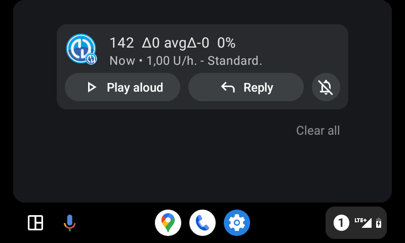
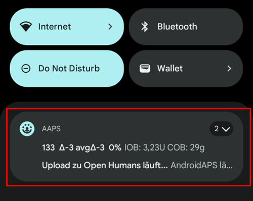
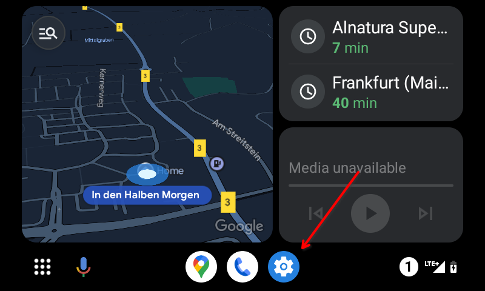
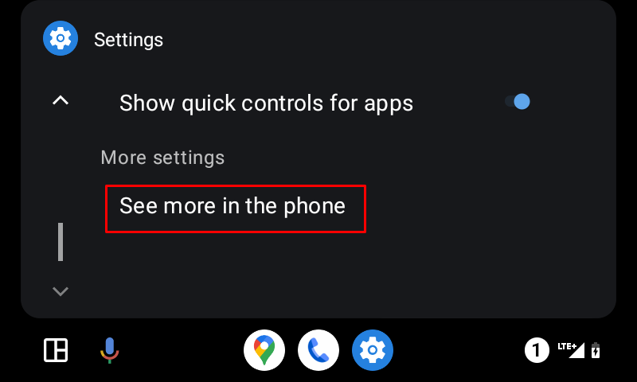
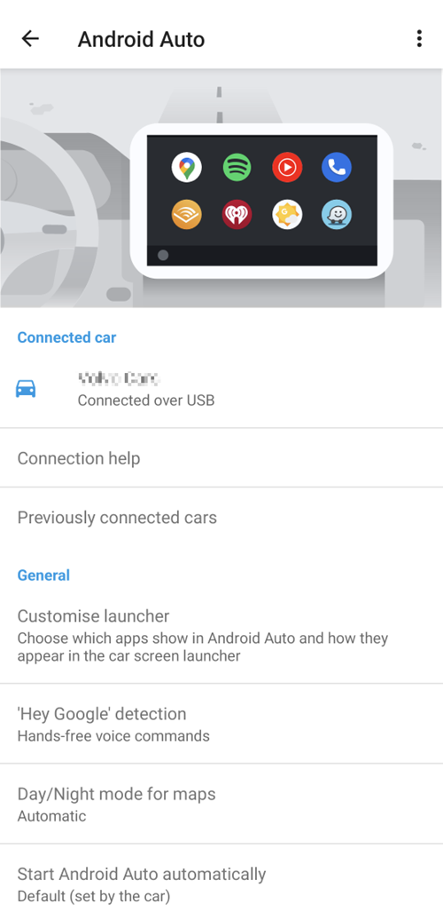
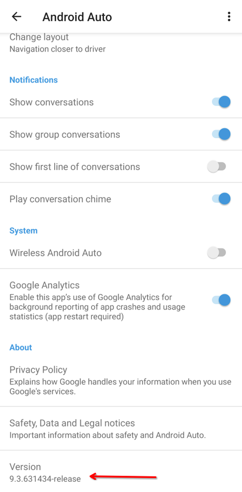
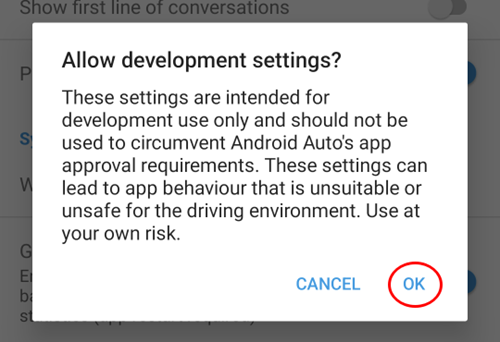
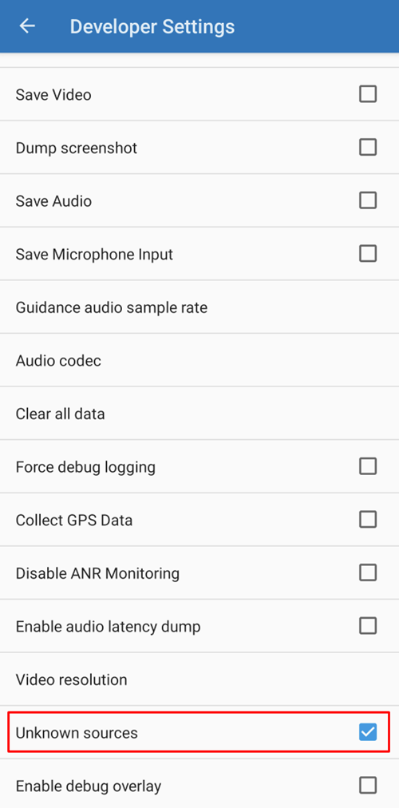
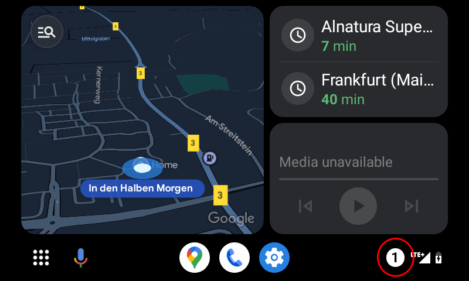

# Android Auto

**AAPS** us pot enviar informació sobre el vostre estat actual com a missatge, directament a Android Auto al vostre cotxe.

## Requisits

**AAPS** uses a feature of Android Auto which allows messages from apps on the mobile to be routed to the display of the car audio system.

Això vol dir que:

* Android must allow **AAPS** to show notifications and
* Com que **AAPS** no és una aplicació oficial, permeteu l'ús de «fonts desconegudes» a Android Auto.

(androidauto-check-that-aaps-can-show-notifications)=

## Check that AAPS can show notifications

**AAPS** always shows a status notification with your current glucose, IOB and COB. This is the notification that Android Auto displays in the car. There is nothing to switch on in **AAPS**, but Android must allow **AAPS** to show notifications.

On your phone, open **Settings** > **Apps** > **AAPS** > **Notifications** and make sure **All AAPS notifications** is on.

Scroll down and make sure **Ongoing status** is on: this is the channel of the status notification.

Please check now that you see the **AAPS** status notification on the phone before you walk to your car!

(androidauto-allow-the-use-of-unknown-sources-with-android-auto)=

## Permetre l'ús de «fonts desconegudes» a Android Auto.

Com que **AAPS** no és una aplicació oficial d'Android Auto, cal activar les notificacions per a «fonts desconegudes» a Android Auto. Això es fa amb el mode de desenvolupador, que us mostrem aquí.

Go to your car and connect your mobile with the car's audio system.

Ara hauríeu de veure una pantalla semblant a aquesta.

Premeu la icona de **configuració** per començar la configuració.

Desplaceu-vos fins al final de la pàgina i seleccioneu **Mostra'n més al telèfon** (see more in the phone).

Ara activarem el mode de desenvolupador al telèfon.

La primera pantalla és així. Desplaceu-vos fins al final de la pàgina.

Allà veureu la versió d'Android Auto. Toqueu 10 vegades (en lletres: deu) la versió d'Android Auto. Amb aquesta combinació amagada, ja heu activat el mode de desenvolupador.

Confirmeu que voleu activar el mode de desenvolupador al diàleg «Vols permetre la configuració de desenvolupament?» (Allow development settings?).

A la **configuració per a desenvolupadors**, activeu «Fonts desconegudes» (Unknown sources).

Ara podeu sortir del mode de desenvolupador si voleu. Per fer-ho, toqueu el menú de tres punts a la part superior dreta.

## Mostrar les notificacions al cotxe

Toqueu la **icona del número** a la part inferior dreta d'Android Auto al vostre cotxe.

Les vostres dades del CGM es mostraran així:

(android-auto-troubleshooting)=

## Resolució de problemes:

* If you don't see the notification, check if you [allowed AAPS to show notifications](#androidauto-check-that-aaps-can-show-notifications) in Android and if [Android Auto has access rights to notifications](#androidauto-allow-the-use-of-unknown-sources-with-android-auto).