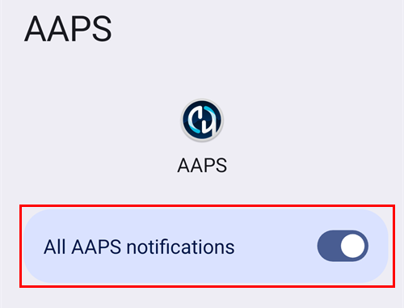
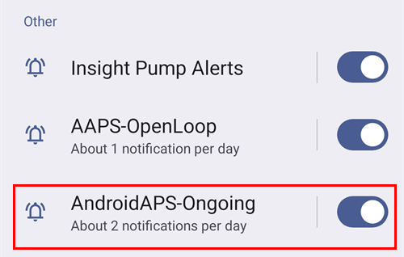

# Android Auto

**AAPS** us pot enviar informació sobre el vostre estat actual com a missatge, directament a Android Auto al vostre cotxe.

## Requisits

**AAPS** fa servir una funció d'Android Auto que permet enviar els missatges de les aplicacions del telèfon a la pantalla del sistema d'àudio del cotxe.

Això vol dir que:

* Android ha de permetre que **AAPS** mostri notificacions i
* Com que **AAPS** no és una aplicació oficial, permeteu l'ús de «fonts desconegudes» a Android Auto.

(androidauto-check-that-aaps-can-show-notifications)=

## Comproveu que AAPS pot mostrar notificacions

**AAPS** sempre mostra una notificació d'estat amb la glucèmia actual, l'IOB i el COB. Aquesta és la notificació que Android Auto mostra al cotxe. No cal activar res a **AAPS**, però Android ha de permetre que **AAPS** mostri notificacions.

Al telèfon, obriu **Configuració** > **Aplicacions** > **AAPS** > **Notificacions** i comproveu que **Totes les notificacions d'AAPS** (All AAPS notifications) està activat.

Desplaceu-vos cap avall i comproveu que **Estat en curs** està activat: és el canal de la notificació d'estat.

Comproveu ara que veieu la notificació d'estat d'**AAPS** al telèfon abans d'anar al cotxe!

(androidauto-allow-the-use-of-unknown-sources-with-android-auto)=

## Permetre l'ús de «fonts desconegudes» a Android Auto.

Com que **AAPS** no és una aplicació oficial d'Android Auto, cal activar les notificacions per a «fonts desconegudes» a Android Auto. Això es fa amb el mode de desenvolupador, que us mostrem aquí.

Aneu al cotxe i connecteu el telèfon al sistema d'àudio del cotxe.

Ara hauríeu de veure una pantalla semblant a aquesta.

Premeu la icona de **configuració** per començar la configuració.

Desplaceu-vos fins al final de la pàgina i seleccioneu **Mostra'n més al telèfon** (see more in the phone).

Ara activarem el mode de desenvolupador al telèfon.

La primera pantalla és així. Desplaceu-vos fins al final de la pàgina.

Allà veureu la versió d'Android Auto. Toqueu 10 vegades (en lletres: deu) la versió d'Android Auto. Amb aquesta combinació amagada, ja heu activat el mode de desenvolupador.

Confirmeu que voleu activar el mode de desenvolupador al diàleg «Vols permetre la configuració de desenvolupament?» (Allow development settings?).

A la **configuració per a desenvolupadors**, activeu «Fonts desconegudes» (Unknown sources).

Ara podeu sortir del mode de desenvolupador si voleu. Per fer-ho, toqueu el menú de tres punts a la part superior dreta.

## Mostrar les notificacions al cotxe

Toqueu la **icona del número** a la part inferior dreta d'Android Auto al vostre cotxe.

Les vostres dades del CGM es mostraran així:

(android-auto-troubleshooting)=

## Resolució de problemes:

* Si no veieu la notificació, comproveu si heu [permès que AAPS mostri notificacions](#androidauto-check-that-aaps-can-show-notifications) a Android i si [Android Auto té permís per accedir a les notificacions](#androidauto-allow-the-use-of-unknown-sources-with-android-auto).