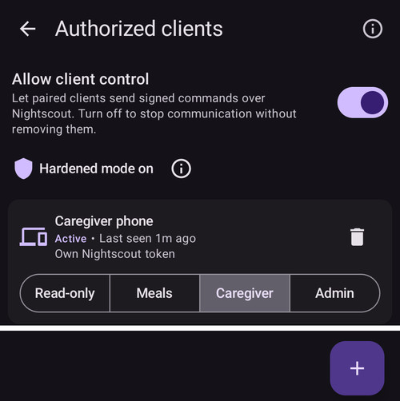
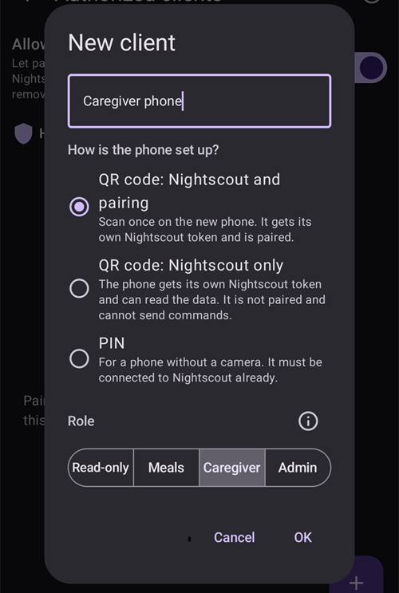
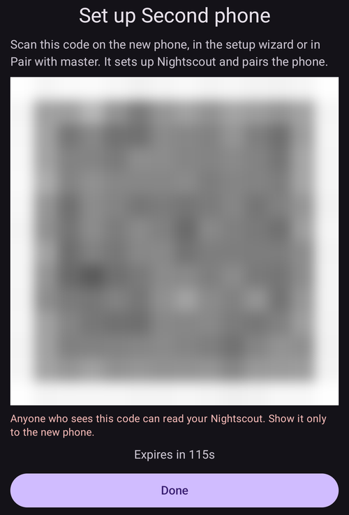
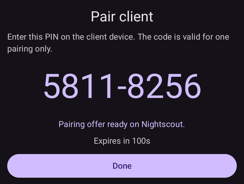
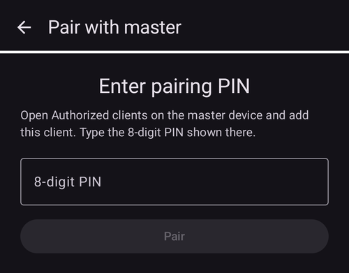
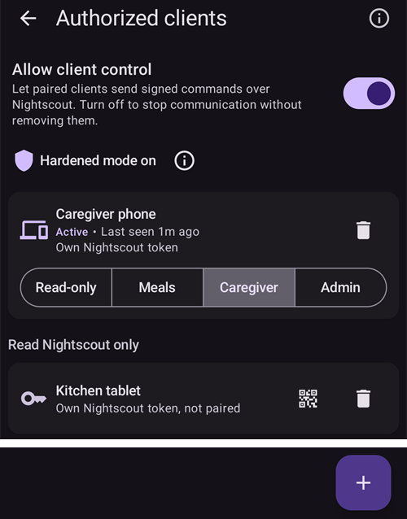
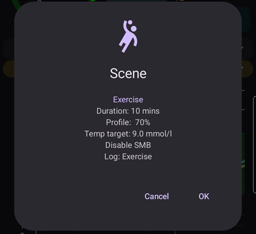
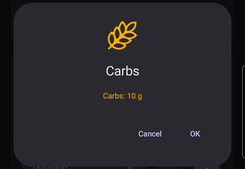
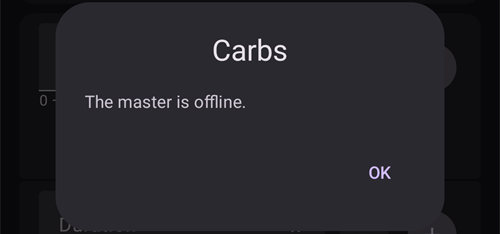
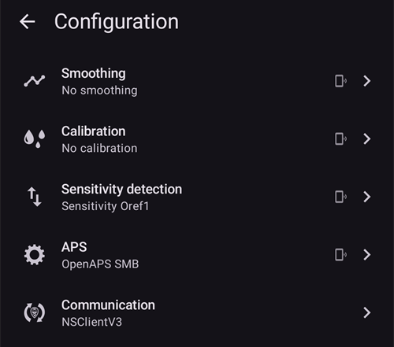

(client-master-control)=
# Control principal ↔ client (control remot signat)

A partir de la versió 4 d'**AAPS**, un telèfon seguidor amb **AAPSClient** pot fer molt més que *anunciar* tractaments a través de Nightscout: un cop **emparellat** amb el telèfon principal, pot enviar **ordres signades** que el telèfon principal (el **dispositiu principal**) comprova, confirma i executa, fins i tot el lliurament d'un **bolus d'insulina** amb la bomba del dispositiu principal.

Aquesta pàgina explica com funciona, com configurar-ho i com fer-ho servir.

```{contents} Table of contents
:depth: 2
:local: true
```

```{admonition} Wording used on this page
:class: note
- **Principal** = el telèfon **AAPS** principal, que té la bomba i executa el llaç (l'aplicació `full`).
- **Client** = un telèfon amb **AAPSClient**, sense bomba, que segueix el dispositiu principal i ara també el *controla*.
- Els dos telèfons han d'estar connectats al **mateix** lloc de Nightscout. Tota la comunicació continua passant per Nightscout: no cal cap connexió directa entre els telèfons.
```

---

## Com funciona

```{admonition} Coming from AAPS v3?
:class: note
A **AAPS** v3, **AAPSClient** només podia escriure a Nightscout tractaments del portal de cures sense signar, i no podia lliurar bolus. Ara el control remot necessita un [emparellament](#client_master_master_setup) que es fa una sola vegada. Vegeu també [Què ha canviat a AAPS v4](#v4changes-remote-control).
```

**AAPS** v4 fa servir un canal propi de **control des de clients** (Client-Control). Continua passant pel vostre lloc de Nightscout (a la col·lecció `settings`), però cada missatge està **signat criptogràficament** amb un secret que només coneixen els dos telèfons. El secret es passa una sola vegada, durant l'**emparellament**, i just després se substitueix per un de nou, de manera que mai no viatja en text clar.

El principi bàsic és que **el dispositiu principal mana**:

1. El client envia una *intenció* («bolus de 2 U», «iniciar l'escena Esport», «establir aquest objectiu temporal»…).
2. El **dispositiu principal** torna a calcular l'acció i la **limita** segons les seves **pròpies** dades actuals (perfil, IOB, COB, objectiu temporal actual, bomba), i **redacta la confirmació exacta** que veurà l'usuari.
3. El client (o el rellotge) mostra el text de confirmació del **dispositiu principal**: mai no en crea un de propi.
4. Quan es confirma, el dispositiu principal **l'executa una sola vegada** i envia el resultat al client.

Què vol dir això per a vosaltres:

- **Ordres signades**: només els clients que heu emparellat poden enviar ordres (secret d'emparellament i signatura per a cada client). Les ordres antigues o repetides es rebutgen.
- **Un rol per a cada client**: decidiu què pot fer cada client, des de *Només lectura* fins a *Admin*. Vegeu [Rols dels clients](#client-master-control-roles).
- **Bolus d'insulina des d'un client**: el dispositiu principal el lliura amb la seva bomba, i el client mostra el progrés del lliurament.
- **El dispositiu principal decideix**: limita cada acció segons les seves pròpies restriccions i escriu la confirmació que es mostra al client.
- **Només els clients emparellats canvien la teràpia**: mentre el control des dels clients està activat, el dispositiu principal ja no accepta tractaments ni canvis escrits directament a Nightscout. Vegeu [Mode reforçat](#client-master-control-hardened-mode).
- **Cada client té el seu propi token de Nightscout**, només amb els permisos que necessita un client. Vegeu [El token de Nightscout propi del client](#client-master-control-own-token).
- **Dispositiu principal fora de línia**: les accions es bloquegen amb un missatge clar.
- **Revocar un client** només demana un toc (per a cada client), o podeu fer servir l'interruptor del dispositiu principal per aturar tots els clients.

Accions que es poden fer des d'un client: **bolus**, **carbohidrats / e-carbs**, **objectiu temporal** (establir i cancel·lar), **canvi de perfil**, canvi de **llaç / mode de funcionament**, **basal temporal** (establir i cancel·lar), **bolus estès** (establir i cancel·lar), **selecció de la insulina** i **[escenes](../DailyLifeWithAaps/Scenes.md)**. Una part de la **configuració** bidireccional també es manté sincronitzada entre el dispositiu principal i els clients.

---

## Rols i requisits previs

```{admonition} Before you start
:class: important
- El **dispositiu principal** fa servir la compilació **AAPS** normal `full` i està connectat a la vostra bomba.
- El **dispositiu principal** fa servir **NSClientV3** amb el vostre Nightscout i mostra *connectat*. Doneu-li un **token d'administrador** del vostre Nightscout: amb aquest token, el dispositiu principal pot crear un token propi per a cada client i mostrar-lo al client com a codi QR.
- El **client** fa servir **[AAPSClient](AapsClient.md)** (o **AAPSClient2** / **AAPSClient3** per a altres pacients; vegeu [Sobre AAPSClient, AAPSClient2 i AAPSClient3](#remotecontrol-aapsclient-versions)). Ha de fer servir el **mateix** Nightscout. Si el configureu amb el codi QR del dispositiu principal, el client rep del dispositiu principal l'adreça i el token de Nightscout; si no, configureu-hi primer **NSClientV3** vosaltres mateixos.
- Els websockets són **obligatoris** per al control remot des d'**AAPSClient**, als dos telèfons. Una ordre només és vàlida durant uns segons: sense websockets falla en lloc d'arribar tard. Mentre el control des dels clients està activat, **AAPS** manté els websockets activats, al dispositiu principal i als clients emparellats. El vostre proveïdor de Nightscout ha de permetre websockets.
```

L'emparellament i la sincronització són dues coses diferents:

- La **sincronització** (dades: glucèmia, tractaments, perfil) es configura com abans. Vegeu [Sincronització](#RemoteControl_aapsclient). El codi QR del dispositiu principal ho pot fer per vosaltres al client.
- L'**emparellament** (control: el canal d'ordres signades que es descriu aquí) és el pas nou que es descriu a continuació.

---

## Configuració

(client_master_master_setup)=
### 1. Al dispositiu principal: activar el control i afegir un client

Al dispositiu principal, obriu la pantalla **Gestionar** i trieu **Clients autoritzats**.

Activeu **Permetre el control des dels clients** (per defecte està **desactivat**). Aquest és l'interruptor general: si està desactivat, cap client no pot enviar ordres, però els clients emparellats es conserven i el podeu tornar a activar més tard. En activar-lo també s'activa el [mode reforçat](#client-master-control-hardened-mode), que es mostra com a «*Mode reforçat activat*» amb una **(i)** que l'explica. En [Mode simple](#preferences-simple-mode), el control des dels clients sempre està activat, per això l'interruptor no es mostra.



Premeu el botó **+** (a baix a la dreta) per afegir un client. Al diàleg **Client nou**:

1. Introduïu un **nom del dispositiu** per poder-lo reconèixer a la llista.
2. Trieu **com es configura el telèfon** (vegeu la taula de sota).
3. Trieu-ne el **[rol](#client-master-control-roles)**. No hi ha res seleccionat per defecte: el rol correcte depèn de qui fa servir el telèfon.



| Manera                                  | Què rep el telèfon nou                                                                          | Feu-la servir quan                                                                                            |
| --------------------------------------- | ----------------------------------------------------------------------------------------------- | ------------------------------------------------------------------------------------------------------------- |
| **Codi QR: Nightscout i emparellament** | l'adreça de Nightscout, el seu propi token de Nightscout i l'emparellament, amb un sol escaneig | el telèfon nou té càmera: és la manera més ràpida, no cal escriure res                                        |
| **Codi QR: només Nightscout**           | l'adreça de Nightscout i el seu propi token de Nightscout, sense emparellament                  | el telèfon només ha de **mostrar** dades i mai no ha d'enviar ordres                                          |
| **PIN**                                 | només l'emparellament; conserva la configuració de Nightscout que ja té                         | el telèfon no té càmera (o el dispositiu principal no pot crear tokens); ja ha d'estar connectat a Nightscout |

Les dues maneres amb codi QR necessiten un **token d'administrador** a la configuració de **NSClientV3** del dispositiu principal, perquè el dispositiu principal crea el token del client a Nightscout. Sense aquest token, les opcions de codi QR es mostren però no es poden triar, i el diàleg n'explica el motiu; el **PIN** sempre funciona.

#### Amb un codi QR

Premeu **OK**: el dispositiu principal crea el token de Nightscout del client i mostra un **codi QR**. Un codi que també emparella funciona durant uns **dos minuts**; la pantalla fa un compte enrere i es tanca sola quan el client s'ha emparellat. Escanegeu-lo al telèfon nou tal com es descriu a [Al client](#client_master_client_setup).

```{admonition} The QR code is a secret
:class: warning
Qualsevol persona que vegi el codi QR pot llegir el vostre Nightscout, i un codi que emparella també porta l'emparellament. Mostreu-lo només al telèfon nou. **AAPS** bloqueja les captures de pantalla mentre el codi és a la pantalla.
```



#### Amb un PIN

Premeu **OK**: el dispositiu principal mostra un **PIN d'emparellament** de 8 xifres, en dos grups de quatre (per exemple `1234 5678`). Aquest PIN és **d'un sol ús** i **caduca al cap d'uns dos minuts**. Igual que amb el codi QR, el dispositiu principal rebutja un nom de client que ja és a la seva llista: cada client rep el seu propi token de Nightscout amb el seu nom.



```{admonition} The pairing PIN is a secret
:class: warning
El PIN protegeix el secret d'emparellament que s'intercanvia a través de Nightscout. Compartiu-lo només amb el dispositiu que esteu emparellant, no el publiqueu i deixeu que caduqui si no el feu servir. Sempre podeu generar un PIN nou prement **+** una altra vegada.
```

(client_master_client_setup)=
### 2. Al client: emparellar amb el dispositiu principal

#### Escanejar el codi QR

Podeu escanejar el codi QR del dispositiu principal en dos llocs:

- a l'**Assistent de configuració** del client, al pas «**Configurar des del dispositiu principal**», que ve abans del pas de Nightscout. Llavors un sol escaneig configura Nightscout i, amb un codi que emparella, també l'emparellament, de manera que la configuració s'ha acabat: l'assistent es tanca i s'obre la pantalla d'inici;
- en qualsevol moment més tard, des de **Gestionar → Emparellar amb el dispositiu principal → Escanejar codi QR**.

La primera vegada, **AAPSClient** demana el permís de la **càmera**. Si el rebutgeu, la pantalla diu que cal la càmera, i la podeu permetre amb **Tornar-ho a provar** o bé emparellar amb el PIN.

Apunteu la càmera al codi. El client mostra què fa el codi (l'adreça de Nightscout i, per a un codi que emparella, el dispositiu principal amb què s'emparella) i pregunta «**Fer servir aquest codi?**». Premeu **Utilitzar**: el client activa **NSClientV3**, substitueix la seva adreça i el seu token de Nightscout pels del codi i activa els websockets. Un codi que emparella també emparella el telèfon; aquest saluda el dispositiu principal tan bon punt s'ha connectat a Nightscout.


```{admonition} Scanning is available on Android
:class: note
En un ordinador sense càmera, feu servir el PIN.
```

#### Introduir el PIN

Al client, obriu **Gestionar → Emparellar amb el dispositiu principal** (o el pas de l'assistent **Emparellar amb el dispositiu principal**, després del pas de Nightscout), **introduïu el PIN de 8 xifres** que es mostra al dispositiu principal i premeu **Emparellar**. El client fa servir el PIN per obtenir de manera segura l'oferta d'emparellament a través de Nightscout, i després pregunta «**Emparellar amb aquest dispositiu principal?**» i mostra l'identificador del dispositiu principal. Premeu **Emparellar** per confirmar (vegeu [Emparellament amb el dispositiu principal](#aapsclient-pairing-with-the-master) per veure'n una captura de pantalla).



#### Després de l'emparellament

Un cop emparellat, el client envia una salutació (**Hello**) al dispositiu principal i apareix a la llista **Clients autoritzats** del dispositiu principal com a **Actiu**, amb l'hora de la *«darrera connexió»*. El client coneix el seu [rol](#client-master-control-roles) gràcies a l'emparellament, per això mostra de seguida els botons correctes. Un emparellament fet a l'Assistent de configuració acaba l'assistent. En el mateix pas, els dos telèfons substitueixen el secret d'emparellament per un de nou que mai no ha viatjat (vegeu [Notes de seguretat](#client-master-control-security)), i un client configurat amb el PIN rep el seu propi token de Nightscout (vegeu [El token de Nightscout propi del client](#client-master-control-own-token)). Un client només es pot emparellar amb **un** dispositiu principal alhora; per emparellar-lo amb un altre dispositiu principal, primer premeu **Desemparellar**.


### 3. Gestionar els clients

Des de la pantalla **Clients autoritzats** del dispositiu principal podeu, en qualsevol moment:

- **Canviar el rol** d'un client amb la fila de quatre botons que hi ha sota el seu nom. El rol nou s'aplica de seguida, sense tornar a emparellar.
- **Veure amb quin token de Nightscout** escriu un client: «*Token de Nightscout propi*» és el que voleu. Una línia vermella «*Fa servir el token de Nightscout …, que té més permisos dels que necessita un client*» vol dir que el client encara fa servir un token amb més permisos, normalment el vostre token d'administrador. Vegeu [El token de Nightscout propi del client](#client-master-control-own-token).
- **Revocar** un sol client: premeu la icona de la **paperera** que hi ha al costat. El client ja no pot enviar ordres fins que no es torni a emparellar. També s'elimina el seu token de Nightscout propi, de manera que tampoc no pot llegir el vostre Nightscout.
- **Aturar tot el control** sense perdre els emparellaments: desactiveu **Permetre el control des dels clients**.

Els telèfons configurats amb **Codi QR: només Nightscout** apareixen sota els clients, a «**Només lectura de Nightscout**». Per a cadascun podeu tornar a mostrar el codi QR (per configurar de nou el mateix telèfon) o eliminar-ne el token, cosa que li treu l'accés al vostre Nightscout.



---

(client-master-control-roles)=
## Rols dels clients

Cada client emparellat té un **rol**. El dispositiu principal el comprova en cada ordre, i el client només mostra el que permet el seu rol. Un rol nou s'aplica de seguida, sense tornar a emparellar. Els rols es basen els uns en els altres: cadascun pot fer tot el que pot fer l'anterior.

| Rol               | El client pot                                                                                                                                                                                                                                                                  |
| ----------------- | ------------------------------------------------------------------------------------------------------------------------------------------------------------------------------------------------------------------------------------------------------------------------------ |
| **Només lectura** | només mostrar dades. Continua emparellat, així que està preparat quan li doneu un rol superior.                                                                                                                                                                                |
| **Àpats**         | fer un bolus, fer servir la calculadora de bolus i l'assistent ràpid, introduir carbohidrats i aturar un bolus en curs. Els carbohidrats introduïts aquí poden fer que el llaç doni més insulina.                                                                              |
| **Cuidador**      | fer tot el que fa un usuari a **AAPS**: objectius temporals, canvis de perfil i d'insulina, mode del llaç, basal temporal, bolus estès, escenes, esdeveniments del portal de cures, calibracions i eliminació de registres. No pot canviar la configuració ni els predefinits. |
| **Admin**         | fer-ho tot, també la configuració i els predefinits (assistent ràpid, objectius temporals predefinits, escenes, perfils, automatització, insulina).                                                                                                                            |

La **(i)** a la part superior de la pantalla **Clients autoritzats** mostra la mateixa explicació. Al client, **Gestionar → Emparellar amb el dispositiu principal** mostra el rol del mateix telèfon.

---

(client-master-control-hardened-mode)=
## Mode reforçat

Quan **Permetre el control des dels clients** està activat, el dispositiu principal és en **mode reforçat**: només accepta canvis dels clients emparellats. **No** accepta tractaments, objectius temporals, canvis de perfil, canvis de mode de funcionament ni eliminacions fets directament a Nightscout, per exemple al web de Nightscout o en altres aplicacions.

- Les opcions per acceptar dades de Nightscout (**NSClientV3 → Sincronització**) s'amaguen mentre el mode reforçat està activat; **AAPS** les fa servir com si estiguessin desactivades.
- El dispositiu principal continua **enviant** totes les seves dades a Nightscout, també la glucèmia, i manté els **websockets** activats.
- Si el dispositiu principal obté la **glucèmia de Nightscout**, la continua agafant d'allà.
- Per carregar l'historial en un dispositiu principal **nou**, feu servir **Sincronització completa** a **NSClientV3**: agafa tot el que hi ha a Nightscout, també els perfils.
- Les [ordres SMS](SMSCommands.md) no es veuen afectades.

Un client emparellat segueix el mode reforçat del dispositiu principal: manté els websockets activats, i també s'hi amaguen les mateixes opcions de Nightscout. Un client no emparellat conserva la seva pròpia configuració.

El [Mode simple](#preferences-simple-mode) sempre activa el mode reforçat. Per desactivar-lo, sortiu del mode simple i desactiveu **Permetre el control des dels clients** al dispositiu principal.

```{admonition} Why hardened mode
:class: note
Tot el que envia un client emparellat està signat, i el dispositiu principal ho comprova i ho confirma. Un tractament escrit al web de Nightscout no ho està: qualsevol persona amb permís d'escriptura al vostre Nightscout el podria afegir. En mode reforçat, només les ordres signades poden canviar el que fa el dispositiu principal.
```

---

(client-master-control-own-token)=
## El token de Nightscout propi del client

Un client no necessita un token d'administrador. Només llegeix el vostre Nightscout i hi envia les seves ordres per al dispositiu principal; ell mateix no hi envia res més. Per això el dispositiu principal dona a cada client un token de Nightscout propi, només amb aquests permisos:

- llegir-ho tot,
- escriure a la col·lecció `settings`, el canal cap al dispositiu principal,
- postposar les alarmes de Nightscout.

El token pertany a un rol de Nightscout anomenat **`aaps-client`**, que el dispositiu principal crea la primera vegada que el necessita. Podeu veure el rol i els tokens (anomenats `aaps-` més el nom del client) a **Admin tools** del vostre lloc de Nightscout. Si s'hi canvia el rol, el dispositiu principal el restableix la propera vegada que crea un token o que obriu **Clients autoritzats**.

Com rep el seu token un client:

- **Configurat amb un codi QR**: el token és dins del codi.
- **Emparellat amb el PIN** (o emparellat abans que existís aquesta funció): després de l'emparellament, el dispositiu principal envia al client el seu token propi pel canal emparellat, encriptat. Primer el client comprova que s'hi pot iniciar sessió, i després el fa servir en lloc del token que tenia. Això necessita un token d'administrador al dispositiu principal; sense aquest token, el client conserva el seu token, i la seva targeta al dispositiu principal mostra la línia vermella.

**Un client conserva el seu token propi.** Quan el dispositiu principal ha vist que un client escriu amb el seu token propi, només accepta les ordres d'aquest client amb aquest token. Una ordre escrita amb un altre token (per exemple un token d'administrador introduït més tard al client, o el token d'un altre client) es rebutja, encara que el client estigui emparellat, i el client diu «*El telèfon principal ho ha rebutjat: aquest telèfon escriu a Nightscout amb un token diferent del seu*». La seva targeta al dispositiu principal també ho indica en vermell. El client continua apareixent en línia, perquè pugueu veure què passa. Per solucionar-ho, elimineu el client al dispositiu principal i torneu-lo a afegir.

El dispositiu principal mai no elimina ni canvia un token de Nightscout que no ha creat ell (un token amb rols diferents d'`aaps-client`): aquests tokens són vostres. Elimina el token propi d'un client quan elimineu el client.

---

## Fer servir el control remot

### Fer una acció des del client

Feu servir el client exactament com faríeu servir el mateix telèfon: obriu **Carbs**, **Insulina**, **Objectiu temporal**, **Perfil**, **Escenes**, el full **Gestionar**, etc., i ompliu els valors.

Quan confirmeu, el client mostra un moment **«Contactant amb el telèfon principal…»**, el **dispositiu principal** calcula i limita l'acció, i després el client mostra la **confirmació del mateix dispositiu principal**: les mateixes línies, valors i colors que el dispositiu principal mostraria a la seva pantalla. Reviseu-les i premeu **OK** per continuar.



El mateix passa amb una simple entrada de carbohidrats: la quantitat que es mostra per confirmar és la que ha calculat el dispositiu principal:



Després de confirmar, el dispositiu principal executa l'acció una sola vegada i el resultat es mostra al client.

### Bolus d'insulina des d'un client

Aquesta és la funció nova principal de la v4. Un bolus iniciat en un client **el lliura el dispositiu principal amb la seva bomba**; el dispositiu principal el limita segons les seves pròpies restriccions, i el client mostra el **progrés del lliurament en directe** mentre dura (i una alarma si la bomba informa d'un error).

```{admonition} Boluses are always confirmed and capped on the master
:class: note
Un client mai no decideix tot sol la quantitat lliurada. El dispositiu principal la torna a calcular i la limita, vosaltres confirmeu la quantitat redactada pel dispositiu principal, i només llavors es lliura.
```

(clientmastercontrol-when-the-master-is-offline)=
### Quan el dispositiu principal està fora de línia

Si no es pot contactar amb el dispositiu principal (el telèfon està apagat o en repòs, no està connectat a Nightscout o els websockets no funcionen), les accions de control al client **es bloquegen abans d'enviar res**, i rebeu un missatge clar. No s'aplica res a mitges.



El client torna a comprovar automàticament si pot contactar amb el dispositiu principal i torna a activar el control quan el dispositiu principal torna a estar en línia.

(clientmastercontrol-wear-os-on-a-client)=

### Wear OS (rellotge) en un client

Un rellotge emparellat amb un telèfon **client** passa les seves accions al dispositiu principal a través del client (rellotge → client → dispositiu principal). El rellotge mostra les línies de confirmació del **dispositiu principal** i el resultat real, igual que el telèfon. La configuració del rellotge no canvia. Vegeu [Configurar AAPS al vostre rellotge Wear OS](../WearOS/WearOsSmartwatch.md).


<!-- 📷 SCREENSHOT NEEDED (optional): watch confirmation screen relayed from the master,
     and/or the "Contacting master" state on the watch. Requires a paired Wear OS device. -->

---

(client-master-config-prefs)=
## Canviar el configurador i la configuració

L'emparellament fa més que passar accions puntuals: també manté alineats el **configurador** i moltes **opcions de configuració** entre el dispositiu principal i els seus clients.

### Configurador (quins plugins estan actius)

Els **plugins** actius (algoritme APS, sensibilitat, suavitzat, …) es trien al **dispositiu principal** i es **copien** a cada client emparellat. En un client, aquestes seleccions porten una petita **icona de mòbil** a la pantalla [Configurador](#configuration_sync_icon): canvieu-les al dispositiu principal i els clients les segueixen automàticament, i a l'inrevés.

En un client, la icona de mòbil apareix a *Suavitzat*, *Calibració*, *Detecció de sensibilitat* i *APS* (sincronitzats des del dispositiu principal), però no a *Comunicació*:



Les dades de connexió pròpies de cada dispositiu (sobretot l'**URL de Nightscout / el token d'accés de NSClient**) *no* es sincronitzen. Cada telèfon té les seves; en un client provenen del codi QR del dispositiu principal, o les configureu vosaltres.

### Perfils

La vostra **llista de perfils** també es manté sincronitzada entre el dispositiu principal i els seus clients emparellats. En un client emparellat, **Gestionar → Perfil** mostra els mateixos perfils que el dispositiu principal; podeu **editar** un perfil o **activar-ne** un i, com qualsevol altra ordre, el canvi s'envia al **dispositiu principal**, s'hi aplica i es torna a sincronitzar.

La primera vegada que activeu un perfil en un client acabat d'instal·lar, és possible que el client mostri «*Encara no hi ha cap insulina en ús*» i us demani que **seleccioneu la insulina**. Trieu la insulina que està activa al dispositiu principal (**Gestionar → Configuració d'insulina** al dispositiu principal la mostra).

En un client **no emparellat**, la pantalla Perfil continua disponible, però **només de lectura**: el client mostra els perfils que rep a través de Nightscout (els necessita per als seus propis càlculs), però no hi ha cap botó per editar ni activar: no hi ha cap dispositiu principal a qui enviar el canvi.

### Configuració

Una part de les **opcions de configuració** és **bidireccional**: les podeu canviar al **dispositiu principal o en un client emparellat**, i el canvi se sincronitza a l'altra banda. Quan canvieu una d'aquestes opcions en un client, s'envia al dispositiu principal pel canal signat, s'hi aplica i es torna el valor que compta, de manera que el que veieu al client sempre és el que ha desat el dispositiu principal. Si la mateixa opció es canvia en dos dispositius gairebé alhora, **guanya el canvi més recent**. En una opció amb un control lliscant, el valor nou s'envia quan aixequeu el dit.

Dins de la configuració, la mateixa petita **icona de mòbil** marca les opcions concretes que se sincronitzen. En l'exemple de sota, *Límit d'absorció* se sincronitza (icona de mòbil), mentre que les opcions sense la icona són locals del dispositiu:


```{admonition} The master must be online to change synced settings from a client
:class: note
Com que el dispositiu principal és qui mana sobre el valor desat, per editar des d'un client un element del configurador controlat pel dispositiu principal o una opció bidireccional cal que es pugui **contactar** amb el dispositiu principal. Quan el dispositiu principal està fora de línia, aquests controls estan desactivats al client (vegeu [Quan el dispositiu principal està fora de línia](#clientmastercontrol-when-the-master-is-offline)).
```

---

(client-master-control-security)=
## Notes de seguretat

```{admonition} How the channel is protected
:class: tip
- **Secret d'emparellament**: el dispositiu principal el dona al client una sola vegada (protegit amb el PIN en un document de Nightscout, o dins del codi QR) i tots dos el guarden encriptat.
- **Un secret nou just després de l'emparellament**: el primer missatge del client després de l'emparellament inicia un intercanvi de claus, i a partir d'aquell moment els dos telèfons fan servir un secret que mai no ha viatjat. Un secret que algú pot haver vist (un codi QR fotografiat, una oferta de PIN llegida de Nightscout) després ja no serveix de res. Els telèfons emparellats abans que existís aquesta funció fan el mateix una vegada després de l'actualització.
- **Cada ordre està signada** (HMAC). El dispositiu principal rebutja tot el que tingui una signatura que no correspongui a un client emparellat.
- **Les repeticions s'eviten** amb un comptador creixent per a cada client, i cada ordre **caduca** al cap de poc temps.
- **Els mínims permisos a Nightscout**: cada client té el seu [token de Nightscout propi](#client-master-control-own-token), que només pot llegir i escriure al canal de control des de clients. Quan el client l'ha fet servir, el dispositiu principal només accepta les seves ordres amb aquest token. Si s'elimina el client, s'elimina el token.
- **Només canvis signats**: en [mode reforçat](#client-master-control-hardened-mode), el dispositiu principal ignora els canvis de teràpia escrits directament a Nightscout.
- **El dispositiu principal signa el que comparteix**: la configuració, la llista de clients i el senyal «el dispositiu principal funciona» que el dispositiu principal posa a Nightscout per als seus clients porten la signatura del dispositiu principal. Un client només els accepta si la signatura és del dispositiu principal, de manera que el token d'un altre client no els pot canviar. El client coneix la clau del dispositiu principal quan s'emparella, o pel codi QR en el cas d'un telèfon que només llegeix Nightscout. Un document rebutjat apareix al registre de NSClient com a «*✕ SETTINGS … refused*».
- **Vosaltres manteniu el control**: doneu a cada client el [rol](#client-master-control-roles) que necessita, revoqueu un client amb un toc, o desactiveu-ho tot amb **Permetre el control des dels clients**.
```

```{admonition} After restoring a backup
:class: warning
Si un client es restaura des d'una còpia de seguretat que fa tornar enrere el seu comptador d'ordres, el dispositiu principal rebutjarà les seves properes ordres com a repeticions. Per solucionar-ho, només cal **desemparellar i tornar a emparellar**.
```

---

(client-master-control-troubleshooting)=

## Resolució de problemes

Per a problemes de Nightscout o de sincronització, vegeu primer [Resolució de problemes de NSClient](../GettingHelp/TroubleshootingNsClient.md).

### Emparellament

**Les opcions de codi QR no es poden triar al diàleg Client nou**

El diàleg n'explica el motiu:

- *No és un token d'administrador*: doneu al dispositiu principal un token d'administrador del vostre Nightscout, o afegiu el client amb el **PIN**.
- *No connectat*: espereu fins que el dispositiu principal mostri *connectat* a **NSClientV3**.

**«Nightscout ja té un token amb aquest nom i altres permisos»**

Un dels vostres tokens de Nightscout es diu `aaps-` més aquest nom. Trieu un altre nom per al client.

**«Ja hi ha un client amb aquest nom a la llista»**

Trieu un altre nom o elimineu primer aquest client.

**El client diu «Aquest codi és d'una altra versió d'AAPS»**

El dispositiu principal i el client han de fer servir la **mateixa** versió d'**AAPS**. Actualitzeu el que tingui la versió més antiga.

**El client diu «Aquest codi ha caducat»**

Un codi que emparella funciona durant uns dos minuts. Torneu a afegir el client al dispositiu principal per obtenir un codi nou.

**El client diu «Aquest telèfon ja està emparellat»**

Primer desemparelleu-lo (**Gestionar → Emparellar amb el dispositiu principal → Desemparellar**) i després torneu a escanejar. Un codi **només Nightscout** també funciona en un telèfon emparellat.

**L'emparellament es cancel·la amb «No s'ha pogut desar el secret d'emparellament»**

No s'ha canviat res. Torneu a començar l'emparellament. Si continua fallant, reinicieu **AAPSClient** i torneu-ho a provar una vegada més.

**El client diu que no està emparellat**

Torneu a emparellar des de **Gestionar → Emparellar amb el dispositiu principal**. Comproveu que el client apareix com a **Actiu** a la llista **Clients autoritzats** del dispositiu principal.

**No passa res després de l'emparellament**

Comproveu que **Permetre el control des dels clients** està ACTIVAT al dispositiu principal i que el dispositiu principal està connectat a Nightscout.

### Ordres

**El client diu que el dispositiu principal està fora de línia, o les ordres fallen**

Comproveu que:

- el telèfon principal està actiu i **AAPS** s'està executant,
- els dos telèfons estan connectats a **NSClientV3**, al mateix lloc de Nightscout,
- els **websockets** estan activats als dos telèfons.

Els websockets són **obligatoris** per al control remot des d'**AAPSClient**. Si la connexió websocket es talla sovint, el control remot no funciona. Vegeu [Resolució de problemes de NSClient](../GettingHelp/TroubleshootingNsClient.md).

**El dispositiu principal rebutja una ordre**

El dispositiu principal torna a comprovar cada ordre amb el seu estat actual: per exemple, el perfil triat ja no existeix, o el tipus de bomba no coincideix. Comproveu-ho al dispositiu principal.

**Els tractaments introduïts al web de Nightscout no s'apliquen**

És el comportament esperat en [mode reforçat](#client-master-control-hardened-mode). Introduïu-los en un client emparellat.

### Tokens i configuració de Nightscout

**El client diu «El telèfon principal ho ha rebutjat: aquest telèfon escriu a Nightscout amb un token diferent del seu»**

El client feia servir abans el seu token de Nightscout propi i ara escriu amb un altre, per exemple després d'introduir un token a la seva configuració de Nightscout. Elimineu el client al dispositiu principal i torneu-lo a afegir (vegeu [El token de Nightscout propi del client](#client-master-control-own-token)).

**La targeta del client mostra «Fa servir el token de Nightscout …» en vermell**

El client encara escriu amb un token que té més permisos dels que necessita. El dispositiu principal envia al client el seu token propi després de l'emparellament, però només si el dispositiu principal té un token d'administrador. Comproveu el token del dispositiu principal, o torneu a configurar el client amb un codi QR.

**El registre de NSClient al client mostra «✕ SETTINGS … refused» i la seva configuració ja no segueix el dispositiu principal**

Algú altre ha escrit el document de configuració del dispositiu principal, o el dispositiu principal té una clau nova (per exemple, després d'esborrar-ne les dades). Un client emparellat agafa la clau nova automàticament la propera vegada que es connecta a Nightscout. Un telèfon que només llegeix Nightscout necessita de nou el codi QR del dispositiu principal (**Només lectura de Nightscout → mostrar el codi**).

**Un client ja no pot llegir Nightscout**

El seu token s'ha eliminat, per exemple perquè el client s'ha eliminat al dispositiu principal. Torneu-lo a afegir.

---


<!-- =====================================================================
     SCREENSHOTS STILL TO ADD:
       1. (optional) Wear OS confirmation relayed from the master
     Already included:
       - authorized_clients_master.png       (master: Allow client control, hardened mode, client card, + button)
       - authorized_clients_roles.png        (master: client card with roles, Read Nightscout only section)
       - new_client_master.png               (master: New client dialog, three ways and role row)
       - qr_code_master.png                  (master: pairing QR code with countdown, code blurred; console screenshot)
       - aapsclient_wizard_from_master.png   (client: Set up from the master wizard step)
       - pair_with_master_unpaired.png       (client: pairing screen, unpaired PIN entry)
       - pairing_pin_master.png              (master: one-time pairing PIN — expired demo PIN)
       - pair_with_master_client.png         (client: pairing screen, paired state)
       - confirmation_master_authored.png    (client: master-authored scene confirmation)
       - carbs_confirmation_client.png       (client: master-authored carbs confirmation)
       - master_offline_error.png            (client: master-offline message)
     Maintainers: relocate page + images and fix cross-links as needed.
     ===================================================================== -->
