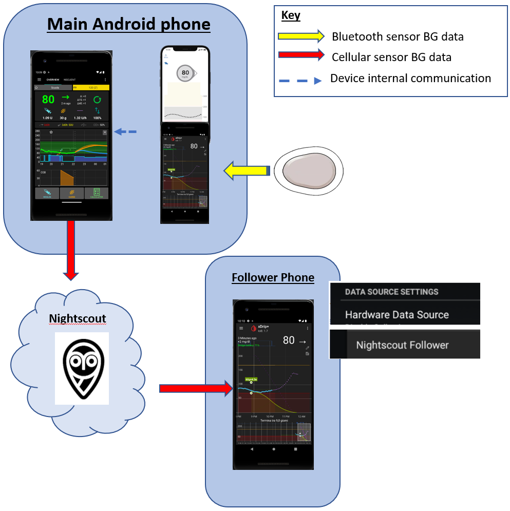
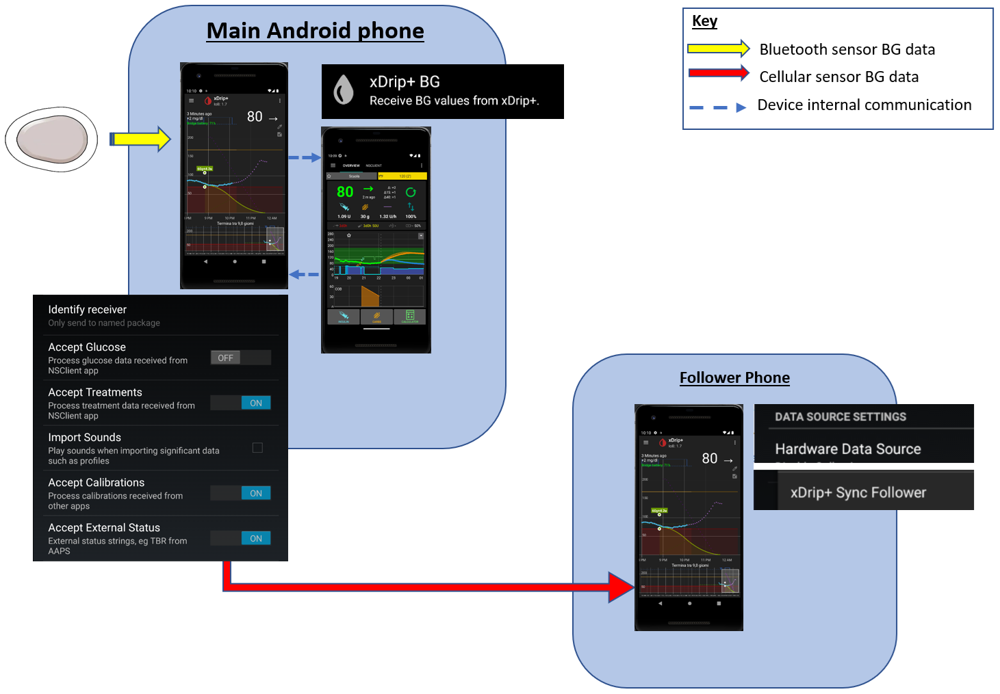
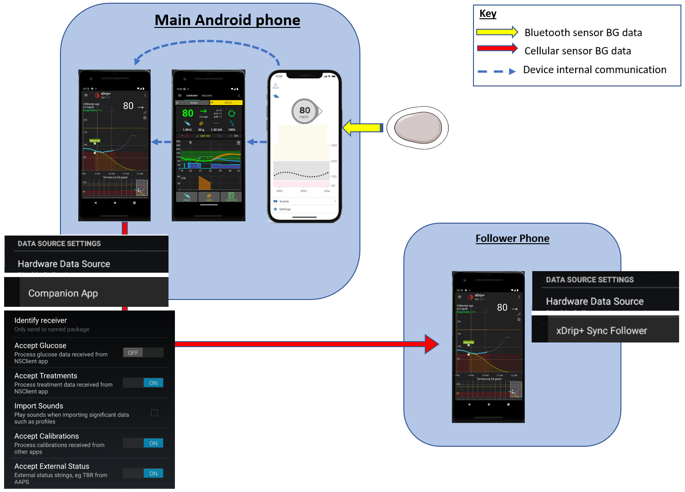
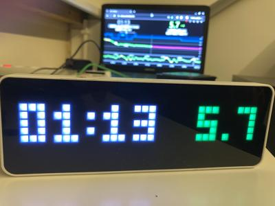

# Seguir AAPS (sense interacció amb el sistema AAPS)

A més de les moltes possibilitats per controlar _i_ seguir **AAPS** a distància, que es descriuen a [Control remot d'AAPS](../RemoteFeatures/RemoteControl.md), hi ha diverses aplicacions i dispositius que ha desenvolupat la comunitat per seguir només els números (nivells de glucèmia i altra informació), sense interactuar amb **AAPS**.

Trobareu una bona visió general de les moltes opcions per seguir **AAPS** a la pàgina web [Nightscout follower](https://nightscout.github.io/nightscout/downloaders/#).

```{contents} Table of contents
:depth: 1
:local: true
```

Les estratègies més habituals que es fan servir amb **AAPS** s'expliquen amb més detall a continuació.

## Aplicacions per al telèfon intel·ligent

```{contents} These are some of the main “follower” apps used by **AAPS** users. All of these apps are “free”: 
:depth: 1
:local: true
```

### Dexcom Follow ([Android](https://play.google.com/store/apps/details?id=com.dexcom.follow.region2.mgdl) i [iOS](https://apps.apple.com/fr/app/dexcom-follow-mg-dl-dxcm2/id1032203080))


* Dexcom Follow és compatible amb molts telèfons (tant Android com iPhone). Dexcom Follow es pot fer servir encara que no feu servir l'aplicació oficial de Dexcom per rebre les dades del sensor.

* Molts cuidadors coneixen Dexcom Follow i prefereixen la seva interfície clara a una cosa més complicada.

* Dexcom Follow va molt bé per a mestres, avis i persones que saben molt poc de diabetis i de nivells de glucèmia. Té alertes personalitzables (nivell de glucèmia, quin so cal fer sonar, etc.). Si cal, les alarmes es poden desactivar del tot. Això és molt útil si teniu un sensor que encara s'està estabilitzant i dona moltes hipoglucèmies falses.

#### Configurar Dexcom Follow: guia pas a pas

Si feu servir l'aplicació no oficial de Dexcom BYODA per rebre les dades del sensor, potser podreu enviar invitacions als seguidors des de l'aplicació BYODA.

Ja no podeu enviar correus d'invitació als seguidors de Dexcom des d'aplicacions de tercers. A xDrip, la petició d'invitació només donarà el missatge «invite not sent».

Heu d'instal·lar l'aplicació oficial de Dexcom, enviar la invitació i després desinstal·lar l'aplicació oficial.

Els passos són aquests:

1)  Instal·leu l'aplicació oficial «Dexcom» a _qualsevol_ telèfon intel·ligent (Android/iPhone). Pot ser el telèfon del seguidor, si us va millor. 2)  Inicieu sessió amb el vostre nom d'usuari i contrasenya de Dexcom. Són les mateixes dades d'accés que faríeu servir per a Dexcom Clarity, si ja sou clients de Dexcom/Clarity. Si no teniu un compte de Dexcom, en aquest punt podeu crear-ne un de nou.   
3)  Passeu les pantalles d'introducció. 4)  Afegiu «sense codi» com a codi del sensor. 5)  A «Transmitter SN» seleccioneu «introduir manualment» i introduïu qualsevol codi de transmissor vàlid (feu servir el codi d'un dels vostres transmissors caducats, si en sabeu un, perquè no interfereixi amb el transmissor actual; els codis segueixen un format concret de números i lletres, «NLNNNL», i només fan servir certes combinacions, per això és més fàcil fer servir un codi que ja sabeu que és vàlid). 6)  Quan l'aplicació intenti trobar el transmissor i el sensor, podreu convidar seguidors: toqueu els tres puntets a la part superior esquerra de l'aplicació i afegiu un seguidor nou. També podeu fer servir això si un dels vostres seguidors ha canviat de telèfon i necessita una invitació nova: aquí el podeu eliminar de la llista de seguidors i tornar a enviar un correu d'invitació perquè el faci servir al telèfon nou. 7)  Al telèfon del seguidor, instal·leu Dexcom Follow des de l'App Store (iPhone) o Play (Android). Configureu l'aplicació Dexcom Follow. Se us demanarà que obriu el correu electrònic per trobar la invitació per ser seguidor.    
8)  Ara ja podeu eliminar l'aplicació oficial Dexcom G6.

Per a Dexcom Follow, les dades del sensor s'exporten des del telèfon amb **AAPS**, directament des de BYODA o des de xDrip, segons quina aplicació feu servir.


### [Nightguard](https://apps.apple.com/fr/app/nightguard/id1116430352) (iOS)


Avantatges (segons els usuaris):

* Disponible a l'[App Store](https://apps.apple.com/us/app/nightguard/id1116430352), amb una interfície senzilla i fàcil d'utilitzar.

* Llisqueu el botó o sacsegeu el telèfon per postposar les alarmes durant diferents intervals, de 5 min a 24 hores

* Alarmes personalitzables (alertes d'alta, de baixa, lectures perdudes quan no hi ha dades durant 15–45 minuts).

* Pujada o baixada ràpida en 2–5 lectures seguides (ho trieu vosaltres). També podeu triar la delta entre dues lectures individuals

* Postposició intel·ligent: no avisa si els nivells es mouen en la direcció correcta

* Hi ha una pestanya «Care» que sembla que permet posar un objectiu temporal nou per a un temps concret, eliminar l'objectiu temporal o introduir carbohidrats.

Inconvenients (segons els usuaris)

* Només disponible per a iOS

* L'objectiu temporal es mostra com a 5 mmol, sigui quin sigui el nivell d'objectiu temporal posat

* Mai no mostra la taxa de la basal temporal, encara que mostra «TB»

### [Nightwatch](https://play.google.com/store/apps/details?id=se.cornixit.nightwatch) (Android)


* Nightwatch es presenta com un client de Nightscout i controla els nivells de glucèmia de Nightscout de l'usuari en un telèfon o una tauleta Android.

* L'aplicació es pot descarregar de [Google Play](https://play.google.com/store/apps/details?id=se.cornixit.nightwatch) i mostra les dades de glucèmia en temps real.

* L'usuari pot rebre avisos amb alarmes sonores personalitzades de baixa i d'alta.

* Les dades de glucèmia es poden veure en mmol/l o en mg/dl.

* Necessita Android 5.0 o posterior.

* It has a dark UI, large readings and buttons, designed for usage at night.

### xDrip (Android)

Podeu fer servir xDrip com a seguidor.

#### Amb Nightscout

Configureu xDrip com a seguidor de Nightscout («Nightscout Follower»). Rebreu la glucèmia i els tractaments, però no la basal.



#### Sense Nightscout - xDrip com a origen de la glucèmia

Si l'origen de les dades d'**AAPS** és xDrip (o si xDrip també pot rebre la glucèmia d'una altra aplicació com BYODA, Juggluco, ...), el podeu fer servir des del telèfon principal per compartir dades amb seguidors de xDrip, i mostrar glucèmia, tractaments i taxes basals.



#### Sense Nightscout - aplicació companya de glucèmia per a xDrip

Si l'origen de les dades d'**AAPS** no és xDrip però podeu mostrar les dades de glucèmia des de l'origen de dades «Companion App», el podeu fer servir des del telèfon principal per compartir dades amb seguidors de xDrip, i mostrar glucèmia, tractaments i taxes basals.



### xDrip4iOS (iOS)


xDripSwift was created from porting the original xDrip app to iOS and evolved into "xDrip for iOS", written as **xDrip4iOS**.

```{admonition} Further detail about how to attempt to obtain the original **xDrip4iOS** app
:class: dropdown
El [grup de Facebook de xDrip4iOS](https://www.facebook.com/groups/853994615056838/announcements) és el principal suport de la comunitat per a xDrip4iOS i Shuggah. **xDrip4iOS** es pot connectar a molts sistemes CGM i transmissors diferents i mostrar valors de glucèmia, gràfics i estadístiques, i també donar alarmes. També pot enviar dades a Nightscout o fer d'[aplicació seguidora de Nightscout](https://xdrip4ios.readthedocs.io/en/latest/connect/follower/). 

«Com puc tenir **xDrip4iOS** al meu iPhone?»
Hi ha dues opcions:

1. Si teniu un Mac i un compte d'Apple Developer (99 EUR/USD l'any), podeu compilar el vostre propi xDrip4iOS [seguint les instruccions](https://xdrip4ios.readthedocs.io/en/latest/install/build/).

Si voleu, després podeu ser «releaser» i [compartir un Personal Testflight de xDrip4iOS](https://xdrip4ios.readthedocs.io/en/latest/install/personal_testflight/) amb fins a 100 persones més per ajudar-les.

2. Entreu al [grup de Facebook de xDrip4iOS](https://www.facebook.com/groups/853994615056838/announcements) i llegiu les publicacions fixades per conèixer les maneres actuals d'obtenir l'aplicació. **No demaneu una invitació a l'aplicació** (llegiu les normes del grup).
```


«Què és **Shuggah**?» Un grup de desenvolupadors ucraïnesos va copiar el codi del projecte xDrip4iOS (que és públic a GitHub) i el va publicar a l'App Store amb un compte d'empresa. Els desenvolupadors de xDrip4iOS no gestionen de cap manera la versió Shuggah.

El [grup de Facebook de xDrip4iOS](https://www.facebook.com/groups/853994615056838/announcements) dona suport a xDrip4iOS i a les aplicacions corresponents per a Apple Watch.

### [Sugarmate](https://apps.apple.com/fr/app/sugarmate/id1111093108) (iOS)


[Sugarmate](https://sugarmate.io/) es pot descarregar a l'iPhone des de l'App Store. Sugarmate és compatible amb:
* Apple iPhone (necessita la versió de programari 13.0 o posterior)
* Apple iPad (necessita la versió de programari 13.0 o posterior)
* Google Android (deseu l'aplicació web a la pantalla d'inici)

Usuaris de Sugarmate diuen que als EUA es pot fer servir amb Apple CarPlay per veure els valors de glucèmia mentre conduïu. Encara no se sap si això és possible en països de fora dels EUA. If you know more about this, please add details in here to the documentation by completing a [pull request](../SupportingAaps/HowToEditTheDocs.md), which is quick and easy to do.


### [Spike](https://spike-app.com/) (iOS)


Spike es pot fer servir com a receptor principal o com a aplicació seguidora, i dona glucèmia, alarmes, IOB i més.

El lloc web i l'aplicació ja no es desenvolupen. Hi ha suport a [Facebook](https://www.facebook.com/groups/1973791946274873) i a [Gitter](https://gitter.im/SpikeiOS/Lobby).

## Rellotges intel·ligents per al **monitoratge d'AAPS** (totes les dades del perfil, o només la glucèmia) quan **AAPS** funciona en un telèfon.

Vegeu [aquí](../Getting-Started/Watches.md).


## Dispositius per seguir AAPS

```{contents} Devices include:
:depth: 1
:local: true
```

### M5Stack


El M5Stack és una caixa petita que es pot programar per a moltes aplicacions. El projecte de Martin [M5Stack NightscoutMon](https://github.com/mlukasek/M5_NightscoutMon/wiki) mostra els valors de glucosa del sensor i les tendències, l'IOB i el COB. És una caixa de plàstic amb pantalla de color, ranura per a targeta micro SD, 3 botons, altaveu i bateria interna. És un monitor de glucèmia molt bo i és força fàcil de configurar si teniu un compte de Nightscout. Normalment els usuaris el fan funcionar amb la Wi-Fi de casa, però alguns diuen que el fan servir com a pantalla quan van en moto, amb el punt d'accés Wi-Fi del telèfon.

### SugarPixel

SugarPixel és un dispositiu secundari de visualització i alertes de glucèmia per a la monitorització contínua de glucosa. Es connecta amb l'aplicació de Dexcom o de Nightscout al telèfon intel·ligent de l'usuari. El dispositiu mostra els valors de glucèmia en temps real. Aquest monitor CGM té alertes sonores amb tons aleatoris (que sonen molt fort), alertes de vibració per a persones amb problemes d'audició, opcions de pantalla personalitzables i seguiment multiusuari integrat.


* SugarPixel té diverses opcions de pantalla en mg/dl i mmol/l, amb valors de glucèmia en colors, per adaptar-se a les necessitats de l'usuari.
* La pantalla estàndard mostra la glucèmia, la fletxa de tendència i la delta. La delta és el canvi, + o -, respecte a la lectura anterior.
* SugarPixel es pot ajustar per fer-lo servir amb poca brillantor, amb la pantalla «BG and Time», per veure la glucèmia i l'hora actual a la tauleta de nit de l'usuari.
* La pantalla de color de SugarPixel fa servir tota la pantalla per mostrar un sol color que representa el valor de glucèmia. Així l'usuari pot veure els valors de glucèmia de lluny, a través de la finestra, mentre juga fora al jardí, al pati o a la piscina.
* La pantalla «Big BG» és útil per a qui el té a la tauleta de nit i porta ulleres o lents de contacte.

### Nightscout Clock a l'Ulanzi TC001

**Nightscout Clock** és un programari de codi obert que funciona al dispositiu **Ulanzi TC001**. Es connecta amb els servidors de Dexcom o amb Nightscout i mostra els valors de glucèmia en temps real.



* El rellotge admet les unitats mmol/l i mg/dl, i té alarmes sonores.
* Several displays are available, see [Github nightscout-clock](https://github.com/ktomy/nightscout-clock?tab=readme-ov-file#more-information-for-people-who-needs-it) for an overview.
* Configurar el dispositiu només necessita uns quants passos senzills. Un cop configurat, només necessita corrent i Wi-Fi per funcionar.
* El dispositiu Ulanzi TC001 és molt més barat que el SugarPixel.
* El programari i les instruccions d'instal·lació són a [Github nightscout-clock](https://github.com/ktomy/nightscout-clock?tab=readme-ov-file).
* El desenvolupa i manté Artiom Kenibasov, que dona suport al [grup de Facebook AAPS Users](https://www.facebook.com/groups/cgminthecloud/posts/8776932509094594/).

### PC (TeamViewer)
Alguns usuaris troben útil una eina d'accés remot complet com [TeamViewer](https://www.teamviewer.com/) per resoldre problemes avançats a distància.
