# Control remot d'AAPS

```{contents} In this page
:backlinks: entry
:depth: 2
```

Hi ha quatre eines molt eficaces per gestionar **AAPS** a distància:

1) [Ordres SMS](#RemoteControl_SMS-Commands) (el telèfon seguidor pot ser Android o iOS), 2) [AAPSClient](#RemoteControl_aapsclient) (el dispositiu seguidor és un telèfon o tauleta Android, o un ordinador Windows, Mac o Linux; en un iPhone [compileu l'aplicació vosaltres mateixos](#aapsclient-iphone)) 3) [Nightscout](#RemoteControl_nightscout) (Android, iOS o un altre ordinador o dispositiu), sobretot per seguir: vegeu la nota sobre el [control des del client](#client-master-control) en aquella secció.  
4) [Rellotges intel·ligents](#RemoteControl_smartwatches) (Android)

Les tres primeres són sobretot adequades per a cuidadors i pares, però els rellotges intel·ligents són molt útils per a cuidadors i pares **i** també per a adults amb diabetis.

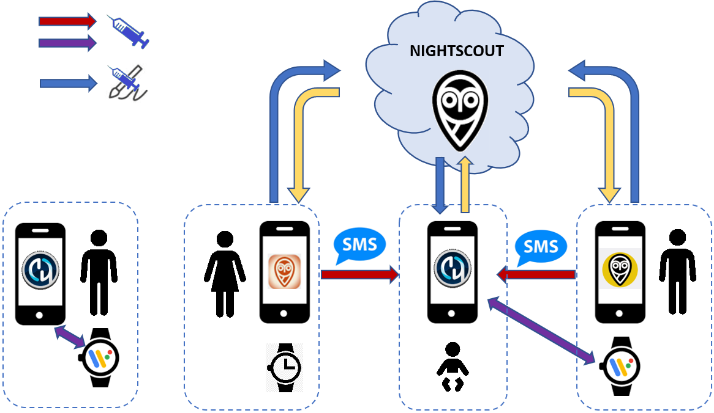

(RemoteControl_SMS-Commands)=

## 1) Ordres SMS

Vegeu la pàgina dedicada [Ordres SMS](../RemoteFeatures/SMSCommands.md).

(RemoteControl_aapsclient)=
## 2) AAPSClient

**AAPSClient** s'assembla molt al mateix **AAPS**: ofereix al cuidador les mateixes pantalles i botons per enviar ordres a distància a **AAPS**:


(remotecontrol-aapsclient-versions)=
### Sobre AAPSClient, AAPSClient2 i AAPSClient3

Hi ha 3 versions de l'aplicació client: **AAPSClient**, **AAPSClient2** i **AAPSClient3**. Funcionen igual. L'única diferència és que es poden instal·lar juntes al mateix telèfon seguidor.

Un cuidador que segueix una sola persona només necessita **AAPSClient**. Per seguir i controlar a distància una segona persona (amb el seu propi lloc **Nightscout** i el seu propi telèfon **AAPS**), instal·leu també **AAPSClient2**, i **AAPSClient3** per a una tercera persona. Cada aplicació es configura i s'[emparella](#aapsclient-pairing-with-the-master) per separat, amb el lloc **Nightscout** i el telèfon **AAPS** de la persona que segueix.

Per distingir les aplicacions, alguns elements tenen un color diferent: groc per a **AAPSClient**, blau per a **AAPSClient2** i verd per a **AAPSClient3**. Aquests elements són la icona de l'aplicació, el fons del widget i la secció d'estat d'**AAPS** a la pantalla d'inici de l'aplicació. <br/> Nota: l'opacitat del fons del widget es pot ajustar a la configuració del widget. Amb una opacitat baixa, el color es veu malament.

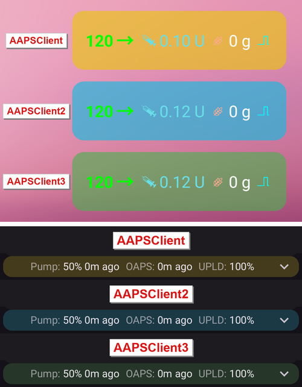

### Descàrrega i instal·lació

**AAPSClient** es pot instal·lar en un sol telèfon o en diversos telèfons seguidors (p. ex. el telèfon seguidor del pare 1 i el del pare 2), perquè tots dos cuidadors tinguin accés i puguin controlar a distància el telèfon **AAPS** del pacient.

Per descarregar **AAPSClient**, aneu al [repositori de GitHub](https://github.com/nightscout/AndroidAPS/releases/) i feu clic a l'arxiu **“app-AAPSClient-release_x.x.x.x”** (pot ser una versió més nova que la de la captura de sota):

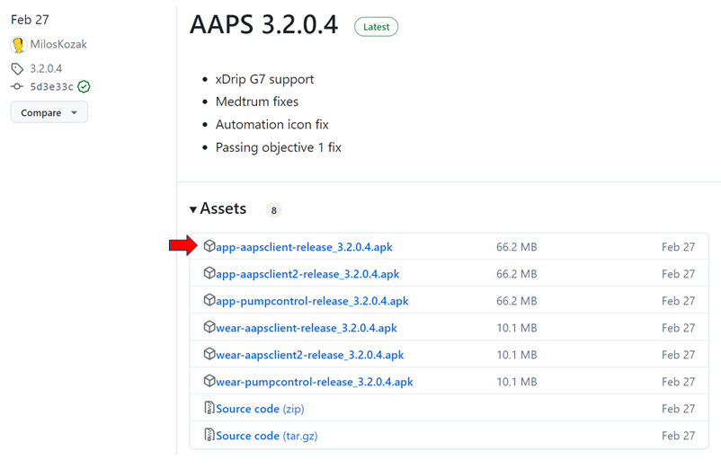

Després aneu a les _baixades_ de l'ordinador. A Windows, les _baixades_ es mostren a la barra de la dreta:

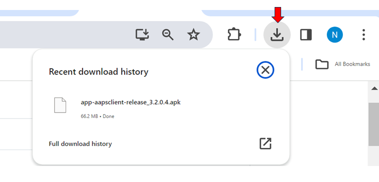

Un cop descarregat, feu clic a _mostra a la carpeta_ per trobar el fitxer.

Ara l'apk d'**AAPSClient** es pot:

Transferir-lo al telèfon seguidor amb un cable USB; o Arrossegar-lo a una carpeta de Google Drive i després afegir-lo al telèfon seguidor fent clic al fitxer "app-AAPSClient-release".

Si necessiteu **AAPS** per a vosaltres i **AAPSClient** per seguir una altra persona, haureu de compilar **AAPSClient** vosaltres mateixos en lloc de descarregar-lo del repositori de GitHub com s'ha explicat abans. El motiu és que no podeu instal·lar **AAPS** i **AAPSClient** al mateix telèfon si estan signats amb claus diferents. <br/> Per compilar **AAPSClient** vosaltres mateixos, seguiu el mateix procés que per a la [compilació normal d'AAPS](../SettingUpAaps/BuildingAaps.md). A la pàgina **Generate signed App Bundle or APK**, seleccioneu **aapsclientRelease** en lloc de **fullRelease**.

La mateixa regla s'aplica quan instal·leu diverses aplicacions client (**AAPSClient**, **AAPSClient2**, **AAPSClient3**) en un telèfon seguidor: totes han d'estar signades amb la **mateixa clau**. Si no, Android no deixa instal·lar la segona (error `INSTALL_FAILED_DUPLICATE_PERMISSION`).

### Sincronització: configuració d'AAPSClient i d'AAPS

Un cop instal·lat l'apk d'__AAPSClient__ al telèfon seguidor, assegureu-vos que **NSClientV3** està configurat igual als dos telèfons per a Nightscout 15 (vegeu les [notes d'actualització](../Maintenance/UpdateToNewVersion.md)). L'exemple de sota mostra la configuració de la sincronització amb NSClientV3 i Nightscout 15; a __AAPS__ hi ha altres fonts de dades disponibles (p. ex. xDrip).

A **Configurador** > **Comunicació**, l'usuari sincronitza les seves dades amb Nightscout mitjançant __NSClientV3__ (amb l'API v3), configurat de la mateixa manera tant a __AAPS__ com al telèfon seguidor.


L'usuari s'ha d'assegurar que __tots dos__ telèfons, AAPS i AAPS Client, estiguin sincronitzats configurant NSClientV3 a cadascun. Al telèfon seguidor, també es pot fer escanejant un codi QR que mostra **AAPS**; vegeu [Emparellar AAPSClient amb AAPS](#remotecontrol-pairing) més avall:

- Introduïu la vostra **URL de Nightscout** a la **Configuració** de NSClientV3

- Introduïu el vostre **Token d'accés de Nightscout** a la mateixa configuració. Seguiu les notes [d'aquí](https://nightscout.github.io/nightscout/security/#create-a-token). Al telèfon **AAPS**, feu servir un **token d'administrador**: amb aquest token, **AAPS** crea un token propi per a cada telèfon seguidor.

- Activeu **Utilitzar websockets** als **dos** telèfons. Els websockets són **obligatoris** per al control remot des d'**AAPSClient**, als dos telèfons. Sense ells, **AAPSClient** pot seguir **AAPS** però no el pot controlar. En tots dos telèfons també fan la sincronització més ràpida, a canvi d'un consum de bateria una mica més alt.

  El vostre proveïdor de Nightscout ha de permetre websockets. Si la connexió websocket es talla sovint, el control remot no funciona. Vegeu [Resolució de problemes de NSClient](../GettingHelp/TroubleshootingNsClient.md).


L'usuari s'ha d'assegurar que tant __AAPSClient__ com __AAPS__ mostren «connectat» a la pantalla **NSClientV3** de cada telèfon. En aquest moment **AAPSClient** segueix **AAPS** (glucèmia, tractaments, perfil), però encara no el pot controlar: emparelleu els dos telèfons com s'explica a continuació.

(remotecontrol-pairing)=
### Emparellar AAPSClient amb AAPS (control remot)

Des de la versió 4 d'**AAPS**, **AAPSClient** controla **AAPS** mitjançant una connexió segura i **emparellada**. La sincronització sola no n'hi ha prou: fins que els telèfons no estan emparellats, **AAPSClient** només mostra **Gestionar** amb un **Perfil** només de lectura i **Emparellar amb el dispositiu principal**.

1. Al telèfon **AAPS**, obriu **Gestionar → Clients autoritzats** i activeu **Permetre el control des dels clients** (està desactivat per defecte i sempre activat en el mode simple).
2. Premeu **+**, introduïu un nom per al telèfon seguidor, trieu com es configura i trieu el seu **rol**:
   - **Codi QR: Nightscout i emparellament**: **AAPS** mostra un codi QR que configura Nightscout al telèfon seguidor i l'emparella, tot amb un sol escaneig. Cal un token d'administrador a la configuració de NSClientV3 del telèfon **AAPS**.
   - **PIN**: per a un telèfon seguidor sense càmera i ja connectat a Nightscout. Apunteu el **PIN** d'un sol ús (és vàlid uns dos minuts).
3. Al telèfon **AAPSClient**, escanegeu el codi (a l'assistent de configuració, o a **Gestionar → Emparellar amb el dispositiu principal → Escanejar codi QR**), o obriu **Gestionar → Emparellar amb el dispositiu principal** i introduïu el PIN. Confirmeu.

Aleshores el telèfon seguidor apareix com a **Actiu** a la llista **Clients autoritzats**, i **AAPSClient** mostra **Tractaments**, **Escenes** i **Gestionar**. El telèfon seguidor rep un token de Nightscout propi, només amb els permisos que necessita. El procediment complet, amb captures de pantalla i resolució de problemes, és a [Control principal ↔ client](#client_master_master_setup).

Comproveu que la configuració funciona: introduïu carbohidrats a **AAPSClient**, confirmeu la quantitat que es mostra i comproveu que l'entrada apareix a **Tractaments** als dos telèfons.

(remotecontrol-nightscout-access-token)=

### Resolució de problemes amb la configuració del «Token d'accés de Nightscout»

La configuració exacta del «Token d'accés de Nightscout» pot ser diferent segons si el vostre proveïdor de Nightscout és un servei allotjat de pagament o no.

Si teniu problemes perquè **AAPS** accepti el «Token d'accés de Nightscout» i feu servir un Nightscout allotjat de pagament, potser és millor consultar primer el vostre proveïdor de Nightscout per resoldre els problemes amb el token. Si no, contacteu amb el grup d'**AAPS**, però abans comproveu bé que heu seguit correctament les notes [d'aquí](https://nightscout.github.io/nightscout/security/#create-a-token).

### Què ofereix AAPSClient

Un cop emparellat, **AAPSClient** ofereix al cuidador gairebé les mateixes pantalles que el mateix **AAPS**:

- **Tractaments**: bolus d'insulina, carbohidrats i la calculadora de bolus.
- **Escenes**: iniciar i aturar [escenes](../DailyLifeWithAaps/Scenes.md).
- **Gestionar**: perfils, configuració d'insulina, objectius temporals, Assistent ràpid, automatització, aliments, rotació de punts d'inserció, emparellament i la basal temporal en curs.
- **Menú principal**: historial de tractaments, historial, estadístiques, manteniment, configurador.

A **AAPSClient** no hi ha bomba ni objectius. Vegeu [L'aplicació AAPSClient](AapsClient.md) per a una descripció detallada.

**AAPSClient** permet al cuidador fer a distància, per la xarxa mòbil o per internet, la majoria dels ajustos que es poden fer directament a **AAPS**, **també bolus d'insulina**. Cada ordre es signa i s'envia a través de Nightscout al telèfon **AAPS**, que la comprova amb les seves pròpies dades, la limita, us mostra la seva pròpia confirmació i només aleshores l'executa. **AAPSClient** _pot_ ser molt més ràpid que les [Ordres SMS](../RemoteFeatures/SMSCommands.md), sobretot per a ordres que necessitarien autenticació.

Els tractaments introduïts a Nightscout d'una altra manera (per exemple, al web de Nightscout) no s'apliquen mentre el control des del client està activat: aleshores **AAPS** és en [mode reforçat](#client-master-control-hardened-mode) i només accepta canvis dels clients emparellats. Amb el control des del client desactivat, només s'apliquen si les opcions **Rebre** corresponents estan activades a la [secció Sincronització de la configuració de NSClient](#Preferences-nsclient-synchronization).

El control remot amb **AAPSClient** només es recomana si la sincronització funciona bé (_és a dir_, no veieu canvis de dades no desitjats, com OT o TBR que es modifiquen sols, etc.).

### AAPSClient amb opcions de rellotge intel·ligent

Un rellotge intel·ligent pot ser una eina molt útil per ajudar a gestionar **AAPS** amb nens. Es poden fer servir diverses configuracions. Si **AAPSClient** està instal·lat al telèfon del cuidador, l'[aplicació **AAPSClient WearOS**](https://github.com/nightscout/AndroidAPS/releases/) es pot descarregar i instal·lar en un rellotge intel·ligent compatible connectat al telèfon del pare o la mare. Això mostra la glucèmia actual i l'estat del llaç. Un cop **AAPSClient** està emparellat amb **AAPS**, les accions del rellotge (també bolus, carbohidrats, objectius temporals i canvis de perfil) passen per **AAPSClient** fins a **AAPS**, que les confirma i les executa: vegeu [Wear OS en un client](#clientmastercontrol-wear-os-on-a-client). Podeu llegir més sobre els rellotges intel·ligents [aquí](#remotecontrol-smartwatches).

(RemoteControl_nightscout)=
## 3) Nightscout

A més de ser un servidor «al núvol», Nightscout també té una aplicació **Nightscout** pròpia, que podeu descarregar directament de l'App Store al vostre iPhone. Si teniu un telèfon seguidor Android, no hi ha cap aplicació Nightscout dedicada i és millor fer servir [**AAPSClient**](#RemoteControl_aapsclient). Si només voleu seguir, sense enviar tractaments, podeu descarregar i instal·lar l'aplicació [Nightwatch](https://play.google.com/store/apps/details?id=se.cornixit.nightwatch) de Play Store.

Un cop instal·lada l'aplicació **Nightscout** a l'iPhone, obriu-la i seguiu els passos de configuració: introduïu l'adreça del vostre Nightscout (vegeu a sota, a l'esquerra). El format de l'adreça pot variar segons on estigui allotjat el vostre Nightscout. (_p. ex._ http://youraddresshere.herokuapp.com). Després introduïu l'API secret del vostre Nightscout (vegeu a sota, a la dreta). Si l'aplicació no us demana la contrasenya de l'API, l'heu d'introduir fent clic al cadenat de la part de dalt de l'aplicació:

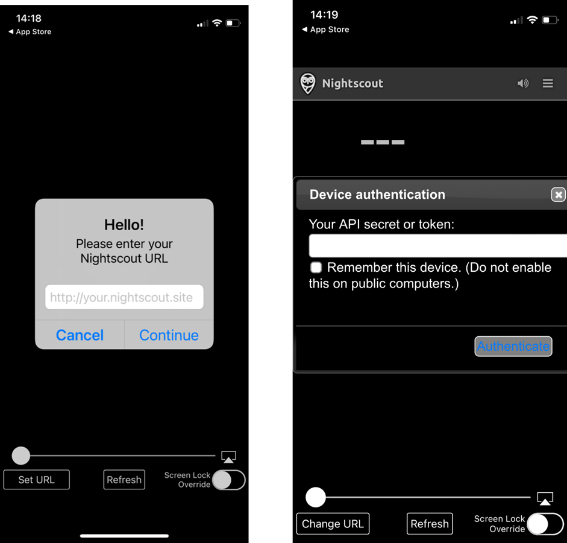

Trobareu més informació sobre la configuració directament a [Nightscout](https://nightscout.github.io/nightscout/discover/)

Quan inicieu la sessió per primera vegada, la pantalla serà molt senzilla. Personalitzeu les opcions de visualització: seleccioneu el menú «hamburguesa» (a dalt a la dreta) i desplaceu-vos cap avall:

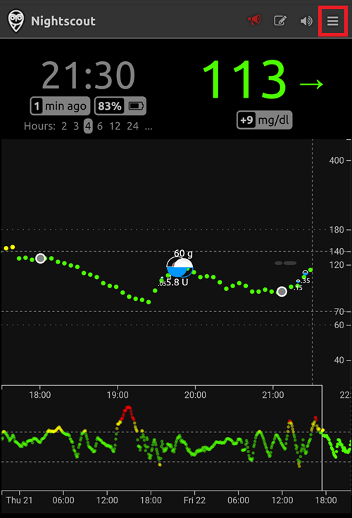

Desplaceu-vos cap avall fins a «Settings». Potser voleu canviar «scale» a «linear», perquè la visualització de la glucèmia és logarítmica per defecte. A «render basal», seleccioneu «default» perquè es mostri la basal de la bomba.

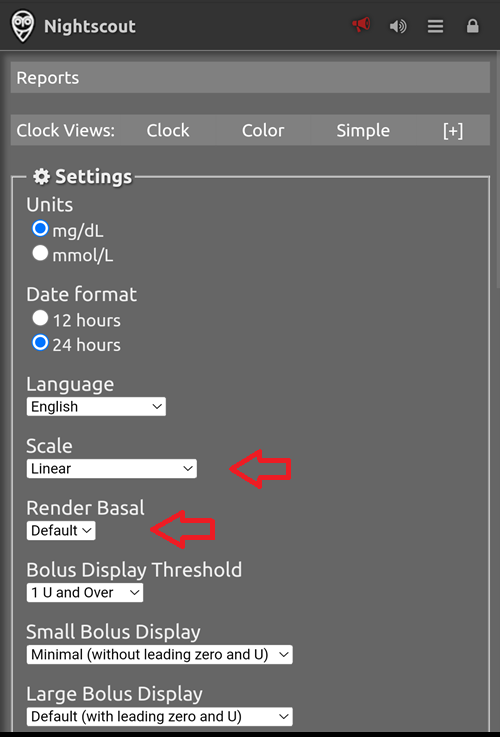

Seleccioneu les opcions que vulgueu. Desmarqueu les alarmes si feu servir una altra aplicació per a les alarmes.

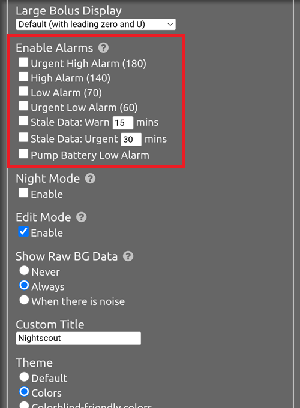

Continueu baixant fins a «show plugins».

Assegureu-vos que «careportal» estigui marcat. També podeu seleccionar altres dades (les més útils són: IOB, care portal, pump, cannula age, insulin age, basal profile i OpenAPS).

Important: ara heu de fer clic a «save», a la part de baix, perquè els canvis tinguin efecte.

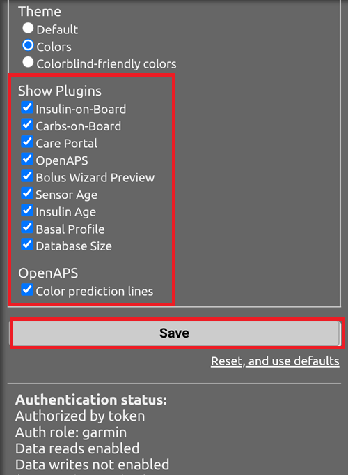

Després de prémer «save», l'aplicació torna a la pantalla principal de Nightscout, que serà semblant a aquesta:

1. Valor actual de glucèmia
2. Informació sobre l'estat del sistema AAPS: toqueu cada pestanya de la pantalla per veure'n més detalls. Afegiu o traieu aquestes opcions de visualització amb el menú hamburguesa.
3. Corba recent de glucèmia amb els tractaments (carbohidrats, bolus)
4. Corba de glucèmia a més llarg termini
5. Menú «hamburguesa» per a les opcions de visualització, crear informes, editar perfils i les eines d'administració de Nightscout
6. Menú «**+**» per introduir tractaments (vegeu [més avall](#RemoteControl_nightscout-treatments) quan els aplica **AAPS**).
7. Seleccionar un altre període de temps per mostrar
8. Perfil d'insulina basal
9. Línia verda = glucèmia passada Línies blaves = glucèmia prevista

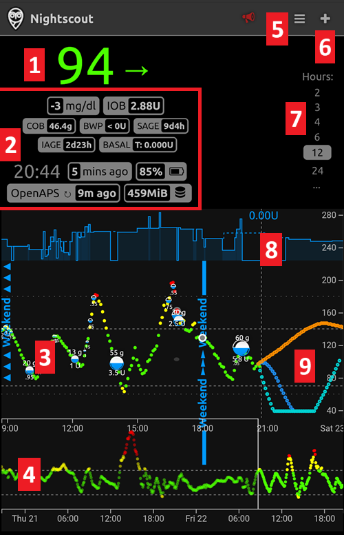

Vegem amb més detall el menú de dalt a l'esquerra de l'aplicació Nightscout:

1. Edició retrospectiva del Careportal
2. Activar/desactivar les alarmes
3. Hamburguesa: per a la configuració
4. Careportal - Anotar tractament (vegeu [més avall](#RemoteControl_nightscout-treatments) quan els aplica **AAPS**)

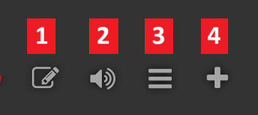

En aquesta pantalla hi ha moltíssima informació sobre l'estat del sistema **AAPS** a les pestanyes grises (i encara més si toqueu la pestanya):

1. Tendència de glucèmia de 5 min
2. Previsualització de la calculadora de bolus (BWP)
3. Premeu Basal per veure el vostre perfil actual i la informació de la basal
4. Temps des de l'última lectura del CGM a AAPS
5. **Bomba**: insulina, % de pila i quan AAPS s'hi va connectar per última vegada
6. Última actualització d'AAPS: si fa més de 5 min, pot indicar un problema de connexió entre el telèfon AAPS i la bomba o el CGM
7. Premeu IOB per veure la insulina basal i la de bolus per separat
8. Edat de la insulina al reservori
9. Edat de la cànula
10. Estat de la bateria del telèfon AAPS
11. Mida de la vostra base de dades. Si s'omple massa (només Nightscout autoallotjat (DIY); els serveis allotjats no en fan cas), podeu començar a tenir problemes de connexió. Podeu eliminar dades per reduir aquest número al menú Admin tools (des del menú hamburguesa).

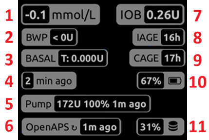

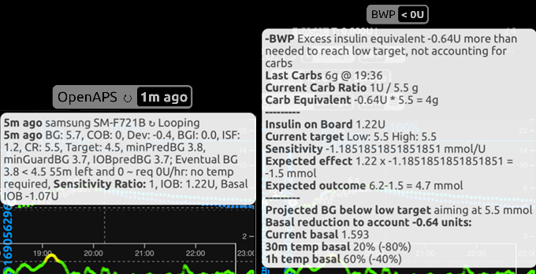

Premeu «refresh» a la part de baix de la pàgina per tancar la finestra emergent.

(RemoteControl_nightscout-treatments)=
### Enviar tractaments a AAPS amb l'aplicació Nightscout

A **AAPS** 4, la manera admesa de controlar **AAPS** a distància és un **AAPSClient emparellat**, vegeu [Control principal ↔ client](#client-master-control): cada client té un [rol](#client-master-control-roles) que limita el que pot fer, i cada ordre la signa el client i després la comprova i la confirma el telèfon **AAPS**. Mentre el control des del client està activat, el telèfon **AAPS** és en [mode reforçat](#client-master-control-hardened-mode): els tractaments, objectius temporals i canvis de perfil introduïts al web de Nightscout o a l'aplicació Nightscout **no** s'apliquen. Aleshores l'aplicació Nightscout és només una eina per seguir.

```{admonition} Only when client control is off
:class: warning
Si **Permetre el control des dels clients** està desactivat a **Gestionar → Clients autoritzats** (i el mode simple està desactivat), **AAPS** aplica les entrades del Careportal de Nightscout només per als tipus de dades que heu activat a **Rebre**, a la [secció Sincronització de la configuració de NSClientV3](#Preferences-nsclient-synchronization): carbohidrats, objectius temporals, canvis de perfil i les altres entrades del Careportal. Mai no es lliura insulina d'aquesta manera: un «Bolus de correcció» introduït a Nightscout només s'*anota*, i **AAPS** el compta com a insulina a bord sense lliurar-lo. Aquesta configuració no es recomana per al control remot; feu servir un **AAPSClient** emparellat.
```

Llegiu més sobre les opcions de **Nightscout** [aquí](https://nightscout.github.io/)

### Consells per treure el màxim profit de l'aplicació Nightscout

1). Si us «quedeu encallats» en una pàgina i voleu tornar a veure la pantalla principal, feu clic a «refresh» (a baix al mig) i tornareu a la pàgina d'inici de **Nightscout** amb el gràfic de glucèmia.

Per veure el perfil actual que funciona al telèfon, premeu les diverses icones de la pantalla, a sobre del gràfic. Podeu veure més informació (ràtio de carbohidrats actual, sensibilitat, fus horari, etc.) prement «basal». «OpenAPS» dona informació sobre el perfil, l'objectiu actual, etc. També podeu controlar el % de bateria del telèfon i el % de pila de la bomba. BWP dona informació sobre el que l'algoritme creu que passarà en el futur, segons l'IOB i el COB.

#### Altres icones del menú: què vol dir el llapis (editar)?

(Tècnicament) podeu fer servir el llapis d'edició per moure o eliminar tractaments de bolus o de correcció de les últimes 48 h.

Més informació [aquí](https://nightscout.github.io/nightscout/discover/#edit-mode-edit)

Això podria ser útil per eliminar carbohidrats anotats (però sense bolus), però a la pràctica ara mateix no funciona bé amb **AAPS**. Us recomanem fer aquests canvis directament a l'aplicació **AAPS**.

(RemoteControl_smartwatches)= (remotecontrol-smartwatches)=

## 4) Rellotges intel·ligents

### Opció 1) Controlar AAPS des d'un rellotge Wear OS

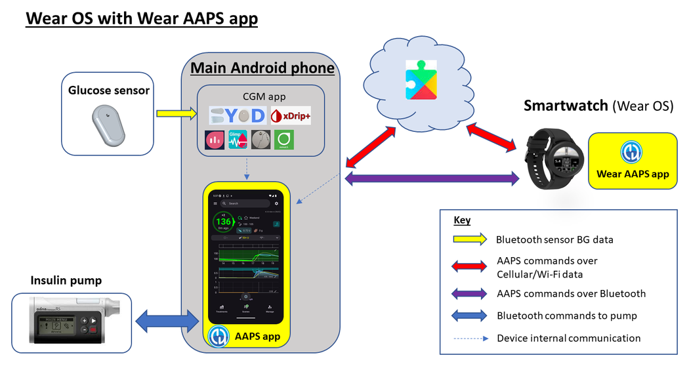

Un cop hàgiu [configurat **AAPS** al vostre rellotge](../WearOS/BuildingAapsWearOS.md), trobareu molts detalls sobre les esferes del rellotge i les seves funcions a [Configurar AAPS al vostre rellotge Wear OS](../WearOS/WearOsSmartwatch.md).

En resum, des del rellotge intel·ligent es poden fer aquestes funcions:

* establir un objectiu temporal

* fer servir la calculadora de bolus (les variables del càlcul es poden definir a la configuració del telèfon)

* administrar e-carbs

* administrar un bolus (insulina + carbohidrats)

* configuració del rellotge

* estat

* comprovar l'estat de la bomba

* comprovar l'estat del llaç

* comprovar i canviar el perfil, CPP (Circadian Percentage Profile = desplaçament horari + percentatge)

* mostrar la TDD (dosi diària total = bolus + basal per dia)

* Bolus remot quan el cuidador i el nen amb DT1 són en llocs diferents (és possible amb el rellotge **AAPS** i el telèfon **AAPS** si tots dos dispositius estan connectats a la xarxa)

#### Comunicació dels cuidadors amb el rellotge mitjançant altres aplicacions (com WhatsApp)

Es poden afegir altres aplicacions al rellotge, com WhatsApp, per enviar missatges (per exemple) entre cuidadors i nens. És important tenir només UN compte de Google associat al telèfon; si no, el rellotge no rebrà aquestes dades. Cal tenir 13 anys o més per tenir un compte de Samsung, i s'ha de crear amb la mateixa adreça de correu que es fa servir al telèfon Android.

Hi ha un vídeo que explica com configurar WhatsApp per a missatges al rellotge Galaxy 4 (no hi teniu totes les funcions de WhatsApp) [aquí](https://gorilla-fitnesswatches.com/how-to-get-whatsapp-on-galaxy-watch-4/)

Si feu ajustos tant a l'aplicació **Galaxy wearable** del telèfon **AAPS** com al rellotge, els missatges de WhatsApp poden avisar amb una vibració suau, i el missatge de WhatsApp es pot mostrar per sobre del watchface.

### Opció 2) **AAPS** al rellotge, per controlar a distància **AAPS** en un telèfon

De manera semblant a fer servir un telèfon seguidor amb **AAPSClient** o ordres SMS (vegeu les seccions anteriors), un rellotge intel·ligent es pot fer servir per controlar **AAPS** a distància i veure totes les dades del perfil. Una diferència clau respecte a un telèfon seguidor és que l'enllaç entre el rellotge i el telèfon **AAPS** és per Bluetooth i no necessita ni Nightscout ni codi d'autenticació. Com a nota, si el rellotge i el telèfon **AAPS** enllaçats per Bluetooth també estan en una xarxa Wi-Fi o de dades mòbils, el rellotge també es comunicarà amb el telèfon **AAPS** per aquesta xarxa, i l'abast de comunicació serà més gran. Això inclou lliurar un bolus a distància quan el cuidador amb el rellotge **AAPS** i el nen amb DT1 (amb el telèfon **AAPS**) són en llocs diferents, cosa que pot ser útil quan el nen amb DT1 és a l'escola.

Per tant, un rellotge intel·ligent per al control remot sovint és útil en qualsevol situació en què:

a)  Les ordres d'**AAPSClient** o **SMS** no poden funcionar; o

b)  L'usuari vol evitar escriure un codi d'autenticació (com cal per a les ordres SMS).

Un rellotge intel·ligent necessita **Wear OS 3 o més nou** per poder controlar **AAPS**. Comproveu les especificacions tècniques del rellotge i vegeu la pàgina [Rellotges intel·ligents i AAPS](../Getting-Started/Watches.md). Si teniu dubtes, cerqueu o pregunteu als grups de Facebook/Discord d'**AAPS**.

A continuació hi ha guies pas a pas per configurar **AAPS** al popular Samsung Galaxy Watch 4 (40 mm). El rellotge [Garmin](https://apps.garmin.com/en-US/apps/a2eebcac-d18a-4227-a143-cd333cf89b55?fbclid=IwAR0k3w3oes-OHgFdPO-cGCuTSIpqFJejHG-klBTm_rmyEJo6gdArw8Nl4Zc#0) també és una opció popular. Si teniu experiència configurant un altre rellotge intel·ligent i creieu que pot ser útil per a altres persones, afegiu-ho a aquestes pàgines ([editeu la documentació](../SupportingAaps/HowToEditTheDocs.md)) per compartir-ho amb tota la comunitat d'**AAPS**.

### Opció 3) AAPSClient en un rellotge, per controlar a distància **AAPS** en un telèfon

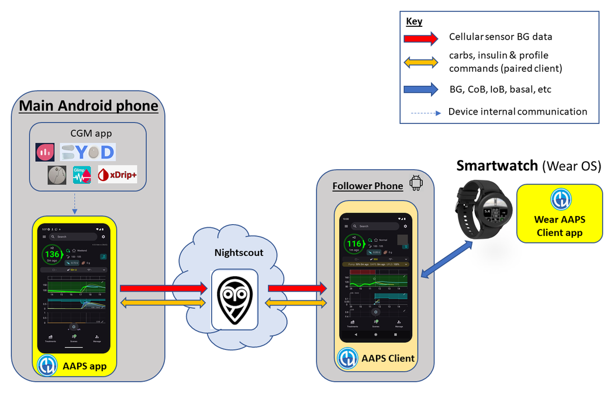

El programari per al rellotge, l'apk de Wear d'**AAPSClient**, es pot descarregar directament de [GitHub](https://github.com/nightscout/AndroidAPS/releases/).

Per descarregar el programari, feu clic a l'aplicació de rellotge que correspon a l'aplicació client del telèfon: **wear-aapsclient-release_**_versió_ va amb **AAPSClient**, **wear-aapsclient2-release_**_versió_ va amb **AAPSClient2** (vegeu [Sobre AAPSClient, AAPSClient2 i AAPSClient3](#remotecontrol-aapsclient-versions)):


Després feu «Desa com» i deseu el fitxer en un lloc còmode de l'ordinador:


L'apk de Wear d'**AAPSClient** es pot transferir al telèfon i instal·lar manualment al rellotge de la mateixa manera que l'aplicació Wear d'**AAPS**, com s'explica a [Transferir l'aplicació Wear al vostre telèfon AAPS](#remote-control-transferring-the-aaps-wear-app-onto-your-aaps-phone)  


