# Controlar AAPS amb el vostre rellotge Wear OS

(Watchfaces-aaps-watchfaces)=

## Watchfaces d'AAPS

```{warning}
Els watchfaces clàssics d'**AAPS** només funcionen a Wear OS 5 i anteriors, i Wear OS 5 ja els limita. A **Wear OS 6 i posteriors**, l'aplicació del rellotge instal·la en canvi un sol watchface en el format Watch Face Format de Google: el vostre watchface personalitzat com a imatge, o el **Watchface de complicacions**. Vegeu [Canvis dels watchfaces a Wear OS](#wearos-watchface-changes) per saber què deixa de funcionar a cada versió de Wear OS, i [el watchface que instal·la AAPS](#wearos-aaps-v4-watchface) per a Wear OS 6.
```

A Wear OS 5 i anteriors, l'aplicació de rellotge d'**AAPS** porta integrats diversos watchfaces clàssics. Mostren el valor de glucèmia amb la delta, la IOB, la taxa basal activa i un gràfic de les lectures. Hi funcionen dos tocs:

* Toqueu dues vegades el valor de glucèmia per obrir el menú principal d'**AAPS**
* Toqueu dues vegades el gràfic per canviar-ne l'interval de temps

A totes les versions de Wear OS, les [complicacions](#Watchfaces-complications) i els [mosaics](#WearOsSmartwatch-wear-os-tiles) descrits en aquesta pàgina funcionen amb qualsevol watchface que tingui espai per a ells.

## Configuració

Activeu **Wear** a [**Configurador** > **Comunicació**](#Config-Builder-wear).

Per fer un bolus o altres accions des del rellotge, activeu **Control des de Wear**. Les opcions de la calculadora de bolus per al rellotge es configuren al mateix lloc: vegeu [Configuració > Wear](#preferences-wear). Mentre **Control des de Wear** està desactivat, el telèfon rebutja tots els tractaments i canvis de mode enviats des del rellotge, i el rellotge mostra *«El control des del rellotge està desactivat a la configuració de Wear del telèfon.»*

Amb **Obrir plugin** a la targeta **Wear** obriu la pantalla de Wear:

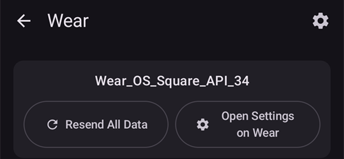

La línia de dalt mostra el nom del rellotge connectat, o **(Cap rellotge connectat)**. Des d'aquesta pantalla podeu

* Tornar a enviar totes les dades. Pot ser útil si el rellotge no ha estat connectat durant un temps i voleu enviar la informació al rellotge.
* Obriu la configuració del rellotge directament des del telèfon.
* Triar quin watchface instal·la **AAPS** al rellotge (**Watchface instal·lat al rellotge**: el vostre watchface personalitzat o el watchface de complicacions). Aquesta targeta només es mostra mentre hi ha connectat un rellotge amb **Wear OS 6** o posterior. Vegeu [el watchface que instal·la AAPS](#wearos-aaps-v4-watchface).
* Gestionar el **Watchface personalitzat** (la targeta es mostra mentre hi ha un rellotge connectat): **Carregar watchface** envia un watchface personalitzat al rellotge, **Informació del watchface** mostra els detalls del watchface carregat i els camps que conté, **Més watchfaces** obre el [lloc d'intercanvi](../ExchangeSiteCustomWatchfaces/index.md) al navegador, i **Exportar plantilla** desa una plantilla que podeu editar. A sota dels botons es mostra una vista prèvia del watchface carregat. Vegeu [Canviar a un watchface d'AAPS](#WearOS_changing-to-AAPS-watchface).

Assegureu-vos que les notificacions d'AAPS no estan bloquejades al rellotge. La confirmació d'una acció (p. ex. bolus, objectiu temporal) arriba amb una notificació que heu de lliscar i marcar.

## Accedir al menú principal d'AAPS

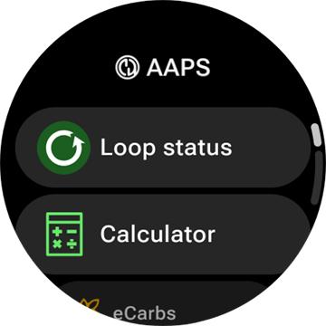

Per obrir el menú principal d'**AAPS**, feu servir una d'aquestes opcions:

* obriu **AAPS** des de la llista d'aplicacions del rellotge
* toqueu una complicació d'**AAPS** que obri el menú, vegeu [Configuració de les complicacions](#WearOsSmartwatch-complication-settings)
* toqueu el mosaic **Gràfic glucèmia** amb l'**Acció en tocar** posada a **Menú principal**, vegeu [Configuració dels mosaics](#WearOsSmartwatch-wear-os-tiles)
* en un watchface clàssic d'**AAPS**, toqueu dues vegades el valor de glucèmia

(WearOsSmartwatch-loop-status)=

## Pantalla Estat del llaç

La pantalla **Estat del llaç** mostra un resum del que fa el llaç, sense haver de treure el telèfon. Obriu-la des del menú principal d'AAPS (**Estat del llaç**, o **Estat → Llaç**), o tocant la complicació **Glucèmia**. El menú **Estat** també té una pàgina **Bomba** i una pàgina **TDD** amb les dosis diàries totals.

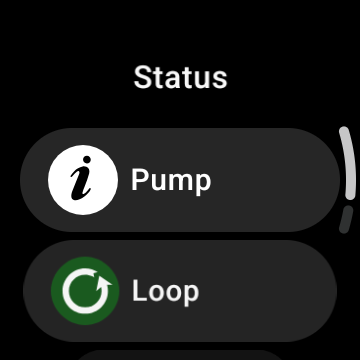

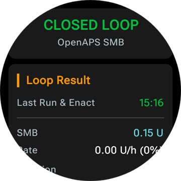

La pantalla és una llista de targetes. Desplaceu-vos cap avall per veure-les totes:

* **Mode de funcionament**: el mode actual (llaç tancat, llaç obert, LGS, suspès, desconnectat…) i, per a un mode temporal, quant de temps li queda.
* **Resultat del llaç**: quan es va executar el llaç per última vegada, i la basal temporal o l'SMB que va demanar.
* **Escena**: només mentre hi ha una [escena](#scenes-from-watch) activa: el seu nom, el temps que queda (o **Fins que s'acabi** per a una escena sense hora de fi) i l'**Escena següent** que comença quan s'acaba.
* **Objectius**: el vostre objectiu, i l'objectiu temporal si n'hi ha un en marxa.
* **Perfil**: el nom del perfil actiu, amb el seu **Percentatge** i **Desplaçament horari** quan no tenen els valors per defecte. Un canvi de perfil temporal es destaca i mostra quant de temps li queda i el perfil on torna quan s'acaba (**Torna a**).
* **Sensibilitat**: les mateixes línies que l'indicador de sensibilitat de la pantalla principal del telèfon: el valor d'Autosens i l'ISF del perfil, el variable i l'efectiu.

Una icona petita d'escena al costat d'un mode de funcionament, d'un objectiu temporal o d'un canvi de perfil vol dir que ho ha definit l'escena activa (**Definit per l'escena activa**). La mateixa icona es mostra al selector de **Mode de funcionament**.

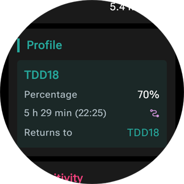

(WearOsSmartwatch-bolus-calculator)=

## La calculadora de bolus al rellotge

Obriu la **Calculadora** des del menú principal d'**AAPS**, des del [mosaic Accions](#WearOsSmartwatch-wear-os-tiles) o des d'una complicació configurada per obrir la calculadora. Passa per unes quantes pàgines; llisqueu de dreta a esquerra per continuar:

| Carbs                                                                       | Petició                                                                  | Resultat                                                                 | Càlcul                                                                           | Confirmar                                                                    |
| --------------------------------------------------------------------------- | ------------------------------------------------------------------------ | ------------------------------------------------------------------------ | -------------------------------------------------------------------------------- | ---------------------------------------------------------------------------- |
| 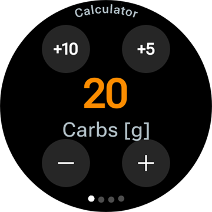 | 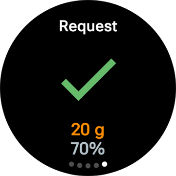 | 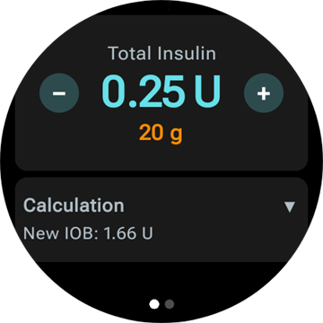 | 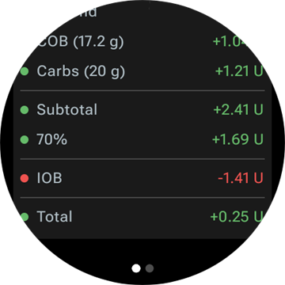 | 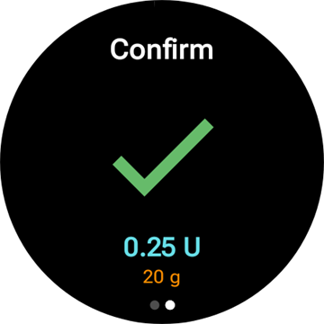 |

1. **Carbs**: introduïu els carbohidrats amb els botons **+10**, **+5**, **−** i **+**.
2. **Petició**: l'última pàgina abans que el telèfon prengui el control. Mostra el que heu introduït: els carbohidrats, i el tipus d'àpat, l'hora dels carbohidrats i el percentatge quan els feu servir, vegeu [Pàgines opcionals](#WearOsSmartwatch-calculator-optional-pages). Toqueu la marca de validació per enviar-ho al telèfon, que fa el càlcul.
3. **Resultat**: el bolus que proposa **AAPS**, amb els carbohidrats a sota: els carbohidrats d'ara i els e-carbs de més tard, l'hora dels carbohidrats i la campaneta del recordatori d'àpat. Ajusteu la dosi amb **−** i **+**, vegeu més avall. Desplaceu-vos cap avall fins a la targeta **Càlcul**: toqueu-la per veure totes les línies del càlcul, igual que al telèfon.
4. **Confirmar**: llisqueu fins a la segona pàgina i toqueu la marca de validació. El telèfon lliura el bolus i registra els carbohidrats.

(WearOsSmartwatch-calculator-optional-pages)=

### Pàgines opcionals

Tres opcions del rellotge afegeixen cadascuna una pàgina després de **Carbs**. Per defecte estan desactivades. Obriu el menú principal d'**AAPS**, després **Configuració** > **Interfície**, i activeu les que vulgueu; quan n'hi ha més d'una activada, les pàgines surten en aquest ordre: **Tipus d'àpat**, **Hora dels carbohidrats**, **Percentatge**. Els punts de la part de baix de la calculadora mostren quantes pàgines té.

| Configuració                                                                                       | Tipus d'àpat                                                                     | Hora dels carbohidrats                                                                      | Percentatge                                                                      |
| -------------------------------------------------------------------------------------------------- | -------------------------------------------------------------------------------- | ------------------------------------------------------------------------------------------- | -------------------------------------------------------------------------------- |
| 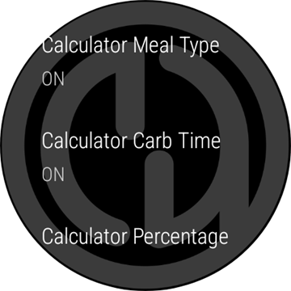 | 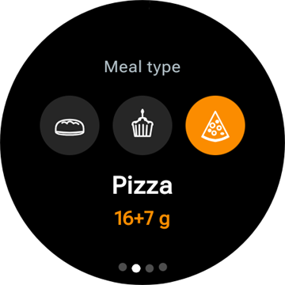 | 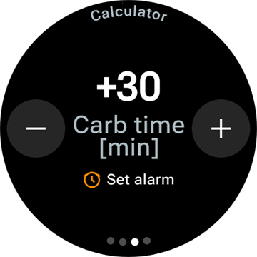 | 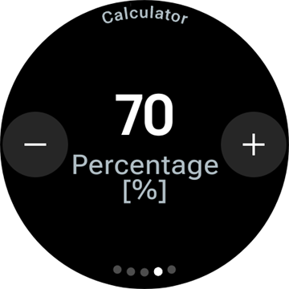 |

* **Tipus d'àpat a la calculadora**: **Pa**, **Pastís** o **Pizza**, que divideix els carbohidrats d'un àpat lent en carbohidrats d'ara i e-carbs de més tard, vegeu [Triar el tipus d'àpat](#WearOsSmartwatch-wizard-meal-type).
* **Temps dels carbohidrats a la calculadora**: els minuts fins que mengeu, amb una campaneta **Establir alarma** per al recordatori d'àpat, vegeu [L'hora dels carbohidrats i el recordatori d'àpat](#WearOsSmartwatch-wizard-carb-time).
* **Percentatge calculadora**: un percentatge del bolus calculat, per exemple 70% quan voleu una dosi més petita. Comença al **Percentatge del bolus** de la [configuració de la calculadora de bolus](#Preferences-deliver-this-part-of-bolus-wizard-result) del telèfon, 100% si no l'heu canviat. Vegeu també la nota a [Ajustar el bolus a la pàgina de resultat](#WearOsSmartwatch-wizard-result).

(WearOsSmartwatch-wizard-result)=

### Ajustar el bolus a la pàgina de resultat

La pàgina de resultat mostra el bolus que proposa **AAPS**, amb un botó **−** i un botó **+**. Feu-los servir per ajustar la dosi abans de confirmar-la, sense tornar al telèfon.

| Proposat                                                                         | Més                                                                                   | Menys                                                                                |
| -------------------------------------------------------------------------------- | ------------------------------------------------------------------------------------- | ------------------------------------------------------------------------------------ |
| 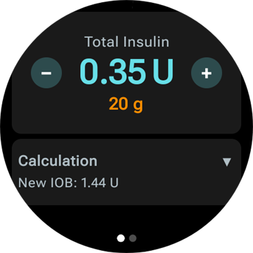 | 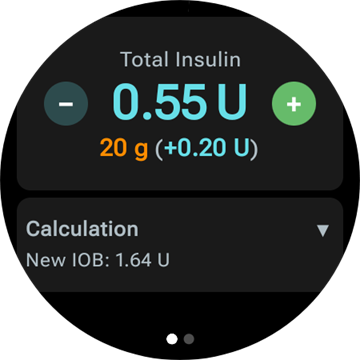 | 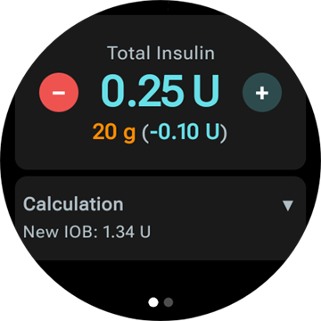 |

* Cada toc canvia el bolus en **un pas de la vostra bomba**, de manera que les quantitats que s'ofereixen sempre coincideixen amb el que la bomba pot lliurar de veritat.
* **Manteniu premut** un botó per continuar canviant el valor. Com més temps el manteniu, més ràpid va.
* No podeu baixar de **0 U** ni passar de la vostra configuració de **bolus màxim**.

El total actual es mostra a la pàgina de resultat, així sempre veieu la quantitat que esteu a punt de confirmar. El canvi es mostra després dels carbohidrats, per exemple *(+0,20 U)*, i el botó que heu fet servir es torna verd per a més o vermell per a menys.

Si **AAPS** ha hagut de limitar la dosi, per exemple perquè el bolus calculat supera la vostra configuració de **bolus màxim**, una línia d'avís en color ambre sota el total ho indica (per exemple *«Restricció de bolus aplicada»*). El mateix passa amb una quantitat de carbohidrats limitada.

```{admonition} Això no és el mateix que Percentatge calculadora :class: note L'opció **Percentatge calculadora** us permet introduir un *percentatge* del bolus calculat **abans** que aparegui la pàgina de resultat. Els botons **−** i **+** ajusten la *quantitat final* **a** la pàgina de resultat. Podeu fer servir totes dues coses.

    <br />(WearOsSmartwatch-wizard-meal-type)=
    
    ### Triar el tipus d'àpat
    
    La calculadora del rellotge pot dividir els carbohidrats d'un àpat lent en carbohidrats d'ara i e-carbs de més tard, com el [tipus de carbohidrats](#AapsScreens-carbs-type) de la calculadora del telèfon. Activeu **Tipus d'àpat a la calculadora** a **Configuració** > **Interfície** del rellotge. Per defecte l'opció està desactivada, i llavors la pàgina **Tipus d'àpat** no es mostra.
    
    * Després d'introduir els carbohidrats, una pàgina **Tipus d'àpat** mostra tres icones: **Pa**, **Pastís** i **Pizza**. Toqueu una icona: el seu nom i els carbohidrats que dona es mostren sota les icones, per exemple *65 g* per al pa, o *52+22 g* per a la pizza (52 g ara i 22 g d'e-carbs més tard). **Pa** és el valor per defecte i deixa tots els carbohidrats per a ara.
    * Les pàgines de petició i de confirmació mostren els carbohidrats de la mateixa manera (*52+22 g*). La pàgina de resultat també mostra quan comencen els e-carbs i quant de temps duren.
    * El bolus només es calcula per als carbohidrats que mengeu ara. La divisió fa servir els mateixos números que la calculadora del telèfon.
    
    (WearOsSmartwatch-wizard-carb-time)=
    
    ### L'hora dels carbohidrats i el recordatori d'àpat
    
    Amb **Temps dels carbohidrats a la calculadora** activat a **Configuració** > **Interfície** del rellotge, després dels carbohidrats ve una pàgina **Hora dels carbohidrats**: els minuts fins que mengeu, com l'[hora dels carbohidrats](#aaps-screens-bolus-wizard) de la calculadora del telèfon. **Ara** és el valor per defecte. **−** i **+** el mouen en passos de 5 minuts, fins a una hora abans o després d'ara. Una hora en el passat és per a carbohidrats que ja heu menjat.
    
    Amb una hora en el futur, sota el valor apareix una campaneta **Establir alarma**. Per defecte està activada; toqueu-la per desactivar-la. Les pàgines de petició i de resultat mostren l'hora dels carbohidrats, per exemple *+30 min*, i la campaneta. El telèfon registra els carbohidrats a aquella hora, hi mou també els e-carbs del tipus d'àpat i inicia el seu recordatori **Hora de menjar**.
    
    | Resultat | Gràfic de glucèmia | En marxa | Hora de menjar |
    | --- | --- | --- | --- |
    | 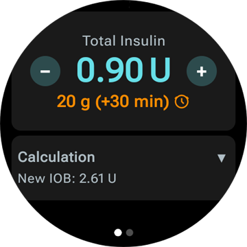 | 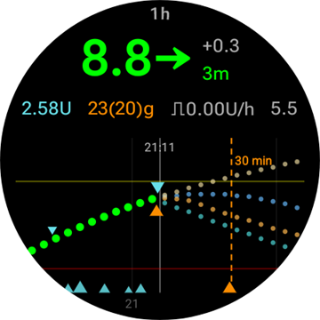 | 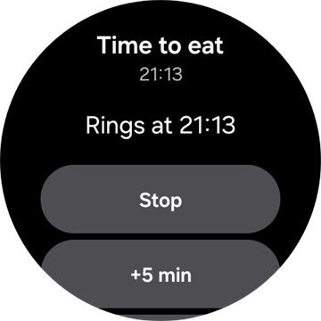 | 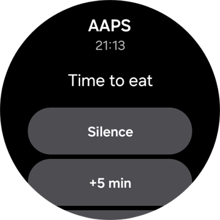 |
    
    El recordatori també funciona al rellotge, així sona encara que el telèfon no estigui a prop:
    
    * La pantalla **Gràfic glucèmia**, el mosaic **Gràfic glucèmia** i el gràfic del **Watchface de complicacions** dibuixen una línia taronja discontínua on sonarà el recordatori, amb els minuts que queden al costat.
    * Mentre està en marxa, una notificació silenciosa **Hora de menjar** amb **Aturar** i **+5 min** queda a la llista de notificacions. Torna a aparèixer si la llisqueu per treure-la, fins que s'acaba el recordatori.
    * Quan arriba l'hora, el rellotge vibra, i torna a vibrar cada mig minut durant cinc minuts fins que respongueu. La notificació ofereix **Silenciar** i **+5 min**, i si la llisqueu per treure-la també se silencia.
    
    **Aturar**, **Silenciar** i **+5 min** fan el mateix al rellotge, al telèfon i en un **AAPSClient**, i tots mostren el mateix recordatori.
    
    (Watchfaces-complications)=
    
    ## Complicacions
    
    _Complicació_ és un terme de la rellotgeria tradicional, on descriu un afegit a l'esfera principal, com una altra finestra petita o subesfera (amb la data, el dia de la setmana, la fase de la lluna, etc.). Wear OS 2.0 porta aquesta idea als proveïdors de dades personalitzats, com el temps, les notificacions, els comptadors d'activitat física i més: es poden afegir a qualsevol watchface que admeti complicacions.
    
    L'aplicació AAPS per a Wear OS admet complicacions des de la versió `2.6`, i permet configurar qualsevol watchface de tercers que admeti complicacions perquè mostri dades d'AAPS (glucèmia amb la tendència, IOB, COB, etc.).
    
    Les complicacions també serveixen de **drecera** a les funcions d'AAPS. Si els toqueu, podeu obrir menús i diàlegs d'AAPS (segons el tipus de complicació i la configuració).
    
    
    
    ### Tipus de complicacions
    
    L'aplicació AAPS per a Wear OS només proporciona dades en brut, segons formats predefinits. És el watchface de tercers el que decideix on i com es dibuixen les complicacions, inclosos la disposició, la vora, el color i la font. Dels molts tipus de complicacions de Wear OS que hi ha, AAPS fa servir:
    
    * `SHORT TEXT` - Conté dues línies de text, de 7 caràcters cadascuna, de vegades anomenades valor i etiqueta. Normalment es dibuixa dins d'un cercle o d'una píndola petita, una sota l'altra o una al costat de l'altra. És una complicació amb molt poc espai. AAPS intenta treure els caràcters que no calen perquè hi càpiga: arrodoneix els valors, treu els zeros del principi i del final dels valors, etc.
    * `LONG TEXT` - Conté dues línies de text, d'uns 20 caràcters cadascuna. Normalment es dibuixa dins d'un rectangle o d'una píndola llarga, una sota l'altra. Es fa servir per a més detalls i per a l'estat en text.
    * `RANGED VALUE` - Es fa servir per a valors dins d'un interval predefinit, com un percentatge. Conté una icona i una etiqueta, i normalment es dibuixa com un indicador circular de progrés.
    * `LARGE IMAGE` - Imatge de fons personalitzada que es pot fer servir com a fons (si el watchface ho admet).
    * `SMALL IMAGE` / `MONOCHROMATIC IMAGE` - Una icona petita. En un espai `SMALL IMAGE`, AAPS la dibuixa amb el seu propi color; en un espai `MONOCHROMATIC IMAGE`, el watchface la pinta.
    
    ### Configurar les complicacions
    
    Per afegir una complicació al watchface, configureu-lo amb una pulsació llarga i tocant la icona de l'engranatge de sota. Segons com els configuri cada watchface: o bé toqueu els espais buits, o bé entreu al menú de configuració de complicacions del watchface. Les complicacions d'AAPS estan agrupades a l'entrada de menú AAPS.
    
    Quan configureu complicacions al watchface, Wear OS mostra i filtra la llista de complicacions que caben a l'espai triat del watchface. Si no trobeu una complicació a la llista, probablement és pel seu tipus, que no es pot fer servir en aquell espai.
    
    ### Complicacions que ofereix AAPS
    
    AAPS ofereix les complicacions següents. «Obre» és el que fa un toc quan l'**Acció toc complicació** està a **Per defecte**, vegeu [Configuració de les complicacions](#WearOsSmartwatch-complication-settings).
    
    **Glucèmia**
    
    * **Glucèmia** (`SHORT TEXT`, obre _Estat del llaç_): el valor de glucèmia amb la fletxa de tendència a la primera línia, l'antiguitat de la lectura i la delta a la segona.
    * **Glucèmia (gran)** (`SHORT TEXT`, obre _Gràfic glucèmia_): només el valor de glucèmia a la primera línia, perquè el watchface el pugui dibuixar gran. L'antiguitat i la fletxa de tendència són a la segona línia.
    * **Gràfic glucèmia** (`SMALL IMAGE` / `LARGE IMAGE`, obre _Gràfic glucèmia_): el gràfic de glucèmia com a imatge, per a watchfaces amb un espai d'imatge. Aquest és el gràfic del **Watchface de complicacions**.
    * **Estat complet** (`LONG TEXT`, obre _Menú_): la majoria de dades en una línia: el valor de glucèmia amb la fletxa de tendència, la delta i l'antiguitat de la lectura, i després els carbohidrats a bord, la insulina a bord i la taxa basal.
    * **Estat complet (invertit)** (`LONG TEXT`, obre _Menú_): el mateix, amb les dues línies intercanviades, per a watchfaces que només mostren una de les dues línies d'un espai `LONG TEXT`.
    
    **Insulina i carbohidrats**
    
    * **Icona IoB** (`SHORT TEXT`, obre _Bolus_): la insulina a bord amb una icona de xeringa.
    * **IoB detallat** (`SHORT TEXT`, obre _Bolus_): la insulina a bord total a la primera línia, la part de bolus i la part de basal a la segona.
    * **Icona CoB** (`SHORT TEXT`, obre _Calculadora_): els carbohidrats a bord amb una icona de carbohidrats.
    * **CoB detallat** (`SHORT TEXT`, obre _Calculadora_): els carbohidrats a bord d'ara a la primera línia, els carbohidrats que encara han de venir (e-carbs) a la segona.
    * **CoB i IoB** (`SHORT TEXT`, obre _Calculadora_): la insulina a bord a la primera línia, els carbohidrats a bord a la segona.
    
    **Basal i objectiu**
    
    * **Taxa basal** (`SHORT TEXT`, obre _Menú_): la taxa basal actual.
    * **BR i IoB** (`SHORT TEXT`, obre _Menú_): la insulina a bord a la primera línia, la taxa basal a la segona.
    * **BR i objectiu** (`SHORT TEXT`, obre _Objectiu temporal_): l'objectiu a la primera línia, amb el temps que queda quan hi ha un objectiu temporal en marxa, i la taxa basal a la segona.
    * **Objectiu** (`SHORT TEXT`, obre _Objectiu temporal_): l'objectiu a la primera línia i, mentre hi ha un objectiu temporal en marxa, el temps que li queda a la segona.
    * **BR, CoB i IoB** (`SHORT TEXT`, obre _Menú_): la taxa basal a la primera línia, els carbohidrats a bord i la insulina a bord a la segona.
    
    **Llaç i telèfon**
    
    * **Mode de funcionament** (`SMALL IMAGE` / `ICON`, obre _Selector de mode de funcionament_): el mode actual del llaç com a icona: llaç tancat, llaç obert, suspensió per glucèmia baixa, suspès, desconnectat o desactivat. Un toc obre un selector amb els canvis de mode permesos en aquell moment, per exemple **Suspendre el llaç**, **Desconnectar bomba**, **Reprendre llaç** o **Reconnectar bomba**. El mateix selector és al menú principal d'**AAPS**, a **Mode de funcionament**.
    * **Bateria uploader/telèfon** (`RANGED VALUE` / `SHORT TEXT` / `ICON`, obre _Estat_): la bateria del telèfon amb **AAPS**, com a indicador amb una icona de bateria, com a número o només com a icona. S'actualitza juntament amb les altres dades d'**AAPS**, normalment cada 5 minuts amb una lectura nova.
    
    El selector de **Mode de funcionament**, tal com s'obre des de la complicació, el menú principal o el mosaic Mode de funcionament:
    
    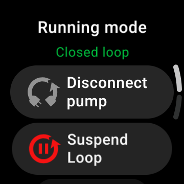
    
    (WearOsSmartwatch-complication-settings)=
    
    ### Configuració de les complicacions
    
    Al menú principal d'**AAPS** del rellotge, obriu **Configuració** > **Complicació**:
    
    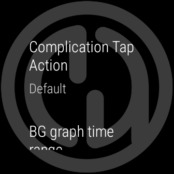
    
    * **Acció toc complicació** (per defecte `Per defecte`): què obre un toc en una complicació d'**AAPS**, per a totes les complicacions alhora:
      * _Per defecte_: el que obre la mateixa complicació, vegeu la llista de dalt
      * _Menú_: el menú principal d'**AAPS**
      * _Calculadora_: la calculadora de bolus
      * _Tractament_: el diàleg de tractament, insulina i carbohidrats
      * _e-carbs_: el diàleg d'e-carbs
      * _Estat_: el menú d'estat
      * _Mode de funcionament_: el selector de mode de funcionament. Cal tenir **Control des de Wear** activat a la configuració de Wear del telèfon; si no, s'obre el menú principal.
      * _Cap_: un toc no fa res
    * **Interval de temps del gràfic de glucèmia** (per defecte `3 hores`): quantes hores mostra la complicació **Gràfic glucèmia**: 1, 3 o 6. El mosaic Gràfic glucèmia té la seva pròpia opció.
    * **Unicode a complicacions** (per defecte `Activat`): les complicacions fan servir símbols Unicode com `Δ` per a la delta, `⁞` com a separador i `⎍` per a la taxa basal. Com es veuen depèn de la font del watchface. Poseu-ho a `Desactivat` quan un watchface els dibuixa com a quadrats o espais en blanc.
    
    (WearOsSmartwatch-wear-os-tiles)=
    
    ## Mosaics de Wear OS
    
    Els mosaics són les pàgines a les quals arribeu lliscant des del watchface. **AAPS** en porta set, cadascun amb un conjunt de fins a quatre botons. Un toc en un botó obre el diàleg corresponent al rellotge, o us demana que confirmeu, i després el telèfon fa la feina. Un mosaic és una drecera, no una pantalla d'estat: no guarda l'estat de l'aplicació del telèfon.
    
    Abans de fer servir els mosaics, activeu **Control des de Wear** a [Configuració > Wear](#preferences-wear).
    
    ### Afegir un mosaic
    
    Hi ha dues maneres, segons el rellotge i el telèfon:
    
    1. Al rellotge: llisqueu des del watchface més enllà de l'últim mosaic fins a **Add tile** (Afegir mosaic) i trieu un mosaic d'**AAPS**. A la majoria de rellotges, una pulsació llarga en un mosaic també obre la vista per afegir i treure mosaics.
    2. Al telèfon, a l'aplicació complementària del rellotge (**Galaxy Wearable** per a Samsung, **Wear OS** per a altres marques): obriu **Tiles** (Mosaics), toqueu **Add** (Afegir) i trieu els mosaics d'**AAPS** que vulgueu. L'ordre dels mosaics es pot canviar arrossegant-los.
    
    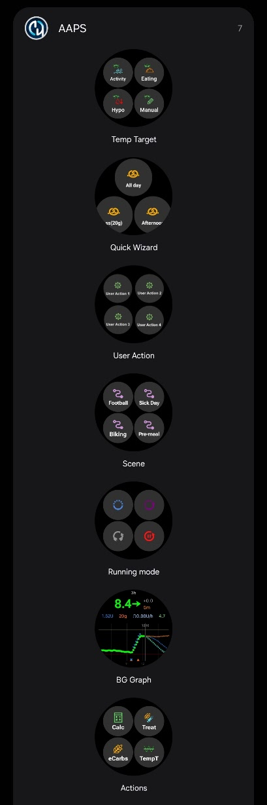
    
    ### Configuració dels mosaics
    
    Els mosaics **Accions**, **Objectiu temporal**, **Gràfic glucèmia** i **Escena** tenen opcions al rellotge. Obriu el menú principal d'**AAPS**, després **Configuració** > **Mosaics**, i trieu el mosaic. Una pulsació llarga al mosaic també n'obre la configuració, excepte als rellotges Pixel. Els altres tres mosaics s'omplen des del telèfon i no tenen res a configurar al rellotge.
    
    | Menú principal | Configuració | Mosaics |
    | --- | --- | --- |
    | 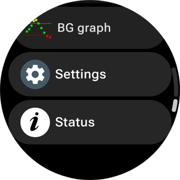 | 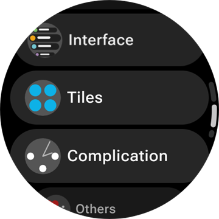 | 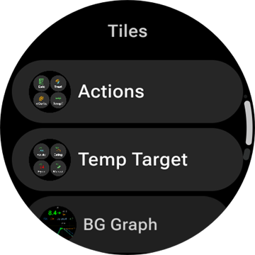 |
    
    La configuració d'un mosaic és una llista dels seus quatre llocs. Toqueu un lloc per triar què hi mostra, o **Cap** per deixar-lo buit.
    
    | Pulsació llarga al mosaic | Configuració del mosaic Objectiu temporal |
    | --- | --- |
    | 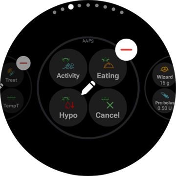 | 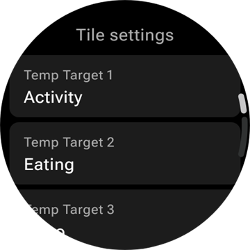 |
    
    Cada mosaic té quatre llocs. Un mosaic amb més entrades mostra les quatre primeres.
    
    ### Mosaic Accions
    
    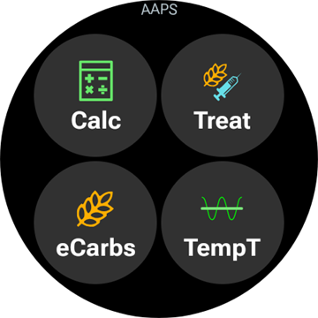
    
    Dreceres als diàlegs de l'aplicació de rellotge d'**AAPS**. Trieu-ne fins a quatre a la configuració del mosaic:
    
    * **Calc**: la calculadora de bolus, amb una entrada de carbohidrats, un percentatge opcional [1] i un tipus d'àpat opcional [2]
    * **Tract**: insulina i carbohidrats alhora
    * **Insulina**: un bolus, introduït en unitats
    * **Carbs**: carbohidrats, també carbohidrats estesos. S'accepta una quantitat **negativa**, fins al vostre COB actual, per corregir carbohidrats que heu introduït abans. Els carbohidrats retirats es mostren al gràfic de glucèmia del rellotge.
    * **e-carbs**: carbohidrats estesos
    * **TempT**: un objectiu temporal amb un objectiu i una durada personalitzats
    * **Canvi de perfil**: un canvi de perfil amb percentatge, desplaçament horari i durada
    
    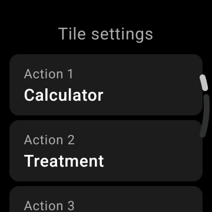
    
    Els diàlegs que obren els botons. Llisqueu de dreta a esquerra per arribar a la pàgina següent d'un diàleg, i toqueu la marca de validació a l'última pàgina per enviar la petició al telèfon:
    
    | Tract | Insulina | Carbs | e-carbs | TempT | Canvi de perfil |
    | --- | --- | --- | --- | --- | --- |
    | 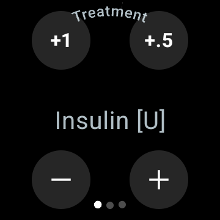 | 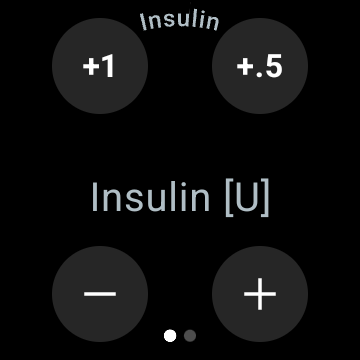 |  | 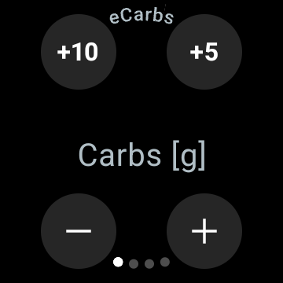 | 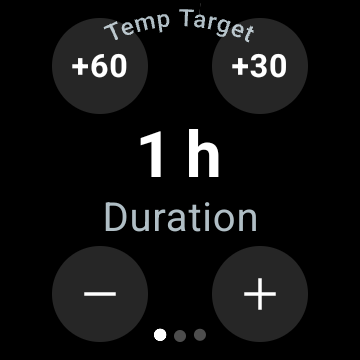 | 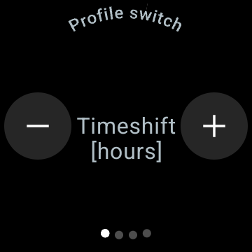 |
    
    [1] A **Configuració** > **Interfície** del rellotge, activeu **Percentatge calculadora** per mostrar l'entrada de percentatge a la calculadora de bolus. El percentatge per defecte ve del [«Percentatge del bolus»](#Preferences-deliver-this-part-of-bolus-wizard-result) del telèfon. Les altres opcions de la calculadora són les del telèfon, a **Configuració** > **Configuració de la calculadora de bolus**.
    
    [2] A **Configuració** > **Interfície** del rellotge, activeu **Tipus d'àpat a la calculadora** per mostrar la pàgina **Tipus d'àpat**, on trieu **Pa**, **Pastís** o **Pizza** per dividir els carbohidrats d'un àpat lent en carbohidrats d'ara i e-carbs de més tard. Vegeu [Triar el tipus d'àpat](#WearOsSmartwatch-wizard-meal-type).
    
    ### Mosaic Objectiu temporal
    
    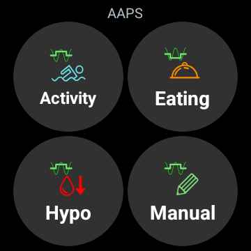
    
    Objectius temporals dels valors predefinits del telèfon. Configureu la durada i l'objectiu de cada valor predefinit al telèfon, a **Configuració** > [Objectius temporals per defecte](#Preferences-default-temp-targets). Trieu-ne fins a quatre a la configuració del mosaic:
    
    * **Activitat (esport)**: per fer esport
    * **Menjar aviat**: un objectiu més baix perquè hi hagi més insulina a bord a l'hora de l'àpat
    * **Hipo**: un objectiu més alt durant el tractament d'una hipoglucèmia
    * **Manual**: un objectiu i una durada personalitzats
    * **Cancel·lar**: atura l'objectiu temporal en marxa. El botó només es mostra mentre hi ha un objectiu temporal en marxa.
    
    ### Mosaic Assistent ràpid
    
    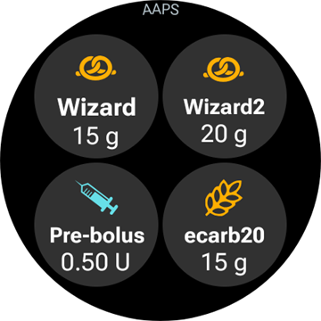
    
    Les entrades d'[Assistent ràpid](#quickwizards) del telèfon que tenen activat **Mostrar al rellotge**, dins de les seves hores vàlides. Una entrada de carbohidrats mostra els seus carbohidrats en g; una entrada d'insulina, la seva dosi fixa en U. Un toc executa l'entrada després d'una confirmació al rellotge. No hi ha res a configurar al rellotge: editeu les entrades al telèfon i activeu **Mostrar al rellotge** a **Selecció de dispositiu** per a cada entrada que vulgueu al mosaic. Fora de les hores vàlides de totes les vostres entrades, el mosaic mostra **Cap configuració disponible**.
    
    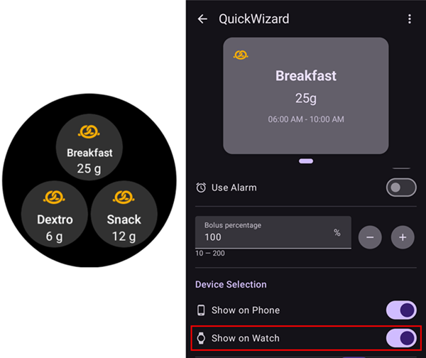
    
    ### Mosaic Escena
    
    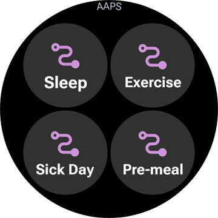
    
    Les [escenes](#scenes-from-watch) del telèfon. Cadascun dels quatre llocs es configura com a **Automàtic**, **Cap** o una escena a la configuració del mosaic. Un lloc **Automàtic** agafa la següent escena de la llista del telèfon que cap altre lloc no ha agafat. Un lloc configurat amb una escena que ja no existeix al telèfon mostra **No disponible**.
    
    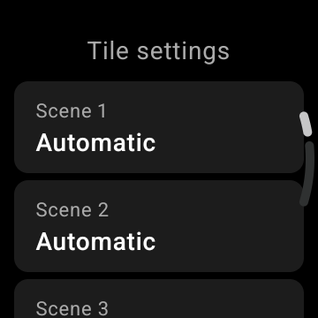
    
    ### Mosaic Mode de funcionament
    
    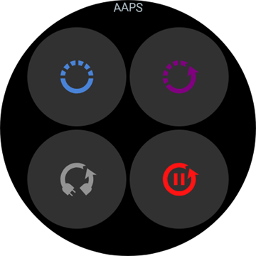
    
    Els [modes de funcionament](#aaps-screens-running-mode) als quals podeu canviar des de l'actual, amb les mateixes icones que al telèfon: llaç tancat, suspensió per glucèmia baixa, llaç obert, desactivar el llaç, suspendre el llaç i desconnectar la bomba, o reprendre i reconnectar mentre un d'aquests està en marxa. **Suspendre el llaç** i **Desconnectar bomba** primer us demanen una durada. El telèfon decideix quins modes s'ofereixen; el rellotge mostra els quatre primers i no mostra **Desactivar llaç** quan **Suspendre el llaç** és a la llista.
    
    ### Mosaic Acció de l'usuari
    
    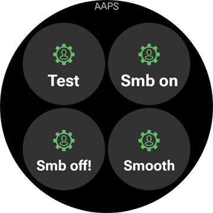
    
    Un botó per a cada [automatització](#automations-automation-triggers) del telèfon que té com a activador **Acció de l'usuari**. Un toc us demana que confirmeu, i després el telèfon executa les accions de l'automatització. Els botons porten el nom de les automatitzacions, així que poseu-los noms curts. No hi ha res a configurar al rellotge.
    
    ### Mosaic Gràfic glucèmia
    
    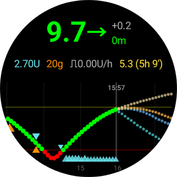
    
    El valor de glucèmia amb la fletxa, la delta i l'antiguitat; a sota, IOB, COB, taxa basal i objectiu; i el gràfic de glucèmia amb les prediccions, els bolus, els carbohidrats i els SMB. Dues opcions al rellotge: **Interval de temps** (1, 3 o 6 hores) i **Acció en tocar**, que obre el **Gràfic glucèmia** complet, el **Menú principal** o la pantalla **Estat del llaç**.
    
    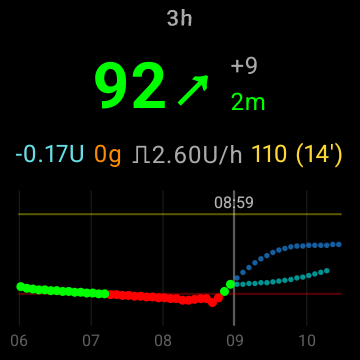
    
    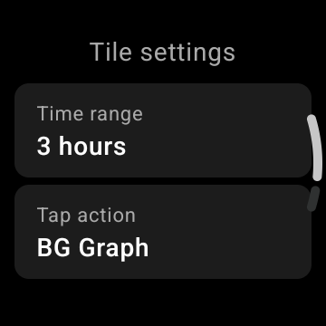
    
    ## Sempre activa
    
    Aquesta secció i la següent s'apliquen als watchfaces clàssics d'**AAPS** a Wear OS 5 i anteriors. A Wear OS 6, el **Watchface de complicacions** té la seva pròpia pantalla sempre activa, vegeu [el watchface que instal·la AAPS](#wearos-aaps-v4-watchface).
    
    Una bateria de llarga durada és un repte per als rellotges intel·ligents Android Wear OS. Alguns rellotges intel·ligents arriben a unes 30 hores abans d'haver-los de carregar. Per estalviar el màxim d'energia, la pantalla s'hauria d'apagar quan no la feu servir. La majoria de rellotges admeten la pantalla «Sempre activa».
    
    Des de la versió 3 d'AAPS podem fer servir «Simplificar la interfície» durant el mode sempre actiu. Aquesta interfície només mostra la glucèmia, la tendència i l'hora. Aquesta interfície està optimitzada per gastar poca energia: s'actualitza menys sovint, mostra menys informació i encén menys píxels per estalviar energia a les pantalles OLED.
    
    El mode d'interfície simplificada està disponible per als watchfaces Digital Style i personalitzats. La interfície simplificada és opcional i es configura a la configuració del watchface (pulsació llarga al watchface i toqueu «editar» o la icona de l'engranatge). Seleccioneu l'opció «Simplificar la interfície» i poseu-la a «Mode sempre encès» o «Sempre encès i carregant».
    
    ### Mode nocturn
    
    Mentre es carrega, seria útil que la pantalla pogués quedar «sempre activa» i mostrar la glucèmia durant la nit. Però els watchfaces normals són massa brillants i tenen massa informació, i els detalls són difícils de llegir amb els ulls adormits. Per això hem afegit una opció al watchface per simplificar la interfície només mentre es carrega, si s'activa a la configuració.
    
    El mode d'interfície simplificada està disponible per als watchfaces Digital Style i personalitzats. La interfície simplificada és opcional i es configura a la configuració del watchface (pulsació llarga al watchface i toqueu «editar» o la icona de l'engranatge). Seleccioneu l'opció «Simplificar la interfície» i poseu-la a «Durant la càrrega» o «Sempre encès i carregant».
    
    Les opcions per a desenvolupadors d'Android permeten que el rellotge es mantingui despert mentre es carrega. Per fer disponibles les opcions per a desenvolupadors, vegeu la [documentació oficial](https://developer.android.com/training/wearables/get-started/debugging). Poseu «Stay awake when charging» (Mantenir actiu durant la càrrega) a «on» a les opcions per a desenvolupadors.
    
    Nota: no totes les pantalles suporten bé el mode sempre actiu. Pot cremar la pantalla (marques permanents), sobretot a les pantalles OLED més antigues. En general, els rellotges enfosqueixen la pantalla per evitar que es cremi; consulteu el manual del rellotge, el fabricant o internet per tenir consells.
    
    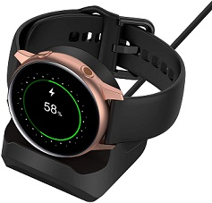
    
    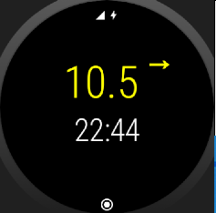
    
    (WearOsSmartwatch-phone-alarms)=
    
    ## Alarmes del telèfon al rellotge
    
    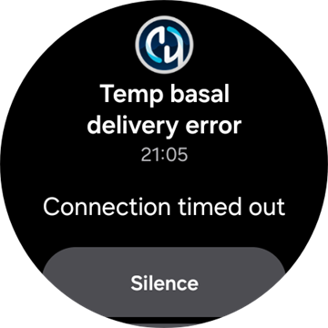
    
    El rellotge mostra les alarmes del telèfon, així veieu per què el telèfon fa soroll i podeu respondre des del canell. El rellotge vibra, i torna a vibrar cada mig minut durant cinc minuts fins que respongueu. Una notificació mostra el títol i el text de l'alarma, amb les mateixes respostes que el recordatori [Hora de menjar](#WearOsSmartwatch-wizard-carb-time):
    
    * **Silenciar**, o lliscar: l'alarma s'atura i la pantalla d'alarma del telèfon es tanca.
    * **Silenciar 5 min**: l'alarma s'atura i torna a sonar al cap de cinc minuts, al telèfon i al rellotge.
    
    Al rellotge arriben dos tipus d'alarma:
    
    * La pantalla d'alarma del telèfon (errors de la bomba, alarmes d'automatització, alarmes de glucèmia): **Silenciar** i **Silenciar 5 min**.
    * Notificacions urgents amb so, com *Bomba no accessible* o una alarma de Nightscout: només **Silenciar**. Per a aquestes, el telèfon només té **Ignorar**, i tornen per si soles mentre la causa continua.
    
    El recordatori *Hora de menjar* no s'envia d'aquesta manera: el rellotge el fa sonar ell mateix.
    
    ## Drecera per postposar alertes
    
    El rellotge [mostra l'alarma](#WearOsSmartwatch-phone-alarms) ell mateix; la drecera és una segona manera de silenciar-la, amb una sola pulsació. Es pot crear una drecera per postposar les alertes/alarmes d'AAPS. Silenciar el so des del rellotge és còmode i més ràpid, sense haver d'agafar el telèfon. Nota: igualment heu de comprovar el missatge d'alarma al telèfon i fer el que calgui, però ho podeu fer més tard. Si el rellotge té dos botons, podeu assignar una tecla al programa `AAPS Snooze Alert` (Postposar alerta AAPS).
    
    Per enllaçar el botó al Samsung Watch 4, aneu a `Settings > Advanced Features > Customize Buttons > Double press > AAPS Snooze Alert`
    
    En un watchface amb complicacions, una complicació **App shortcut** (drecera d'aplicació) configurada a **Postposar alerta AAPS** fa el mateix amb un toc. La [configuració alternativa del Watchface de complicacions](#wearos-complications-watchface-setup) fa servir el seu espai de dalt a la dreta per a això.
    
    ### Postposar xDrip
    
    Si feu servir xDrip i el teniu instal·lat al rellotge, la drecera 'AAPS Snooze Alert' també postposarà qualsevol alarma de xDrip. 
    
    
    ## Consells de rendiment i de durada de la bateria
    
    Els rellotges Wear OS són dispositius amb molt poca energia disponible. La mida de la caixa del rellotge limita la capacitat de la bateria que porta. Tot i els avenços recents en maquinari i programari, els rellotges Wear OS encara s'han de carregar cada dia.
    
    Si la bateria dura menys d'un dia (de l'alba al vespre), aquí teniu uns quants consells per trobar la causa.
    
    Les parts que gasten més bateria són:
    
    * La pantalla activa amb la retroil·luminació encesa (per a LED) o en mode d'intensitat completa (per a OLED)
    * Dibuixar a la pantalla
    * La comunicació per ràdio amb Bluetooth
    
    Com que no podem renunciar a la comunicació (necessitem dades actualitzades) i volem mostrar les dades més recents, la majoria d'optimitzacions es poden fer en el _temps de pantalla_:
    
    * Els watchfaces de fàbrica normalment estan més ben optimitzats que els personalitzats, descarregats de la botiga.
    * És millor fer servir watchfaces que limitin la quantitat de dades dibuixades en mode inactiu / atenuat.
    * Aneu amb compte quan combineu altres complicacions, com ginys del temps de tercers o d'altres que fan servir dades de fonts externes.
    * Comenceu amb watchfaces més senzills. Afegiu les complicacions d'una en una i observeu com afecten la durada de la bateria.
    * Feu servir un tema fosc al watchface. A les pantalles OLED, menys píxels encesos vol dir menys consum i menys risc de cremar la pantalla.
    * Comproveu què funciona millor al vostre rellotge: els watchfaces d'AAPS de fàbrica o altres watchfaces amb complicacions d'AAPS.
    * Observeu-ho durant uns quants dies, amb diferents perfils d'activitat. La majoria de rellotges encenen la pantalla quan hi mireu, quan es mouen i amb altres activadors d'ús.
    * Comproveu la configuració general del sistema que afecta el rendiment: notificacions, temps d'espera de la retroil·luminació/pantalla activa, quan s'activa el GPS.
    * Consulteu la [llista de telèfons i rellotges provats](#Phones-list-of-tested-phones) i [pregunteu a la comunitat](../GettingHelp/WhereCanIGetHelp.md) per conèixer l'experiència d'altres usuaris i la durada de bateria que han tingut.
    * **No podem garantir que les dades que es mostren al watchface o a la complicació estiguin actualitzades**. Al final, és Wear OS qui decideix quan actualitza un watchface o una complicació. Encara que l'aplicació AAPS demani una actualització, el sistema pot decidir ajornar-la o ignorar-la per estalviar bateria. Si teniu dubtes i el rellotge té poca bateria, comproveu-ho sempre a l'aplicació AAPS principal del telèfon.
    
    (Watchfaces-troubleshooting-the-wear-app)=
    
    ## Resolució de problemes de l'aplicació Wear
    
    Si el rellotge no mostra dades o mostra dades antigues, primer comproveu la connexió entre el rellotge i el telèfon, vegeu [Resolució de problemes de la comunicació rellotge AAPS - telèfon AAPS](#wear-os-watch-phone-communication). Per a un rellotge amb Wear OS 5, vegeu també les [recomanacions generals de resolució de problemes per a Wear OS 5](#wear-os-5-troubleshooting). Una complicació que no s'actualitza té les mateixes causes que un mosaic o un watchface que no s'actualitza, així que comproveu primer aquests punts.
    
    ## També hi ha més watchfaces personalitzats d'AAPS
    
    [Aquí](../ExchangeSiteCustomWatchfaces/index.md) podeu descarregar fitxers zip amb watchfaces personalitzats fets per altres usuaris.
    
    ## Feu el vostre propi watchface
    
    Si voleu fer el vostre propi watchface, seguiu la [guia d'aquí](../ExchangeSiteCustomWatchfaces/CustomWatchfaceReference.md).
    
    Quan hàgiu fet un watchface personalitzat, podeu compartir el vostre watchface personalitzat d'**AAPS** amb altres persones: el fitxer zip es pot pujar a la carpeta "ExchangeSiteCustomWatchfaces" amb una pull request a GitHub. Quan s'accepti (merge) la pull request, l'equip de documentació extraurà el fitxer CustomWatchface.png i hi posarà davant el nom del fitxer zip.
    
    (WearOsSmartwatch-complications-watchface-download)=
    
    ## Feu la vostra pròpia versió del Watchface de complicacions
    
    El **Watchface de complicacions** que **AAPS** instal·la a Wear OS 6 (vegeu [el watchface que instal·la AAPS](#wearos-aaps-v4-watchface)) està fet amb **Watch Face Studio** de Samsung. El seu fitxer de projecte es pot descarregar de franc, així el podeu canviar al vostre gust, o fer-lo servir en un rellotge amb Wear OS 5 o anterior, on **AAPS** no l'instal·la:
    
    [Watchface de complicacions (AAPS V4), zip](https://github.com/openaps/AndroidAPSdocs/raw/refs/heads/master/docs/_static/wearos/Complications_watchface_AAPS_V4.zip)
    
    El zip conté quatre fitxers:
    
    * `AAPS V4_0_2.wfs`: el projecte. Obriu-lo amb [Watch Face Studio](https://developer.samsung.com/watch-face-studio/download.html), canvieu el que vulgueu i instal·leu-lo al rellotge des d'allà.
    * `com.watchfacestudio.aapsv4.apk`: el watchface tal com és, a punt per instal·lar amb [adb](https://developer.android.com/tools/releases/platform-tools): `adb install com.watchfacestudio.aapsv4.apk` amb el rellotge connectat amb la depuració ADB.
    * `README.txt`: les dues configuracions de complicacions recomanades, les mateixes que a la [pàgina de Wear OS](#wearos-complications-watchface-setup).
    * `AAPS V4.png`: una vista prèvia.
    
    ```{admonition} Això no és un watchface personalitzat
    :class: note
    El zip no és un watchface personalitzat per a **Carregar watchface** al plugin **Wear**, i el telèfon no el pot instal·lar. S'ha de descomprimir i instal·lar al rellotge amb Watch Face Studio o adb, com s'explica més amunt.