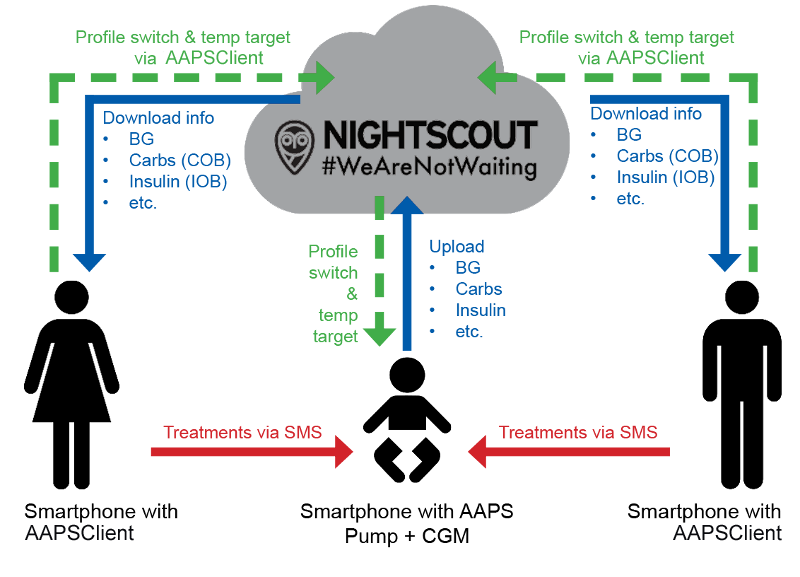

# Monitoratge remot

__AAPS__ ofereix diverses funcions per al monitoratge remot de nens amb diabetis tipus 1, i també permet ordres remotes que envien instruccions a __AAPS__ a distància. De la mateixa manera, __AAPSClient__ també es pot fer servir per al monitoratge remot, per seguir l'__AAPS__ de la vostra parella o d'un amic.

## Funcions

- La bomba del nen es controla des del telèfon del nen amb __AAPS__.
- Els cuidadors poden seguir a distància i veure totes les dades importants, com ara els nivells de glucèmia, els carbohidrats a bord, la insulina a bord, etc., amb l'**apk AAPSClient** al seu telèfon Android (s'està desenvolupant una versió d'**AAPSClient** per a iPhone, vegeu [L'aplicació AAPSClient](AapsClient.md)). La configuració que canvieu a __AAPS__ es sincronitza amb __AAPSClient__ i a l'inrevés.
- Els cuidadors poden rebre alarmes amb l'**aplicació xDrip en mode seguidor** al seu telèfon Android, si el mode companion de xDrip està configurat.
- El control remot d'__AAPS__ amb [Ordres SMS](../RemoteFeatures/SMSCommands.md) està protegit amb autenticació de dos factors.
- El control remot amb __AAPSClient__ fa servir el canal d'ordres signades que va arribar amb **AAPS** 4: primer cal **emparellar** el client amb el dispositiu principal (amb un codi QR o un PIN), i el dispositiu principal confirma i executa cada ordre. El telèfon de cada cuidador pot tenir el seu propi [rol](#client-master-control-roles), des de només lectura fins a control complet. Vegeu [Control principal ↔ client](#client-master-control).

## Eines i aplicacions per al monitoratge remot

- [Nightscout](https://nightscout.github.io/) al navegador web (sobretot per mostrar dades).
- [__AAPSClient__](AapsClient.md) és una versió reduïda d'__AAPS__ que pot seguir l'__AAPS__ principal i, un cop **emparellada**, enviar ordres remotes: carbohidrats, __objectius temporals__, __canvis de perfil__ i fins i tot bolus (vegeu [Control principal ↔ client](#client-master-control)). Hi ha 3 aplicacions: [AAPSClient, AAPSClient2 i AAPSClient3 per descarregar](https://github.com/nightscout/AndroidAPS/releases/), de manera que un cuidador pot seguir fins a tres persones diferents des del mateix telèfon (p. ex. dos nens amb diabetis tipus 1, cadascun amb el seu compte de Nightscout i el seu __AAPS__ principal).
- Dexcom Follow, si feu servir l'aplicació original de Dexcom (només valors de glucèmia).
- [xDrip](../CompatibleCgms/xDrip.md) en mode seguidor (sobretot valors de glucèmia i **alarmes**).
- [Sugarmate](https://sugarmate.io/) o [Spike](https://spike-app.com/) a iOS (sobretot valors de glucèmia i **alarmes**).
- Alguns usuaris troben útil una eina d'accés remot complet com [TeamViewer](https://www.teamviewer.com/) per resoldre problemes avançats a distància.

## Opcions de rellotge intel·ligent

Un rellotge intel·ligent pot ser una eina molt útil per ajudar a gestionar __AAPS__ amb nens amb DT1. Hi ha algunes opcions possibles:

- Opció 1 - Si __AAPSClient__ està instal·lat al telèfon del cuidador, l'[aplicació AAPSClient per a WearOS](https://github.com/nightscout/AndroidAPS/releases/) es pot instal·lar en un rellotge intel·ligent compatible connectat al telèfon del cuidador. Mostra la __glucèmia__ actual, l'estat del llaç i l'historial de bolus, i permet introduir carbohidrats, __objectius temporals__ i canvis de __perfil__. Si el client està **emparellat** amb el dispositiu principal, el rellotge també pot iniciar un **bolus**: l'ordre passa pel client fins al dispositiu principal, que la confirma i la lliura (vegeu [Control principal ↔ client](#client-master-control)).
- Opció 2 - També es pot compilar l'[aplicació AAPS per a WearOS](../WearOS/WearOsSmartwatch.md) i instal·lar-la en un rellotge intel·ligent compatible, connectat al telèfon del nen però portat pel cuidador. Això inclou totes les funcions de dalt i, a més, permet fer un bolus d'insulina directament, sense haver de treure el telèfon al nen.
- Opció 3 - Només visualització: un rellotge que **AAPS** no admet directament (Xiaomi, Amazfit o un rellotge Wear OS que mostra una complicació) pot mostrar la glucèmia, l'IOB, el COB i l'estat del llaç amb una aplicació complementària com WatchDrip+ o GlucoDataHandler, que rep les dades del plugin **Apps complementàries externes** del telèfon amb **AAPS** o **AAPSClient** al qual està connectat. Vegeu [Apps complementàries externes](#watches-external-companion-apps).

## Coses a tenir en compte

- Tingueu en compte el retard entre el dispositiu principal i el seguidor pel temps d'enviament i de descàrrega, i també que el telèfon principal amb __AAPS__ només envia dades després que s'executi el llaç.
- Quin és el vostre pla d'emergència per quan el control remot no funcioni (_p. ex._ problemes de xarxa o connexió Bluetooth perduda)? Penseu sempre què passarà amb **AAPS** si de cop no podeu enviar una ordre nova. **AAPS** sobreescriu la basal, l'ISF i la ràtio I:C de la bomba amb els valors del perfil actual. Si canvieu a un perfil d'insulina més fort, feu servir només canvis de perfil temporals (_és a dir_, amb una durada fixada), per si es talla la connexió remota. Així la bomba tornarà al perfil original quan s'acabi el temps.
