# Ordres SMS

```{contents} Table of contents
:depth: 2
```

La majoria d'ajustos remots (objectius temporals, carbohidrats, canvis de perfil i, un cop el client està emparellat, bolus) es poden fer amb l'[aplicació **AAPSClient**](../RemoteFeatures/RemoteMonitoring.md) en un telèfon Android amb connexió a internet; vegeu [Control principal ↔ client (control remot signat)](#client-master-control) (s'està desenvolupant una versió d'**AAPSClient** per a iPhone; vegeu [L'aplicació AAPSClient](AapsClient.md)). Les ordres SMS continuen sent una alternativa que funciona sense internet, i l'única opció remota si feu servir un iPhone com a seguidor i encara no teniu **AAPSClient**.

**Les ordres SMS són molt útils:**
1. Per al control remot habitual

2. Si voleu fer un bolus d'insulina remot sense un **AAPSClient** emparellat

3. En una zona amb mala cobertura d'internet, on els missatges de text arriben però la connexió de dades/internet del telèfon és limitada. Això és molt útil quan aneu a zones aïllades (p. ex. càmping, esquí).

4. Si el vostre altre mètode de control remot (**AAPSClient**) temporalment no funciona

## Primer, la seguretat

Si activeu el **Comunicador SMS** a **AAPS**, tingueu en compte que el telèfon configurat per donar ordres remotes el podrien robar o el podria fer servir una altra persona. Bloquegeu sempre el telèfon, com a mínim amb un PIN. Es recomana molt una contrasenya forta i/o un bloqueig biomètric, i assegureu-vos que sigui diferent de la clau mestra de l'APK (la contrasenya que cal per exportar la configuració d'**AAPS**).

A més, es recomana permetre un [segon número de telèfon](#SMSCommands-authorized-phone-numbers) per a les ordres SMS. Així podeu fer servir el segon número per [desactivar](#SMSCommands-other) el comunicador SMS si el vostre telèfon remot principal queda compromès.

El temps mínim per defecte entre ordres de bolus és de 15 minuts, comptats des del moment en què la bomba accepta un bolus. Per motius de seguretat, heu d'afegir com a mínim dos números de telèfon autoritzats per canviar-ho a un temps d'espera més curt. Si intenteu fer un altre bolus remot abans de 15 minuts després de l'anterior, rebreu la resposta «Bolus remot no disponible. Torneu-ho a intentar més tard.»

AAPS també us informarà per missatge de text si les vostres ordres remotes, com un bolus o un canvi de perfil, s'han executat. És recomanable configurar-ho perquè els textos de confirmació s'enviïn com a mínim a dos números de telèfon diferents, per si roben un dels telèfons que els reben.

**Si feu un bolus amb ordres SMS, heu d'introduir els carbohidrats per separat (segon SMS, AAPSClient...)!** Si no ho feu, l'IOB serà correcta però el COB serà massa baix, i això pot fer que no es faci un bolus de correcció, perquè **AAPS** suposa que teniu massa insulina activa.

Per a les ordres sensibles, s'ha de fer servir una app d'autenticació amb una contrasenya d'un sol ús basada en el temps, per augmentar la seguretat.

Si voleu treure a un telèfon de cuidador la possibilitat d'enviar ordres SMS, feu servir el botó d'emergència «[Restablir autenticadors](#sms-commands-authenticator-setup)» a **AAPS** o envieu l'ordre SMS «[SMS stop](#SMSCommands-other)». En restablir els autenticadors, TOTS els telèfons dels cuidadors deixen de ser vàlids. Els haureu de tornar a configurar.

## Configurar les ordres SMS

```{contents} The overall process is as follows
:depth: 1
:local: true
```

(sms-commands-authenticator-setup)=
### Configuració de l'Autenticador

Es fa servir l'autenticació en dos factors per millorar la seguretat.

Al telèfon del cuidador, descarregueu (de l'App Store o de Google Play) i instal·leu una app d'autenticació. Apps gratuïtes populars:
  - [Authy](https://authy.com/download/)
  - Google Authenticator - [Android](https://play.google.com/store/apps/details?id=com.google.android.apps.authenticator2) / [iOS](https://apps.apple.com/de/app/google-authenticator/id388497605)
  - [LastPass Authenticator](https://lastpass.com/auth/)
  - [FreeOTP Authenticator](https://freeotp.github.io/)

Aquestes apps d'autenticació generen una contrasenya de 6 xifres d'un sol ús i amb temps limitat, semblant a la banca mòbil o a les compres en línia. Podeu fer servir una altra app d'autenticació, sempre que sigui compatible amb tokens RFC 6238 TOTP. Microsoft Authenticator no funciona.

### Comproveu la configuració del telèfon

Al vostre telèfon, aneu a **Aplicacions > AAPS > Permisos**. Assegureu-vos que **SMS** i **Telèfon** estan permesos.

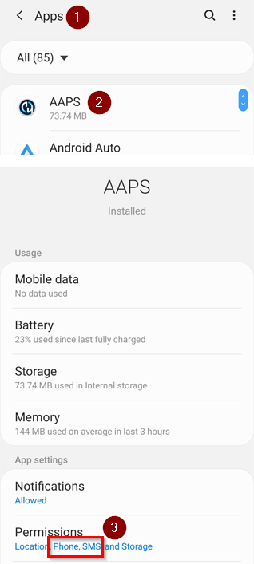

```{admonition} "App was denied access to SMS"
:class: tip
Android pot bloquejar el permís d'**SMS** per a les apps que no s'han instal·lat des d'una botiga d'aplicacions, com **AAPS**. Si veieu aquest missatge quan concediu el permís d'**SMS**, obriu **Configuració > Aplicacions > AAPS** al telèfon, toqueu el menú **⋮** (a dalt a la dreta) i seleccioneu **Permet la configuració restringida**. Després torneu a concedir el permís d'**SMS**.
```

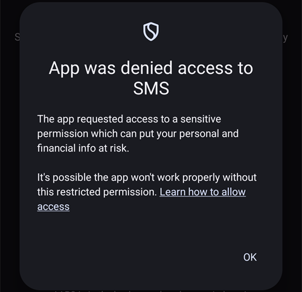

### Sincronització de la data i l'hora

L'hora dels dos telèfons ha d'estar sincronitzada. El millor és que s'ajusti automàticament des de la xarxa. Les diferències d'hora poden causar problemes d'autenticació.

Tant al telèfon d'**AAPS** com al telèfon del cuidador, comproveu que la data i l'hora estan sincronitzades. Com fer-ho exactament depèn del vostre dispositiu; potser haureu de provar diferents opcions.

Exemple (per a Samsung S23): **Configuració > Administració general > Data i hora**: assegureu-vos que **Data i hora automàtiques** està marcat.

Algunes opcions poden aparèixer en gris, perquè necessiten un administrador d'un compte familiar si el telèfon s'ha configurat com a compte infantil. En un iPhone de cuidador/pare o mare, aquesta opció de data i hora s'anomena «Ajusta automàticament». Si no esteu segurs d'haver sincronitzat els telèfons, no us preocupeu: podeu configurar les ordres SMS i resoldre els problemes després, si sembla que en causa (demaneu ajuda si cal).

### Configuració d'AAPS

Ara que heu comprovat la configuració del telèfon, a la mateixa app **AAPS** aneu a [**Configurador** → **Comunicació**](../SettingUpAaps/ConfigBuilder.md) i activeu el plugin **Comunicador SMS**.

Obriu la configuració del **Comunicador SMS**.

Activeu **Permetre ordres remotes per SMS**. Les opcions **PIN obligatori addicional al final del token** i **Configuració de l'Autenticador** només apareixen quan això està activat:

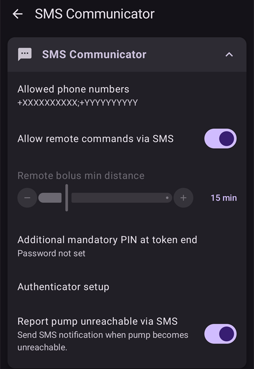

(SMSCommands-authorized-phone-numbers)=
#### Números de telèfon permesos

Introduïu el número o els números de telèfon dels cuidadors. Incloeu el prefix del país i traieu el primer «0» del número de telèfon, com en aquests exemples:
* Número de telèfon del Regne Unit: +447976304596
* Número de telèfon dels EUA: +11234567890
* Número de telèfon de França:  +33612344567
* _etc._

Tingueu en compte que el «+» davant del número pot ser necessari o no, segons on sigueu. Per saber-ho, envieu un text de prova, que mostrarà el format rebut a la pantalla del plugin **Comunicador SMS** (**Configurador** → **Comunicació** → **Comunicador SMS** → **Obrir plugin**).

Si heu d'afegir més d'un número de telèfon, separeu-los amb punts i coma, **SENSE espai entre els números** (això és molt important!). Seleccioneu **OK**:

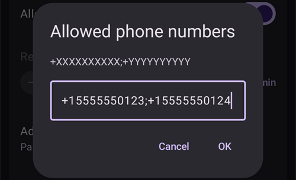

#### Distància mínima entre bolus remots

- Podeu definir el temps mínim (en minuts) entre dos bolus donats per SMS.
- Per motius de seguretat, heu d'afegir com a mínim dos números de telèfon autoritzats per editar aquest valor.

#### PIN obligatori addicional al final del token

Per motius de seguretat, el codi de resposta ha d'anar seguit d'un PIN. Trieu un PIN que vosaltres (i els altres cuidadors) fareu servir al final del codi de l'autenticador quan envieu l'ordre SMS.

Requisits del PIN:

* com a mínim 6 xifres
* només xifres

Per tenir un PIN més segur, no feu servir la mateixa xifra moltes vegades (_p. ex._ 111111) ni una seqüència (_p. ex._ 123456).

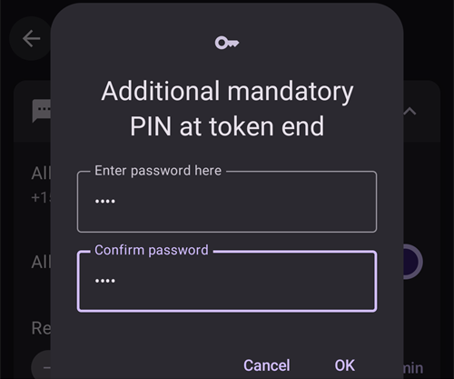

#### Configuració de l'Autenticador

* Toqueu **Configuració de l'Autenticador** i seguiu les instruccions pas a pas de la pantalla.
* Obriu l'app d'autenticació instal·lada al _telèfon del cuidador_, configureu una connexió nova i
* Feu servir el telèfon del cuidador per escanejar el codi QR que es mostra a **Escanejar el codi per configurar els codis OTP d'AAPS**.

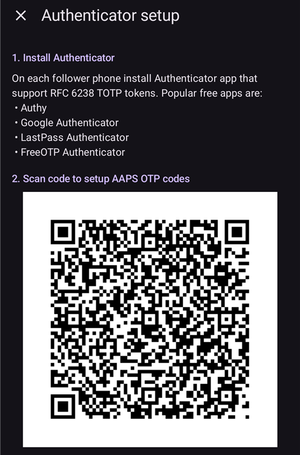

* A **Provar clau d'un sol ús**, introduïu a **Codi per comprovar** la contrasenya d'un sol ús de l'app d'autenticació del telèfon del cuidador, seguida del vostre PIN:

Exemple:
* El token de l'app d'autenticació és 457051
* El vostre PIN obligatori és 2401
* Codi per comprovar: 4570512401

Si l'entrada és correcta, el text vermell «PIN INCORRECTE» canviarà automàticament a un «OK» verd. **No hi ha cap botó per prémer!** El procés ja s'ha acabat; no cal prémer cap botó «OK» després d'introduir el codi:

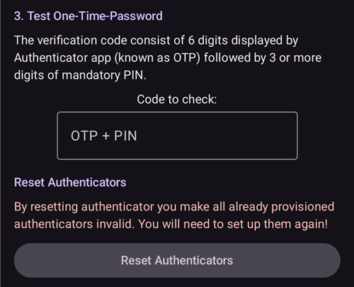

Ara ja hauríeu de tenir les ordres SMS configurades.

Feu servir el botó **Restablir autenticadors** a la part de baix de la pantalla **Configuració de l'Autenticador** si voleu eliminar els autenticadors configurats. (En restablir l'autenticador, TOTS els autenticadors ja configurats deixen de ser vàlids. Els haureu de tornar a configurar.)

## Ús de les ordres SMS

### Primers passos amb les ordres SMS

1)  Per comprovar que ho heu configurat tot correctament, proveu la connexió escrivint «bg» en un SMS des del telèfon del cuidador al telèfon d'**AAPS**. Hauríeu de rebre una resposta semblant a aquesta:

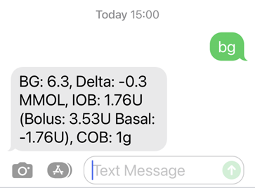

Si no rebeu cap resposta, consulteu la secció [Resolució de problemes](#SMSCommands-troubleshooting) de més avall.

2)  Ara proveu una ordre SMS que necessiti l'autenticador, _p. ex._ «target hypo». El telèfon del cuidador rebrà un text de resposta que us demanarà introduir la **contrasenya de sis xifres** de l'app d'autenticació, seguida del **PIN** secret addicional que només coneixen els cuidadors/seguidors (en total una cadena de dotze xifres, si el vostre PIN té 6 xifres).

Quan proveu d'enviar una ordre SMS per primera vegada, feu-ho amb el telèfon d'**AAPS** al davant, per veure com funciona:

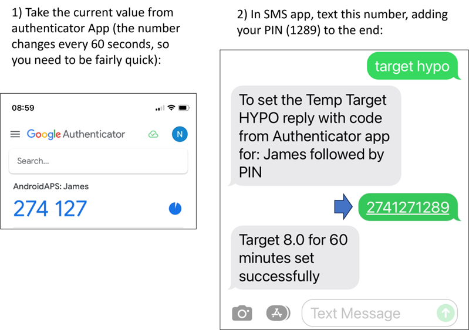

El telèfon del cuidador rebrà un SMS de resposta d'**AAPS** per confirmar si l'ordre SMS remota s'ha executat correctament.

Si l'ordre té èxit, rebreu una resposta que ho confirma. Si hi ha un problema, rebreu un missatge d'error. Vegeu [Resolució de problemes](#SMSCommands-troubleshooting) més avall per als errors habituals.

**Consell**: si s'envien molts SMS, pot ser útil tenir SMS il·limitats a la tarifa del telèfon (per a cada telèfon que es faci servir).

### Lliurar bolus d'àpat amb ordres SMS

El bolus d'insulina remot es pot fer amb les **ordres SMS** o amb un **AAPSClient** emparellat (vegeu [Control principal ↔ client (control remot signat)](#client-master-control)); no es pot fer des del lloc web de Nightscout. Els carbohidrats també es poden anunciar per SMS o amb **AAPSClient**. Amb SMS, no és possible enviar ordres de carbohidrats i d'insulina en un sol missatge SMS. Aquestes ordres s'han d'enviar per separat, així:

1)  Envieu el bolus d'insulina (_p. ex._ «bolus 2» ordena un bolus de 2 unitats); amb ordres SMS això equival a **Tractaments** → **Insulina** a **AAPS**. 2)  Envieu els carbohidrats (_p. ex._ «carbs 20» anuncia 20 g de carbohidrats). Això equival a **Tractaments** → **Carbs** a **AAPS**.

Per evitar hipos, és bona idea començar amb prudència i fer un bolus amb **menys insulina** de la que caldria segons la vostra ràtio de carbohidrats, perquè no teniu en compte el nivell de glucèmia actual ni la seva tendència.

**L'ordre en què envieu aquestes ordres és important**. Si anuncieu una quantitat gran de carbohidrats per qualsevol via i teniu els SMB activats, **AAPS** pot respondre de seguida donant un bolus parcial d'insulina. Per tant, si proveu d'enviar un bolus d'insulina _després_ d'anunciar els carbohidrats, podeu tenir un retard molest i un missatge de «bolus en curs», i llavors haureu de comprovar què s'ha donat com a SMB. O bé, si no us adoneu que s'està lliurant un SMB i el vostre propi bolus posterior també té èxit, es pot lliurar massa insulina per a l'àpat en total. Per això, si feu bolus d'àpat a distància, envieu sempre el bolus d'insulina _abans_ d'anunciar els carbohidrats. Si ho preferiu, podeu combinar **AAPSClient** amb les ordres SMS: els carbohidrats introduïts en un **AAPSClient** emparellat no necessiten codi d'autenticació i per això són més ràpids que les ordres SMS. Els carbohidrats o altres tractaments introduïts al lloc web de Nightscout **no** s'apliquen mentre el control des del client està activat; llavors **AAPS** està en [mode reforçat](#client-master-control-hardened-mode).

(SMSCommands-commands)=
## Ordres

```{contents} List of command groups
:depth: 1
:local: true
```

Les ordres s'han d'enviar en anglès; la resposta serà en el vostre idioma si el text de resposta ja està [traduït](#translations-translate-strings-for-AAPS-app). Les ordres no distingeixen entre majúscules i minúscules; podeu fer servir les unes o les altres.

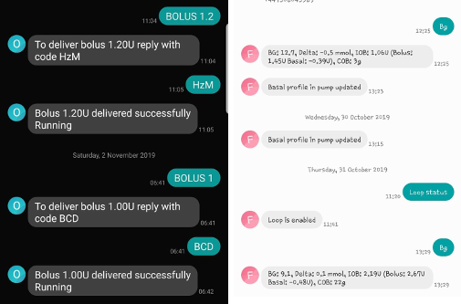

Les **taules d'ordres SMS** de més avall mostren totes les ordres SMS possibles. Es donen _valors d'exemple_ per ajudar a entendre-les. Les ordres tenen el mateix rang de valors possibles (objectius, percentatge del perfil, etc.) que es permet a la mateixa app **AAPS**.

(authentication-or-not)=
### Amb autenticació o sense?

Algunes ordres SMS donen una resposta immediata, i altres necessiten una **autenticació** forta amb l'app d'autenticació. Una consulta senzilla com «**BG**» (que demana la glucèmia actual) és ràpida d'escriure, no necessita autenticació i retorna la informació d'estat d'**AAPS** que es mostra a sota:


Les ordres que necessiten més seguretat demanen introduir un codi, per exemple:

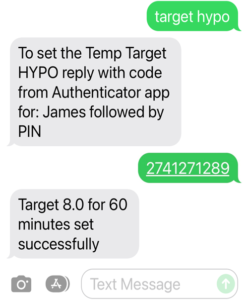

La columna *Autenticació* de les taules de més avall indica si cada ordre necessita aquesta autenticació forta.

### Dades del CGM

| Ordre      | Autenticació | Funció & *Resposta*                                                                                                                                                                                                                                          |
| ---------- | ------------ | ------------------------------------------------------------------------------------------------------------------------------------------------------------------------------------------------------------------------------------------------------------ |
| BG         | No           | Retorna: darrera glucèmia, delta, IOB (bolus i basal), COB<br/>*Darrera glucèmia: 5,6 fa 4min, Delta: -0,2 mmol, IOB: 0,20U (Bolus: 0,10U Basal: 0,10U)*                                                                                               |
| CAL 5.6/90 | Sí           | Calibrarà el CGM amb un valor de 5.6/90<br/>(feu servir el valor adequat a les vostres unitats de glucèmia)<br/>Només funciona si està ben configurat a **AAPS**.<br/>*Calibració enviada. Cal que la recepció a xDrip+ estigui activada.* |

### Bomba

| Ordre                | Autenticació | Funció & *Resposta*                                                                               |
| -------------------- | ------------ | ------------------------------------------------------------------------------------------------- |
| PUMP                 | No           | ÚltConn: fa 1 min<br/>Temp: 0,00U/h @11:38 5/30min<br/>IOB: 0,5U Reserv: 34U Bat: 100 |
| PUMP DISCONNECT *30* | Sí           | Per desconnectar la bomba durant *30* minuts                                                      |
| PUMP CONNECT         | Sí           | Bomba reconnectada                                                                                |

### Basal

| Ordre             | Autenticació | Funció & *Resposta*                            |
| ----------------- | ------------ | ---------------------------------------------- |
| BASAL 0.3         | Sí           | Per iniciar una basal de 0,3 U/h durant 30 min |
| BASAL 0.3 20      | Sí           | Per iniciar una basal de 0,3 U/h durant 20 min |
| BASAL 30%         | Sí           | Per iniciar una basal del 30% durant 30 min    |
| BASAL 30% 50      | Sí           | Per iniciar una basal del 30% durant 50 min    |
| BASAL STOP/CANCEL | Sí           | Per aturar la basal temporal                   |

Algunes bombes només accepten la basal temporal en percentatge, i altres només en U/h. Si feu servir l'altra forma, **AAPS** respon *«Aquesta bomba només accepta la basal temporal en percentatge, no en U/h.»* (o al revés) i no estableix res. La durada ha de ser un múltiple del pas de durada de la basal temporal de la vostra bomba.


### Llaç

| Ordre             | Autenticació | Funció & *Resposta*                                                                                                                                                                                                                                                              |
| ----------------- | ------------ | -------------------------------------------------------------------------------------------------------------------------------------------------------------------------------------------------------------------------------------------------------------------------------- |
| ESTAT DEL LLAÇ    | No           | La resposta depèn de l'estat real:<br/> - *Llaç desactivat* si el llaç està desactivat<br/> - *Llaç activat* si el llaç és tancat, obert o LGS<br/> - *Bomba desconnectada* si la bomba està desconnectada<br/> - *Aturat (10 m)* si el llaç està suspès |
| LOOP STOP/DISABLE | Sí           | La bomba torna a la taxa basal programada.<br/>*El llaç s'ha desactivat*                                                                                                                                                                                                   |
| LOOP SUSPEND 20   | Sí           | *Llaç suspès*                                                                                                                                                                                                                                                                    |
| LOOP RESUME       | Sí           | *Llaç reprès*                                                                                                                                                                                                                                                                    |
| LOOP CLOSED       | Sí           | *Mode de funcionament actual: Llaç tancat*                                                                                                                                                                                                                                       |
| LOOP LGS          | Sí           | *Mode de funcionament actual: Suspensió per glucèmia baixa*                                                                                                                                                                                                                      |

### Bolus

El bolus remot no està permès durant 15 min (aquest valor només es pot editar si hi ha 2 números de telèfon afegits) després de l'última ordre de bolus o de les ordres remotes! En aquest cas, la resposta seria *Bolus remot no disponible. Torneu-ho a intentar més tard.* Aquesta resposta també s'envia quan la bomba està lliurant un bolus.

| Ordre                | Autenticació | Funció & *Resposta*                                                                                                                                                              |
| -------------------- | ------------ | -------------------------------------------------------------------------------------------------------------------------------------------------------------------------------- |
| BOLUS 1.2            | Sí           |                                                                                                                                                                                  |
| BOLUS 0.60 MEAL      | Sí           | Lliura el bolus indicat de 0,60 U<br/>**i** estableix l'[objectiu temporal Menjar aviat](#TempTargets-eating-soon-temp-target)                                             |
| CARBS 5              | Sí           | Per introduir 5 g, sense bolus                                                                                                                                                   |
| CARBS 5 17:35/5:35PM | Sí           | Per introduir 5 g a les 17:35.<br/>El format d'hora acceptat depèn<br/> de l'opció d'hora (12h/24h) del telèfon.                                                     |
| EXTENDED 2 120       | Sí           | Per iniciar un bolus estès de 2 U durant 120 min.<br/>Només per a [bombes compatibles](#Extended-Carbs-extended-bolus-and-switch-to-open-loop-dana-and-insight-pump-only). |
| EXTENDED STOP/CANCEL | Sí           | Per aturar el bolus estès                                                                                                                                                        |

### Perfil

| Ordre          | Autenticació | Funció & *Resposta*                                                                                                                                           |
| -------------- | ------------ | ------------------------------------------------------------------------------------------------------------------------------------------------------------- |
| PROFILE STATUS | No           | Perfil actual i percentatge                                                                                                                                   |
| PROFILE LIST   | No           | La llista actual de perfils a **AAPS**, p. ex.:<br/>1. Profile1<br/> 2. Profile2                                                                  |
| PROFILE 1      | Sí           | Per canviar al perfil 1 de la llista.<br/>Feu servir els números que retorna **PROFILE LIST**,<br/>no els noms dels perfils tal com els vau desar |
| PROFILE 2 30   | Sí           | Per canviar al perfil Profile2 al 30%                                                                                                                         |

El percentatge ha d'estar entre 30 i 250%, com a l'app. Un valor fora d'aquest rang es rebutja abans que se us demani el codi d'autenticació.

### Objectius temporals

| Ordre                     | Autenticació | Funció & *Resposta*                                 |
| ------------------------- | ------------ | --------------------------------------------------- |
| TARGET MEAL/ACTIVITY/HYPO | Sí           | Per establir l'objectiu temporal MEAL/ACTIVITY/HYPO |
| TARGET STOP/CANCEL        | Sí           | Per cancel·lar l'objectiu temporal                  |


(SMSCommands-other)=
### Altres

| Ordre            | Autenticació | Funció & *Resposta*                                                                                                                                                                                                                                                               |
| ---------------- | ------------ | --------------------------------------------------------------------------------------------------------------------------------------------------------------------------------------------------------------------------------------------------------------------------------- |
| RESTART          | Sí           | Reinicia AAPS. Útil si teniu problemes que normalment es resolen amb un reinici.                                                                                                                                                                                                  |
| SMS DISABLE/STOP | Sí           | Per desactivar el Servei Remot d'SMS, contesteu amb el codi.<br/>Tingueu en compte que només el podreu reactivar<br/>directament des del mòbil principal d'**AAPS**.                                                                                                  |
| HELP             | No           | Retorna totes les funcions que es poden consultar:<br/>BG, LOOP, PUMP, BASAL, BOLUS, EXTENDED, CAL, PROFILE, TARGET, SMS, CARBS, HELP, RESTART<br/>Envieu després l'ordre ***HELP ***FUNCIÓ****** per veure<br/>totes les opcions disponibles d'aquesta secció. |
| HELP BOLUS       |              | *BOLUS 1.2<br/>BOLUS 1.2 MEAL*                                                                                                                                                                                                                                              |

(SMSCommands-troubleshooting)=
## Resolució de problemes i preguntes freqüents

```{contents} List of questions and issues
:depth: 1
:local: true
```

### Què _no_ podem fer amb les ordres SMS?

1)  **No podeu establir un canvi de perfil _temporal_** (per exemple, posar «profile exercise» durant 60 minuts), tot i que sí que podeu canviar de manera permanent a «profile exercise». Els canvis de perfil temporals es poden fer amb **AAPSClient**.

2)  **No podeu cancel·lar automatitzacions** ni **establir objectius definits per l'usuari**, però hi ha solucions aproximades: Per exemple, imagineu que l'objectiu normal del perfil és 5,5. Heu creat una automatització a AAPS per establir sempre un objectiu alt de 7,0 entre les 14:30 i les 15:30, per una classe d'esport a l'escola, i una condició de l'automatització és que «no hi hagi cap objectiu temporal». Aquesta setmana us diuen amb poc temps que la classe d'esport s'ha anul·lat i que la substitueix una estona per menjar pizza, però el vostre fill ja és a l'escola amb el telèfon d'**AAPS**. Si l'automatització inicia l'objectiu temporal alt de 7,0 i el cancel·leu (al telèfon d'**AAPS** o a distància), les condicions de l'automatització encara es compleixen i **AAPS** simplement tornarà a establir l'objectiu alt un minut més tard.

**Si teniu accés al telèfon d'AAPS**, podeu desmarcar o modificar l'automatització o, si no ho voleu fer, podeu simplement establir un objectiu temporal nou de 5,6 durant 60 min prement l'objectiu a la pantalla principal, o amb **Gestionar** → **Objectiu temporal**. Així evitaríeu que l'automatització establís l'objectiu alt de 7,0.

**Si no teniu accés al telèfon d'AAPS**, podeu fer servir les ordres SMS com a solució aproximada: per exemple, amb l'ordre «target meal» per establir un objectiu de 5,0 durant 45 min (els altres objectius per defecte són 8,0 per a activitat o hipo; vegeu la taula). Però amb les ordres SMS no podeu indicar un valor d'objectiu _concret_ (per exemple, 5,6 durant 60 minuts); per fer-ho, hauríeu de fer servir **AAPSClient**.

### Què passa si canvio d'opinió sobre una ordre que acabo d'enviar?

**AAPS** només executarà l'ordre més recent. Per tant, si escriviu «bolus 1.5» i després, sense autenticar-vos, envieu una ordre nova «bolus 1», s'ignorarà l'ordre anterior d'1.5. **AAPS** sempre enviarà al telèfon del cuidador una resposta per confirmar quina és l'ordre SMS abans de demanar-vos el codi d'autenticació, i també una resposta després de l'acció.

### Per què no he rebut cap resposta a una ordre SMS?

Pot ser per un d'aquests motius:

1)  El missatge no ha arribat al telèfon (problemes de xarxa). 2)  **AAPS** encara està processant la petició (_p. ex._ un bolus, que pot trigar una estona a lliurar-se segons la velocitat de bolus). 3)  El telèfon d'**AAPS** no té una bona connexió Bluetooth amb la bomba quan rep l'ordre, i l'ordre ha fallat (normalment això crea una alarma al telèfon d'**AAPS**).

### Cap resposta a les ordres SMS

Al telèfon del cuidador i/o al telèfon d'**AAPS**, proveu de desactivar les opcions següents:
* **Envia com a missatge de xat** (Send as chat message) 
* Si feu servir l'app Missatges d'Android o Google Missatges, desactiveu els missatges RCS:
  - obriu la conversa d'SMS concreta a Missatges
  - Seleccioneu el menú d'opcions (tres punts) a la cantonada de dalt a la dreta
  - seleccioneu «Detalls»
  - Activeu «Envia només missatges SMS i MMS» (Only send SMS and MMS messages) 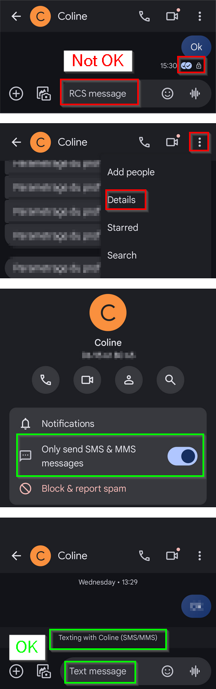

### Errors en executar les ordres

Hi ha diversos motius possibles pels quals l'ordre pot no tenir èxit:

* La configuració de les ordres SMS no és completa o correcta
* Heu enviat una ordre amb un format incorrecte (com «disconnect pump 45» en lloc de «pump disconnect 45»)
* Heu fet servir un codi d'autenticador incorrecte o caducat (normalment és bo esperar uns segons a tenir un codi nou si l'actual està a punt de caducar)
* El codi+PIN era correcte, però l'SMS va trigar a sortir o a arribar, i per això **AAPS** va calcular que el codi de l'autenticador havia caducat
* El telèfon d'**AAPS** està fora d'abast o sense contacte amb la bomba
* El sistema ja està ocupat lliurant un bolus

Els errors habituals es mostren als exemples de sota:

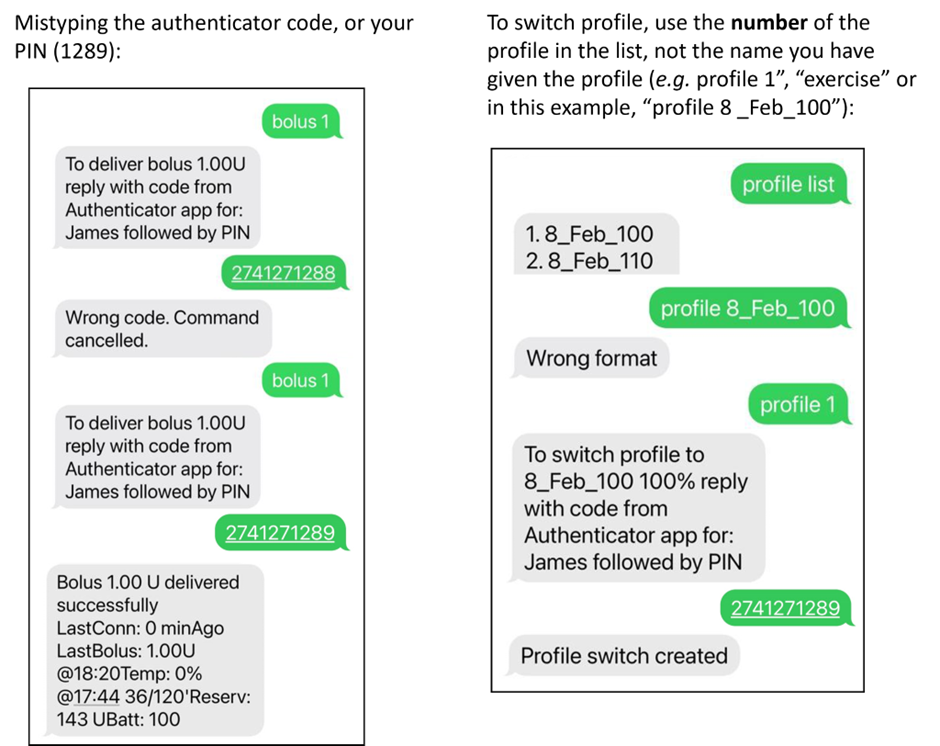

### Com puc aturar una ordre un cop s'ha autenticat?

No podeu. Però podeu cancel·lar un bolus enviat per SMS al mateix telèfon d'**AAPS**, simplement cancel·lant-lo a la finestra emergent del bolus, si sou ràpids. Moltes ordres SMS (excepte els bolus i els anuncis de carbohidrats) es poden desfer fàcilment, o es poden prendre mesures per reduir els efectes no desitjats si us equivoqueu.

Per als errors en bolus i anuncis de carbohidrats, encara podeu actuar. Per exemple, si heu anunciat 20 g de carbohidrats però el vostre fill només en menja 10 g, i vosaltres (o un cuidador que hi sigui) no podeu eliminar el tractament directament al telèfon d'**AAPS**, podeu establir un objectiu temporal alt o un perfil reduït perquè **AAPS** sigui menys agressiu.

### Diversos SMS

Si rebeu el mateix missatge una vegada i una altra (_p. ex._ un canvi de perfil), potser heu creat sense voler un bucle amb altres apps. Per exemple, podria ser xDrip. En aquest cas, assegureu-vos que xDrip (o qualsevol altra app) no envia tractaments a NightScout.

Si l'altra app està instal·lada en diversos telèfons, assegureu-vos de desactivar l'enviament a tots.

(sms-commands-too-many-messages)=
### Rebo massa missatges de text de les ordres SMS. Puc reduir-ne la freqüència o fer que s'aturin?

Fer servir ordres SMS pot generar molts missatges automàtics del telèfon d'**AAPS** al telèfon del cuidador. També rebreu missatges, per exemple «Perfil de basal actualitzat a la bomba», si teniu automatitzacions configurades a **AAPS**. Si s'envien molts SMS, pot ser útil tenir SMS il·limitats a la tarifa del telèfon d'**AAPS** (i de cada telèfon de cuidador que es faci servir), i desactivar les notificacions, les alarmes o les vibracions dels SMS a tots els telèfons. No és possible fer servir les ordres SMS sense rebre aquestes actualitzacions. Per això potser voldreu una altra manera de comunicar-vos directament amb el vostre fill (si té prou edat), en lloc dels SMS. Entre les apps de comunicació alternatives que fan servir els cuidadors d'**AAPS** hi ha WhatsApp, LINE, Telegram i Facebook Messenger.

És possible desactivar l'SMS «Perfil de basal actualitzat a la bomba» quan el canvi de perfil ve de Nightscout. Per fer-ho, creeu un fitxer anomenat **exactament** `do_not_send_sms_on_profile_change` a la carpeta `extra` del vostre directori d'AAPS.
