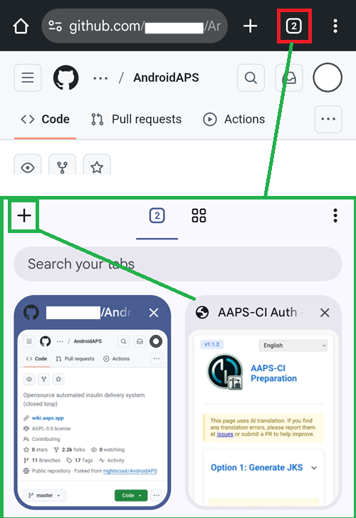

(browser-build)=

# Compilació al navegador

Compilar AAPS amb GitHub Actions.

**La versió mínima d'AAPS compatible és la 3.3.2.1.**

## Compileu-la vosaltres mateixos en lloc de descarregar-la

**L'aplicació AAPS (un fitxer apk) no es pot descarregar, per les normes sobre dispositius mèdics. És legal compilar l'aplicació per al vostre ús propi, però no en podeu donar una còpia a altres persones!**

Vegeu la [pàgina de preguntes freqüents](../UsefulLinks/FAQ.md) per a més detalls.

(Building-APK-without-a-computer)=

## Trieu com voleu compilar

Trieu el mètode que correspon al dispositiu des del qual compileu:

### En un telèfon Android: AAPS Builder (recomanat)

Una pàgina de configuració us guia per crear el vostre propi repositori privat de compilació a GitHub. No cal instal·lar res ni fer servir cap fitxer de preparació, i cada compilació la inicieu vosaltres. Descarregueu l'aplicació directament des de GitHub. Google Drive és opcional.

També funciona des del navegador d'un ordinador.

**→ [Compilació al navegador amb AAPS Builder](BrowserBuildAapsBuilder.md)**

### On a computer or an iPhone / iPad: fork and preparation file

Feu una còpia (fork) del codi font d'AAPS a GitHub, creeu el vostre magatzem de claus amb un fitxer de preparació, i l'aplicació compilada es desa al vostre Google Drive. Seguiu els quatre passos de més avall.

```{note}
**Ja compileu amb un fork?** Continueu actualitzant-lo com s'explica a [Actualitzar amb el navegador (fork)](../Maintenance/UpdateBrowserBuild.md), o passeu a AAPS Builder. Per canviar, primer obteniu una còpia del vostre magatzem de claus des del vostre fork: vegeu [Si veniu de la compilació al navegador anterior](#aaps-builder-from-fork).
```

Haureu de fer servir diverses pestanyes al navegador i passar d'una a l'altra. Exemple amb Chrome:



```{note}
Haureu de saltar d'una pestanya a una altra: comenceu amb totes les pestanyes tancades per no perdre-us quan passeu d'una a l'altra.
```

#### Què necessitareu

- A **Google account**, so the built app can be saved to your Google Drive.
- Un **compte de GitHub** (gratuït) – el creareu al Pas 1.
- Un **navegador web** que pugui tenir diverses pestanyes obertes alhora (més avall es fa servir Chrome).
- Una petita **eina per executar el fitxer de preparació**. La que necessiteu depèn del dispositiu des del qual compileu – ara no cal instal·lar res, el Pas 2 us guia per al vostre dispositiu:
  - **Computer (Windows / Mac / Linux):** Simple Web Server.
  - **iPhone / iPad:** cap aplicació addicional – feu servir l'aplicació Fitxers i el navegador que ja hi ha.

#### Els passos

La compilació al navegador és una sèrie d'eleccions. Seguiu aquests passos en ordre:

1. **[Creeu el vostre fork a GitHub](BrowserBuildFork.md)** – feu la vostra còpia personal del codi font d'AAPS.
2. **[Creeu el vostre magatzem de claus de signatura](BrowserBuildKeystore.md)** – la decisió clau: generar un nou magatzem de claus (Opció 1) o pujar el que ja teniu (Opció 2), i després seguir la pàgina del vostre dispositiu.
3. **[Autoritzeu Google Drive](BrowserBuildGoogleDrive.md)** – permeteu que GitHub desi l'aplicació compilada al vostre Google Drive.
4. **[Compileu l'APK](BrowserBuildAPK.md)** – executeu el workflow de GitHub Actions i trieu la versió i la variant.

Si teniu problemes, vegeu **[Compilació al navegador: resolució de problemes](../GettingHelp/BrowserBuildTroubleshooting.md)**. For optional operations with a fork, see [exporting your keystore](#ci-keystore-export) or [cherry-picking a commit](#github-cherry-pick).

----

**Comenceu amb el [Pas 1 – Creeu el vostre fork a GitHub](BrowserBuildFork.md) →**

```{toctree}
:hidden:

AAPS Builder <BrowserBuildAapsBuilder.md>
Pas 1: Creeu el vostre fork <BrowserBuildFork.md>
Pas 2: Creeu el vostre magatzem de claus <BrowserBuildKeystore.md>
Pas 3: Autoritzeu Google Drive <BrowserBuildGoogleDrive.md>
Pas 4: Compileu l'APK <BrowserBuildAPK.md>
```
