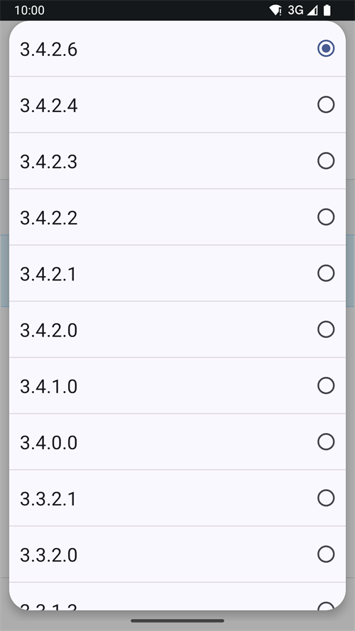
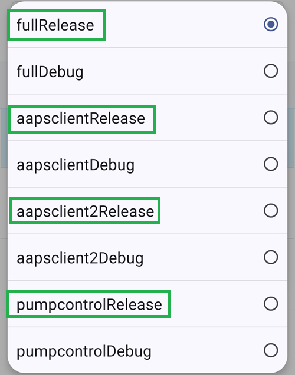

(github-build-apk)=

# Compilació al navegador – Pas 4: Compileu l'APK

```{note}
Aquest és el **pas 4** de la [Compilació al navegador](BrowserBuild.md). Primer completeu el [Pas 3 – Autoritzeu Google Drive](BrowserBuildGoogleDrive.md).
```

## GitHub Actions AAPS-CI per compilar l'APK d'AAPS
 - Adequat per a tots els usuaris.

```{tab-set}

:::{tab-item} Wiki
### Executeu el workflow per compilar l'APK signat

1. A la vostra còpia d'AndroidAPS a GitHub, seleccioneu Actions.
2. Obriu All Workflows.
3. Seleccioneu AAPS-CI


4. Desplaceu-vos cap avall i premeu Run Workflow.


5. Deixeu **Use workflow from** a la branca master. A **Select AAPS Version**, seleccioneu la versió d'**AAPS** que voleu compilar (normalment la més nova). Seleccioneu la [variant](#browserbuild-variant) (fullRelease) i toqueu Run workflow.


6. Veureu el missatge Workflow run was successfully requested. Actualitzeu la pàgina del navegador i podreu seguir el progrés de la compilació. Quan l'acció acabi, l'acció AAPS CI mostrarà una marca verda. Heu compilat correctament la versió actualitzada d'Android APS.


### Instal·leu l'APK d'AAPS

1. Obriu el vostre Google Drive
2. Entreu a la carpeta AAPS, seleccioneu la carpeta de la nova versió i hi trobareu la versió per al telèfon i la versió per a Android Wear.


:::

:::{tab-item} Video
<div align="center" style="max-width: 360px; margin: auto; margin-bottom: 2em;">
  <div style="position: relative; width: 100%; aspect-ratio: 9/16;">
    <iframe
      src="https://geo.dailymotion.com/player/x9rdwms.html?video=x9rdwms&loop=true&mute=true"
      loading="lazy"
      style="position: absolute; top: 0; left: 0; width: 100%; height: 100%;"
      frameborder="0"
      allowfullscreen>
    </iframe>
  </div>
</div>
:::  

```

## Selecció de la versió a compilar

**Només les versions d'AAPS 3.3.2.1 i posteriors es poden compilar amb el mètode del navegador.**

Toqueu **Select AAPS Version** i trieu la versió que voleu compilar. La versió més nova és a dalt de tot de la llista.



(browserbuild-variant)=

## Selecció de la variant de compilació

*Nota: es compilen automàticament tant l'aplicació d'Android com la de Wear OS.*

  - Seleccioneu la variant que necessiteu:
    - fullRelease: per a l'ús normal amb bomba, amb totes les funcions.
    - [aapsclientRelease, aapsclient2Release, aapsclient3Release](#RemoteControl_aapsclient): per a cuidadors (cal [Nightscout](../SettingUpAaps/Nightscout.md)). `aapsclient3Release` compila **AAPSClient3**, disponible a partir de la versió 4.0 d'**AAPS** (vegeu [Sobre AAPSClient, AAPSClient2 i AAPSClient3](#remotecontrol-aapsclient-versions)).
    - pumpcontrolRelease: per substituir l'aplicació o el controlador de la vostra bomba



Les variants que acaben en «Debug» indiquen que l'APK es compilarà en mode de depuració, útil per als desenvolupadors per resoldre problemes.

<!-- If you want to test the items in a pull request has been moved to dev page /AdvancedOptions/DevBranch.md -->

----

Quan la compilació acaba correctament, l'apk es desa al vostre Google Drive. Continueu amb [Transferir i instal·lar AAPS al vostre telèfon](TransferringAndInstallingAaps.md).

```{note}
A partir de setembre de 2026, la [verificació de desenvolupadors d'Android](#android-developer-verification) de Google pot impedir instal·lar l'APK tocant el fitxer, segons el vostre país. En aquella pàgina s'expliquen solucions gratuïtes.
```

Si la compilació falla, primer [esbrineu què ha fallat al registre de compilació](#aaps-ci-read-the-logs) i després vegeu [Compilació al navegador: resolució de problemes](../GettingHelp/BrowserBuildTroubleshooting.md). Per incloure un commit concret a la vostra compilació, vegeu [cherry-pick d'un commit](#github-cherry-pick).
