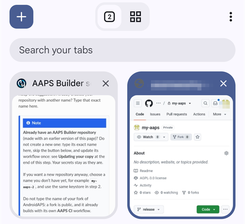
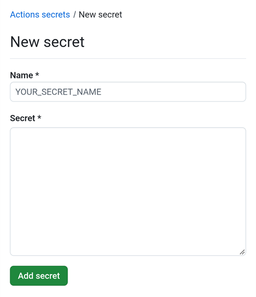
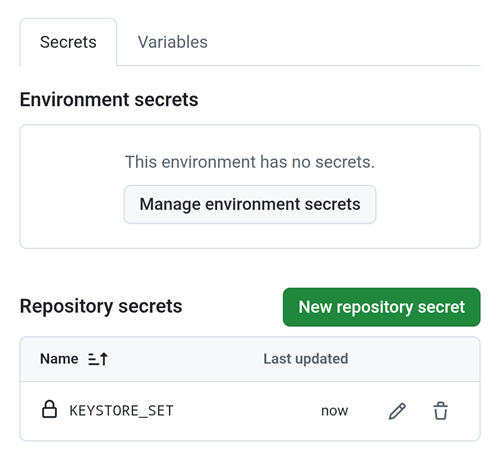
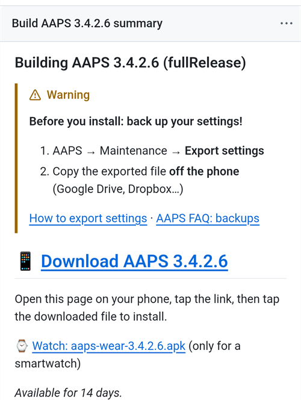

(aaps-builder)=

# Compilació al navegador amb AAPS Builder

```{note}
Aquesta és la manera recomanada de compilar AAPS des d'un **telèfon Android**. També funciona des de qualsevol navegador d'ordinador. Per a les altres maneres de compilar des d'un ordinador o un iPhone, vegeu la visió general de la [Compilació al navegador](BrowserBuild.md).
```

```{contents} In this page
:backlinks: entry
:depth: 2
```

**AAPS Builder** compila l'aplicació AAPS per a vosaltres a GitHub, el lloc web gratuït per allotjar codi. No cal instal·lar res al telèfon ni obrir cap fitxer de preparació.

A setup page walks you through it. La primera vegada triga uns 10 minuts:

1. Create your own **private copy** of AAPS Builder in your GitHub account: the setup page opens GitHub with everything filled in, you only confirm. The build workflow, the file that tells GitHub how to build AAPS, is already in it.
2. Create or upload your **signing key** (the keystore).
3. Give the key to your repository as a GitHub **secret**.
4. **Build** the app. One build takes 15 to 30 minutes.
5. **Download and install** the app on your phone.

**No** cal fer un fork d'AndroidAPS: el codi font d'AAPS es descarrega del repositori oficial d'AndroidAPS a cada compilació. Tampoc **no** cal Google Drive: descarregueu l'aplicació directament de GitHub.

```{admonition} Where the code comes from
:class: note

The build workflow is maintained by the AAPS developers in the [nightscout/aaps-builder](https://github.com/nightscout/aaps-builder) repository, and your repository is a copy of it. The [workflow](https://github.com/nightscout/aaps-builder/blob/main/.github/workflows/build.yml) in your copy is short: it runs the [build steps](https://github.com/nightscout/aaps-builder/blob/main/.github/workflows/aaps-builder.yml) kept in that repository, so improvements reach you without any change to your repository. You can read both files. Quan compila, el workflow només descarrega el codi font oficial d'AAPS i les eines de compilació pròpies de GitHub. El vostre magatzem de claus no surt mai del vostre navegador ni del vostre repositori privat.
```

(aaps-builder-before-you-start)=

## Abans de començar

Necessitareu:

- Un **compte de GitHub** (gratuït). Si no en teniu, creeu-ne un primer a [github.com](https://github.com/signup).
- Un **navegador web**: Chrome al telèfon, o qualsevol navegador en un ordinador. Inicieu la sessió a github.com en aquest navegador abans de començar.
- **Teniu l'aplicació GitHub al telèfon?** La podeu conservar. Aleshores alguns botons de la pàgina de configuració obren l'aplicació en lloc de Chrome. Building works in the app, but the app **cannot download** the finished AAPS: [step 5](#aaps-builder-step5) shows how to switch to Chrome for the download.
- El vostre **magatzem de claus existent** (fitxer `.jks`), la seva contrasenya i el seu àlies, si ja havíeu compilat AAPS abans i el voleu actualitzar sense reinstal·lar-lo.

```{warning}
**El vostre repositori de compilació ha de ser sempre privat.** Tot el que produeix una compilació és visible per a qualsevol persona que pugui veure el repositori. La pàgina de configuració us crea un repositori privat. Never change it to public, and don't **fork** AAPS Builder instead: a fork is always public.

Un repositori privat té 2000 minuts gratuïts de GitHub Actions al mes, prou per a diverses compilacions.
```

```{warning}
**Clau nova o clau existent: això decideix si podeu actualitzar AAPS.**

- **Ja teniu AAPS al telèfon, compilat amb un magatzem de claus que encara teniu**: trieu **Ja tinc un magatzem de claus** a la pàgina de configuració i pugeu-lo. La vostra propera compilació actualitzarà AAPS sense perdre res. Heu compilat AAPS amb la compilació al navegador anterior (el vostre propi fork)? El vostre magatzem de claus és al vostre fork: [primer obtingueu-ne una còpia](#aaps-builder-from-fork).
- **Compileu AAPS per primera vegada, o heu perdut el magatzem de claus o la seva contrasenya**: trieu **Crear una clau nova**. Una aplicació signada amb una clau nova **no pot actualitzar** un AAPS signat amb una altra clau. You must export your settings, copy the file off your phone, uninstall the old AAPS, install the new one, then import your settings: see [Reinstalling AAPS with a new keystore](#reinstall-aaps).

Després, feu servir sempre la mateixa clau. Quan creeu una clau nova, descarregueu la còpia de seguretat que ofereix la pàgina i guardeu-la amb la seva contrasenya i el seu àlies (`key0`) en un lloc segur, fora del telèfon.
```

(aaps-builder-from-fork)=

## Si veniu de la compilació al navegador anterior (fork)

Ometeu aquesta secció si no heu compilat mai AAPS amb el mètode anterior de compilació al navegador (la vostra pròpia còpia, o fork, d'AndroidAPS a GitHub, amb el fitxer de preparació i Google Drive).

El vostre magatzem de claus està desat com a secrets al vostre fork. GitHub no torna a mostrar mai un secret, així que no el podeu copiar al vostre repositori nou. Get a copy of your keystore first, then use it in [step 2](#aaps-builder-step2) with **I already have a keystore**.

```{warning}
No trieu **Crear una clau nova**. Un AAPS compilat amb una clau nova no pot actualitzar l'AAPS del vostre telèfon.
```

Quin és el vostre cas?

- **Vau fer servir l'opció 2** (vau pujar el vostre propi magatzem de claus d'Android Studio) i encara teniu el fitxer `.jks`, les seves contrasenyes i el seu àlies: aquí no cal fer res. Use that file in step 2.
- **Vau fer servir l'opció 1** (el fitxer de preparació va crear la clau), o ja no teniu el fitxer del magatzem de claus: exporteu-lo del vostre fork com s'explica a continuació.

Per exportar el magatzem de claus del vostre fork:

1. Al vostre fork, obriu **Settings** → **Secrets and variables** → **Actions** i afegiu un secret amb el nom `ZIP_PASSWORD`. Trieu una contrasenya només amb lletres angleses i números. Protegeix el fitxer que creareu ara.
2. Obriu la pestanya **Actions** del vostre fork, toqueu **CI Keystore Export** i després **Run workflow**. Més detalls: [Exporteu el vostre magatzem de claus](#ci-keystore-export).
3. Quan l'execució tingui una marca verda, obriu el vostre Google Drive: el fitxer `keystore.zip` és a la carpeta **AAPS** → **KeyStore**. Si l'execució falla al pas de Google Drive, l'accés del vostre fork a Google Drive ha caducat: vegeu [El token de renovació de Google ha caducat](#aaps-ci-google-token-expired).
4. Descarregueu `keystore.zip` i obriu-lo amb la vostra `ZIP_PASSWORD`: en un ordinador, o al telèfon amb una aplicació de gestió de fitxers que pugui obrir fitxers ZIP protegits amb contrasenya. Conté:
   - `keystore.jks`: el vostre magatzem de claus,
   - `keyStoreInfo.txt`: la vostra `KEYSTORE_PASSWORD`, `KEY_PASSWORD` i `ALIAS` (normalment `key0`).
5. Copieu `keystore.jks` al telèfon (o a Google Drive, per poder-lo triar des d'allà).

In [step 2](#aaps-builder-step2) of the setup page:

1. Toqueu **Ja tinc un magatzem de claus**.
2. A **Fitxer del magatzem de claus**, trieu `keystore.jks`.
3. A **Contrasenya del magatzem de claus**, escriviu la `KEYSTORE_PASSWORD` de `keyStoreInfo.txt`.
4. A **Àlies de la clau**, trieu o escriviu l'`ALIAS` de `keyStoreInfo.txt`.
5. Si la `KEY_PASSWORD` és diferent de la `KEYSTORE_PASSWORD`, desmarqueu **La contrasenya de la clau és la mateixa que la del magatzem de claus** i escriviu la `KEY_PASSWORD`.

Guardeu `keystore.zip` i la seva `ZIP_PASSWORD` en un lloc segur, fora del telèfon: és la còpia de seguretat de la vostra clau.

To also save the builds of AAPS Builder in Google Drive, do [step 6](#aaps-builder-google-drive): the setup page gets a new `GDRIVE_OAUTH2` for you. Podeu conservar el vostre fork fins que tingueu instal·lat al telèfon l'AAPS compilat amb AAPS Builder.

## Obrir la pàgina de configuració

**→ [Obriu la pàgina de configuració d'AAPS Builder](#aaps-builder-setup)**

The setup page is part of this documentation, in your language. Keep this page open in another tab as well: the sections below explain each step of the setup page in more detail, with screenshots.

La pàgina de configuració obre cada pàgina de GitHub en una pestanya nova de Chrome. Per tornar a la pàgina de configuració, toqueu el botó de pestanyes al costat de la barra d'adreces de Chrome (el quadrat amb un número) i trieu la pàgina de configuració d'AAPS Builder.



La pàgina de configuració funciona completament al vostre navegador: la clau i les contrasenyes no s'envien enlloc, excepte al secret de GitHub on les enganxeu vosaltres mateixos. Només el vostre nom d'usuari de GitHub s'envia a GitHub, per comprovar que existeix. Recorda el vostre nom d'usuari de GitHub i el nom del repositori, així que hi podeu tornar en qualsevol moment per obrir de nou la pàgina de secrets o les vostres compilacions.


(aaps-builder-step1)=

## Pas 1 – Creeu el vostre repositori privat de compilació

This step creates your own private copy of AAPS Builder in your GitHub account, with the build workflow already in it. Només vosaltres podeu veure'l, i també les aplicacions que compila.

1. Assegureu-vos que heu iniciat la sessió a github.com en aquest navegador.

2. A **El vostre nom d'usuari de GitHub**, escriviu el vostre nom d'usuari de GitHub, no el vostre correu electrònic. La pàgina el comprova amb GitHub: **✓ Usuari de GitHub trobat** vol dir que és correcte.

3. A **Nom del vostre repositori**, deixeu el suggeriment `my-aaps`. Si ja vau crear el vostre repositori amb un altre nom, escriviu exactament aquest nom.

   ```{note}
   **Already have an AAPS Builder repository** (made with an earlier version of the setup page)? Don't create a new one: type its exact name, skip **Create my private repository**, and update its workflow once as explained in [Updating AAPS](#aaps-builder-updates). Your secrets stay as they are. If you want a new repository anyway, choose a name you don't have yet, for example `my-aaps-2`, and use the same keystore in step 2.

   Don't type the name of your fork of AndroidAPS: a fork is public, and it already builds with its own **AAPS CI** workflow.
   ```

   

4. Comproveu la línia **El vostre repositori:**, que mostra `github.com/<your username>/my-aaps`. The setup page remembers the name from your last visit: check it every time before you use its buttons.

5. Toqueu **Crear el meu repositori privat**.

   

6. GitHub opens **Create a new repository** in a new tab. Everything is already filled in: under **Start with a template**, the template `nightscout/aaps-builder` with **Include all branches** off, and under **General**, your account as **Owner** and the name you chose.

   

   Don't change anything.

7. Scroll down: under **Configuration**, **Choose visibility** is already **Private**. Tap the green **Create repository** button.

   

   GitHub shows your new repository: it contains a folder `.github` (with the build workflow) and a file `README.md`. **Torneu a la pestanya de la pàgina de configuració** per al pas 2: toqueu el botó de pestanyes al costat de la barra d'adreces de Chrome i trieu la pàgina de configuració.

   

```{warning}
**Your new repository is empty**, with no files? It was not created from the template, and it cannot build. Delete it (**Settings** → bottom of the page → **Delete this repository**), then tap **Create my private repository** on the setup page again.
```

```{tip}
GitHub says **my-aaps already exists in this account**? You already have your repository: close the GitHub tab and go on with the setup page. If your key is already in it, continue with [step 4](#aaps-builder-step4). See [troubleshooting](#aaps-builder-ts-repo-exists).
```

(aaps-builder-step2)=

## Step 2 – Your signing key

L'aplicació s'ha de signar amb la vostra pròpia clau. Trieu una de les dues pestanyes. Primer llegiu l'[avís sobre clau nova o clau existent](#aaps-builder-before-you-start).


### Ja tinc un magatzem de claus

1. Toqueu **Ja tinc un magatzem de claus**.
2. A **Fitxer del magatzem de claus**, trieu el vostre fitxer `.jks` (o `.keystore`, `.p12`, `.pfx`). En un telèfon, primer copieu el fitxer al telèfon o a Google Drive.
3. A **Contrasenya del magatzem de claus**, escriviu la contrasenya del magatzem de claus.
4. A **Àlies de la clau**, trieu el vostre àlies de la llista, o escriviu-lo si no hi ha llista. Per als magatzems de claus creats amb Android Studio sol ser `key0`.
5. Si la contrasenya de la clau és diferent de la del magatzem de claus, desmarqueu **La contrasenya de la clau és la mateixa que la del magatzem de claus** i escriviu la contrasenya de la clau.
6. Toqueu **Comprovar i continuar**.

La pàgina comprova la contrasenya i l'àlies al vostre dispositiu. **Magatzem de claus correcte! Continue with step 3.** means everything is right. Si diu que la contrasenya es comprovarà quan compileu, continueu igualment: la compilació us dirà si hi ha algun problema.

### Crear una clau nova

1. Toqueu **Crear una clau nova**.

2. Trieu una contrasenya i escriviu-la dues vegades. Normes: com a mínim 8 caràcters, només les lletres a–z i A–Z, les xifres 0–9 i símbols com `! ? #`. Sense espais, sense lletres amb accent i sense el caràcter `|`.

3. Toqueu **Crear clau**. Passen uns segons abans que aparegui **Clau creada**.

   

4. Toqueu **Descarregar còpia de seguretat (aaps-keystore.jks)**. Si Chrome pregunta **Download file again?**, ja teniu al telèfon una còpia de seguretat antiga amb el mateix nom: toqueu **Download again**. Aleshores Chrome desa la clau nova com a `aaps-keystore (1).jks`: aquest és el fitxer que va amb aquesta clau. Guardeu-lo i no el confongueu amb l'antic.

   Guardeu aquestes tres coses juntes, en un lloc segur fora del telèfon (per exemple, el vostre propi emmagatzematge al núvol):

   - el fitxer `aaps-keystore.jks`,
   - la vostra contrasenya,
   - l'àlies de la clau: **`key0`**.

   Necessitareu les tres coses si algun dia compileu AAPS d'una altra manera, per exemple amb Android Studio. Les claus creades amb una versió anterior de la pàgina de configuració tenen l'àlies `aaps`.

   

(aaps-builder-step3)=

## Step 3 – Give the key to your repository

Step 3 unlocks when step 2 is done. La clau, les seves contrasenyes i el seu àlies s'agrupen en un sol valor, el secret `KEYSTORE_SET`.

1. Toqueu **Obrir la pàgina de secrets**.


2. GitHub obre la pàgina **New secret** del vostre repositori. En un telèfon, és a sota del menú de configuració: desplaceu-vos cap avall.



3. Canvieu a la pestanya de la pàgina de configuració i toqueu **Copiar nom**. Torneu a la pestanya de GitHub i enganxeu-lo al camp petit **Name**. El nom és `KEYSTORE_SET`.

4. Canvieu a la pestanya de la pàgina de configuració i toqueu **Copiar secret**. Torneu a la pestanya de GitHub i enganxeu-lo al quadre gran **Secret** (en un telèfon, amb una pulsació llarga). El secret és un codi molt llarg, de milers de caràcters: la pàgina de configuració en mostra els primers caràcters al costat del botó. No hi enganxeu la paraula `KEYSTORE_SET`.

5. Toqueu **Add secret**. Ara `KEYSTORE_SET` apareix a **Repository secrets**.



Només cal fer això una vegada.

```{tip}
GitHub mostra **Page not found** (404)? Primer comproveu que heu iniciat la sessió a github.com en aquest navegador: GitHub mostra 404 per als repositoris privats quan no heu iniciat la sessió. Si no, el nom d'usuari o el nom del repositori del pas 1 no coincideixen amb el vostre repositori. Comproveu el nom a github.com, corregiu-lo al pas 1 i toqueu el botó de nou.
```

(aaps-builder-step4)=

## Step 4 – Build the app

1. A la pàgina de configuració, toqueu **Obrir la pàgina de compilació**. GitHub obre la pàgina **Build AAPS** del vostre repositori.

   

   Si s'obre l'**aplicació GitHub**: toqueu **RUN WORKFLOW**, comproveu la versió i la variant, i toqueu **RUN WORKFLOW** de nou. Pot ser que l'aplicació encara mostri **Nothing to see here**: estireu la llista cap avall per actualitzar-la i veure la vostra compilació. Després continueu amb el pas 4 de més avall.

2. If GitHub asks, tap the green button to enable workflows.

   The list of workflows shows two entries: use **Build AAPS**. Ignore **AAPS Builder**: it holds the build steps and has no **Run workflow** button.

3. Toqueu **Run workflow**. S'obre un formulari petit:
   - **Version**: keep `latest` to build the newest AAPS release, or type a release number such as `4.0.0`.
   - **Variant**: deixeu `fullRelease` per a l'ús normal amb una bomba. Les altres variants s'expliquen a [variants de compilació](#browserbuild-variant). `aapsclient3Release` builds **AAPSClient3**, available from **AAPS** version 4.0 (see [About AAPSClient, AAPSClient2 and AAPSClient3](#remotecontrol-aapsclient-versions)).
   - Toqueu el botó verd **Run workflow**.

   

4. La compilació comença i mostra **In progress**, amb dues parts: **AAPS / Check** i després **AAPS / Build AAPS**.

   

5. Espereu entre 15 i 30 minuts. Una marca verda vol dir que la compilació ha acabat. Una creu vermella vol dir que ha fallat: obriu la compilació per llegir el missatge i després vegeu la [resolució de problemes](#aaps-builder-troubleshooting).

   

   ```{tip}
   **Correu electrònic quan acaba una compilació:** GitHub només us envia un correu quan una compilació falla. Per rebre també un correu quan acaba bé: a github.com, obriu la vostra foto de perfil → **Settings** → **Notifications** → **System** → **Actions**, i desmarqueu **Only notify for failed workflows**.
   ```

Si no hi ha cap botó **Build AAPS** o **Run workflow**:

- Open your repository and check that it has a folder `.github` with the file `workflows/build.yml`. If the repository is empty, it was not created from the template: delete it (**Settings** → bottom of the page → **Delete this repository**) and do [step 1](#aaps-builder-step1) again with the button.
- The file is there, but GitHub shows **This workflow does not exist**: see [troubleshooting](#aaps-builder-ts-workflow-not-found).
- Obriu la pestanya **Actions**. Si diu que els workflows estan desactivats, toqueu el botó verd per activar-los i després toqueu **Build AAPS** a la llista.

(aaps-builder-step5)=

## Step 5 – Install the app on your phone

```{warning}
**Abans de cada actualització**, [exporteu la configuració](#ExportImportSettings-Automating-Settings-Export) a AAPS i copieu el fitxer **fora del telèfon** (Google Drive, Dropbox…). Guardeu-hi també diverses exportacions antigues i els fitxers APK, així sempre podreu tornar enrere.
```

1. Al telèfon, obriu la pàgina de configuració a **Chrome**. Inicieu la sessió a github.com si us ho demana.
2. Toqueu **Obrir les meves compilacions** i després la compilació més nova amb una marca verda.

   ```{admonition} The GitHub app opened instead of Chrome?
   :class: note

   L'aplicació GitHub no pot descarregar compilacions. A l'aplicació, obriu la compilació més nova i toqueu **Artifacts ↗**, o toqueu la icona de compartir de dalt i trieu **Chrome** (o **Copy link**, i després enganxeu l'enllaç a la barra d'adreces de Chrome). La compilació s'obre a Chrome: continueu allà amb el pas següent.

   Perquè els enllaços de GitHub no s'obrin a l'aplicació: a Android, **Configuració** → **Aplicacions** → **GitHub** → **Obre de manera predeterminada** → desactiveu **Obre els enllaços compatibles**.
   ```

   

3. Desplaceu-vos cap avall fins al resum de la compilació i toqueu l'enllaç **Download AAPS**.

   

   ```{tip}
   Desplaceu-vos amb el dit sobre el text, no sobre el diagrama dels passos de compilació: si no, es mou el diagrama en lloc de la pàgina.
   ```

   També podeu baixar més avall fins a **Artifacts** i tocar la icona de descàrrega al costat de `aaps-….apk`.

   

4. Quan acabi la descàrrega, obriu el menú de Chrome **⋮** → **Downloads**, toqueu `aaps-….apk` i trieu **Install**. Si us ho demana, permeteu instal·lar aplicacions d'aquesta font.

   

`aaps-wear-….apk` és l'aplicació per al rellotge intel·ligent. Ometeu-la si no en feu servir cap.

L'aplicació es guarda a la pàgina de compilació durant **14 dies**. No apareix a **Code** del vostre repositori. Copieu-la en un lloc segur, fora del telèfon, juntament amb les exportacions de la configuració.

Per a més maneres d'instal·lar l'aplicació, vegeu [Transferir i instal·lar AAPS al vostre telèfon](TransferringAndInstallingAaps.md).

```{note}
A partir de setembre de 2026, la [verificació de desenvolupadors d'Android](#android-developer-verification) de Google pot impedir instal·lar l'APK tocant el fitxer, segons el vostre país. En aquella pàgina s'expliquen solucions gratuïtes.
```

(aaps-builder-google-drive)=

## Step 6 (optional) – Also save the app in Google Drive

També podeu desar cada compilació al vostre Google Drive, a la carpeta `AAPS/<version>`. És opcional: l'aplicació sempre està disponible a la pàgina de compilació.

Necessita un secret més, `GDRIVE_OAUTH2`. Step 6 of the setup page gets it from Google for you, on a phone or a computer. **AAPS** can then only see and change the files it creates in your Google Drive, nothing else.

1. On the setup page, tap **Connect Google Drive**. Google opens in a new tab.

2. Choose your Google account and allow access. If Google says the app is not verified, tap **Advanced**, then **Go to …**.

   

   

3. The new tab then shows an error such as **This site can't be reached** or **127.0.0.1 refused to connect**. **This is expected:** Google's answer is in the address of that tab. Tap the address bar, then the copy icon next to the address (on a computer: select the whole address and copy it). It starts with `http://127.0.0.1:47913/`.

   

   

4. Go back to the setup page tab within a few minutes: Google's answer is only valid for a short time, and only once. Paste the address into **Paste the copied address here** and tap **Get GDRIVE_OAUTH2**. The page shows **GDRIVE_OAUTH2 is ready**.

   

   

5. Toqueu **Obrir la pàgina de secrets**. Toqueu **Copiar nom** i després enganxeu-lo al camp petit **Name** (el nom és `GDRIVE_OAUTH2`). Tap **Copy secret**, paste it into the big **Secret** box and tap **Add secret**.

   

A partir de la propera compilació, els APK també es desen a Google Drive.

Already have a `GDRIVE_OAUTH2` value from the preparation file of the other browser build methods? It works too: add it as the `GDRIVE_OAUTH2` secret.

Google atura l'accés si no compileu durant 6 mesos, o si canvieu la contrasenya de Google. Aleshores la compilació us ho dirà: torneu a fer aquests passos. Vegeu [El token de renovació de Google ha caducat](#aaps-ci-google-token-expired).

(aaps-builder-updates)=

## Actualitzar AAPS

El vostre repositori no compila mai res tot sol: vosaltres decidiu quan compilar, quina versió i quina variant. Quan surt una nova versió d'AAPS:

1. [Back up your settings](#aaps-builder-step5) as explained in step 5.
2. Build the new version as in [step 4](#aaps-builder-step4). Deixeu `latest`, o escriviu el número de la versió.
3. Download and install it as in [step 5](#aaps-builder-step5).

**Updates of the build steps** reach you by themselves: at every build, your repository runs the build steps released by the AAPS developers in nightscout/aaps-builder. Nothing changes in your repository, and there is no automatic build.

**Updates of your workflow file** are rare: only when the **Run workflow** form changes, for example for a new build variant, or once if your repository was made with an earlier version of the setup page (an empty repository with a short workflow file) or from the old template. The [Docs updates & changes](../Maintenance/DocumentationUpdate.md) page says so. Your `KEYSTORE_SET` secret stays as it is. On the setup page, open **Updating your copy** at the end of step 1:

1. Tap **Open the newest workflow**. On a computer, click the **copy icon** ("Copy raw file") at the top right of the file. On a phone, open the **plain-text version** instead, press and hold the text, then **Select all** and **Copy**.
2. Tap **Open my workflow file**, then the **⋯** menu at the top right of the file and **Edit file… In place** (on a computer, click the pencil).
3. Replace the whole text with the copied workflow (long press on a phone: **Select all**, then **Paste**).
4. Tap **Commit changes…**, then **Commit changes**.

The first line of the file shows its version.

## Resolució de problemes

Something went wrong? See [AAPS Builder troubleshooting](#aaps-builder-troubleshooting).

```{toctree}
:hidden:

AAPS Builder setup page <BrowserBuildAapsBuilderSetup.md>
```
