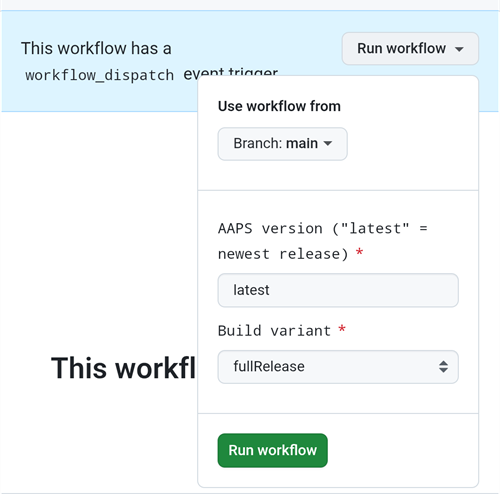
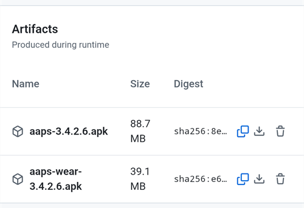

(aaps-builder)=

# Compilació al navegador amb AAPS Builder

```{note}
Aquesta és la manera recomanada de compilar AAPS des d'un **telèfon Android**. També funciona des de qualsevol navegador d'ordinador. Per a les altres maneres de compilar des d'un ordinador o un iPhone, vegeu la visió general de la [Compilació al navegador](BrowserBuild.md).
```

```{contents} In this page
:backlinks: entry
:depth: 2
```

**AAPS Builder** compila l'aplicació AAPS per a vosaltres a GitHub, el lloc web gratuït per allotjar codi. No cal instal·lar res al telèfon ni obrir cap fitxer de preparació.

Una pàgina de configuració us guia pas a pas. La primera vegada triga uns 10 minuts:

1. Creeu la vostra pròpia **còpia privada** d'AAPS Builder al vostre compte de GitHub: la pàgina de configuració obre GitHub amb tot emplenat, només heu de confirmar. Ja conté el workflow de compilació, el fitxer que diu a GitHub com compilar AAPS.
2. Creeu o pugeu la vostra **clau de signatura** (el magatzem de claus).
3. Doneu la clau al vostre repositori com a **secret** de GitHub.
4. **Compileu** l'aplicació. Una compilació triga entre 15 i 30 minuts.
5. **Descarregueu i instal·leu** l'aplicació al telèfon.

**No** cal fer un fork d'AndroidAPS: el codi font d'AAPS es descarrega del repositori oficial d'AndroidAPS a cada compilació. Tampoc **no** cal Google Drive: descarregueu l'aplicació directament de GitHub.

```{admonition} Where the code comes from
:class: note

Els desenvolupadors d'AAPS mantenen el workflow de compilació al repositori [nightscout/aaps-builder](https://github.com/nightscout/aaps-builder), i el vostre repositori n'és una còpia. El [workflow](https://github.com/nightscout/aaps-builder/blob/main/.github/workflows/build.yml) de la vostra còpia és curt: executa els [passos de compilació](https://github.com/nightscout/aaps-builder/blob/main/.github/workflows/aaps-builder.yml) que es guarden en aquell repositori, així les millores us arriben sense cap canvi al vostre repositori. Podeu llegir els dos fitxers. Quan compila, el workflow només descarrega el codi font oficial d'AAPS i les eines de compilació pròpies de GitHub. El vostre magatzem de claus no surt mai del vostre navegador ni del vostre repositori privat.
```

(aaps-builder-before-you-start)=

## Abans de començar

Necessitareu:

- Un **compte de GitHub** (gratuït). Si no en teniu, creeu-ne un primer a [github.com](https://github.com/signup).
- Un **navegador web**: Chrome al telèfon, o qualsevol navegador en un ordinador. Inicieu la sessió a github.com en aquest navegador abans de començar.
- **Teniu l'aplicació GitHub al telèfon?** La podeu conservar. Aleshores alguns botons de la pàgina de configuració obren l'aplicació en lloc de Chrome. Compilar funciona a l'aplicació, però l'aplicació **no pot descarregar** l'AAPS acabat: el [pas 5](#aaps-builder-step5) explica com passar a Chrome per a la descàrrega.
- El vostre **magatzem de claus existent** (fitxer `.jks`), la seva contrasenya i el seu àlies, si ja havíeu compilat AAPS abans i el voleu actualitzar sense reinstal·lar-lo.

```{warning}
**El vostre repositori de compilació ha de ser sempre privat.** Tot el que produeix una compilació és visible per a qualsevol persona que pugui veure el repositori. La pàgina de configuració us crea un repositori privat. No el canvieu mai a públic, i no feu un **fork** d'AAPS Builder en lloc d'això: un fork sempre és públic.

Un repositori privat té 2000 minuts gratuïts de GitHub Actions al mes, prou per a diverses compilacions.
```

```{warning}
**Clau nova o clau existent: això decideix si podeu actualitzar AAPS.**

- **Ja teniu AAPS al telèfon, compilat amb un magatzem de claus que encara teniu**: trieu **Ja tinc un magatzem de claus** a la pàgina de configuració i pugeu-lo. La vostra propera compilació actualitzarà AAPS sense perdre res. Heu compilat AAPS amb la compilació al navegador anterior (el vostre propi fork)? El vostre magatzem de claus és al vostre fork: [primer obtingueu-ne una còpia](#aaps-builder-from-fork).
- **Compileu AAPS per primera vegada, o heu perdut el magatzem de claus o la seva contrasenya**: trieu **Crear una clau nova**. Una aplicació signada amb una clau nova **no pot actualitzar** un AAPS signat amb una altra clau. Heu d'exportar la configuració, copiar el fitxer fora del telèfon, desinstal·lar l'AAPS antic, instal·lar el nou i després importar la configuració: vegeu [Reinstal·lar AAPS amb un nou magatzem de claus](#reinstall-aaps).

Després, feu servir sempre la mateixa clau. Quan creeu una clau nova, descarregueu la còpia de seguretat que ofereix la pàgina i guardeu-la amb la seva contrasenya i el seu àlies (`key0`) en un lloc segur, fora del telèfon.
```

(aaps-builder-from-fork)=

## Si veniu de la compilació al navegador anterior (fork)

Ometeu aquesta secció si no heu compilat mai AAPS amb el mètode anterior de compilació al navegador (la vostra pròpia còpia, o fork, d'AndroidAPS a GitHub, amb el fitxer de preparació i Google Drive).

El vostre magatzem de claus està desat com a secrets al vostre fork. GitHub no torna a mostrar mai un secret, així que no el podeu copiar al vostre repositori nou. Primer obtingueu una còpia del vostre magatzem de claus i després feu-la servir al [pas 2](#aaps-builder-step2) amb **Ja tinc un magatzem de claus**.

```{warning}
No trieu **Crear una clau nova**. Un AAPS compilat amb una clau nova no pot actualitzar l'AAPS del vostre telèfon.
```

Quin és el vostre cas?

- **Vau fer servir l'opció 2** (vau pujar el vostre propi magatzem de claus d'Android Studio) i encara teniu el fitxer `.jks`, les seves contrasenyes i el seu àlies: aquí no cal fer res. Feu servir aquest fitxer al pas 2.
- **Vau fer servir l'opció 1** (el fitxer de preparació va crear la clau), o ja no teniu el fitxer del magatzem de claus: exporteu-lo del vostre fork com s'explica a continuació.

Per exportar el magatzem de claus del vostre fork:

1. Al vostre fork, obriu **Settings** → **Secrets and variables** → **Actions** i afegiu un secret amb el nom `ZIP_PASSWORD`. Trieu una contrasenya només amb lletres angleses i números. Protegeix el fitxer que creareu ara.
2. Obriu la pestanya **Actions** del vostre fork, toqueu **CI Keystore Export** i després **Run workflow**. Més detalls: [Exporteu el vostre magatzem de claus](#ci-keystore-export).
3. Quan l'execució tingui una marca verda, obriu el vostre Google Drive: el fitxer `keystore.zip` és a la carpeta **AAPS** → **KeyStore**. Si l'execució falla al pas de Google Drive, l'accés del vostre fork a Google Drive ha caducat: vegeu [El token de renovació de Google ha caducat](#aaps-ci-google-token-expired).
4. Descarregueu `keystore.zip` i obriu-lo amb la vostra `ZIP_PASSWORD`: en un ordinador, o al telèfon amb una aplicació de gestió de fitxers que pugui obrir fitxers ZIP protegits amb contrasenya. Conté:
   - `keystore.jks`: el vostre magatzem de claus,
   - `keyStoreInfo.txt`: la vostra `KEYSTORE_PASSWORD`, `KEY_PASSWORD` i `ALIAS` (normalment `key0`).
5. Copieu `keystore.jks` al telèfon (o a Google Drive, per poder-lo triar des d'allà).

Al [pas 2](#aaps-builder-step2) de la pàgina de configuració:

1. Toqueu **Ja tinc un magatzem de claus**.
2. A **Fitxer del magatzem de claus**, trieu `keystore.jks`.
3. A **Contrasenya del magatzem de claus**, escriviu la `KEYSTORE_PASSWORD` de `keyStoreInfo.txt`.
4. A **Àlies de la clau**, trieu o escriviu l'`ALIAS` de `keyStoreInfo.txt`.
5. Si la `KEY_PASSWORD` és diferent de la `KEYSTORE_PASSWORD`, desmarqueu **La contrasenya de la clau és la mateixa que la del magatzem de claus** i escriviu la `KEY_PASSWORD`.

Guardeu `keystore.zip` i la seva `ZIP_PASSWORD` en un lloc segur, fora del telèfon: és la còpia de seguretat de la vostra clau.

Per desar també les compilacions d'AAPS Builder a Google Drive, feu el [pas 6](#aaps-builder-google-drive): la pàgina de configuració us obté un `GDRIVE_OAUTH2` nou. Podeu conservar el vostre fork fins que tingueu instal·lat al telèfon l'AAPS compilat amb AAPS Builder.

## Obrir la pàgina de configuració

**→ [Obriu la pàgina de configuració d'AAPS Builder](#aaps-builder-setup)**

La pàgina de configuració forma part d'aquesta documentació, en el vostre idioma. Mantingueu també aquesta pàgina oberta en una altra pestanya: les seccions de més avall expliquen cada pas de la pàgina de configuració amb més detall, amb captures de pantalla.

La pàgina de configuració obre cada pàgina de GitHub en una pestanya nova de Chrome. Per tornar a la pàgina de configuració, toqueu el botó de pestanyes al costat de la barra d'adreces de Chrome (el quadrat amb un número) i trieu la pàgina de configuració d'AAPS Builder.


La pàgina de configuració funciona completament al vostre navegador: la clau i les contrasenyes no s'envien enlloc, excepte al secret de GitHub on les enganxeu vosaltres mateixos. Només el vostre nom d'usuari de GitHub s'envia a GitHub, per comprovar que existeix. Recorda el vostre nom d'usuari de GitHub i el nom del repositori, així que hi podeu tornar en qualsevol moment per obrir de nou la pàgina de secrets o les vostres compilacions.


(aaps-builder-step1)=

## Pas 1 – Creeu el vostre repositori privat de compilació

Aquest pas crea la vostra pròpia còpia privada d'AAPS Builder al vostre compte de GitHub, amb el workflow de compilació ja inclòs. Només vosaltres podeu veure'l, i també les aplicacions que compila.

1. Assegureu-vos que heu iniciat la sessió a github.com en aquest navegador.

2. A **El vostre nom d'usuari de GitHub**, escriviu el vostre nom d'usuari de GitHub, no el vostre correu electrònic. La pàgina el comprova amb GitHub: **✓ Usuari de GitHub trobat** vol dir que és correcte.

3. A **Nom del vostre repositori**, deixeu el suggeriment `my-aaps`. Si ja vau crear el vostre repositori amb un altre nom, escriviu exactament aquest nom.

   ```{note}
   **Ja teniu un repositori d'AAPS Builder** (fet amb una versió anterior de la pàgina de configuració)? No en creeu un de nou: escriviu exactament el seu nom, ometeu **Crear el meu repositori privat** i actualitzeu-ne el workflow una vegada com s'explica a [Actualitzar AAPS](#aaps-builder-updates). Els vostres secrets es queden com estan. Si igualment voleu un repositori nou, trieu un nom que encara no tingueu, per exemple `my-aaps-2`, i feu servir el mateix magatzem de claus al pas 2.

   No escriviu el nom del vostre fork d'AndroidAPS: un fork és públic i ja compila amb el seu propi workflow **AAPS CI**.
   ```

   

4. Comproveu la línia **El vostre repositori:**, que mostra `github.com/<your username>/my-aaps`. La pàgina de configuració recorda el nom de la vostra última visita: comproveu-lo cada vegada abans de fer servir els seus botons.

5. Toqueu **Crear el meu repositori privat**.

   

6. GitHub obre **Create a new repository** en una pestanya nova. Tot ja està emplenat: a **Start with a template**, la plantilla `nightscout/aaps-builder` amb **Include all branches** desactivat, i a **General**, el vostre compte com a **Owner** i el nom que heu triat.

   

   No canvieu res.

7. Desplaceu-vos cap avall: a **Configuration**, **Choose visibility** ja és **Private**. Toqueu el botó verd **Create repository**.

   

   GitHub mostra el vostre repositori nou: conté una carpeta `.github` (amb el workflow de compilació) i un fitxer `README.md`. **Torneu a la pestanya de la pàgina de configuració** per al pas 2: toqueu el botó de pestanyes al costat de la barra d'adreces de Chrome i trieu la pàgina de configuració.

   

```{warning}
**El vostre repositori nou és buit**, sense fitxers? No s'ha creat a partir de la plantilla i no pot compilar. Elimineu-lo (**Settings** → final de la pàgina → **Delete this repository**) i després toqueu de nou **Crear el meu repositori privat** a la pàgina de configuració.
```

```{tip}
GitHub diu **my-aaps already exists in this account**? Ja teniu el vostre repositori: tanqueu la pestanya de GitHub i continueu amb la pàgina de configuració. Si la vostra clau ja hi és, continueu amb el [pas 4](#aaps-builder-step4). Vegeu la [resolució de problemes](#aaps-builder-ts-repo-exists).
```

(aaps-builder-step2)=

## Pas 2 – La vostra clau de signatura

L'aplicació s'ha de signar amb la vostra pròpia clau. Trieu una de les dues pestanyes. Primer llegiu l'[avís sobre clau nova o clau existent](#aaps-builder-before-you-start).


### Ja tinc un magatzem de claus

1. Toqueu **Ja tinc un magatzem de claus**.
2. A **Fitxer del magatzem de claus**, trieu el vostre fitxer `.jks` (o `.keystore`, `.p12`, `.pfx`). En un telèfon, primer copieu el fitxer al telèfon o a Google Drive.
3. A **Contrasenya del magatzem de claus**, escriviu la contrasenya del magatzem de claus.
4. A **Àlies de la clau**, trieu el vostre àlies de la llista, o escriviu-lo si no hi ha llista. Per als magatzems de claus creats amb Android Studio sol ser `key0`.
5. Si la contrasenya de la clau és diferent de la del magatzem de claus, desmarqueu **La contrasenya de la clau és la mateixa que la del magatzem de claus** i escriviu la contrasenya de la clau.
6. Toqueu **Comprovar i continuar**.

La pàgina comprova la contrasenya i l'àlies al vostre dispositiu. **Magatzem de claus correcte! Continueu amb el pas 3.** vol dir que tot està bé. Si diu que la contrasenya es comprovarà quan compileu, continueu igualment: la compilació us dirà si hi ha algun problema.

### Crear una clau nova

1. Toqueu **Crear una clau nova**.

2. Trieu una contrasenya i escriviu-la dues vegades. Normes: com a mínim 8 caràcters, només les lletres a–z i A–Z, les xifres 0–9 i símbols com `! ? #`. Sense espais, sense lletres amb accent i sense el caràcter `|`.

3. Toqueu **Crear clau**. Passen uns segons abans que aparegui **Clau creada**.

   

4. Toqueu **Descarregar còpia de seguretat (aaps-keystore.jks)**. Si Chrome pregunta **Download file again?**, ja teniu al telèfon una còpia de seguretat antiga amb el mateix nom: toqueu **Download again**. Aleshores Chrome desa la clau nova com a `aaps-keystore (1).jks`: aquest és el fitxer que va amb aquesta clau. Guardeu-lo i no el confongueu amb l'antic.

   Guardeu aquestes tres coses juntes, en un lloc segur fora del telèfon (per exemple, el vostre propi emmagatzematge al núvol):

   - el fitxer `aaps-keystore.jks`,
   - la vostra contrasenya,
   - l'àlies de la clau: **`key0`**.

   Necessitareu les tres coses si algun dia compileu AAPS d'una altra manera, per exemple amb Android Studio. Les claus creades amb una versió anterior de la pàgina de configuració tenen l'àlies `aaps`.

   

(aaps-builder-step3)=

## Pas 3 – Doneu la clau al vostre repositori

El pas 3 es desbloqueja quan el pas 2 està fet. La clau, les seves contrasenyes i el seu àlies s'agrupen en un sol valor, el secret `KEYSTORE_SET`.

1. Toqueu **Obrir la pàgina de secrets**.


2. GitHub obre la pàgina **New secret** del vostre repositori. En un telèfon, és a sota del menú de configuració: desplaceu-vos cap avall.


3. Canvieu a la pestanya de la pàgina de configuració i toqueu **Copiar nom**. Torneu a la pestanya de GitHub i enganxeu-lo al camp petit **Name**. El nom és `KEYSTORE_SET`.

4. Canvieu a la pestanya de la pàgina de configuració i toqueu **Copiar secret**. Torneu a la pestanya de GitHub i enganxeu-lo al quadre gran **Secret** (en un telèfon, amb una pulsació llarga). El secret és un codi molt llarg, de milers de caràcters: la pàgina de configuració en mostra els primers caràcters al costat del botó. No hi enganxeu la paraula `KEYSTORE_SET`.

5. Toqueu **Add secret**. Ara `KEYSTORE_SET` apareix a **Repository secrets**.


Només cal fer això una vegada.

```{tip}
GitHub mostra **Page not found** (404)? Primer comproveu que heu iniciat la sessió a github.com en aquest navegador: GitHub mostra 404 per als repositoris privats quan no heu iniciat la sessió. Si no, el nom d'usuari o el nom del repositori del pas 1 no coincideixen amb el vostre repositori. Comproveu el nom a github.com, corregiu-lo al pas 1 i toqueu el botó de nou.
```

(aaps-builder-step4)=

## Pas 4 – Compileu l'aplicació

1. A la pàgina de configuració, toqueu **Obrir la pàgina de compilació**. GitHub obre la pàgina **Build AAPS** del vostre repositori.

   

   Si s'obre l'**aplicació GitHub**: toqueu **RUN WORKFLOW**, comproveu la versió i la variant, i toqueu **RUN WORKFLOW** de nou. Pot ser que l'aplicació encara mostri **Nothing to see here**: estireu la llista cap avall per actualitzar-la i veure la vostra compilació. Després continueu amb el pas 4 de més avall.

2. Si GitHub us ho demana, toqueu el botó verd per activar els workflows.

   La llista de workflows mostra dues entrades: feu servir **Build AAPS**. Ignoreu **AAPS Builder**: conté els passos de compilació i no té cap botó **Run workflow**.

3. Toqueu **Run workflow**. S'obre un formulari petit:
   - **Version**: deixeu `latest` per compilar la versió més nova d'AAPS, o escriviu un número de versió com `4.0.0`.
   - **Variant**: deixeu `fullRelease` per a l'ús normal amb una bomba. Les altres variants s'expliquen a [variants de compilació](#browserbuild-variant). `aapsclient3Release` compila **AAPSClient3**, disponible a partir de la versió 4.0 d'**AAPS** (vegeu [Sobre AAPSClient, AAPSClient2 i AAPSClient3](#remotecontrol-aapsclient-versions)).
   - Toqueu el botó verd **Run workflow**.

   

4. La compilació comença i mostra **In progress**, amb dues parts: **AAPS / Check** i després **AAPS / Build AAPS**.

   

5. Espereu entre 15 i 30 minuts. Una marca verda vol dir que la compilació ha acabat. Una creu vermella vol dir que ha fallat: obriu la compilació per llegir el missatge i després vegeu la [resolució de problemes](#aaps-builder-troubleshooting).

   

   ```{tip}
   **Correu electrònic quan acaba una compilació:** GitHub només us envia un correu quan una compilació falla. Per rebre també un correu quan acaba bé: a github.com, obriu la vostra foto de perfil → **Settings** → **Notifications** → **System** → **Actions**, i desmarqueu **Only notify for failed workflows**.
   ```

Si no hi ha cap botó **Build AAPS** o **Run workflow**:

- Obriu el vostre repositori i comproveu que té una carpeta `.github` amb el fitxer `workflows/build.yml`. Si el repositori és buit, no s'ha creat a partir de la plantilla: elimineu-lo (**Settings** → final de la pàgina → **Delete this repository**) i torneu a fer el [pas 1](#aaps-builder-step1) amb el botó.
- El fitxer hi és, però GitHub mostra **This workflow does not exist**: vegeu la [resolució de problemes](#aaps-builder-ts-workflow-not-found).
- Obriu la pestanya **Actions**. Si diu que els workflows estan desactivats, toqueu el botó verd per activar-los i després toqueu **Build AAPS** a la llista.

(aaps-builder-step5)=

## Pas 5 – Instal·leu l'aplicació al telèfon

```{warning}
**Abans de cada actualització**, [exporteu la configuració](#ExportImportSettings-Automating-Settings-Export) a AAPS i copieu el fitxer **fora del telèfon** (Google Drive, Dropbox…). Guardeu-hi també diverses exportacions antigues i els fitxers APK, així sempre podreu tornar enrere.
```

1. Al telèfon, obriu la pàgina de configuració a **Chrome**. Inicieu la sessió a github.com si us ho demana.
2. Toqueu **Obrir les meves compilacions** i després la compilació més nova amb una marca verda.

   ```{admonition} The GitHub app opened instead of Chrome?
   :class: note

   L'aplicació GitHub no pot descarregar compilacions. A l'aplicació, obriu la compilació més nova i toqueu **Artifacts ↗**, o toqueu la icona de compartir de dalt i trieu **Chrome** (o **Copy link**, i després enganxeu l'enllaç a la barra d'adreces de Chrome). La compilació s'obre a Chrome: continueu allà amb el pas següent.

   Perquè els enllaços de GitHub no s'obrin a l'aplicació: a Android, **Configuració** → **Aplicacions** → **GitHub** → **Obre de manera predeterminada** → desactiveu **Obre els enllaços compatibles**.
   ```

   

3. Desplaceu-vos cap avall fins al resum de la compilació i toqueu l'enllaç **Download AAPS**.

   

   ```{tip}
   Desplaceu-vos amb el dit sobre el text, no sobre el diagrama dels passos de compilació: si no, es mou el diagrama en lloc de la pàgina.
   ```

   També podeu baixar més avall fins a **Artifacts** i tocar la icona de descàrrega al costat de `aaps-….apk`.

   

4. Quan acabi la descàrrega, obriu el menú de Chrome **⋮** → **Downloads**, toqueu `aaps-….apk` i trieu **Install**. Si us ho demana, permeteu instal·lar aplicacions d'aquesta font.

   

`aaps-wear-….apk` és l'aplicació per al rellotge intel·ligent. Ometeu-la si no en feu servir cap.

L'aplicació es guarda a la pàgina de compilació durant **14 dies**. No apareix a **Code** del vostre repositori. Copieu-la en un lloc segur, fora del telèfon, juntament amb les exportacions de la configuració.

Per a més maneres d'instal·lar l'aplicació, vegeu [Transferir i instal·lar AAPS al vostre telèfon](TransferringAndInstallingAaps.md).

```{note}
A partir de setembre de 2026, la [verificació de desenvolupadors d'Android](#android-developer-verification) de Google pot impedir instal·lar l'APK tocant el fitxer, segons el vostre país. En aquella pàgina s'expliquen solucions gratuïtes.
```

(aaps-builder-google-drive)=

## Pas 6 (opcional) – Deseu també l'aplicació a Google Drive

També podeu desar cada compilació al vostre Google Drive, a la carpeta `AAPS/<version>`. És opcional: l'aplicació sempre està disponible a la pàgina de compilació.

Necessita un secret més, `GDRIVE_OAUTH2`. El pas 6 de la pàgina de configuració l'obté de Google per a vosaltres, en un telèfon o en un ordinador. Aleshores **AAPS** només pot veure i canviar els fitxers que crea al vostre Google Drive, res més.

1. A la pàgina de configuració, toqueu **Connectar Google Drive**. Google s'obre en una pestanya nova.

2. Trieu el vostre compte de Google i permeteu l'accés. Si Google diu que l'aplicació no està verificada, toqueu **Advanced** i després **Go to …**.

   

   

3. Aleshores la pestanya nova mostra un error com **This site can't be reached** o **127.0.0.1 refused to connect**. **Això és normal:** la resposta de Google és a l'adreça d'aquesta pestanya. Toqueu la barra d'adreces i després la icona de copiar al costat de l'adreça (en un ordinador: seleccioneu tota l'adreça i copieu-la). Comença amb `http://127.0.0.1:47913/`.

   

   

4. Torneu a la pestanya de la pàgina de configuració en pocs minuts: la resposta de Google només és vàlida durant poc temps, i només una vegada. Enganxeu l'adreça a **Enganxeu aquí l'adreça copiada** i toqueu **Obtenir GDRIVE_OAUTH2**. La pàgina mostra **GDRIVE_OAUTH2 està a punt**.

   

   

5. Toqueu **Obrir la pàgina de secrets**. Toqueu **Copiar nom** i després enganxeu-lo al camp petit **Name** (el nom és `GDRIVE_OAUTH2`). Toqueu **Copiar secret**, enganxeu-lo al quadre gran **Secret** i toqueu **Add secret**.

   

A partir de la propera compilació, els APK també es desen a Google Drive.

Ja teniu un valor `GDRIVE_OAUTH2` del fitxer de preparació dels altres mètodes de compilació al navegador? També funciona: afegiu-lo com a secret `GDRIVE_OAUTH2`.

Google atura l'accés si no compileu durant 6 mesos, o si canvieu la contrasenya de Google. Aleshores la compilació us ho dirà: torneu a fer aquests passos. Vegeu [El token de renovació de Google ha caducat](#aaps-ci-google-token-expired).

(aaps-builder-updates)=

## Actualitzar AAPS

El vostre repositori no compila mai res tot sol: vosaltres decidiu quan compilar, quina versió i quina variant. Quan surt una nova versió d'AAPS:

1. [Feu una còpia de seguretat de la configuració](#aaps-builder-step5) com s'explica al pas 5.
2. Compileu la versió nova com al [pas 4](#aaps-builder-step4). Deixeu `latest`, o escriviu el número de la versió.
3. Descarregueu-la i instal·leu-la com al [pas 5](#aaps-builder-step5).

Les **actualitzacions dels passos de compilació** us arriben soles: a cada compilació, el vostre repositori executa els passos de compilació publicats pels desenvolupadors d'AAPS a nightscout/aaps-builder. Al vostre repositori no canvia res, i no hi ha cap compilació automàtica.

Les **actualitzacions del vostre fitxer de workflow** són rares: només quan canvia el formulari **Run workflow**, per exemple per a una variant de compilació nova, o una vegada si el vostre repositori es va fer amb una versió anterior de la pàgina de configuració (un repositori buit amb un fitxer de workflow curt) o a partir de la plantilla antiga. Ho diu la pàgina [Actualitzacions i canvis de la documentació](../Maintenance/DocumentationUpdate.md). El vostre secret `KEYSTORE_SET` es queda igual. A la pàgina de configuració, obriu **Actualitzar la vostra còpia** al final del pas 1:

1. Toqueu **Obrir el workflow més recent**. En un ordinador, feu clic a la **icona de copiar** («Copy raw file») a dalt a la dreta del fitxer. En un telèfon, obriu en canvi la **versió de text pla**, mantingueu premut el text i després toqueu **Select all** i **Copy**.
2. Toqueu **Obrir el meu fitxer de workflow**, després el menú **⋯** a dalt a la dreta del fitxer i **Edit file… In place** (en un ordinador, feu clic al llapis).
3. Substituïu tot el text pel workflow copiat (en un telèfon, amb una pulsació llarga: **Select all** i després **Paste**).
4. Toqueu **Commit changes…** i després **Commit changes**.

La primera línia del fitxer mostra la seva versió.

## Resolució de problemes

Alguna cosa ha anat malament? Vegeu la [resolució de problemes d'AAPS Builder](#aaps-builder-troubleshooting).

```{toctree}
:hidden:

Pàgina de configuració d'AAPS Builder <BrowserBuildAapsBuilderSetup.md>
```
