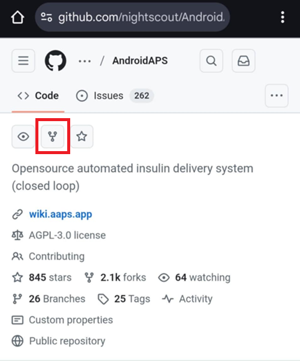
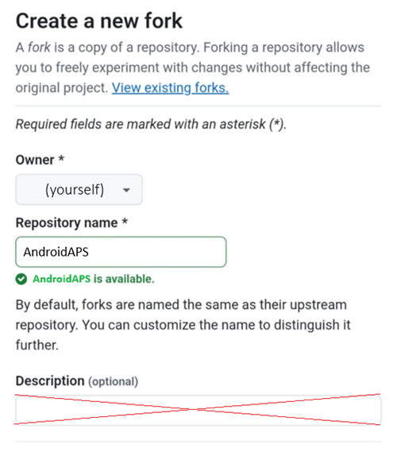
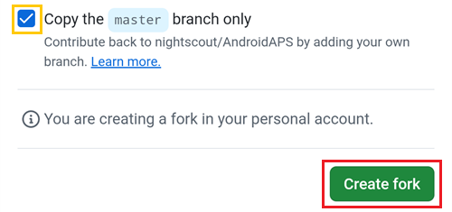
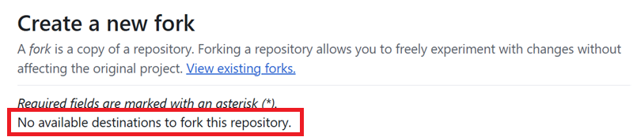
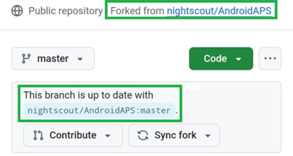

(github-fork)=

# Compilació al navegador – Pas 1: Creeu el vostre fork a GitHub

```{note}
Aquest és el **pas 1** de la [Compilació al navegador](BrowserBuild.md).
```

Haureu de desar la vostra clau Java d'Android personal i les dades de Google Drive com a secrets a GitHub (més endavant us explicarem com fer-ho).

Com que això no es pot fer dins del repositori públic d'AndroidAPS, heu de fer la vostra còpia personal del codi font (anomenada fork).

## Compte de GitHub

Si encara no en teniu, heu de [crear un compte de GitHub](https://github.com/signup).  
Us podeu registrar amb el vostre correu electrònic o amb Google. Seguiu el procés de registre i de verificació.

Quan tingueu un compte, [inicieu la sessió a GitHub](https://github.com/login).

## Fer un fork d'AndroidAPS

Obriu el repositori oficial d'AndroidAPS amb [aquest enllaç](https://github.com/nightscout/AndroidAPS).

Toqueu la icona de fork. Això crearà una còpia dins del vostre propi compte.



Desplaceu-vos cap avall a la pantalla següent i toqueu **Create Fork**.



*Nota: podeu **desmarcar** «Copy the master branch only» si voleu compilar versions de desenvolupament o personalitzacions.*



```{note}
No podeu fer el fork i veieu això?<br/><br/>
**`No available destinations to fork this repository.`**<br/><br/>
<br/><br/>
Això vol dir que ja teniu un fork d'AndroidAPS.<br/>
Assegureu-vos que està actualitzat i continueu amb els passos de preparació.
```

```{warning}
**No elimineu mai el vostre fork sense haver fet una còpia de seguretat dels vostres secrets!**
```

Ara GitHub mostra la vostra còpia personal d'AndroidAPS. Deixeu oberta aquesta pestanya del navegador.



----

**Següent: [Pas 2 – Creeu el vostre magatzem de claus de signatura](BrowserBuildKeystore.md) →**
