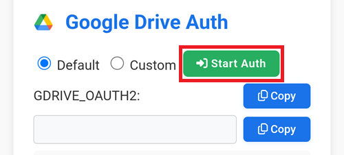
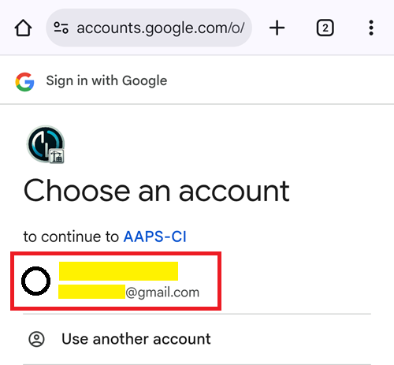
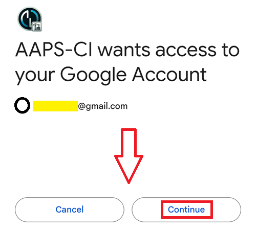
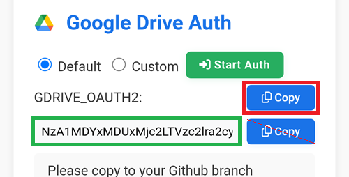
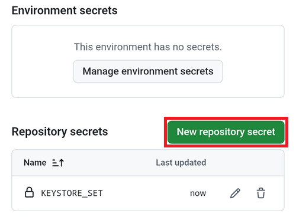
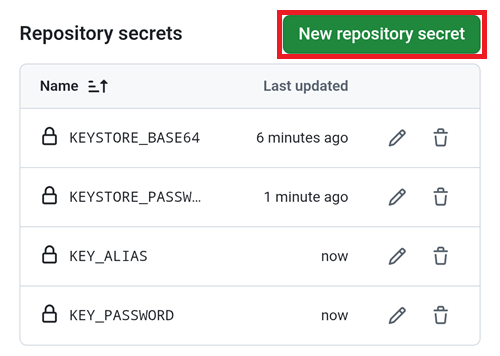
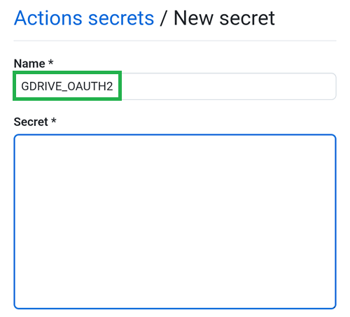
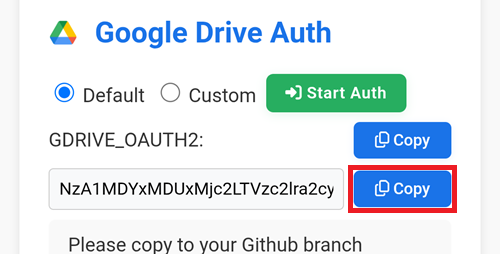
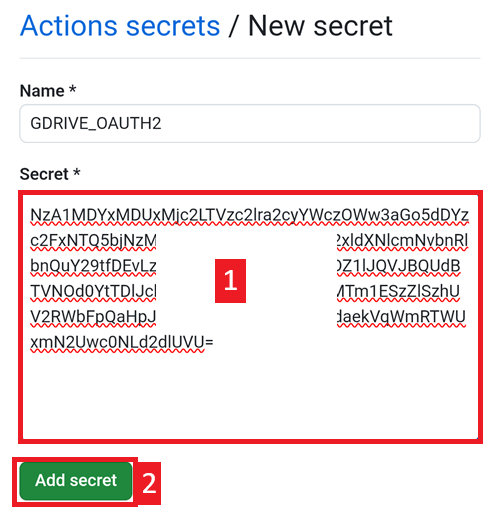
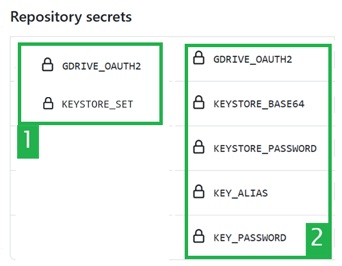

(aaps-ci-google-drive-auth)=

# Compilació al navegador – Pas 3: Autoritzeu Google Drive

```{note}
Aquest és el **pas 3** de la [Compilació al navegador](BrowserBuild.md). Primer completeu el [Pas 2 – Creeu el vostre magatzem de claus de signatura](BrowserBuildKeystore.md).
```

```{warning}
Sigui quin sigui el conjunt d'instruccions anterior que heu seguit (opció 1 o opció 2), HEU d'afegir l'autorització de Google Drive per poder fer servir la compilació al navegador.
```

Nota: si ja heu fet aquesta part amb el vídeo, ara podeu passar directament al [Pas 4 – Compileu l'APK](BrowserBuildAPK.md).

```{warning}
Si l'autorització de Google no comença o la pàgina de preparació falla, tanqueu la pàgina de preparació, torneu a obrir `aaps-ci-preparation.html` de la mateixa manera que al pas 2 i torneu a començar aquest pas. Vegeu la [resolució de problemes](#aaps-ci-preparation-web).
```

Torneu a la pestanya de la pàgina de preparació.

Desplaceu-vos cap avall fins a la secció Google Drive Auth i toqueu Start Auth.



Seleccioneu el vostre compte de Google.



Desplaceu-vos cap avall i accepteu l'accés. La pàgina web el necessita per obtenir la clau d'autenticació de Google Drive.

Toqueu Continue.



El camp `GDRIVE_OAUTH2` s'omplirà; toqueu el botó Copy de dalt.



Torneu a la pestanya de GitHub.

Desplaceu-vos cap avall fins a Repository secrets i toqueu New repository secret.

Si heu seguit l'opció 1, hauríeu de veure això:



Si heu seguit l'opció 2, hi haurà més claus:



Al camp Name, enganxeu el text que acabeu de copiar. Feu una pulsació llarga al quadre de text per mostrar el menú d'enganxar.



Canvieu a la pestanya de la pàgina de preparació.

Toqueu el segon botó Copy.



Torneu a la pestanya de GitHub.

1. Al camp Secret, enganxeu el text que acabeu de copiar. Feu una pulsació llarga al quadre de text per mostrar el menú d'enganxar.

2. Toqueu Add secret.



Ara hauríeu de tenir dues (opció 1) o cinc (opció 2) entrades de secrets.



Un cop compilat, GitHub podrà desar el fitxer apk d'AAPS al vostre Google Drive.

----

**Següent: [Pas 4 – Compileu l'APK](BrowserBuildAPK.md) →**
