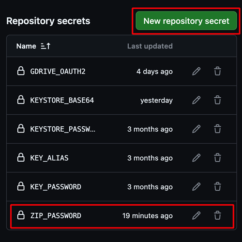
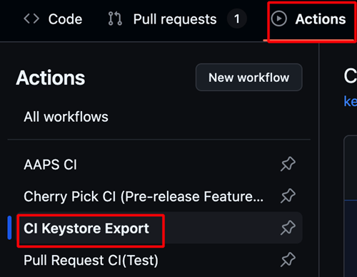
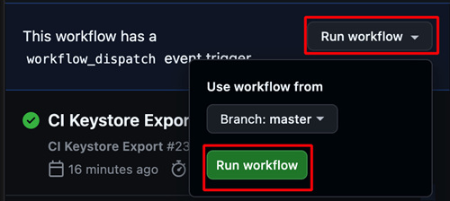

(aaps-ci-preparation)=

# Compilació al navegador – Pas 2: Creeu el vostre magatzem de claus de signatura

```{note}
Aquest és el **Pas 2** de la [Compilació al navegador](BrowserBuild.md). Primer completeu el [Pas 1 – Creeu el vostre fork a GitHub](BrowserBuildFork.md).
```

AAPS s'ha de signar amb claus privades desades en un **Java KeyStore (JKS)**. Aquesta és la decisió més important de tot el procés, perquè determina si més endavant podreu **actualitzar** AAPS sense reinstal·lar-lo.

```{note}
En els passos següents desareu informació privada (el vostre magatzem de claus i, més endavant, l'accés al vostre Google Drive) dins de GitHub com a **secrets**. Un secret és simplement un valor xifrat que només la vostra pròpia compilació pot llegir – ningú més el pot veure, ni tan sols les persones que miren el vostre fork. Així la vostra compilació continua sent només vostra.
```

## Trieu com voleu obtenir el magatzem de claus

Llegiu les dues opcions i trieu la que correspon a la vostra situació.

### Opció 1 – Generar un nou magatzem de claus (usuaris nous)

Trieu aquesta opció si **qualsevol** d'aquests punts és cert:

- És la **primera vegada** que compileu AAPS.
- No teniu cap magatzem de claus d'una compilació anterior amb Android Studio (a l'ordinador).
- Heu oblidat la contrasenya o l'àlies del vostre magatzem de claus.

```{warning}
Compilar AAPS amb l'**Opció 1** crea un magatzem de claus completament nou, per tant **no us permetrà actualitzar l'AAPS que ja teniu instal·lat**. Per passar a aquesta nova compilació, heu d'exportar la vostra configuració, desinstal·lar l'AAPS antic, instal·lar el nou i tornar a importar la vostra configuració. Seguiu els passos de [Reinstal·lar AAPS amb un nou magatzem de claus](#reinstall-aaps).
```

**→ [Continueu amb l'Opció 1 – Generar un nou magatzem de claus](BrowserBuildO1.md)**

### Opció 2 – Pujar el vostre magatzem de claus existent (usuaris actuals o antics)

Trieu aquesta opció si **ja teniu** el magatzem de claus `.jks` que vau fer servir en una compilació anterior d'AAPS a l'ordinador amb Android Studio, **i** en sabeu la contrasenya i l'àlies (normalment `key0`).

Així l'AAPS que teniu instal·lat es podrà continuar actualitzant: les actualitzacions futures faran servir el mateix magatzem de claus.

**→ [Continueu amb l'Opció 2 – Pujar el vostre magatzem de claus existent](BrowserBuildO2.md)**

----

```{note}
A la pàgina següent triareu el vostre dispositiu (ordinador o iPhone). Després, la pàgina de cada dispositiu us guia per descarregar i obrir el fitxer de preparació de la manera correcta per a aquest dispositiu, i per crear el vostre magatzem de claus. L'aplicació AAPS compilada es desarà al vostre Google Drive.
```

**Següent: trieu l'[Opció 1](BrowserBuildO1.md) o l'[Opció 2](BrowserBuildO2.md) de més amunt i després seguiu la pàgina del vostre dispositiu.**

----

(ci-keystore-export)=

## Exporteu el vostre magatzem de claus (opcional)

Si voleu exportar el magatzem de claus que teniu desat, feu servir aquest mètode.

Aquest script exporta la informació del magatzem de claus que heu configurat abans (amb l'Opció 1 o l'Opció 2) com a fitxer ZIP protegit amb contrasenya a la carpeta `/AAPS/KeyStore` del vostre Google Drive.

```{warning}
Abans de fer servir aquest mètode d'exportació, assegureu-vos que heu completat la configuració del magatzem de claus i de Google Drive.
```

### Passos:

1. **Afegiu el secret de la contrasenya del ZIP:**
   - Aneu a **Settings** → **Secrets and variables** → **Actions** del vostre repositori
   - Feu clic a **New repository secret**
   - Al camp **Name**, escriviu: `ZIP_PASSWORD`
   - Al camp **Secret**, escriviu la vostra pròpia contrasenya per xifrar el ZIP
   - Feu servir només lletres angleses i números per a la contrasenya (sense símbols especials)
   - Feu clic a **Add secret**

   

2. **Executeu el workflow d'exportació:**
   - Aneu a la pestanya **Actions** del vostre repositori
   - Seleccioneu **CI Keystore Export**
   - Feu clic a **Run workflow**
   - El fitxer ZIP amb el magatzem de claus exportat es desarà al vostre Google Drive

   

   

```{toctree}
:hidden:

Opció 1 – Generar un nou magatzem de claus <BrowserBuildO1.md>
Opció 2 – Pujar el vostre magatzem de claus existent <BrowserBuildO2.md>
```
