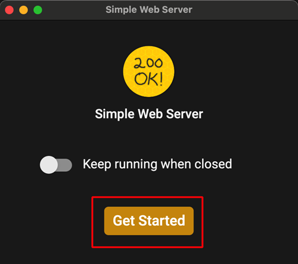
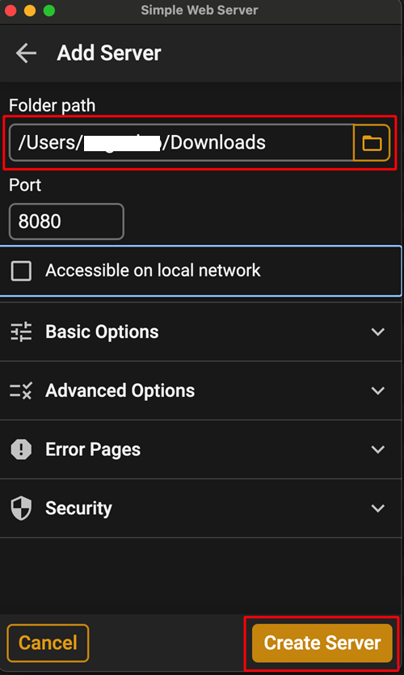
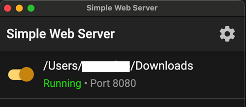

(aaps-ci-option1-computer)=

# Option 1 · Computer – Generate a new keystore

```{note}
[Option 1](BrowserBuildO1.md) (generate a new keystore) on a **computer** (Windows / Mac / Linux).
```

## 1. Download the preparation file

:::{include} BrowserBuildDownloadPrep.md
:::

## 2. Start a local server and generate the keystore

Feu servir un ordinador (Windows/Mac/Linux)

Obriu la pàgina web [https://simplewebserver.org/download.html](https://simplewebserver.org/download.html)

Install Simple Web Server<br/> If you are a Windows or Mac user, you can install it from the Microsoft Store or the Mac App Store.<br/> If your browser asks whether to open the store app, allow it.<br/><br/> <br/>

Exemple en un Mac:

- get → install → open<br/><br/> <br/><br/>

- Feu clic a «Get Started»<br/><br/> <br/><br/>

- Click New Server<br/><br/> <br/><br/>

- A «Folder Path», seleccioneu la carpeta on hi ha el fitxer aaps-ci-preparation.html i després feu clic a «Create Server».<br/><br/> <br/><br/>

- Si veieu aquesta pantalla, el servidor s'ha iniciat.<br/><br/> <br/><br/>

- Do not close Simple Web Server. Please switch to your browser and open<br/> [http://127.0.0.1:8080/aaps-ci-preparation.html](http://127.0.0.1:8080/aaps-ci-preparation.html)<br/><br/>

- Per als passos següents, mireu el vídeo de sota, a partir del minut 1 i 37 segons.

  <!--crowdin: exclude-->
  <div align="center" style="max-width: 360px; margin: auto; margin-bottom: 2em;">
    <div style="position: relative; width: 100%; aspect-ratio: 9/16;">
      <iframe
        src="https://geo.dailymotion.com/player/x9rdrpy.html?video=x9rdrpy&startTime=97&loop=true&mute=true"
        loading="lazy"
        style="position: absolute; top: 0; left: 0; width: 100%; height: 100%;"
        frameborder="0"
        allowfullscreen>
      </iframe>
    </div>
  </div>

----

**Next: [Step 3 – Authorize Google Drive](BrowserBuildGoogleDrive.md) →**
